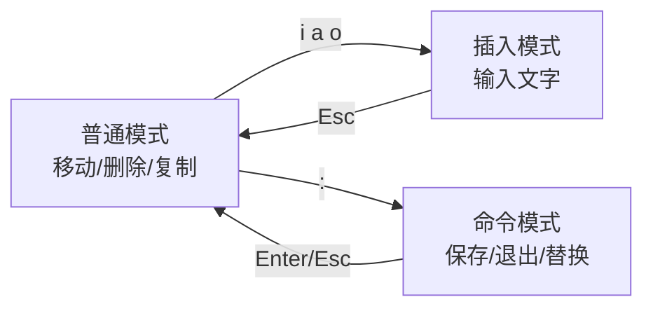

# vim · 终端编辑器

> 命令手册 · [文件与文本](/commands/basic/) ｜ 频率：每天用
> 服务器上改配置没有图形界面，vim 是标配编辑器。模式切换是核心，先懂"普通/插入/命令"三模式。

## 一句话用途

终端下的全屏文本编辑器，改配置/写脚本。

## 三种模式



## 高频操作速查

```text
vim file.conf          打开
i                      进入插入（光标前）
a                      光标后插入 / o 下方新行
Esc                    回普通模式
:w                     保存
:q                     退出
:wq 或 ZZ              保存退出
:q!                    不保存强制退出
dd                     删一行 / 5dd 删5行
yy                     复制一行 / p 粘贴
u                      撤销 / Ctrl+r 重做
/关键词                搜索（n 下一个）
:%s/旧/新/g            全文替换
:set nu                显示行号
G / gg                 跳末尾/开头
```

## 命令模式常用

| 命令 | 作用 |
|---|---|
| `:wq` | 保存退出 |
| `:q!` | 强制不保存退出 |
| `:%s/old/new/g` | 全文替换 |
| `:%s/old/new/gc` | 替换逐个确认 |
| `:set nu` | 行号 |
| `:set paste` | 粘贴模式（防缩进乱） |
| `:数字` | 跳到该行 |
| `:w !sudo tee %` | 无权限时 sudo 保存 |

::: tip 粘贴配置乱缩进
往 vim 贴大段配置先 `:set paste` 再贴，避免自动缩进把格式搞乱。贴完 `:set nopaste`。或直接用 cat here-doc 写（[cat](./cat)）。
:::

## 运维实战

**改配置**：vim /etc/nginx/nginx.conf → /worker 搜索 → 改 → :wq → nginx -t 验证。
**忘加 sudo**：改完发现没权限，`:w !sudo tee %` 救场。
**快速删行**：普通模式 dd 删当前行，5dd 删5行。
**应急 nano**：实在不熟 vim 可用 nano（底部有提示），但 vim 服务器必有。

## 相关命令

[cat](./cat) · [less](./less) · [sed](./sed) · [diff/patch](./diff-patch) · [dos2unix](./dos2unix-iconv)

## 官方文档

- vim：<https://www.vim.org/docs.php>
- vim 教程：终端运行 `vimtutor`