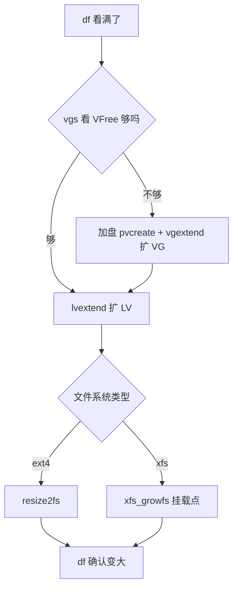

# LVM 扩容 · lvextend / vgextend / resize2fs / xfs_growfs

> 命令手册 · [磁盘与存储](/commands/storage/) ｜ 频率：偶尔用
> "磁盘满了要扩容"——LVM 能在线扩，不用停机。但**扩了 LV 不扩文件系统等于白扩**，最后一步别漏。

## 一句话用途

在线扩大逻辑卷与文件系统容量。

## 扩容全流程（重点）



## 场景一：VG 有剩余

```bash
sudo vgs                                    # 确认 VFree 够
sudo lvextend -L +50G /dev/datavg/datalv    # 扩 50G
sudo lvextend -l +100%FREE /dev/datavg/datalv   # 用尽剩余
# 扩文件系统（关键！）
sudo xfs_growfs /data                       # xfs（传挂载点）
sudo resize2fs /dev/datavg/datalv           # ext4（传设备）
df -h /data                                 # 确认
```

## 场景二：VG 也满了（加盘）

```bash
sudo pvcreate /dev/sdd                      # 新盘初始化
sudo vgextend datavg /dev/sdd               # 加入 VG
sudo vgs                                    # VFree 变多了
sudo lvextend -l +100%FREE /dev/datavg/datalv
sudo xfs_growfs /data
```

## 一步到位（lvextend -r）

```bash
sudo lvextend -r -L +50G /dev/datavg/datalv   # -r 自动扩文件系统
```

`-r`（--resizefs）自动调 resize2fs/xfs_growfs，省一步。

::: danger 扩 LV ≠ 扩文件系统
lvextend 只扩了块设备，文件系统还是旧大小，df 看不到变化。**必须** xfs_growfs（xfs，传挂载点）或 resize2fs（ext4，传设备）。xfs_growfs 只能在线扩（需已挂载）。
:::

## 运维实战

**数据库盘在线扩容**：加盘→vgextend→lvextend -r→df 确认，全程不停服务。
**根分区扩容**：同理，xfs_growfs / 。
**云盘扩容后**：云控制台扩了盘，OS 里 growpart 扩分区 + pvresize + lvextend + xfs_growfs。

## 相关命令

[lvm-view](./lvm-view) · [lvm-create](./lvm-create) · [lvm-reduce](./lvm-reduce) · [df](./df) · [mkfs](./mkfs)

## 官方文档

- lvextend：<https://man7.org/linux/man-pages/man8/lvextend.8.html>
- xfs_growfs：<https://man7.org/linux/man-pages/man8/xfs_growfs.8.html>
- resize2fs：<https://man7.org/linux/man-pages/man8/resize2fs.8.html>