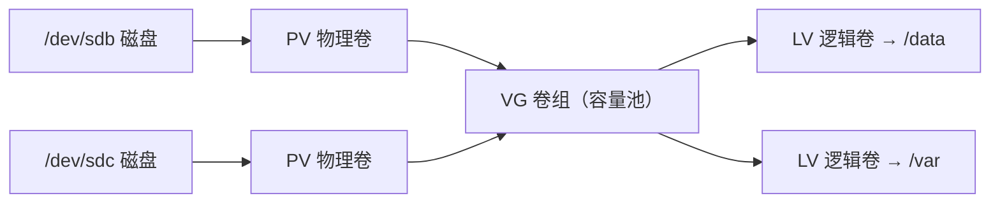

# pvs / vgs / lvs · LVM 查看

> 命令手册 · [磁盘与存储](/commands/storage/) ｜ 频率：偶尔用
> LVM 把磁盘抽象成可灵活扩缩的卷。先懂 PV→VG→LV 三层，再看容量分布。

## LVM 三层概念



- **PV（物理卷）**：磁盘/分区初始化成 LVM 可用。
- **VG（卷组）**：多个 PV 汇成的容量池。
- **LV（逻辑卷）**：从 VG 切出的"虚拟分区"，格式化挂载用。

## 高频场景速查

```bash
sudo pvs                   # PV 速览（属于哪个 VG/容量/剩余）
sudo vgs                   # VG 速览（总容量/剩余/几个 LV）
sudo lvs                   # LV 速览（大小/属于哪个 VG）
sudo pvdisplay             # PV 详情
sudo vgdisplay             # VG 详情（看 Free PE 能否扩容）
sudo lvdisplay             # LV 详情
lsblk                      # 看 LVM 层级
```

## 看什么

- `vgs` 的 **VFree**：VG 剩余空间，决定 LV 能不能扩。
- `pvs` 的 PFree：PV 未分配空间。
- `lvs` 的 LSize：LV 当前大小。

::: tip 扩容前先看 vgs
LV 扩容前提是 VG 有剩余（VFree>0）。VG 满了要先加盘扩 VG（[lvm-extend](./lvm-extend)）。别直接 lvextend 报 "Insufficient free space"。
:::

## 运维实战

**扩容前体检**：`vgs` 看 VFree，`lvs` 看目标 LV，`df` 看文件系统用量，三者结合判断扩多少。
**找空闲容量**：`pvs` 看哪个 PV 还有 PFree。
**理清层级**：`lsblk` 直观看 disk→PV→VG→LV→挂载。

## 相关命令

[lsblk](./lsblk-blkid-findmnt) · [lvm-create](./lvm-create) · [lvm-extend](./lvm-extend) · [df](./df) · [fdisk](./fdisk-parted-gdisk)

## 官方文档

- LVM：<https://sourceware.org/lvm2/>
- pvs/vgs/lvs：<https://man7.org/linux/man-pages/man8/pvs.8.html>