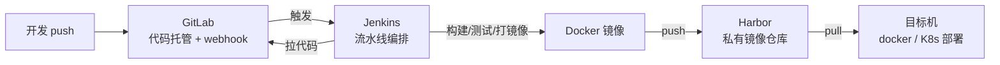

# CI/CD 流水线：GitLab + Jenkins + Harbor

> 组合方案 · 属于 [部署方案](/deploy/) 模块。单服务部署步骤链接到各自服务页。
> 完整落地见 [我的项目 · 项目架构](/projects/homelab) 与 [10-实操 · CI/CD 链路](/projects/homelab/practice/)。

## 一、架构与组件职责



| 组件 | 职责 | 部署详解 |
|---|---|---|
| GitLab | 代码托管、MR、webhook 触发 | [GitLab 服务页](/services/cicd/gitlab) |
| Jenkins | 流水线编排、分布式构建 | [Jenkins 02 · 部署](/services/cicd/jenkins/02-部署) |
| Harbor | 私有镜像存储、扫描、权限 | [Harbor 服务页](/services/container/harbor) |
| Docker / K8s | 目标运行环境 | [Docker](/services/container/docker/01-理论) / [K8s](/services/container/kubernetes/01-理论) |

## 二、为什么这样分工

- **GitLab 管代码与触发**：push/MR 事件经 webhook 通知 Jenkins，代码与 CI 触发解耦。
- **Jenkins 管编排**：声明式 Pipeline（Jenkinsfile）把"拉代码→编译→测试→打镜像→推仓库→部署"串成可版本化的流程。
- **Harbor 管镜像**：私有仓库做镜像版本管理、漏洞扫描、RBAC，比裸 registry 更适合企业。
- **镜像走轩辕云代理**：基础镜像统一从 `docker.xuanyuan.me` 拉取，省时省流量（本站约定）。

## 三、流水线编排（Jenkinsfile 骨架）

```groovy
pipeline {
  agent any
  environment { REGISTRY = 'harbor.example.com/library'; IMG = 'app' }
  stages {
    stage('Checkout') { steps { git branch: 'main', url: 'https://gitlab.example.com/team/app.git' } }
    stage('Build & Test') { steps { sh 'make test' } }
    stage('Image') {
      steps {
        sh "docker build -t ${REGISTRY}/${IMG}:${BUILD_NUMBER} ."
        sh "docker push ${REGISTRY}/${IMG}:${BUILD_NUMBER}"
      }
    }
    stage('Deploy') { steps { sh "ssh deploy@10.0.0.41 'docker pull ... && docker run ...'" } }
  }
}
```

::: warning 凭据管理
仓库密码、Harbor 账号、部署 SSH key 用 Jenkins Credentials 管理，别硬编码进 Jenkinsfile。示例域名/IP 为演示值。
:::

## 四、验证与故障排查

```bash
# webhook 是否触发：GitLab 项目 → Settings → Webhooks → 测试
# Jenkins 构建日志看各 stage 成败
# Harbor 镜像是否推上：harbor 界面或 API 查 tag
# 目标机拉取部署：docker pull + docker ps 确认新版本
```

- 构建失败：看 Jenkins console 定位是编译/测试/镜像哪一步。
- 推镜像失败：Harbor 登录态/项目权限/磁盘空间。
- 部署失败：目标机拉镜像网络、端口冲突、健康检查。

## 五、边界与进阶

- 适用：中小团队标准 CI/CD；GitLab CI 也能替代 Jenkins（一体化）。
- 进阶：蓝绿/金丝雀发布（[接入层](/deploy/stacks/lb-ha) 改 upstream）、K8s 滚动更新、镜像签名与扫描门禁。
- 相关命令：[git](/commands/devtools/git)、[docker](/services/container/docker/03-功能)、[ssh/scp](/commands/network/ssh-rsync)。

---

返回 [部署方案 · 形态矩阵](/deploy/)。