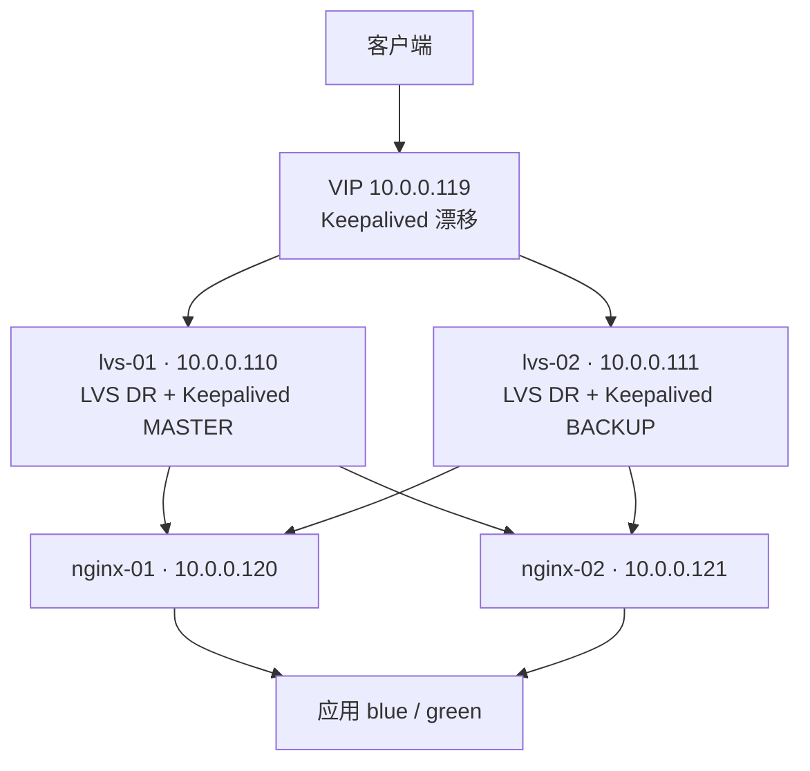

# 接入层高可用：LVS + Keepalived + Nginx

> 组合方案 · 属于 [部署方案](/deploy/) 模块。单服务的部署步骤不在这里重复，链接到各自服务页。
> 完整落地见 [我的项目 · 项目架构](/projects/homelab) 与 [10-实操 · D1-P1 最小链路](/projects/homelab/practice/03-D1-P1最小链路)。

## 一、架构与组件职责



| 组件 | 职责 | 部署详解 |
|---|---|---|
| LVS（DR 模式） | 四层负载，内核态转发，扛高并发 | [LVS + Keepalived 指南](/services/web/lvs-keepalived) |
| Keepalived | VRRP 选主，VIP 在两台 LVS 间漂移 | 同上 |
| Nginx | 七层路由、TLS、静态资源、限流 | [Nginx 02 · 部署](/services/web/nginx/02-部署) |

## 二、为什么是两层

- **LVS 在前**：四层转发在内核完成，单机就能扛数万并发，做最前置的流量分发与 VIP 承载。
- **Nginx 在后**：七层才能按 URI / Host 路由、终结 TLS、做限流缓存。LVS 看不懂 HTTP，干不了这些。
- **Keepalived 管节点故障，不管蓝绿**：VIP 漂移解决的是"LVS 节点挂了"；蓝绿切换是改 Nginx upstream，两件事分开（见 [D2-P2-3 蓝绿发布](/projects/homelab/practice/07-D2-P2-3蓝绿发布)）。

## 三、部署编排（按依赖顺序）

1. **两台 Nginx 先就位**：按 [Nginx 02 · 部署](/services/web/nginx/02-部署) 装好，配置一致，各自能独立返回 200。
2. **两台 LVS 配 DR 转发**：realserver 指向两台 Nginx；Nginx 侧需在 lo 上绑 VIP 并抑制 ARP（DR 模式要求）。
3. **Keepalived 选主**：lvs-01 MASTER、lvs-02 BACKUP，VIP 10.0.0.119。
4. **联调**：客户端访问 VIP → LVS → Nginx → 应用，全链路 200。

### Keepalived 关键配置（组合的"胶水"）

```conf
# lvs-01（MASTER），lvs-02 改 state BACKUP / priority 90
vrrp_instance VI_1 {
    state MASTER
    interface eth0
    virtual_router_id 51
    priority 100
    advert_int 1
    authentication { auth_type PASS; auth_pass 示例密码 }
    virtual_ipaddress { 10.0.0.119 }
}
```

::: warning 密码与网段
示例配置里的 `auth_pass` 与 IP 均为演示值，落地时换成你自己的；本站统一用 10.0.0.0/24 示例网段，不出现真实环境地址。
:::

## 四、验证与故障注入

```bash
# 正常链路
curl -I http://10.0.0.119            # 经 VIP 返回 200
ip addr show eth0 | grep 10.0.0.119  # 在 MASTER 上能看到 VIP

# 故障注入：停掉 MASTER 的 keepalived
sudo systemctl stop keepalived       # 在 lvs-01 执行
# 预期：VIP 漂到 lvs-02，curl VIP 仍 200（短暂中断后恢复）
```

- 看 VRRP 状态：`journalctl -u keepalived -f`，确认 BACKUP 升主。
- 看 LVS 转发：`ipvsadm -Ln`，确认 realserver 权重与连接数。

## 五、边界与进阶

- 适用：中小规模接入层高可用；LVS DR 要求 realserver 与 LVS 同二层。
- 进阶：Nginx 层再做蓝绿 / 灰度（改 upstream），数据层高可用另见 [D2-P2-1 数据层高可用](/projects/homelab/practice/05-D2-P2-1数据层高可用)。
- 相关命令：[ip](/commands/network/ip-addr-link)、[ss](/commands/network/ss)、[systemctl](/commands/system/systemctl-journalctl)。

---

返回 [部署方案 · 形态矩阵](/deploy/)。