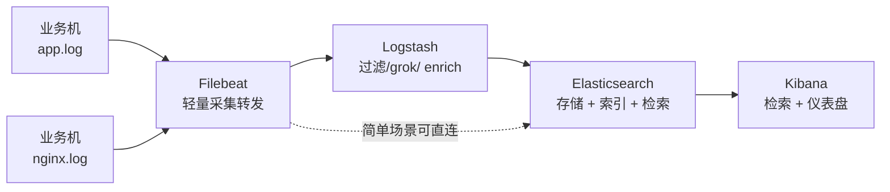

# 日志链路：Filebeat + Logstash + Elasticsearch + Kibana

> 组合方案 · 属于 [部署方案](/deploy/) 模块。单服务部署步骤链接到各自服务页。
> 完整落地见 [我的项目 · 项目架构](/projects/homelab) 与 [10-实操 · 日志链路](/projects/homelab/practice/)。

## 一、架构与数据流



| 组件 | 职责 | 部署详解 |
|---|---|---|
| Filebeat | 业务机轻量采集、断点续传 | [ELK 服务页](/services/observability/elk) |
| Logstash | 集中过滤、grok 解析、字段 enrich | 同上 |
| Elasticsearch | 分布式存储与全文检索 | [ES 02 · 部署](/services/storage-search/elasticsearch/02-部署) |
| Kibana | 检索界面与可视化 | [ELK 服务页](/services/observability/elk) |

## 二、为什么分层

- **Filebeat 轻**：Go 编写、资源占用小，装在每台业务机只负责"读文件→转发"，带 registry 记录读到哪（断点续传）。
- **Logstash 重但强**：JVM 编写、吃资源，集中部署做 grok 正则解析、字段加工、过滤。轻量场景可省掉，Filebeat 直连 ES（用 ingest pipeline 做简单解析）。
- **ES 存与搜**：倒排索引支撑全文检索与聚合，日志按天建索引便于生命周期管理（ILM）。
- **Kibana 看**：Discover 检索、Dashboard 聚合、告警。
- **削峰**：高吞吐可在 Filebeat 与 Logstash 间加 Kafka/Redis 缓冲（[Kafka](/services/middleware/kafka)）。

## 三、部署编排（按依赖顺序）

1. **ES 就位**：按 [ES 02 · 部署](/services/storage-search/elasticsearch/02-部署) 装好（生产至少3节点防脑裂）。
2. **Kibana 接 ES**：配 elasticsearch.hosts，能进 Discover。
3. **Logstash 管道**：配 input（beats 5044）→ filter（grok）→ output（es）。
4. **Filebeat 采集**：业务机配 paths 指向日志，output 指向 Logstash（或直连 ES）。

### Filebeat 关键配置（组合的"胶水"）

```yaml
filebeat.inputs:
  - type: log
    paths: ['/var/log/app/*.log']
    fields: { service: app }
output.logstash:
  hosts: ['10.0.0.60:5044']
# 简单场景直连 ES：
# output.elasticsearch:
#   hosts: ['10.0.0.61:9200']
```

::: warning 示例值
IP 为演示。ES 若开安全认证，Filebeat/Logstash 要配账号密码或 API key。生产 ES 别裸奔公网。
:::

## 四、验证与故障排查

```bash
# ES 健康：curl 10.0.0.61:9200/_cluster/health?pretty（green/yellow）
# 索引是否进数据：curl .../_cat/indices?v
# Kibana Discover 选索引模式看日志
# Filebeat 是否采集：filebeat 日志看 harvester 启动、registry 推进
```

- 日志没进 ES：Filebeat output 连通性、Logstash 管道报错、ES 拒绝（磁盘水位/映射冲突）。
- grok 解析失败：Logstash 看 _grokparsefailure 标签，调正则。
- ES 磁盘满：触发只读水位，清旧索引/扩容（[df](/commands/storage/df)、ILM）。

## 五、边界与进阶

- 适用：集中日志检索与分析；中小规模 Filebeat+ES 即可，重型解析加 Logstash。
- 超大规模：Kafka 缓冲 + 多 Logstash + ES 冷热分层。
- 云原生：Loki（轻量、按标签索引）是另一路线，与 Prometheus 生态更配。
- 相关命令：[curl](/commands/network/curl)、[tail](/commands/basic/tail)、[grep](/commands/basic/grep)、[systemctl](/commands/system/systemctl-journalctl)。

---

返回 [部署方案 · 形态矩阵](/deploy/)。