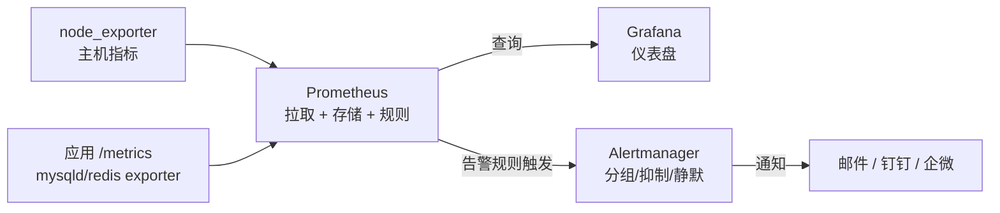

# 监控告警栈：Prometheus + Grafana + Alertmanager

> 组合方案 · 属于 [部署方案](/deploy/) 模块。单服务部署步骤链接到各自服务页。
> 完整落地见 [我的项目 · 项目架构](/projects/homelab) 与 [10-实操 · 监控链路](/projects/homelab/practice/)。

## 一、架构与数据流



| 组件 | 职责 | 部署详解 |
|---|---|---|
| Prometheus | 拉指标、存时序、评估告警规则 | [Prometheus 02 · 部署](/services/observability/prometheus/02-部署) |
| Exporter | 把主机/服务指标暴露成 /metrics | [Prometheus 03 · 功能](/services/observability/prometheus/03-功能) |
| Grafana | 接 Prometheus 数据源做仪表盘 | [Grafana 服务页](/services/observability/grafana) |
| Alertmanager | 告警分组、去重、路由通知 | [Alertmanager 服务页](/services/observability/alertmanager) |

## 二、为什么这样分工

- **Prometheus 拉模型**：主动 scrape 目标 /metrics，目标只需暴露 HTTP 端点，无需装 agent 推送。服务发现适配动态环境。
- **存储与告警分离**：Prometheus 评估规则产生告警，但**怎么发**交给 Alertmanager——分组（同类合并）、抑制（高级别压制低级别）、静默（维护期免打扰）。
- **Grafana 只读可视化**：不存数据，接 Prometheus 查询画图。指标看板与告警是两条消费路径。
- **exporter 适配万物**：主机用 node_exporter，MySQL 用 mysqld_exporter，Redis 用 redis_exporter，黑盒探测用 blackbox_exporter。

## 三、部署编排（按依赖顺序）

1. **Prometheus 就位**：按 [Prometheus 02 · 部署](/services/observability/prometheus/02-部署) 装好，配 scrape_configs。
2. **接 exporter**：目标机装 node_exporter（9100），Prometheus 加 job 抓取。
3. **Grafana 接数据源**：加 Prometheus 数据源（http://prometheus:9090），导入仪表盘（如 Node Exporter Full 1860）。
4. **Alertmanager 接告警**：Prometheus 配 alerting 指向 Alertmanager（9093），配路由与接收器。

### Prometheus 关键配置（组合的"胶水"）

```yaml
scrape_configs:
  - job_name: 'node'
    static_configs:
      - targets: ['10.0.0.51:9100', '10.0.0.52:9100']
alerting:
  alertmanagers:
    - static_configs:
        - targets: ['10.0.0.50:9093']
rule_files:
  - 'rules/*.yml'
```

::: warning 示例值
IP 与端口为演示。告警接收器（邮件/钉钉 webhook）的密钥用配置管理，别提交进仓库。
:::

## 四、验证与故障排查

```bash
# Prometheus 目标健康：浏览器 /targets 看各 job UP
# 查指标：/graph 输入 up 或 node_cpu_seconds_total
# Grafana 仪表盘有数据：确认数据源连通、时间范围对
# 告警链路：Prometheus /alerts 看规则状态 → Alertmanager /#/alerts 看是否收到
```

- 目标 DOWN：exporter 没起/防火墙/抓取地址错（[ss](/commands/network/ss)、[firewall-cmd](/commands/network/firewall-cmd)）。
- 告警没发出：Alertmanager 路由匹配/接收器配置/静默规则。
- 图表空：数据源 URL、指标名、时间范围。

## 五、边界与进阶

- 适用：中小规模指标监控；单机 Prometheus 能扛百万级时序。
- 长期存储/大规模：Thanos / VictoriaMetrics / Mimir。
- 日志另走 [日志链路](/deploy/stacks/log-stack)，指标与日志互补。
- 相关命令：[curl](/commands/network/curl)、[systemctl](/commands/system/systemctl-journalctl)、[ss](/commands/network/ss)。

---

返回 [部署方案 · 形态矩阵](/deploy/)。