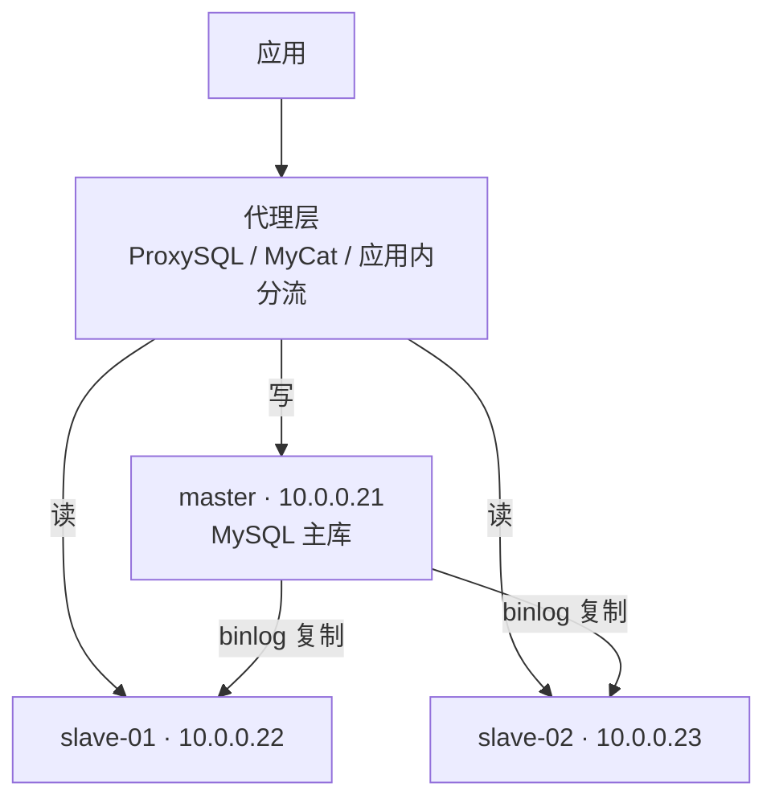

# MySQL 主从 + 读写分离

> 组合方案 · 属于 [部署方案](/deploy/) 模块。单服务的部署步骤不在这里重复，链接到 [MySQL 服务页](/services/database/mysql/01-理论)。
> 完整落地见 [我的项目 · 项目架构](/projects/homelab) 与 [10-实操 · 数据层高可用](/projects/homelab/practice/05-D2-P2-1数据层高可用)。

## 一、架构与组件职责



| 组件 | 职责 | 部署详解 |
|---|---|---|
| MySQL 主库 | 承接写，产生 binlog | [MySQL 02 · 部署](/services/database/mysql/02-部署) |
| MySQL 从库 | 回放 binlog，承接读 | 同上（主从段） |
| 代理层 | 按读/写把 SQL 分到主/从 | [MySQL 03 · 功能](/services/database/mysql/03-功能) |

## 二、为什么是主从 + 读写分离

- **读多写少是常态**：多数业务读远多于写。一主多从把读压力分散到多台从库，主库专心写。
- **复制是异步的**：从库回放 binlog 有延迟，所以"写后立即读"可能读到旧数据——强一致读要强制走主库。
- **主从不是自动高可用**：原生主从主库挂了不会自动切换，需配合 MHA/Orchestrator 或人工切。要自动故障转移看 [Redis 哨兵](/deploy/stacks/redis-sentinel) 的思路或 MySQL Group Replication。

## 三、部署编排（按依赖顺序）

1. **主库就位**：按 [MySQL 02 · 部署](/services/database/mysql/02-部署) 装好，开 binlog、设 server-id、建复制账号。
2. **从库复制**：从库 `CHANGE REPLICATION SOURCE TO` 指向主库，`START REPLICA`，确认 `Replica_IO_Running` 与 `Replica_SQL_Running` 均 Yes。
3. **半同步（可选加固）**：装半同步插件，主库等至少一个从库确认收到 binlog 才返回，降低丢数据风险。
4. **代理分流**：ProxySQL 配主机组（写组/读组），按查询类型路由；或应用层用多数据源自行分流。

### 复制关键配置（组合的"胶水"）

```sql
-- 主库 my.cnf
[mysqld]
server-id = 1
log_bin = mysql-bin
binlog_format = ROW

-- 从库建立复制（8.0 语法）
CHANGE REPLICATION SOURCE TO
  SOURCE_HOST='10.0.0.21', SOURCE_USER='repl',
  SOURCE_PASSWORD='请替换为强密码', SOURCE_AUTO_POSITION=1;
START REPLICA;
SHOW REPLICA STATUS\G
```

::: warning 密码与网段
示例 IP 与密码均为演示值，落地换成你自己的；本站统一 10.0.0.0/24 示例网段。复制账号只授 REPLICATION SLAVE 权限，别给 ALL。
:::

## 四、验证与故障注入

```bash
# 复制健康
mysql -e 'SHOW REPLICA STATUS\G' | grep -E 'Running|Behind'
# Seconds_Behind_Source 应接近 0；IO/SQL 线程均 Yes

# 读写分流验证：写主库 → 从库能查到（短暂延迟后）
# 故障注入：停主库
sudo systemctl stop mysqld     # 在主库执行
# 预期：写失败、读仍可用（从库）；需人工/工具提升从库为新主
```

- 看延迟：`Seconds_Behind_Source` 持续增大说明从库追不上（大事务/从库性能差）。
- 看错误：`Last_IO_Error` / `Last_SQL_Error` 定位复制中断原因。

## 五、边界与进阶

- 适用：读多写少、能接受短暂读延迟的业务。
- 强一致读：写后读走主库（代理层 hint 或应用控制）。
- 自动故障转移：MHA / Orchestrator / MySQL Group Replication（MGR）。
- 相关命令：[mysql 客户端](/services/database/mysql/03-功能)、[systemctl](/commands/system/systemctl-journalctl)、[ss](/commands/network/ss)。

---

返回 [部署方案 · 形态矩阵](/deploy/)。