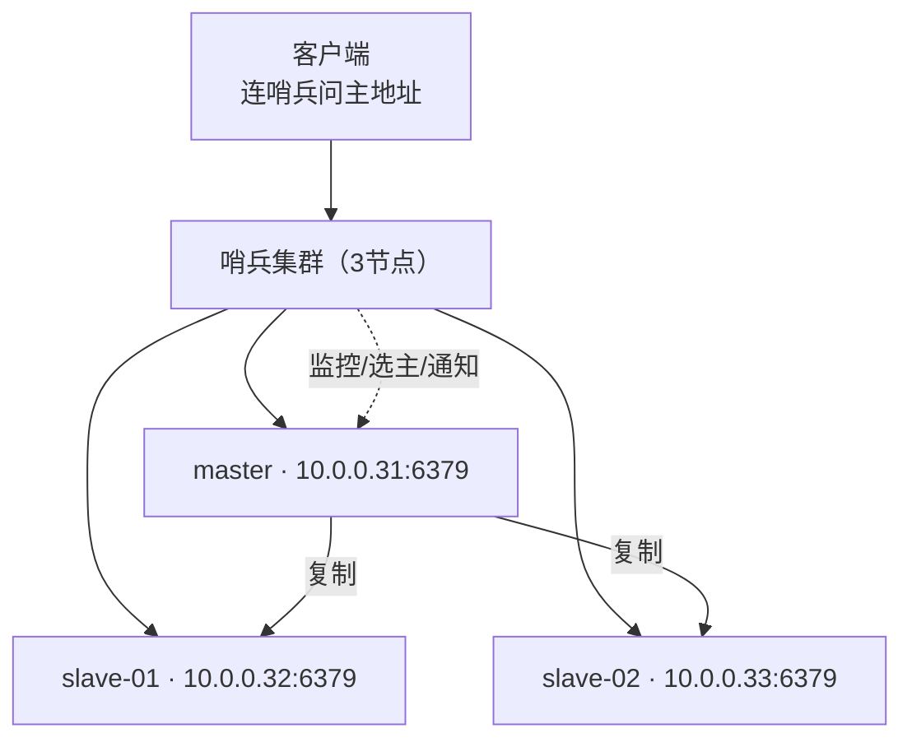

# Redis 哨兵集群

> 组合方案 · 属于 [部署方案](/deploy/) 模块。单服务部署步骤链接到 [Redis 服务页](/services/database/redis/01-理论)。
> 完整落地见 [我的项目 · 项目架构](/projects/homelab) 与 [10-实操 · 数据层高可用](/projects/homelab/practice/05-D2-P2-1数据层高可用)。

## 一、架构与组件职责



| 组件 | 职责 | 部署详解 |
|---|---|---|
| Redis 主从 | 数据读写与复制 | [Redis 02 · 部署](/services/database/redis/02-部署) |
| Sentinel（3节点） | 监控、自动故障转移、配置发现 | 同上（哨兵段） |
| 客户端 | 连哨兵获取当前主地址 | [Redis 03 · 功能](/services/database/redis/03-功能) |

## 二、为什么是三哨兵

- **哨兵本身要高可用**：单哨兵挂了就没法故障转移。多哨兵互相监控，少数挂了仍能决策。
- **奇数节点防脑裂**：选主需要多数派（quorum）。3 节点容忍 1 挂，5 节点容忍 2 挂。偶数不划算（4 节点也只容忍 1）。
- **quorum 与 majority 两回事**：quorum 是"判定主客观下线需要的哨兵数"；真正执行故障转移还需**多数派**哨兵授权。3 节点常设 quorum=2。
- **哨兵不存数据**：它只管"谁是主"，数据在主从里。客户端必须连哨兵问主地址，不能写死主 IP（否则切主后连旧主）。

## 三、部署编排（按依赖顺序）

1. **一主二从就位**：按 [Redis 02 · 部署](/services/database/redis/02-部署) 配好主从复制，`INFO replication` 确认。
2. **三节点哨兵**：每台跑 sentinel，监控同一主，quorum=2。
3. **客户端接哨兵**：用支持 Sentinel 的客户端（Jedis/Lettuce/redis-py sentinel），配哨兵地址 + master 名，自动发现主。

### 哨兵关键配置（组合的"胶水"）

```conf
# sentinel.conf（三节点一致，仅 bind 不同）
port 26379
sentinel monitor mymaster 10.0.0.31 6379 2
sentinel down-after-milliseconds mymaster 5000
sentinel failover-timeout mymaster 60000
sentinel parallel-syncs mymaster 1
```

::: warning 密码与网段
示例 IP 为演示值。主从若设了 requirepass，哨兵要配 `sentinel auth-pass mymaster 密码`，否则哨兵连不上主无法监控。
:::

## 四、验证与故障注入

```bash
# 哨兵看主
redis-cli -p 26379 SENTINEL get-master-addr-by-name mymaster
# 故障注入：停主库
sudo systemctl stop redis     # 在 master 执行
# 预期：约 down-after 时间后哨兵选新主，客户端自动连新主
redis-cli -p 26379 SENTINEL get-master-addr-by-name mymaster   # 地址变了
```

- 看哨兵日志：`journalctl -u redis-sentinel -f`，观察 +sdown / +odown / +failover 事件。
- 看新主：`INFO replication` 在提升的从库上 role:master。

## 五、边界与进阶

- 适用：需要自动故障转移的缓存/会话存储；数据量单机能放下。
- 海量数据/水平扩展：用 Redis Cluster（分片），哨兵不分片。
- 脑裂防护：`min-replicas-to-write` / `min-replicas-max-lag` 让旧主在失去从库时拒写。
- 相关命令：[redis-cli](/services/database/redis/03-功能)、[systemctl](/commands/system/systemctl-journalctl)、[ss](/commands/network/ss)。

---

返回 [部署方案 · 形态矩阵](/deploy/)。