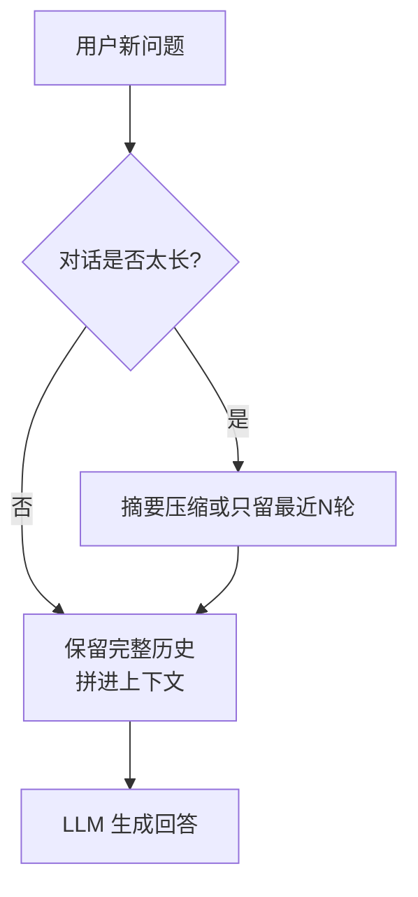
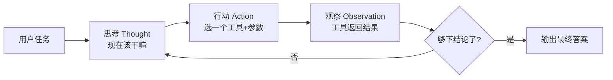
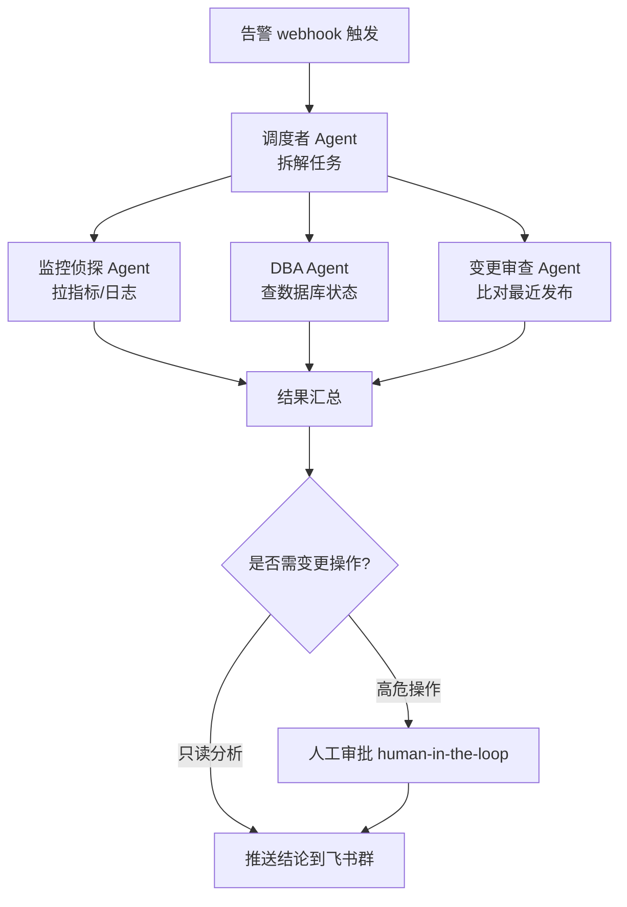
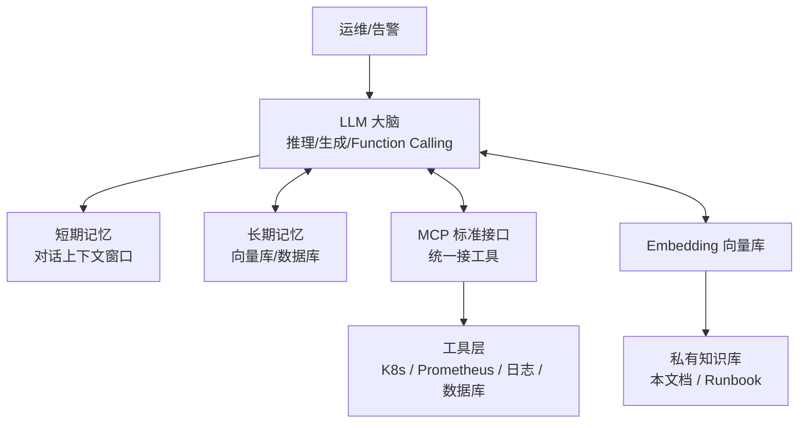

# AI Agent 与 LLM 应用基础

::: tip 本篇定位
给运维同学把"大模型 / Agent"这件事从黑盒讲成白盒：token、上下文、温度到底调的是什么，Agent 为什么能"自己调命令"，以及 LangChain / LangGraph / AutoGen 这些框架到底在帮你干什么。读完能看懂后面 MCP、RAG、运维实战三篇。
本篇版本：LangChain 1.4.2、LangGraph 1.2.12（均为 PyPI 当前稳定版）、Microsoft AutoGen v0.7.5（已进入维护模式，后继为 Microsoft Agent Framework 1.0 GA）。所有版本以官网当前稳定版为准。
:::

## 一、背景与基础

### 1.1 小白类比：大模型到底在干什么

先不堆术语。把大模型想成一个**读过几乎全互联网文本、但被关在房间里、不能自己动手的"超级博闻强记的实习生"**：

- 他**读不到你电脑里的东西**，也**连不上数据库、敲不了命令行**——你问他"我这台服务器现在 CPU 多少"，他只能凭空编。
- 他的本事是"根据前面看到的文字，一个词一个词地接出最合理的下一段"。
- 他**没有记忆**：你不把上次聊的内容再贴进去，他就当第一次见你。

所谓 **Agent（智能体）**，就是给这个实习生配上：**眼睛（看日志/监控）、手（敲命令/调 API）、笔记本（记忆）、还有一张办事流程图（编排框架）**。配上这些，他才能真的帮你干活，而不只是陪聊。

### 1.2 Token：模型计费和"能读多长"的最小单位

模型**不按字符也不按单词**计费和计数，而是按 **token（词元）**。大致规律（英文/中文不同）：

| 语言 | 1 个 token 大约是 | 说明 |
|---|---|---|
| 英文 | 约 0.75 个单词（4 个字母左右） | `kubernetes` 常被切成 `kuber`+`netes` 两个 token |
| 中文 | 约 0.5~1 个汉字 | 一句 20 字的中文大约 20~40 token |

运维里直接相关的两个坑：

1. **日志别整坨塞进去**：一段 1 万行报错日志轻松几十万 token，远超窗口，又贵又被截断。后面 RAG、MCP 做的就是"只把相关的那几行喂进去"。
2. **看账单和限流看 token**：`max_tokens` 是"最多再生成多少"，不是"总共多少"。

快速估算命令（用 `tiktoken`）：

```bash
pip install tiktoken==0.9.0
python -c "import tiktoken; enc=tiktoken.get_encoding('cl100k_base'); print(len(enc.encode('检查一下这台机器为什么CPU飙高')))"
```

### 1.3 上下文窗口（Context Window）

**上下文窗口 = 模型一次能"同时看到"的 token 总数**（你的输入 + 它的输出加一起）。类比：实习生桌上只有一张固定大小的办公桌，你给他摊的资料超过桌面，他就看不见最底下那张了。

| 概念 | 通俗解释 | 运维影响 |
|---|---|---|
| 输入上下文 | 你给它的：系统提示 + 历史对话 + 检索到的资料 | 日志/知识库塞太多会把历史对话挤掉 |
| 输出上限 `max_tokens` | 它一次最多写多长 | 让它生成超长 Runbook 时容易被截断 |
| 总窗口 | 输入 + 输出 ≤ 窗口上限 | 超了要么报错，要么 silently 截断最早内容 |

经验：运维场景别盲目追"百万 token 窗口"。窗口越大越贵、越慢，且**越靠后的内容注意力越弱**；正确做法是靠 RAG/工具"精准喂料"，而不是把所有日志都塞进去。

### 1.4 温度 temperature 与 top_p

这两个是控制"胡说八道程度"的旋钮：

| 参数 | 含义 | 运维该怎么设 |
|---|---|---|
| `temperature` | 采样随机性。0 = 每次都挑概率最高的词（稳定、确定）；越高越发散、越有"创意" | **运维取 0~0.3**：要它准确查事实、写确定性命令，不要它"发挥" |
| `top_p`（核采样） | 只从累计概率前 p% 的词里挑 | 一般配合 temperature，运维保持默认或 0.9，不要和 temperature 同时大调 |

> 一句话：**写代码、写 SQL、查监控、做诊断——低温；写文案、脑暴——才高温。** 生产 Agent 几乎永远用低温。

## 二、Prompt 工程要点

### 2.1 小白类比：给实习生派活怎么说才靠谱

你给新来的实习生派活，会说清三件事：**你是谁、要干什么、输出长什么样**。对 LLM 也一样，这就是 Prompt。一个好用的运维 Prompt 基本结构：

```text
# 角色
你是一名资深 Linux SRE，熟悉 K8s、Prometheus、MySQL。

# 任务
下面是一段告警日志，请你做：1) 判断可能原因；2) 给出3条可立即执行的排查命令；3) 给出结论置信度（高/中/低）。

# 约束
- 不要臆造不存在的指标名，不确定就说"需要进一步确认"。
- 命令必须能直接复制执行，不要省略参数。
- 用中文回答，结论放在最前面。

# 输入
<告警内容>
{{alert_content}}
</告警内容>
```

### 2.2 几条立竿见影的原则

| 原则 | 说明 | 反例 → 正例 |
|---|---|---|
| 给角色 | 设定身份和专长，输出更专业 | "帮我看看日志" → "你是 SRE，分析下面 K8s 日志" |
| 给输出格式 | 要求 JSON / 表格 / 分点，方便程序解析 | 让它自由发挥 → 要求"严格输出 JSON，字段为 cause/cmds/confidence" |
| 给示例（Few-shot） | 给 1~3 个"输入→期望输出"样例，效果最稳 | 光描述规则 → 加一两个范例 |
| 给约束与边界 | 明确"不知道就说不知道"，压制幻觉 | 不说 → 它会编一个看起来很像的答案 |
| 拆分任务 | 一次只让它干一件事 | "全面排查整个系统" → 先分析日志，再查指标，分步来 |

> 运维里最值钱的一句约束：**"如果信息不足以判断，明确说需要哪些额外信息，而不是猜。"** 这一句能挡掉一大半胡说。

## 三、上下文与记忆

### 3.1 小白类比：实习生的"桌面"和"笔记本"

- **短期记忆** = 实习生面前这张办公桌（= 上下文窗口里的历史对话）。桌满了，最早的内容就得撤走。
- **长期记忆** = 实习生下班前记到笔记本里的东西（= 外部数据库/向量库）。明天上班翻笔记就能想起来。

| 记忆类型 | 存哪 | 生命周期 | 典型用途 |
|---|---|---|---|
| 短期记忆 | 对话历史，塞进上下文 | 单次会话，受窗口限制 | "刚才那条告警之后又发生了什么" |
| 长期记忆 | 外部存储（DB / 向量库 / 知识文件） | 跨会话持久 | "这个客户上次出过什么问题""这台机器的特殊配置" |

### 3.2 记忆窗口的管理策略

窗口就这么大，历史对话越长越挤，常见做法：

1. **截断/滑动窗口**：只保留最近 N 轮对话，更早的丢掉。
2. **摘要压缩**：让模型把前 20 轮对话总结成一段话，用摘要代替原始历史。
3. **外部检索**：需要早期细节时，去长期记忆库里检索，而不是全塞进上下文。



## 四、Function Calling（工具调用）

### 4.1 小白类比：从"动嘴"到"动手"

光聊天的实习生遇到"CPU 多少"只能编。**Function Calling 就是教他：遇到需要查实时数据的问题，不要自己猜，而是说"请帮我执行 `top`，把结果给我"。** 他本身不执行，他只输出一个结构化的"我要调哪个工具、参数是啥"，真正执行是你的代码干完再把结果喂回给他。

整个过程是一个**"思考 → 调工具 → 看结果 → 再思考"的循环**。

### 4.2 一个工具的描述长什么样

你要先把"有哪些工具可以用"告诉模型（函数名、用途、参数 JSON Schema）：

```json
{
  "name": "prometheus_query",
  "description": "查询 Prometheus 瞬时指标，例如 CPU 使用率、QPS",
  "parameters": {
    "type": "object",
    "properties": {
      "promql": {
        "type": "string",
        "description": "PromQL 查询语句，如 rate(node_cpu_seconds_total[5m])"
      }
    },
    "required": ["promql"]
  }
}
```

### 4.3 请求与返回结构示例

**第一步：用户提问，模型决定调工具（注意它没有直接回答，而是返回 tool_calls）：**

```json
{
  "model": "qwen3:8b",
  "messages": [
    {"role": "system", "content": "你是运维助手，可调用工具查监控。"},
    {"role": "user", "content": "web 这个 pod 现在 CPU 高不高？"}
  ],
  "tools": [ {"name": "prometheus_query", "description": "查询Prometheus指标", "parameters": {"type": "object", "properties": {"promql": {"type": "string"}}, "required": ["promql"]}} ],
  "tool_choice": "auto"
}
```

模型返回（节选）：

```json
{
  "choices": [{
    "message": {
      "role": "assistant",
      "content": null,
      "tool_calls": [{
        "id": "call_8f3a",
        "type": "function",
        "function": {
          "name": "prometheus_query",
          "arguments": "{\"promql\": \"sum(rate(container_cpu_usage_seconds_total{pod=~\\\"web.*\\\"}[5m])) by (pod)\"}"
        }
      }]
    }
  }]
}
```

**第二步：你的代码真正去查 Prometheus，把结果作为 `role: tool` 消息喂回去：**

```json
{
  "messages": [
    {"role": "system", "content": "你是运维助手，可调用工具查监控。"},
    {"role": "user", "content": "web 这个 pod 现在 CPU 高不高？"},
    {"role": "assistant", "content": null, "tool_calls": [{"id": "call_8f3a", "type": "function", "function": {"name": "prometheus_query", "arguments": "{\"promql\":\"...\"}"}}]},
    {"role": "tool", "tool_call_id": "call_8f3a", "content": "{\"web-7d9f\": 0.92, \"web-2a1c\": 0.31}"}
  ]
}
```

**第三步：模型拿到真实数据，终于给出人话结论。** MCP（见下一篇）本质上就是把"工具清单 + 调用协议"标准化，不用每个 Agent 手写这一套。

## 五、Agent 推理范式

### 5.1 ReAct：边想边做（最常用）

**ReAct = Reasoning（推理）+ Acting（行动）**。循环是：



写法像这样（模型内部的循环轨迹）：

```text
Question: web pod CPU 为什么高？
Thought: 先确认是不是真的高，调 prometheus_query。
Action: prometheus_query(promql="...")
Observation: web-7d9f CPU=0.92，其他正常。
Thought: 单 pod 高，看下这个 pod 最近日志有没有报错。
Action: pod_logs(pod="web-7d9f")
Observation: 反复出现 OOMKilled、FullGC...
Thought: 定位到内存压力导致 GC 频繁。给出结论。
```

### 5.2 Plan-and-Execute：先列计划再分步干

对复杂任务，先让模型**一次性写出完整计划**，再逐步执行，中间可由一个"规划者"动态调整。

| 对比 | ReAct | Plan-and-Execute |
|---|---|---|
| 思路 | 走一步看一步，边想边做 | 先出完整计划，再分步执行 |
| 适合 | 简单、路径不确定、单步即可 | 复杂、多步骤、有明确先后的任务 |
| 优点 | 灵活、省 token、出错及时转向 | 全局视野好、步骤不丢、可控 |
| 缺点 | 复杂任务容易绕圈子/跑偏 | 计划定死了应变差，需规划者修正 |
| 运维例子 | "帮我看下这条告警" | "给我把这个服务从测试环境灰度发布到生产并验证" |

> 实践中常混合：**Plan-and-Execute 搭骨架，每一步内部用 ReAct 调工具**。LangGraph 就是干这个编排的。

## 六、多 Agent 协作

一个 Agent 包打天下容易又慢又乱。复杂运维拆成**多个角色分工**，像一个值班小组：

| 角色 | 职责 | 类比 |
|---|---|---|
| 调度者 / Orchestrator | 接活、拆任务、分配、汇总 | 值班主管 |
| 监控侦探 | 查 Prometheus、日志、链路 | 看监控的工程师 |
| 数据库专家 | 查慢查询、锁、主从延迟 | DBA |
| 变更审查员 | 核对最近有没有发版/配置变更 | 发布负责人 |
| 审批人（人） | 高危操作人工拍板 | 你本人 |



## 七、主流框架与选型

### 7.1 它们分别解决什么

| 框架 | 定位 | 当前状态（2026-09） | 适合谁 |
|---|---|---|---|
| **LangChain** | LLM 应用"零件库"：模型接入、Prompt、文档加载、向量库、工具的统一抽象 | 1.4.2 活跃维护 | 快速搭 RAG、接各种模型/工具 |
| **LangGraph** | 用"图/状态机"编排有状态、可循环、可中断的多步 Agent（人在回路、持久化） | 1.2.12，LangChain 官方主推的 Agent 编排层 | 生产级、要可控流程和 human-in-the-loop 的 Agent |
| **Microsoft AutoGen** | 多 Agent 对话协作框架（让多个 Agent 互相对话解决问题） | **已进入维护模式**（2025-10 起），最后正式版 v0.7.5（2025-09） | 老项目维护；新项目别新起 |
| **Microsoft Agent Framework** | AutoGen + Semantic Kernel 合并后的官方后继 | 1.0 GA（2026-04） | 微软技术栈/.NET 生态新项目 |
| **AG2（社区分叉）** | AutoGen 原作者社区延续 | 1.0.x，Apache-2.0 | 怀念 AutoGen v0.2 风格的开源多 Agent |

> ⚠️ 网上大量"LangChain vs AutoGen"的文章已过时。**2026 年的正确问法是"LangGraph vs Microsoft Agent Framework"**；AutoGen 老仓库已加维护模式徽章，新用户应直接上后继框架。

### 7.2 运维场景怎么选

| 你的需求 | 推荐 |
|---|---|
| 先做个 RAG 问答、接个 OpenAI 兼容接口 | LangChain |
| 要可控的多步 Agent：告警→查指标→诊断→（人工审批后）执行 | **LangGraph**（状态机 + 中断恢复最成熟） |
| 不想写代码，拖拽式搭工作流 | Dify / n8n（见[运维实战](./aiops-agent-practice)） |
| 多 Agent 自由对话探索 | 研究用；生产优先 LangGraph |

### 7.3 一张图看清各组件在 Agent 里的位置



> 看图记一句话：**LLM 是大脑，Function Calling 是手，记忆是笔记，RAG 是查资料，MCP 是统一的 USB-C 接口**（下一篇细讲）。

## 八、常见问题排错

| 现象 | 原因 | 解决 |
|---|---|---|
| 模型一本正经编造指标名/命令 | 没约束 + 高温 + 缺工具 | 温度调到 0~0.3；Prompt 加"不知道就说不知道"；能查的一律用工具查 |
| 回答越来越短、丢了前面的话 | 对话太长撑爆上下文窗口 | 开滑动窗口/摘要压缩；只保留最近 N 轮；历史细节走长期记忆检索 |
| 工具调用参数格式错乱、JSON 缺字段 | 函数描述不清、没给 Schema | 补全参数 JSON Schema、给一个 few-shot 例子、用结构化输出强制校验 |
| Agent 陷入死循环一直调同一个工具 | 没有最大步数限制、观察结果没变化 | 设 `max_iterations`（如 8~12），超过强制收尾；让它把观察结果先总结 |
| 输出被截断 | `max_tokens` 太小 | 调大输出上限；或让它分多次输出 |
| LangChain 升级后报错/导入变了 | 1.x 与旧 0.3 API 差异大 | 锁定版本（`langchain==1.4.2`、`langgraph==1.2.12`），查官方迁移指南 |

::: warning 生产红线
- 永远**低温（0~0.3）**跑运维 Agent，高温只会让它在排障时自由发挥、编命令。
- 工具调用必须**服务端二次校验参数**，不能 LLM 说删什么就删什么——模型给的参数是"建议"，不是"授权"。
- **不要把生产库的写权限/root 直接交给 Agent**：读和写分离，高危操作必须人工审批（见[运维实战](./aiops-agent-practice)）。
- 锁版本：`pip` 里写死 `langchain==1.4.2`、`langgraph==1.2.12`，框架迭代极快，`latest` 明天就可能变 API。
- 全链路留痕：每一轮 Thought/Action/Observation 都要记日志，出了问题能复盘 Agent 到底干了啥。
:::

## 相关速查

- 运维 AI Prompt 与 Agent 指令模板：[运维 AI Prompt 速查](/reference/ai-prompts)
- 云原生排障命令：[云原生命令速查](/reference/cloudnative-commands)
- 模型怎么部署起来：[大模型部署](./container-llm)
- 工具标准化接入协议：[MCP 模型上下文协议](./aiops-mcp)
- 把私有知识喂给模型：[运维知识库与 RAG](./aiops-rag)

### 官方文档

- LangChain 官方文档：https://docs.langchain.com/
- LangChain / LangGraph PyPI 发布页：https://pypi.org/project/langchain/ 、https://pypi.org/project/langgraph/
- LangGraph 1.0 发布说明：https://blog.langchain.com/langchain-langgraph-1dot0/
- LangChain 版本策略（LTS）：https://docs.langchain.com/oss/python/versioning
- Microsoft AutoGen 仓库（维护模式说明）：https://github.com/microsoft/autogen
- Microsoft Agent Framework 文档：https://learn.microsoft.com/en-us/agent-framework/
