# AI Agent 与 LLM 应用基础

::: tip 本篇定位
给运维同学把"大模型 / Agent"这件事从黑盒讲成白盒：token、上下文、温度到底调的是什么，Agent 为什么能"自己调命令"，以及 LangChain / LangGraph / AutoGen 这些框架到底在帮你干什么。读完能看懂后面 MCP、RAG、运维实战三篇。
本篇版本：LangChain 1.4.2、LangGraph 1.2.12（均为 PyPI 当前稳定版）、Microsoft AutoGen v0.7.5（已进入维护模式，后继为 Microsoft Agent Framework 1.0 GA）。所有版本以官网当前稳定版为准。
:::

## 一、背景与基础

### 1.1 小白类比：大模型到底在干什么

先不堆术语。把大模型想成一个**读过几乎全互联网文本、但被关在房间里、不能自己动手的"超级博闻强记的实习生"**：

- 他**读不到你电脑里的东西**，也**连不上数据库、敲不了命令行**——你问他"我这台服务器现在 CPU 多少"，他只能凭空编。
- 他的本事是"根据前面看到的文字，一个词一个词地接出最合理的下一段"。
- 他**没有记忆**：你不把上次聊的内容再贴进去，他就当第一次见你。

所谓 **Agent（智能体）**，就是给这个实习生配上：**眼睛（看日志/监控）、手（敲命令/调 API）、笔记本（记忆）、还有一张办事流程图（编排框架）**。配上这些，他才能真的帮你干活，而不只是陪聊。

### 1.2 Token：模型计费和"能读多长"的最小单位

模型**不按字符也不按单词**计费和计数，而是按 **token（词元）**。大致规律（英文/中文不同）：

| 语言 | 1 个 token 大约是 | 说明 |
|---|---|---|
| 英文 | 约 0.75 个单词（4 个字母左右） | `kubernetes` 常被切成 `kuber`+`netes` 两个 token |
| 中文 | 约 0.5~1 个汉字 | 一句 20 字的中文大约 20~40 token |

运维里直接相关的两个坑：

1. **日志别整坨塞进去**：一段 1 万行报错日志轻松几十万 token，远超窗口，又贵又被截断。后面 RAG、MCP 做的就是"只把相关的那几行喂进去"。
2. **看账单和限流看 token**：`max_tokens` 是"最多再生成多少"，不是"总共多少"。

快速估算命令（用 `tiktoken`）：

```bash
pip install tiktoken==0.9.0
python -c "import tiktoken; enc=tiktoken.get_encoding('cl100k_base'); print(len(enc.encode('检查一下这台机器为什么CPU飙高')))"
```

### 1.3 上下文窗口（Context Window）

**上下文窗口 = 模型一次能"同时看到"的 token 总数**（你的输入 + 它的输出加一起）。类比：实习生桌上只有一张固定大小的办公桌，你给他摊的资料超过桌面，他就看不见最底下那张了。

| 概念 | 通俗解释 | 运维影响 |
|---|---|---|
| 输入上下文 | 你给它的：系统提示 + 历史对话 + 检索到的资料 | 日志/知识库塞太多会把历史对话挤掉 |
| 输出上限 `max_tokens` | 它一次最多写多长 | 让它生成超长 Runbook 时容易被截断 |
| 总窗口 | 输入 + 输出 ≤ 窗口上限 | 超了要么报错，要么 silently 截断最早内容 |

经验：运维场景别盲目追"百万 token 窗口"。窗口越大越贵、越慢，且**越靠后的内容注意力越弱**；正确做法是靠 RAG/工具"精准喂料"，而不是把所有日志都塞进去。

### 1.4 温度 temperature 与 top_p

这两个是控制"胡说八道程度"的旋钮：

| 参数 | 含义 | 运维该怎么设 |
|---|---|---|
| `temperature` | 采样随机性。0 = 每次都挑概率最高的词（稳定、确定）；越高越发散、越有"创意" | **运维取 0~0.3**：要它准确查事实、写确定性命令，不要它"发挥" |
| `top_p`（核采样） | 只从累计概率前 p% 的词里挑 | 一般配合 temperature，运维保持默认或 0.9，不要和 temperature 同时大调 |

> 一句话：**写代码、写 SQL、查监控、做诊断——低温；写文案、脑暴——才高温。** 生产 Agent 几乎永远用低温。

## 二、Prompt 工程要点

### 2.1 小白类比：给实习生派活怎么说才靠谱

你给新来的实习生派活，会说清三件事：**你是谁、要干什么、输出长什么样**。对 LLM 也一样，这就是 Prompt。一个好用的运维 Prompt 基本结构：

```text
# 角色
你是一名资深 Linux SRE，熟悉 K8s、Prometheus、MySQL。

# 任务
下面是一段告警日志，请你做：1) 判断可能原因；2) 给出3条可立即执行的排查命令；3) 给出结论置信度（高/中/低）。

# 约束
- 不要臆造不存在的指标名，不确定就说"需要进一步确认"。
- 命令必须能直接复制执行，不要省略参数。
- 用中文回答，结论放在最前面。

# 输入
<告警内容>
{{alert_content}}
</告警内容>
```

### 2.2 几条立竿见影的原则

| 原则 | 说明 | 反例 → 正例 |
|---|---|---|
| 给角色 | 设定身份和专长，输出更专业 | "帮我看看日志" → "你是 SRE，分析下面 K8s 日志" |
| 给输出格式 | 要求 JSON / 表格 / 分点，方便程序解析 | 让它自由发挥 → 要求"严格输出 JSON，字段为 cause/cmds/confidence" |
| 给示例（Few-shot） | 给 1~3 个"输入→期望输出"样例，效果最稳 | 光描述规则 → 加一两个范例 |
| 给约束与边界 | 明确"不知道就说不知道"，压制幻觉 | 不说 → 它会编一个看起来很像的答案 |
| 拆分任务 | 一次只让它干一件事 | "全面排查整个系统" → 先分析日志，再查指标，分步来 |

> 运维里最值钱的一句约束：**"如果信息不足以判断，明确说需要哪些额外信息，而不是猜。"** 这一句能挡掉一大半胡说。

## 三、上下文与记忆

### 3.1 小白类比：实习生的"桌面"和"笔记本"

- **短期记忆** = 实习生面前这张办公桌（= 上下文窗口里的历史对话）。桌满了，最早的内容就得撤走。
- **长期记忆** = 实习生下班前记到笔记本里的东西（= 外部数据库/向量库）。明天上班翻笔记就能想起来。

| 记忆类型 | 存哪 | 生命周期 | 典型用途 |
|---|---|---|---|
| 短期记忆 | 对话历史，塞进上下文 | 单次会话，受窗口限制 | "刚才那条告警之后又发生了什么" |
| 长期记忆 | 外部存储（DB / 向量库 / 知识文件） | 跨会话持久 | "这个客户上次出过什么问题""这台机器的特殊配置" |

### 3.2 记忆窗口的管理策略

窗口就这么大，历史对话越长越挤，常见做法：

1. **截断/滑动窗口**：只保留最近 N 轮对话，更早的丢掉。
2. **摘要压缩**：让模型把前 20 轮对话总结成一段话，用摘要代替原始历史。
3. **外部检索**：需要早期细节时，去长期记忆库里检索，而不是全塞进上下文。

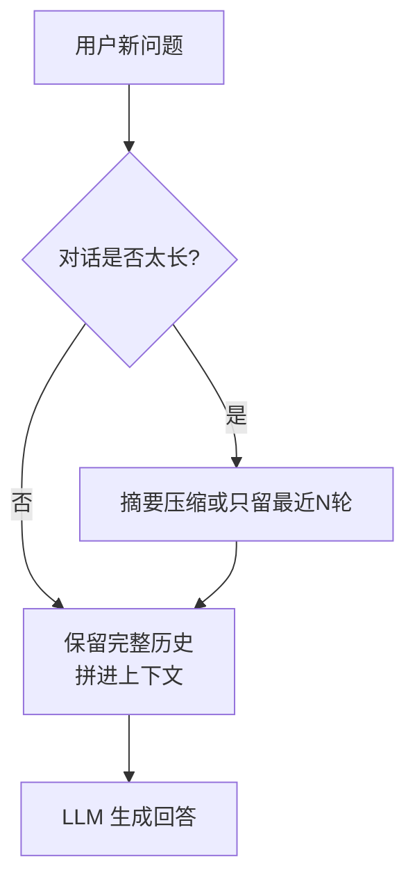

## 四、Function Calling（工具调用）

### 4.1 小白类比：从"动嘴"到"动手"

光聊天的实习生遇到"CPU 多少"只能编。**Function Calling 就是教他：遇到需要查实时数据的问题，不要自己猜，而是说"请帮我执行 `top`，把结果给我"。** 他本身不执行，他只输出一个结构化的"我要调哪个工具、参数是啥"，真正执行是你的代码干完再把结果喂回给他。

整个过程是一个**"思考 → 调工具 → 看结果 → 再思考"的循环**。

### 4.2 一个工具的描述长什么样

你要先把"有哪些工具可以用"告诉模型（函数名、用途、参数 JSON Schema）：

```json
{
  "name": "prometheus_query",
  "description": "查询 Prometheus 瞬时指标，例如 CPU 使用率、QPS",
  "parameters": {
    "type": "object",
    "properties": {
      "promql": {
        "type": "string",
        "description": "PromQL 查询语句，如 rate(node_cpu_seconds_total[5m])"
      }
    },
    "required": ["promql"]
  }
}
```

### 4.3 请求与返回结构示例

**第一步：用户提问，模型决定调工具（注意它没有直接回答，而是返回 tool_calls）：**

```json
{
  "model": "qwen3:8b",
  "messages": [
    {"role": "system", "content": "你是运维助手，可调用工具查监控。"},
    {"role": "user", "content": "web 这个 pod 现在 CPU 高不高？"}
  ],
  "tools": [ {"name": "prometheus_query", "description": "查询Prometheus指标", "parameters": {"type": "object", "properties": {"promql": {"type": "string"}}, "required": ["promql"]}} ],
  "tool_choice": "auto"
}
```

模型返回（节选）：

```json
{
  "choices": [{
    "message": {
      "role": "assistant",
      "content": null,
      "tool_calls": [{
        "id": "call_8f3a",
        "type": "function",
        "function": {
          "name": "prometheus_query",
          "arguments": "{\"promql\": \"sum(rate(container_cpu_usage_seconds_total{pod=~\\\"web.*\\\"}[5m])) by (pod)\"}"
        }
      }]
    }
  }]
}
```

**第二步：你的代码真正去查 Prometheus，把结果作为 `role: tool` 消息喂回去：**

```json
{
  "messages": [
    {"role": "system", "content": "你是运维助手，可调用工具查监控。"},
    {"role": "user", "content": "web 这个 pod 现在 CPU 高不高？"},
    {"role": "assistant", "content": null, "tool_calls": [{"id": "call_8f3a", "type": "function", "function": {"name": "prometheus_query", "arguments": "{\"promql\":\"...\"}"}}]},
    {"role": "tool", "tool_call_id": "call_8f3a", "content": "{\"web-7d9f\": 0.92, \"web-2a1c\": 0.31}"}
  ]
}
```

**第三步：模型拿到真实数据，终于给出人话结论。** MCP（见下一篇）本质上就是把"工具清单 + 调用协议"标准化，不用每个 Agent 手写这一套。

## 五、Agent 推理范式

### 5.1 ReAct：边想边做（最常用）

**ReAct = Reasoning（推理）+ Acting（行动）**。循环是：

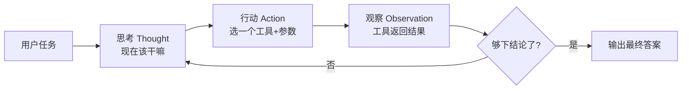

写法像这样（模型内部的循环轨迹）：

```text
Question: web pod CPU 为什么高？
Thought: 先确认是不是真的高，调 prometheus_query。
Action: prometheus_query(promql="...")
Observation: web-7d9f CPU=0.92，其他正常。
Thought: 单 pod 高，看下这个 pod 最近日志有没有报错。
Action: pod_logs(pod="web-7d9f")
Observation: 反复出现 OOMKilled、FullGC...
Thought: 定位到内存压力导致 GC 频繁。给出结论。
```

### 5.2 Plan-and-Execute：先列计划再分步干

对复杂任务，先让模型**一次性写出完整计划**，再逐步执行，中间可由一个"规划者"动态调整。

| 对比 | ReAct | Plan-and-Execute |
|---|---|---|
| 思路 | 走一步看一步，边想边做 | 先出完整计划，再分步执行 |
| 适合 | 简单、路径不确定、单步即可 | 复杂、多步骤、有明确先后的任务 |
| 优点 | 灵活、省 token、出错及时转向 | 全局视野好、步骤不丢、可控 |
| 缺点 | 复杂任务容易绕圈子/跑偏 | 计划定死了应变差，需规划者修正 |
| 运维例子 | "帮我看下这条告警" | "给我把这个服务从测试环境灰度发布到生产并验证" |

> 实践中常混合：**Plan-and-Execute 搭骨架，每一步内部用 ReAct 调工具**。LangGraph 就是干这个编排的。

## 六、多 Agent 协作

一个 Agent 包打天下容易又慢又乱。复杂运维拆成**多个角色分工**，像一个值班小组：

| 角色 | 职责 | 类比 |
|---|---|---|
| 调度者 / Orchestrator | 接活、拆任务、分配、汇总 | 值班主管 |
| 监控侦探 | 查 Prometheus、日志、链路 | 看监控的工程师 |
| 数据库专家 | 查慢查询、锁、主从延迟 | DBA |
| 变更审查员 | 核对最近有没有发版/配置变更 | 发布负责人 |
| 审批人（人） | 高危操作人工拍板 | 你本人 |

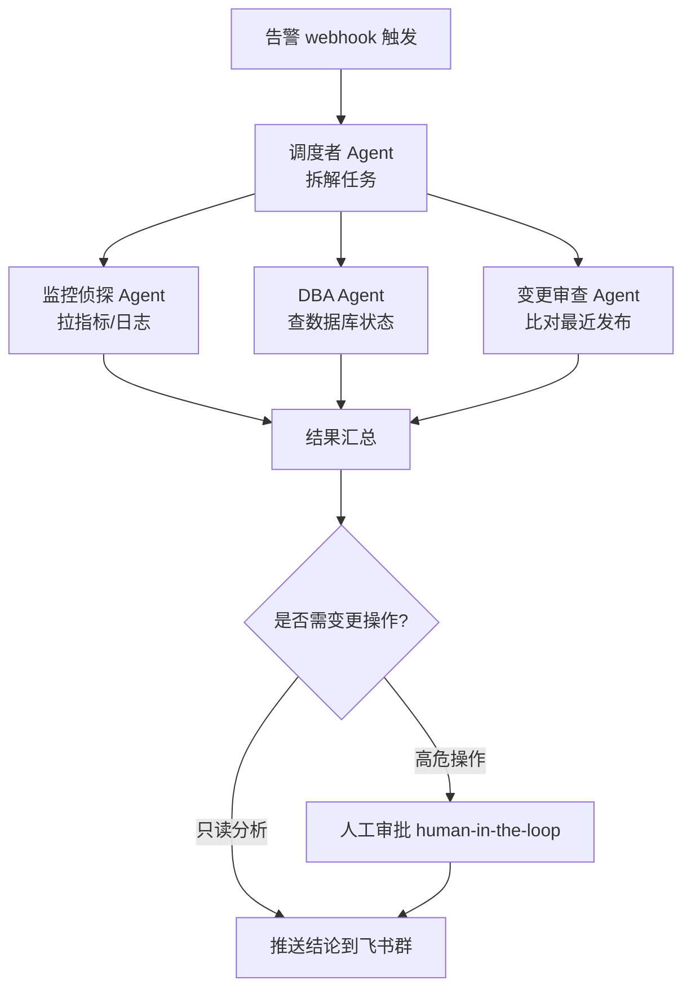

## 七、主流框架与选型

### 7.1 它们分别解决什么

| 框架 | 定位 | 当前状态（2026-09） | 适合谁 |
|---|---|---|---|
| **LangChain** | LLM 应用"零件库"：模型接入、Prompt、文档加载、向量库、工具的统一抽象 | 1.4.2 活跃维护 | 快速搭 RAG、接各种模型/工具 |
| **LangGraph** | 用"图/状态机"编排有状态、可循环、可中断的多步 Agent（人在回路、持久化） | 1.2.12，LangChain 官方主推的 Agent 编排层 | 生产级、要可控流程和 human-in-the-loop 的 Agent |
| **Microsoft AutoGen** | 多 Agent 对话协作框架（让多个 Agent 互相对话解决问题） | **已进入维护模式**（2025-10 起），最后正式版 v0.7.5（2025-09） | 老项目维护；新项目别新起 |
| **Microsoft Agent Framework** | AutoGen + Semantic Kernel 合并后的官方后继 | 1.0 GA（2026-04） | 微软技术栈/.NET 生态新项目 |
| **AG2（社区分叉）** | AutoGen 原作者社区延续 | 1.0.x，Apache-2.0 | 怀念 AutoGen v0.2 风格的开源多 Agent |

> ⚠️ 网上大量"LangChain vs AutoGen"的文章已过时。**2026 年的正确问法是"LangGraph vs Microsoft Agent Framework"**；AutoGen 老仓库已加维护模式徽章，新用户应直接上后继框架。

### 7.2 运维场景怎么选

| 你的需求 | 推荐 |
|---|---|
| 先做个 RAG 问答、接个 OpenAI 兼容接口 | LangChain |
| 要可控的多步 Agent：告警→查指标→诊断→（人工审批后）执行 | **LangGraph**（状态机 + 中断恢复最成熟） |
| 不想写代码，拖拽式搭工作流 | Dify / n8n（见[运维实战](#合并资料)） |
| 多 Agent 自由对话探索 | 研究用；生产优先 LangGraph |

### 7.3 一张图看清各组件在 Agent 里的位置

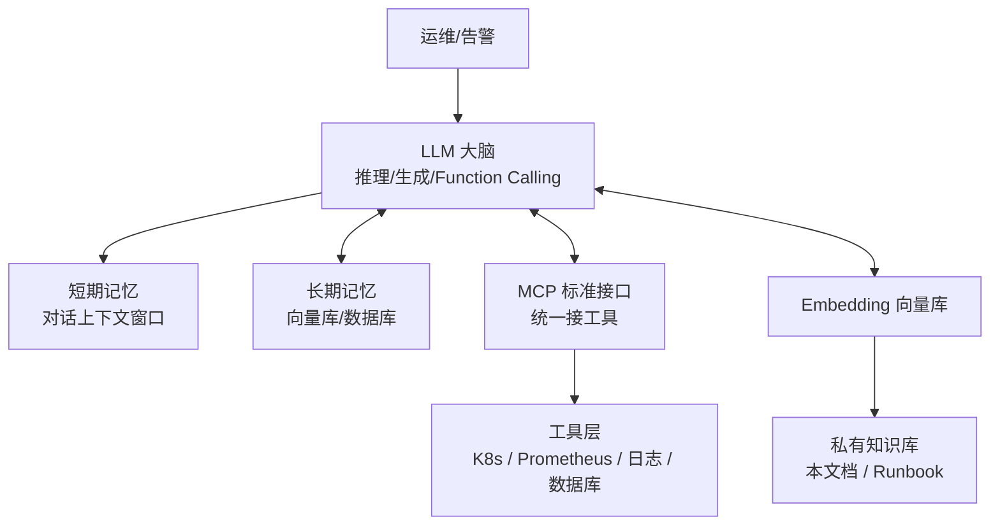

> 看图记一句话：**LLM 是大脑，Function Calling 是手，记忆是笔记，RAG 是查资料，MCP 是统一的 USB-C 接口**（下一篇细讲）。

## 八、常见问题排错

| 现象 | 原因 | 解决 |
|---|---|---|
| 模型一本正经编造指标名/命令 | 没约束 + 高温 + 缺工具 | 温度调到 0~0.3；Prompt 加"不知道就说不知道"；能查的一律用工具查 |
| 回答越来越短、丢了前面的话 | 对话太长撑爆上下文窗口 | 开滑动窗口/摘要压缩；只保留最近 N 轮；历史细节走长期记忆检索 |
| 工具调用参数格式错乱、JSON 缺字段 | 函数描述不清、没给 Schema | 补全参数 JSON Schema、给一个 few-shot 例子、用结构化输出强制校验 |
| Agent 陷入死循环一直调同一个工具 | 没有最大步数限制、观察结果没变化 | 设 `max_iterations`（如 8~12），超过强制收尾；让它把观察结果先总结 |
| 输出被截断 | `max_tokens` 太小 | 调大输出上限；或让它分多次输出 |
| LangChain 升级后报错/导入变了 | 1.x 与旧 0.3 API 差异大 | 锁定版本（`langchain==1.4.2`、`langgraph==1.2.12`），查官方迁移指南 |

::: warning 生产红线
- 永远**低温（0~0.3）**跑运维 Agent，高温只会让它在排障时自由发挥、编命令。
- 工具调用必须**服务端二次校验参数**，不能 LLM 说删什么就删什么——模型给的参数是"建议"，不是"授权"。
- **不要把生产库的写权限/root 直接交给 Agent**：读和写分离，高危操作必须人工审批（见[运维实战](#合并资料)）。
- 锁版本：`pip` 里写死 `langchain==1.4.2`、`langgraph==1.2.12`，框架迭代极快，`latest` 明天就可能变 API。
- 全链路留痕：每一轮 Thought/Action/Observation 都要记日志，出了问题能复盘 Agent 到底干了啥。
:::

## 相关速查

- 运维 AI Prompt 与 Agent 指令模板：[运维 AI Prompt 速查](/reference/ai-prompts)
- 云原生排障命令：[云原生命令速查](/reference/cloudnative-commands)
- 模型怎么部署起来：[大模型部署](/guide/container#合并资料)
- 工具标准化接入协议：[MCP 模型上下文协议](#合并资料)
- 把私有知识喂给模型：[运维知识库与 RAG](#合并资料)

### 官方文档

- LangChain 官方文档：https://docs.langchain.com/
- LangChain / LangGraph PyPI 发布页：https://pypi.org/project/langchain/ 、https://pypi.org/project/langgraph/
- LangGraph 1.0 发布说明：https://blog.langchain.com/langchain-langgraph-1dot0/
- LangChain 版本策略（LTS）：https://docs.langchain.com/oss/python/versioning
- Microsoft AutoGen 仓库（维护模式说明）：https://github.com/microsoft/autogen
- Microsoft Agent Framework 文档：https://learn.microsoft.com/en-us/agent-framework/

<!-- merged-guide-material:start -->
## 合并资料

> 原先单独成页的同主题内容已收进本页；默认折叠，点开看原页全文。

<details>
<summary><strong>Agent 运维实战 — 把前面的 LLM 基础、MCP 真正落到值班场景：告警进来后 Agent 怎么自动拉日志和监控指标、给出归因结论、推送机器人；以及最关键的——哪些事能自动做、哪些必须人来拍板。给一个 LangGraph 端到端可跑骨架 + Dify/n8n 拖拽落地思路。</strong></summary>

::: tip 本篇定位
把前面的 LLM 基础、MCP 真正落到值班场景：告警进来后 Agent 怎么自动拉日志和监控指标、给出归因结论、推送机器人；以及最关键的——哪些事能自动做、哪些必须人来拍板。给一个 LangGraph 端到端可跑骨架 + Dify/n8n 拖拽落地思路。
本篇版本：LangGraph 1.2.12、Dify v1.17.1（自托管 Docker Compose）、n8n 2.41.4。所有版本以官网当前稳定版为准。
:::

#### 一、运维里 Agent 能干什么

##### 1.1 小白类比：Agent 是你的"值班实习生 + 值班群"

深夜告警一响，人要做一串重复动作：登 Grafana 看曲线 → 拉最近日志 → 查最近有没有发版 → 对着 Runbook 猜原因 → 把结论贴群里。**Agent 实战，就是把这套"值班肌肉记忆"自动化成一条流水线**，人只在最后拍板。

| 场景 | Agent 具体做什么 | 自动化程度 |
|---|---|---|
| 日志分析 | 拉最近 N 分钟错误日志，归类报错类型、统计 Top 错误 | 全自动（只读） |
| 告警归因 | 结合指标 + 日志 + 近期变更，给出"最可能原因 + 置信度" | 全自动出结论，人看 |
| 故障诊断 | 按诊断树一步步查：先看指标是否异常 → 再看日志 → 再查变更 | 自动排查，结论人审 |
| 生成脚本/Runbook | 根据现象输出排查命令、生成临时恢复脚本 | 人 review 后执行 |
| 变更/恢复操作 | 重启 pod、扩容、回滚 | **半自动：必须人工审批** |

#### 二、端到端示例：告警自动诊断并推群

##### 2.1 整体编排

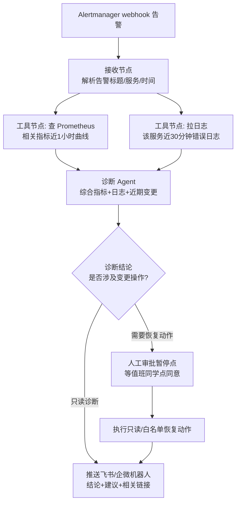

##### 2.2 用 LangGraph 写这个流程（Python 骨架）

LangGraph 把流程画成"状态图"：节点是一步动作，边是流转，中间可以**中断等人审批**（`interrupt`）。下面是可跑骨架（依赖：`langgraph==1.2.12`、`langchain-openai==...`，接你自己的 OpenAI 兼容端点，比如自建 vLLM/Ollama）。

```python
# alert_diag_graph.py —— 告警自动诊断 LangGraph 骨架
from typing import TypedDict, Literal
from langgraph.graph import StateGraph, START, END
from langgraph.types import interrupt, Command

class OpsState(TypedDict):
    alert: dict          # 告警内容
    metrics: str         # 查到的指标
    logs: str            # 拉到的日志
    diagnosis: str       # 诊断结论
    need_action: bool    # 是否需要执行变更动作

def fetch_metrics(state: OpsState) -> dict:
    """查 Prometheus：这里替换成真实 PromQL 查询（可走 MCP server）。"""
    svc = state["alert"].get("labels", {}).get("service", "unknown")
    return {"metrics": f"[示例] service={svc} 错误率近30min 从0.1%升至8%，P99延迟翻倍"}

def fetch_logs(state: OpsState) -> dict:
    """拉日志：替换成对 Loki/ELK 的查询。"""
    return {"logs": "[示例] 近30min 出现 142 次 'connection refused' 到 upstream pay-svc"}

def diagnose(state: OpsState) -> dict:
    """调 LLM 综合诊断（这里用占位逻辑示意，真实接 ChatModel）。"""
    conclusion = (
        f"现象：{state['metrics']}；日志：{state['logs']}。\n"
        "初步判断：pay-svc 连接被拒，疑似下游支付服务不可用。置信度：中。"
    )
    return {"diagnosis": conclusion, "need_action": True}

def human_review(state: OpsState) -> Command:
    """高危动作前中断，等人在外部系统点同意/拒绝。"""
    decision = interrupt({
        "question": "是否允许对 pay-svc 执行只读检查 + 重启异常 pod？",
        "diagnosis": state["diagnosis"],
    })
    if decision.get("approved"):
        return Command(goto="execute_action", update={"need_action": True})
    return Command(goto="notify", update={"need_action": False})

def execute_action(state: OpsState) -> dict:
    """通过审批后才执行，且只做白名单内的动作（如重启指定 deployment）。"""
    return {"diagnosis": state["diagnosis"] + "\n[已执行] 重启 pay-svc 异常 pod（已审批）"}

def notify(state: OpsState) -> dict:
    """推送到飞书/企业微信机器人。"""
    print("=== 推送群消息 ===")
    print(state["diagnosis"])
    return {}

# 组装图
gb = StateGraph(OpsState)
gb.add_node("metrics", fetch_metrics)
gb.add_node("logs", fetch_logs)
gb.add_node("diag", diagnose)
gb.add_node("review", human_review)
gb.add_node("action", execute_action)
gb.add_node("notify", notify)

gb.add_edge(START, "metrics")
gb.add_edge("metrics", "logs")
gb.add_edge("logs", "diag")
gb.add_conditional_edges("diag",
    lambda s: "review" if s["need_action"] else "notify")
gb.add_edge("review", "action")   # human_review 内部用 Command 控制
gb.add_edge("action", "notify")
gb.add_edge("notify", END)

graph = gb.compile()
```

##### 2.3 推送飞书/企业微信机器人

诊断结论推群，用机器人 webhook 就行（飞书自定义机器人/企业微信群机器人都支持 POST JSON）：

```bash
# 飞书自定义机器人 webhook（签名/关键词校验按你机器人安全设置来）
curl -X POST "https://open.feishu.cn/open-apis/bot/v2/hook/你的hook地址" \
  -H "Content-Type: application/json" \
  -d '{
    "msg_type": "text",
    "content": {"text": "【AI 告警诊断】pay-svc 错误率飙升\n初步判断：下游支付服务不可用，置信度中\n建议：查看 pay-svc 依赖的支付网关，已发起重启待审批"}
  }'
```

#### 三、不想写代码：用 Dify / n8n 拖拽落地

写代码灵活但慢，团队想快速搭，用现成平台：

| 平台 | 定位 | 在本场景怎么用 |
|---|---|---|
| **Dify v1.17.1** | 可视化 LLM 工作流 + RAG + Agent，自带模型管理和知识库 | 拖拽画"开始节点→HTTP 请求(查Prom)→LLM节点(诊断)→HTTP请求(推飞书)"，LLM 节点里贴你写好的诊断 Prompt |
| **n8n 2.41.4** | 通用工作流自动化（比 Dify 更偏"系统集成"） | Webhook 节点收告警 → HTTP 节点查监控 → OpenAI/Agent 节点做诊断 → 飞书节点推消息；擅长接一堆第三方系统 |

> 选型：**主要是"LLM 编排 + 知识库"选 Dify；主要是"把一堆系统用自动化串起来"选 n8n；要代码级可控、可版本管理、可测试，选 LangGraph。** 三者底层都能接同一个 OpenAI 兼容模型端点。

Dify 自托管一条命令起（版本写死 v1.17.1）：

```bash
# 拉官方 docker-compose 并启动（多服务：api/web/worker/postgres/redis/weaviate 等）
git clone https://github.com/langgenius/dify.git
cd dify && git checkout 1.17.1
docker compose up -d
# 首次访问 http://服务器IP/install 初始化管理员账号
```

n8n 自托管（Docker，写死版本）：

```bash
docker volume create n8n_data
docker run -d --name n8n -p 5678:5678 \
  -v n8n_data:/home/node/.n8n \
  docker.n8n.io/n8nio/n8n:2.41.4
# 访问 http://服务器IP:5678
```

::: warning 注意 n8n 3.0 即将到来
n8n 3.0 计划 2026-10 发布，届时**只通过 Docker 分发**，不再支持 `npm install n8n`。现在自托管就直接用 Docker（上面的方式），别再用 npm 装，省得到时候迁移。
:::

#### 四、人机协同（human-in-the-loop）与安全边界

这是运维 Agent 和"聊天玩具"最大的区别：**只读可以全自动，写操作必须人在回路。**

##### 4.1 四条铁律

| 原则 | 说明 |
|---|---|
| **默认只读** | Agent 默认权限只能查指标、查日志、查配置，不能改任何东西 |
| **高危操作必须人工审批** | 重启/扩容/回滚/改配置/删资源，一律 `interrupt` 暂停，等人在审批界面点同意 |
| **全程可审计** | 每一步查了什么、调了什么、谁批的，全留日志，可回放 |
| **可回滚** | 自动执行的动作必须有对应的回滚预案，且动作范围被白名单限制（只能动本次告警关联的那个 deployment） |

##### 4.2 审批怎么接进 LangGraph

LangGraph 原生支持"中断—恢复"：图跑到 `interrupt()` 就暂停，把待审批事项持久化存起来；值班同学在审批界面点了"同意"，再用 `Command(resume={"approved": true})` 把图续跑下去。这样即使服务重启，审批状态也不丢。

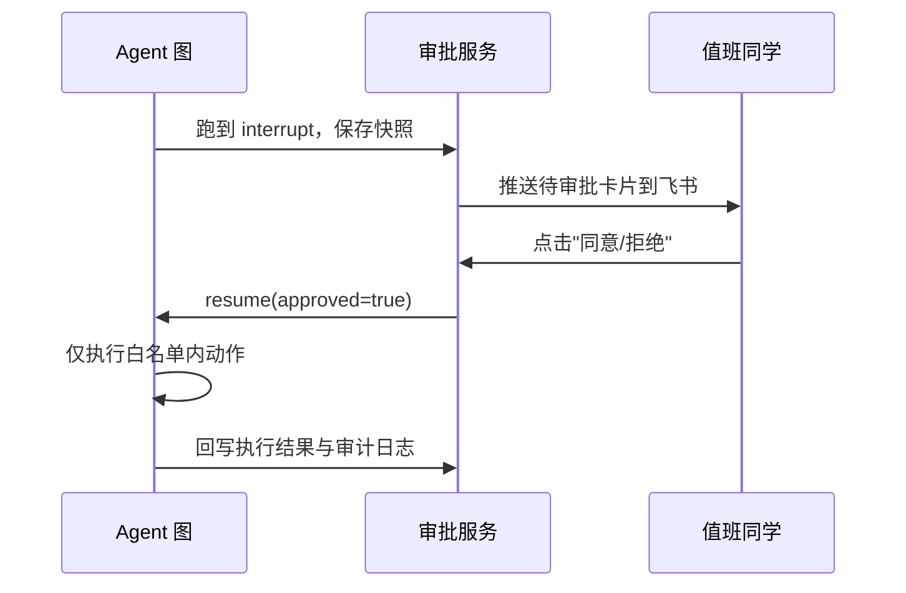

#### 五、常见问题排错

| 现象 | 原因 | 解决 |
|---|---|---|
| Agent 诊断经常"说了等于没说" | Prompt 没要求结论先行 + 缺结构化输出 | 要求"结论放最前，给置信度，给可执行命令"；强制 JSON 输出 |
| 拉了一堆日志还是定位不准 | 日志太多太杂、没先过滤 | 先按级别/时间窗/错误关键字过滤 Top N，再喂 LLM；别整坨塞 |
| 审批后动作执行失败 | 没做权限/预检，直接执行 | 执行前先 dry-run / 预检（目标 pod 存在？在白名单内？），失败即中止并告警 |
| Dify/n8n 里 LLM 节点乱调接口 | 没限定工具白名单 | 只放开本流程需要的工具；写权限工具单独审批 |
| 一条告警触发多次重复诊断 | webhook 没做去重 | 用告警指纹做幂等，同一指纹 N 分钟内只处理一次 |
| LangGraph 服务重启后审批丢了 | 没配持久化 checkpointer | 启用 Sqlite/Postgres checkpointer，中断状态落盘 |

::: warning 生产红线
- **任何写操作不允许无人值守**：Agent 再自信，重启/回滚/改配置也必须人点同意。
- Agent 用的监控/集群账号是**只读账号**；能写的账号只在审批后的执行节点、按白名单临时取用。
- 流程必须有超时与最大步数，防止 Agent 死循环把 Prometheus 打挂。
- 版本写死：`langgraph==1.2.12`、Dify `1.17.1`、n8n 镜像 `2.41.4`，升级先在测试告警上回归。
- 推送机器人 webhook 是密钥，别硬编码进仓库，用环境变量/密钥管理（见[密钥与证书管理](/guide/devops-cicd-advanced#合并资料)）。
:::

#### 相关速查

- 运维 AI Prompt 模板：[运维 AI Prompt 速查](/reference/ai-prompts)
- 云原生排障命令：[云原生命令速查](/reference/cloudnative-commands)
- 监控指标来源：[Prometheus 监控](/services/observability/prometheus/01-理论)
- 日志系统：[ELK 日志栈](/services/observability/elk)
- Agent 接工具的标准方式：[MCP 模型上下文协议](#合并资料)
- 基础概念：[AI Agent 与 LLM 应用基础](./aiops-agent-basics)

##### 官方文档

- LangGraph 文档：https://langchain.com/ 、https://docs.langchain.com/
- LangGraph PyPI：https://pypi.org/project/langgraph/
- Dify 官网与自托管文档：https://dify.ai/ 、https://docs.dify.ai/
- Dify Releases（选 tag）：https://github.com/langgenius/dify/releases
- n8n 文档与 Docker 部署：https://docs.n8n.io/
- n8n Docker 镜像版本：https://hub.docker.com/r/n8nio/n8n

</details>

<details>
<summary><strong>MCP 模型上下文协议 — 讲清楚 MCP（Model Context Protocol）到底解决什么问题、Host/Client/Server 怎么分工，并用官方 Python SDK 从零写一个能跑的运维 MCP Server（查 K8s pod、查 Prometheus 指标），让你的 Agent/Claude Code…</strong></summary>

::: tip 本篇定位
讲清楚 MCP（Model Context Protocol）到底解决什么问题、Host/Client/Server 怎么分工，并用官方 Python SDK 从零写一个能跑的运维 MCP Server（查 K8s pod、查 Prometheus 指标），让你的 Agent/Claude Code/Cursor 用一套标准接口接你内部系统。
本篇版本：MCP 规范 2026-07-28（当前稳定版）、官方 Python SDK `mcp` 2.2.0（要求 Python ≥ 3.10）、官方 TypeScript SDK `@modelcontextprotocol/sdk` 1.30.0。所有版本以官网当前稳定版为准。
:::

#### 一、为什么需要 MCP

##### 1.1 小白类比：M×N 集成灾难 vs USB-C 标准

假设你有 **M 个 AI 客户端**（Claude Desktop、Cursor、你自己写的 LangGraph Agent、IDE 插件……），和 **N 个内部系统**（K8s、Prometheus、MySQL、Git、飞书……）。

没有 MCP 时：每接一个新系统，每个客户端都得单独写一套对接代码。M 个客户端 × N 个系统 = **M×N 套集成**，是个平方级的噩梦。

> 类比：以前每个电器一个充电器，手机一个口、笔记本一个口、相机又一个口，包里一堆线。**USB-C 出来后，大家统一用这个口，一根线通吃。** MCP 就是 AI 世界的"USB-C 标准接口"：每个系统只要实现一次 MCP Server，所有支持 MCP 的客户端都能直接用，变成 **M + N**。

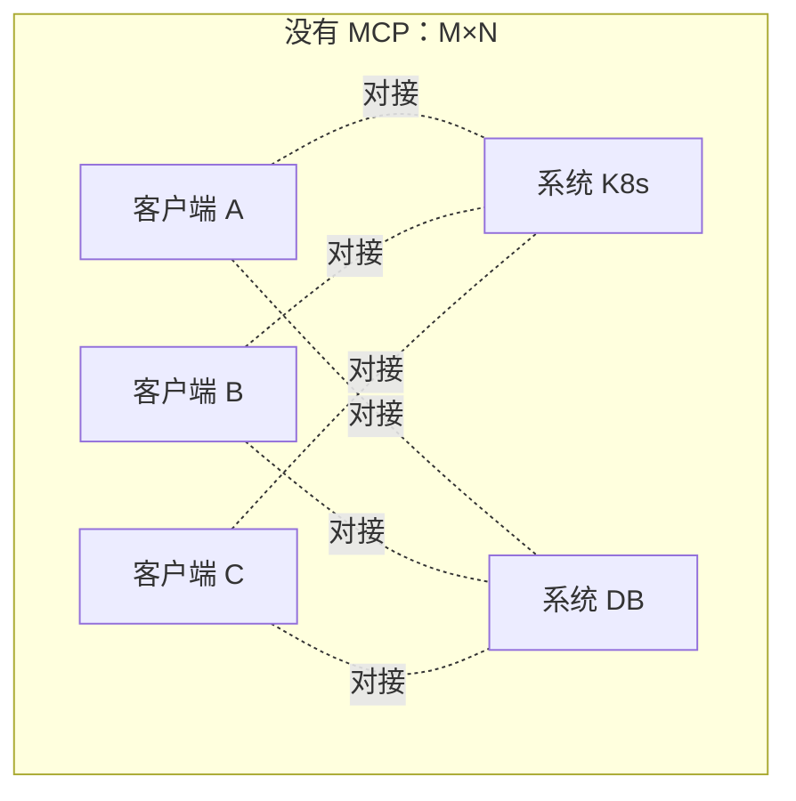

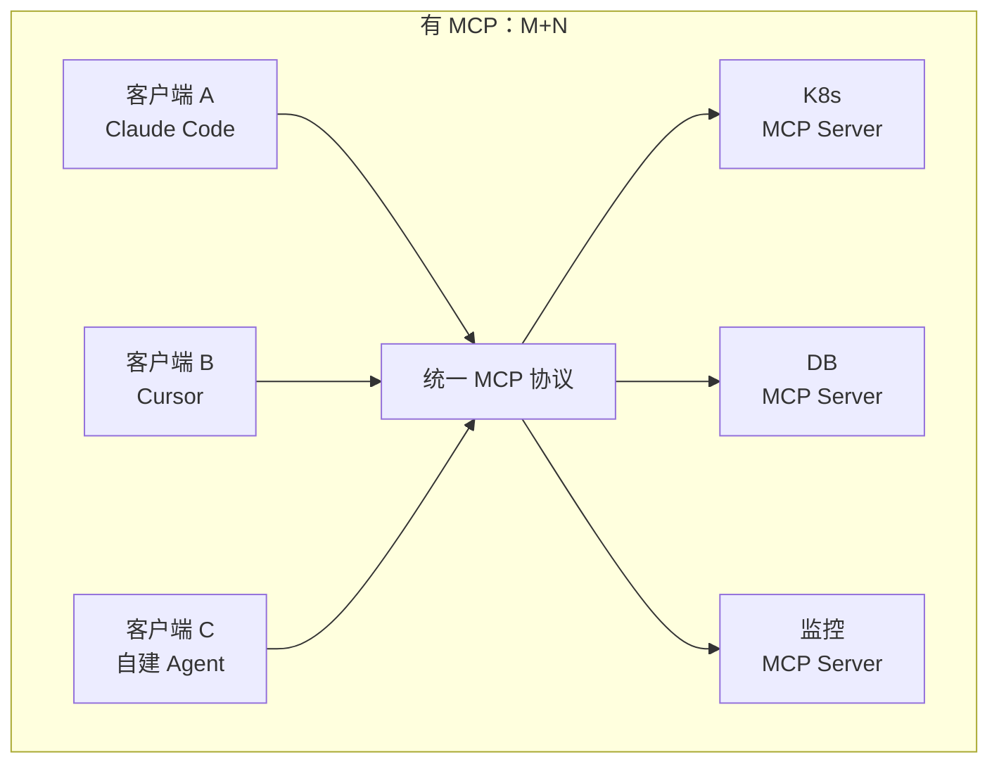

##### 1.2 一句话定义

**MCP 是一个开放协议，规定了"AI 应用（Host）如何用统一的方式去发现并调用外部系统提供的工具、读取其数据、复用其提示词模板"。** 底层走 JSON-RPC。

#### 二、核心概念：Host / Client / Server

| 角色 | 是谁 | 干什么 | 类比 |
|---|---|---|---|
| **Host（宿主）** | 你正在用的 AI 应用：Claude Desktop、Cursor、Claude Code、你写的 LangGraph 程序 | 拥有 LLM、决定何时调用工具 | 电脑/手机 |
| **Client（客户端）** | Host 内部的一个模块 | 负责和某个 MCP Server 握手、按协议收发消息 | 主板上的 USB-C 控制器 |
| **Server（服务端）** | 你写的/别人提供的小进程 | 对外暴露 Tools、Resources、Prompts | U 盘、移动硬盘等外设 |

> 一个 Host 可以挂**多个 Client**，每个 Client 连一个 Server。Host 里的 LLM 看到所有 Server 汇总来的"工具清单"，自己决定调哪个。

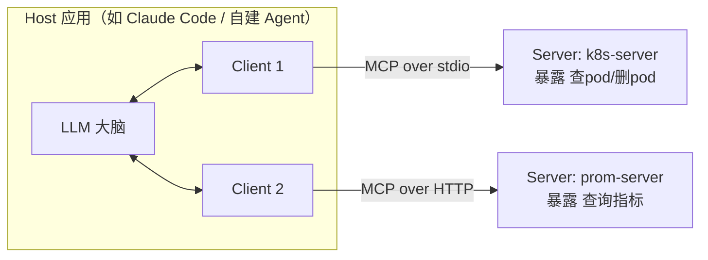

#### 三、传输方式 Transport

MCP 规定了 Client 和 Server 之间怎么通信，两种主流：

| Transport | 怎么跑 | 适用 | 特点 |
|---|---|---|---|
| **stdio** | Server 是个本地子进程，Host 通过它的标准输入/输出收发 JSON-RPC | 本地开发、接本机 CLI 工具（kubectl、数据库） | 最简单，不用开端口，Server 由 Host 拉起 |
| **Streamable HTTP** | Server 跑成一个 HTTP 服务，Host 通过 URL 连 | 团队共享、远端部署、容器化 | 可远程访问、可水平扩展，2026-07-28 规范主推无状态 HTTP 核心 |

> 历史上早期还有个 **SSE（Server-Sent Events）** 单向流式传输，2026-07-28 新规范已用 **Streamable HTTP** 统一取代（无状态核心、可在普通 HTTP 基础设施上扩展），新写 Server 直接上 Streamable HTTP，别再用老 SSE 模式。

#### 四、三大原语（Tools / Resources / Prompts）

MCP Server 对外能提供三类东西，外加两个进阶能力：

| 原语 | 谁来主动用 | 通俗解释 | 运维例子 |
|---|---|---|---|
| **Tools（工具）** | **LLM 自主决定**调用 | 一个"会产生副作用/会算"的函数 | `get_pods(namespace)`、`query_promql(expr)` |
| **Resources（资源）** | 由**用户/应用**指定 | 一段可读的数据/文件，只读 | 某台机器的 `/etc/nginx/nginx.conf`、某个 incident 的记录 |
| **Prompts（提示模板）** | 用户在 Host 里**显式选择** | 预定义好的提示词模板 | "帮我分析这段 nginx 报错日志"一键模板 |

| 进阶能力 | 方向 | 说明 |
|---|---|---|
| **Sampling** | Server → Host 反向 | Server 反过来请求 Host 里的 LLM 帮忙生成内容（少见） |
| **Roots** | Host → Server | Host 告诉 Server"你只能在这些目录/范围内活动"，用于沙箱边界 |

> 记忆法：**Tools 是"手"（LLM 自己会动）、Resources 是"只读资料"、Prompts 是"现成话术"。** 运维 90% 场景先用 Tools。

#### 五、把运维系统接入 Agent 的全景

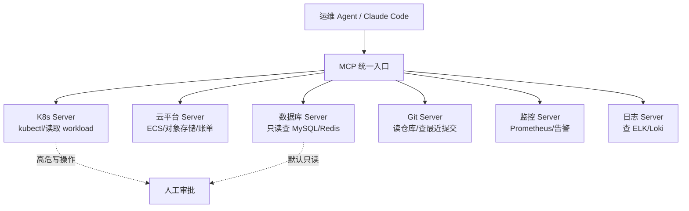

#### 六、常用 MCP Server 盘点

| Server | 提供方 | 能干什么 | 怎么获取 |
|---|---|---|---|
| **官方参考 server 仓库** `modelcontextprotocol/servers` | 官方 | filesystem、git、github、postgres、sqlite、fetch、puppeteer 等一批官方/参考实现 | GitHub 搜 `modelcontextprotocol/servers` |
| K8s / kubectl | 社区 | 查 pod、deployment、日志、events | 社区 `kubernetes-mcp-server` 类项目 |
| Prometheus/Grafana | 社区 | 跑 PromQL、查告警面板 | Grafana 官方与社区均有 |
| 云厂商 | 官方/社区 | 查 ECS、对象存储、账单 | 各家云市场 |
| 数据库 | 官方参考 | postgres/sqlite 的只读查询 | 上述官方 servers 仓库 |

> 官方 server 仓库地址：https://github.com/modelcontextprotocol/servers （里面每个目录是一个独立 server，README 有安装与配置示例）。

#### 七、动手：用官方 SDK 写一个可跑的运维 MCP Server

下面用 **Python SDK `mcp` 2.2.0** 写一个"运维助手 Server"：暴露两个工具——`list_pods`（查 K8s pod）和 `query_prometheus`（查 PromQL）。用 FastMCP 高层 API，几十行就能跑。

##### 7.1 安装

```bash
# 建议建独立虚拟环境
python3 -m venv .venv && source .venv/bin/activate

# 写死版本，2.2.0 对应 2026-07-28 规范
pip install "mcp==2.2.0"
# 可选：下面示例用到的库
pip install "kubernetes==33.1.0" "requests==2.32.3"
```

##### 7.2 完整代码 `ops_server.py`

```python
# ops_server.py —— 一个最小可跑的运维 MCP Server（stdio 传输）
from mcp.server.fastmcp import FastMCP

# 1) 实例化，名字会显示在客户端的 server 列表里
mcp = FastMCP("ops-helper")

# 2) 定义工具：函数 docstring 会被自动当作工具说明喂给 LLM
@mcp.tool()
def list_pods(namespace: str = "default") -> str:
    """列出指定 namespace 下的 Pod 名称与状态。只读操作。

    Args:
        namespace: Kubernetes 命名空间，默认 default
    """
    try:
        from kubernetes import client, config
        try:
            config.load_incluster_config()      # 跑在集群里时用这个
        except Exception:
            config.load_kube_config()           # 本地开发用 ~/.kube/config
        v1 = client.CoreV1Api()
        pods = v1.list_namespaced_pod(namespace)
        lines = [f"{p.metadata.name}\t{p.status.phase}" for p in pods.items]
        return "\n".join(lines) if lines else f"namespace={namespace} 没有 Pod"
    except Exception as e:
        return f"查询失败: {e}"

@mcp.tool()
def query_prometheus(promql: str, prom_url: str = "http://127.0.0.1:9090") -> str:
    """执行一条 PromQL 瞬时查询并返回结果。只读操作。

    Args:
        promql: PromQL 表达式，如 rate(node_cpu_seconds_total[5m])
        prom_url: Prometheus 地址，默认本机 9090
    """
    import requests
    r = requests.get(f"{prom_url}/api/v1/query",
                     params={"query": promql}, timeout=10)
    r.raise_for_status()
    data = r.json()["data"]["result"]
    if not data:
        return "无数据"
    out = []
    for item in data:
        metric = ",".join(f"{k}={v}" for k, v in item["metric"].items())
        out.append(f"{metric} => {item['value'][1]}")
    return "\n".join(out)

# 3) 以 stdio 方式运行（Host 会把它当本地子进程拉起）
if __name__ == "__main__":
    mcp.run(transport="stdio")
```

##### 7.3 先在命令行自测（不接 Host）

```bash
# 启动自带的 MCP Inspector 可视化调试界面，浏览器里点着调工具
mcp dev ops_server.py
# 或直接命令行交互：
mcp run ops_server.py
```

`mcp dev` 会打开一个本地网页（Inspector），左边能看到 `list_pods`、`query_prometheus` 两个工具，填参数点调用，立刻看到返回——**这是调试 MCP Server 最快的方式，别一开始就塞进 Claude Desktop 猜。**

##### 7.4 把它挂到 Host 里（以 Claude Desktop / Claude Code 的配置为例）

在 Host 的 MCP 配置文件里加一段（stdio 方式，告诉 Host 怎么拉起你的 Server）：

```json
{
  "mcpServers": {
    "ops-helper": {
      "command": "/绝对路径/.venv/bin/python",
      "args": ["/绝对路径/ops_server.py"]
    }
  }
}
```

重启 Host，它会自动拉起这个子进程、握手、把两个工具注入给 LLM。之后你在对话里说"看下 default 命名空间有哪些 pod"，LLM 就会自己决定调 `list_pods`。

::: details TypeScript 版本长什么样（对照）
TS SDK `@modelcontextprotocol/sdk` 1.30.0 用 `McpServer` + `registerTool`，思路完全一样：定义工具名、描述、输入 Schema，然后处理 handler。运维同学若团队是 JS/TS 技术栈可直接用，官方模板见 typescript-sdk 仓库 examples。
:::

#### 八、安全边界（生产红线重点）

MCP Server 手里握着你内网的真实系统，**它就是一个能被 LLM 触发的后门**，必须上锁：

| 原则 | 怎么做 |
|---|---|
| **默认只读** | 运维查询类 Server 只暴露 `list_*`、`query_*`，不暴露 `delete`/`apply`/`scale` |
| **最小权限** | 给 Server 的 K8s token、数据库账号按 namespace/库表授权，用只读账号，别用 cluster-admin |
| **输入校验** | Server 内部对 LLM 传来的参数再校一遍（namespace 白名单、PromQL 禁止带 `[for]` 写操作之类），别信任 LLM 的"善意" |
| **高危操作人工审批** | 任何会改状态的工具，执行前必须 human-in-the-loop（见[运维实战](#合并资料)） |
| **全程审计** | 每次工具调用的入参、返回、调用者都记日志，可回放、可追责 |
| **网络收敛** | HTTP 传输的 Server 只监听内网，前面加鉴权（2026-07-28 规范强化了 OAuth/OIDC 授权），别裸露公网 |

#### 九、常见问题排错

| 现象 | 原因 | 解决 |
|---|---|---|
| Host 里看不到我写的工具 | 路径/解释器不对，Server 启动就崩了 | 先用 `mcp dev ops_server.py` 本地跑通；检查配置里 `command` 用绝对路径、venv 里的 python |
| 握手失败 / `Connection closed` | SDK 版本与 Host 期望规范不匹配 | 用 `mcp==2.2.0`；注意 v1.x（`mcp<2`）与 v2 不兼容，老项目临时用 `mcp>=1.28,<2` |
| 工具一直不被调用 | docstring/参数描述写得太笼统，LLM 不知道啥时候用 | 写清工具用途和参数含义，给例子；temperature 调低 |
| stdio 下日志打不出来 | stdio 通道被 JSON-RPC 占用，print 会污染协议 | 日志写到 stderr 或文件，不要往 stdout print |
| HTTP 方式连不上 | 没开端口 / 防火墙 / 路径不对 | 确认用 Streamable HTTP 端点；本机 `curl` 先打通；别再用已废弃的老 SSE 路径 |

::: warning 生产红线
- **永远不要给 MCP Server 生产写权限**：读和写拆成两个 Server，写那个强制走人工审批。
- 版本写死：Python 用 `mcp==2.2.0`，TypeScript 用 `@modelcontextprotocol/sdk@1.30.0`，升级前先在 Inspector 里回归。
- HTTP 传输的 Server 必须加鉴权 + 内网隔离，严禁 `0.0.0.0` 裸奔到公网。
- 每个工具都要有超时和资源上限，防止 LLM 写出一条把 Prometheus 打挂的 PromQL。
- 定期审计工具清单：没人用的 Server 及时下线，缩小攻击面。
:::

#### 相关速查

- 运维 AI Prompt 与工具指令模板：[运维 AI Prompt 速查](/reference/ai-prompts)
- K8s 概念基础：[Kubernetes 集群架构](/services/container/kubernetes/01-理论)
- 监控数据从哪来：[Prometheus 监控](/services/observability/prometheus/01-理论)
- Agent 怎么编排落地：[Agent 运维实战](#合并资料)
- 基础概念补课：[AI Agent 与 LLM 应用基础](./aiops-agent-basics)

##### 官方文档

- MCP 官网与规范：https://modelcontextprotocol.io/
- 2026-07-28 规范发布说明：https://blog.modelcontextprotocol.io/posts/2026-07-28/
- 官方 Python SDK（PyPI）：https://pypi.org/project/mcp/ 、源码 https://github.com/modelcontextprotocol/python-sdk
- 官方 TypeScript SDK（npm）：https://www.npmjs.com/package/@modelcontextprotocol/sdk 、源码 https://github.com/modelcontextprotocol/typescript-sdk
- 官方参考 Server 集合：https://github.com/modelcontextprotocol/servers

</details>

<details>
<summary><strong>传统 AIOps 与机器学习 — 在 LLM 爆火之前，AIOps 早就靠传统机器学习干了十几年活：时序异常检测、告警降噪、日志模板聚类、根因定位。本篇讲清这些方法怎么选、和 LLM Agent 怎么分工，并给一个能直接跑的 Python 时序异常检测小例子。</strong></summary>

::: tip 本篇定位
在 LLM 爆火之前，AIOps 早就靠传统机器学习干了十几年活：时序异常检测、告警降噪、日志模板聚类、根因定位。本篇讲清这些方法怎么选、和 LLM Agent 怎么分工，并给一个能直接跑的 Python 时序异常检测小例子。
本篇版本：Python 3.10+、pandas 2.3.x、scikit-learn 1.5.x、Prophet 1.1.x（可选）。方法本身成熟稳定，不依赖某个快速迭代的框架。
:::

#### 一、背景：AIOps 两条路线

##### 1.1 小白类比：老中医 vs 新博士

- **传统 AIOps（机器学习）**：像一位"老中医"，靠几十年积累的统计/机器学习套路，对**数字信号**（CPU、QPS、延迟）做检测——规则明确、可解释、7×24 稳定跑，但它**看不懂人话**（日志、告警文本、Runbook）。
- **LLM Agent**：像一位"会读文档、会思考的新博士"，擅长读日志文本、做归因推理、生成报告，但**算统计阈值、做高频实时检测不是它的强项**（又慢又贵）。

> 结论：**两者不是替代，是搭档。** 老中医负责"发现异常"（实时、便宜、可靠），新博士负责"解释异常、给出处理建议"（读日志、查文档、写报告）。

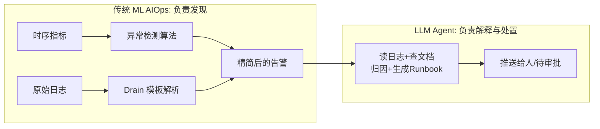

#### 二、指标时序异常检测

##### 2.1 先理解：监控指标长什么样

运维指标（CPU、QPS、延迟）大多有规律：**白天高、夜里低、周末更低**，这叫"季节性"。拿昨天的值今天比，周末比工作日，阈值怎么定都不对——这就是为什么需要专门的异常检测方法。

| 方法 | 原理（通俗） | 适合 | 优点 | 缺点 |
|---|---|---|---|---|
| **3-sigma（Z-score）** | 正常数据集中在均值±3倍标准差内，超出就是异常 | 平稳、无明显周期的指标 | 最简单 | 不懂季节性，误报多 |
| **EWMA 滑动平均** | 越近的数据权重越大，用平滑曲线包上下界 | 缓慢变化的趋势指标 | 简单、实时 | 突变检测一般 |
| **同比/环比基线** | 跟上周同一时刻、昨天同一时刻比 | 有明显日/周周期的业务指标 | 贴合业务 | 需要历史基线 |
| **Prophet** | Facebook 的时序分解工具，自动拆出趋势+季节性+节假日 | 强季节性、有节假日效应 | 省心、自动建模 | 较重，非实时流处理 |
| **孤立森林 Isolation Forest** | 无监督，随机切分空间，越容易被孤立的点越异常 | 多指标联合、高维、不知道长啥样 | 多变量、无需标注 | 可解释性弱 |

##### 2.2 选型速查

| 你的指标 | 推荐 |
|---|---|
| CPU/内存这种相对平稳的机器指标 | 3-sigma + EWMA 足够 |
| QPS/订单量这种强周期业务指标 | 同比环比基线，或 Prophet |
| 想多指标一起看、没有标注数据 | 孤立森林 |
| 实时流、低延迟 | 滑动窗口 + EWMA/3-sigma，别用 Prophet |

#### 三、告警降噪 / 聚合 / 关联

##### 3.1 小白类比：告警风暴就是"群里刷屏"

一个核心节点挂了，可能瞬间炸出几百条告警（每个下游都在喊）。人一晚上被刷屏，真正重要的反而漏了。**降噪就是把这几百条收敛成几条"值得看的"。**

| 技术 | 怎么做 | 类比 |
|---|---|---|
| **去重收敛** | 相同指纹（告警名+指标）在时间窗内只保留第一条 | 同一个人在群里重复发，折叠 |
| **时间窗聚合** | 把 N 分钟内同服务的告警合并成一条 | 把连续几条刷屏打包成一条摘要 |
| **拓扑关联** | 根据依赖拓扑，"上游 DB 挂了"派生出"下游接口超时"，只留根那条 | 找到最先倒下的那个多米诺骨牌 |
| **抑制** | 已经有更高级别告警在处理，抑制掉它派生出的低级别告警 | 大事已在处理，小事别再刷屏 |

#### 四、日志异常检测

##### 4.1 Drain：把半结构化日志变成模板

原始日志成千上万行，大部分是"模板 + 会变的数字/ID"。比如：

```text
connection to 10.0.0.5:5432 timed out
connection to 10.0.0.9:5432 timed out
connection to 10.0.0.2:5432 timed out
```

**Drain 算法**自动归纳成模板：`connection to <IP>:5432 timed out`，把变化部分当通配符。于是几万行日志能聚成几十种"事件类型"，哪种类型突然暴增，就是异常。

| 阶段 | 做什么 |
|---|---|
| 解析 | Drain 把日志归成模板 + 参数（IP、traceId 等抽出来） |
| 统计 | 统计每个模板在时间窗内的出现次数 |
| 检测 | 某模板计数突然远超历史基线 → 异常 |

> 这正好是 LLM 的上游：Drain 先把几万行日志压成"今天突然冒出 142 条 `connection refused` 模板"，LLM 再拿这个精炼结论去做归因，而不是直接吞几万行原始日志。

#### 五、根因定位

光知道"CPU 高了"不够，要定位到"谁引起的"。两条主线：

| 方法 | 思路 |
|---|---|
| **调用链关联（Trace）** | 异常请求在哪个 span 耗时最长/报错，顺着分布式追踪图往上找入口 |
| **变更/部署关联** | 告警时间点附近有没有发版、改配置、扩容——统计"变更后 N 分钟内出问题"的概率 |

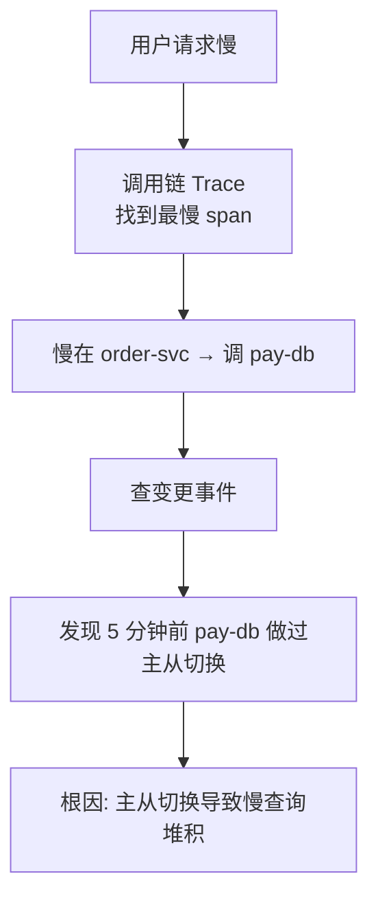

#### 六、常用开源工具 / 平台

| 工具 | 干什么 | 备注 |
|---|---|---|
| **Prometheus + Alertmanager** | 指标采集 + 规则告警 + 基础降噪 | 见[Prometheus 监控](/services/observability/prometheus/01-理论) |
| **ELK / Loki** | 日志存储与查询 | 见[ELK 日志栈](/services/observability/elk) |
| **Drain3 / 各类 logparser** | 日志模板解析 | 纯 Python 库 |
| **单链路/可观测平台** | 调用链追踪 | 见后续 OpenTelemetry 相关文章 |
| 自建 Python 脚本 | 时序异常检测小实验 | 下面就给例子 |

> 个人/小团队别一上来就上重型 AIOps 平台。**先把 Prometheus 告警规则写好、Alertmanager 降噪配好，不够再加统计检测。**

#### 七、可跑的 Python 时序异常检测小例子

下面生成一段"带日周期 + 人为注入异常"的模拟指标，用 **3-sigma** 和 **EWMA** 两种方法判异常，零外部依赖即可跑。

```python
# ts_anomaly_demo.py —— 时序异常检测最小可跑示例
import numpy as np
import pandas as pd

# 1) 造数据：24*7 个点（每 5 分钟一个点，约一周），带"白天高夜里低"的日周期
np.random.seed(42)
n = 24 * 7
t = np.arange(n)
diurnal = 50 + 30 * np.sin(2 * np.pi * (t % 24) / 24)   # 日周期基线
noise = np.random.normal(0, 3, n)                        # 随机波动
series = diurnal + noise

# 人为注入两处异常：第 100 点飙高、第 120 点骤降
series[100] += 60
series[120] -= 50

df = pd.DataFrame({"value": series})

# 2) 方法一：3-sigma（在滑动窗口里算均值/标准差）
window = 48
df["roll_mean"] = df["value"].rolling(window).mean()
df["roll_std"] = df["value"].rolling(window).std()
df["z_score"] = (df["value"] - df["roll_mean"]) / df["roll_std"]
df["anom_3sigma"] = df["z_score"].abs() > 3   # 超出 ±3σ 判异常

# 3) 方法二：EWMA 上下控制带（指数滑动平均）
ewma = df["value"].ewm(span=20).mean()
ewma_std = df["value"].rolling(20).std()
df["anom_ewma"] = (df["value"] - ewma).abs() > 3 * ewma_std

# 4) 输出异常点
print("=== 3-sigma 检测到的异常点 ===")
print(df.index[df["anom_3sigma"]].tolist())
print("=== EWMA 检测到的异常点 ===")
print(df.index[df["anom_ewma"]].tolist())
```

跑一下：

```bash
pip install "pandas==2.3.1" "numpy==2.1.3"
python ts_anomaly_demo.py
# === 3-sigma 检测到的异常点 ===
# [100, 120]
# === EWMA 检测到的异常点 ===
# [100, 120]
```

两种方法都准确抓到了我们注入的第 100、120 号异常点。生产上把 `series` 换成"从 Prometheus `/api/v1/query_range` 拉回来的真实指标"即可。

::: details 想加孤立森林 / Prophet
- 孤立森林做多变量：`from sklearn.ensemble import IsolationForest`，把多列指标拼成 DataFrame 喂 `IsolationForest(contamination=0.01).fit_predict(X)`，返回 -1 即异常。
- Prophet 做强周期：`pip install prophet==1.1.6`，`from prophet import Prophet`，要求列名 `ds`/`y`，自动给出趋势+季节性和置信区间外的点。两者都不适合高频实时流。
:::

#### 八、传统 ML 与 LLM Agent 的分工总结

| 环节 | 谁来干 | 为什么 |
|---|---|---|
| 实时发现指标异常 | 传统 ML（3-sigma/EWMA/孤立森林） | 便宜、快、稳、可解释 |
| 告警去重/收敛/关联 | Alertmanager + 拓扑规则 | 工程成熟，不该让 LLM 每次重算 |
| 日志模板压缩 | Drain 等传统解析 | 确定性、低成本 |
| 读懂日志、做归因推理、写结论 | LLM Agent | 理解自然语言、会查文档 |
| 生成排查脚本/Runbook | LLM Agent | 生成式强项 |
| 执行恢复动作 | 传统自动化 + 人审批 | 确定性 + 安全 |

> 一句话：**传统 ML 负责"眼睛和耳朵"（发现），LLM Agent 负责"大脑和嘴"（理解、建议、报告），人负责"最后拍板"。**

#### 九、常见问题排错

| 现象 | 原因 | 解决 |
|---|---|---|
| 误报满天飞 | 阈值写死、没考虑周期性 | 用同比环比/EWMA 动态阈值，别用固定数字 |
| 漏报 | 窗口太长、阈值太松 | 缩短检测窗口，结合多指标联合判断 |
| 告警风暴 | 没做聚合/抑制 | 配 Alertmanager group_by、抑制规则、拓扑关联 |
| Drain 把不同日志归成一类/一类拆成多类 | 相似度参数没调 | 调整 Drain 的相似度深度/阈值 |
| 孤立森林结果忽好忽坏 | contamination 设得不对 | 先按历史异常占比（如 1%）设 `contamination` |

::: warning 生产红线
- 告警是 SRE 的生命线，**异常检测误报比漏报更伤人**：宁可先松一点观察，再逐步收紧阈值。
- 任何自动"发现异常"到"自动处置"之间，必须留人工确认环节，别一检测到异常就自动重启/回滚。
- 检测脚本/规则要版本管理，阈值变更要灰度观察，别在生产环境随手改。
- 时序检测用的统计窗口要覆盖完整周期（日/周），否则周末/夜里一定误报。
:::

#### 相关速查

- 运维 AI Prompt 模板：[运维 AI Prompt 速查](/reference/ai-prompts)
- 指标从哪来：[Prometheus 监控](/services/observability/prometheus/01-理论)
- 日志系统：[ELK 日志栈](/services/observability/elk)
- Agent 怎么接住这些告警做解释：[Agent 运维实战](#合并资料)
- 基础概念：[AI Agent 与 LLM 应用基础](./aiops-agent-basics)

##### 官方文档

- pandas 文档：https://pandas.pydata.org/docs/
- scikit-learn 孤立森林：https://scikit-learn.org/stable/modules/generated/sklearn.ensemble.IsolationForest.html
- Prophet（Facebook）：https://facebook.github.io/prophet/
- Drain 日志解析：https://github.com/logpai/logparser
- Prometheus Alertmanager 告警管理：https://prometheus.io/docs/alerting/latest/alertmanager/

</details>

<details>
<summary><strong>运维知识库与 RAG — 解决&#x27;大模型不知道你家私有文档、还一本正经瞎编&#x27;的问题：用 RAG（检索增强生成）把你的 VitePress 知识库、Runbook、故障记录先检索出来再喂给模型，让它有据可依地回答。含把本仓库 docs//*.md 全量入库、问答的完整可跑代码。</strong></summary>

::: tip 本篇定位
解决"大模型不知道你家私有文档、还一本正经瞎编"的问题：用 RAG（检索增强生成）把你的 VitePress 知识库、Runbook、故障记录先检索出来再喂给模型，让它**有据可依地回答**。含把本仓库 `docs/**/*.md` 全量入库、问答的完整可跑代码。
本篇版本：Chroma `chromadb` 1.5.9、Milvus 2.6.21（生产稳定，3.0.0 已 GA）、Qdrant 1.18.0、pgvector 0.8.2、Embedding 模型 BAAI/bge-m3 与 bge-large-zh-v1.5。所有版本以官网当前稳定版为准。
:::

#### 一、为什么需要 RAG

##### 1.1 小白类比：开卷考试 vs 闭卷瞎编

直接问大模型"我们公司 K8s 生产环境的 Pod 安全策略是什么"，它不知道你公司的内部文档，就会**闭卷瞎编一个看起来很合理的答案**——这就是"幻觉"。

**RAG = 开卷考试**：考试前，先把相关的那几页资料翻出来摆在桌上，让它**看着资料作答**，并且能告诉你"我是根据第几页说的"。

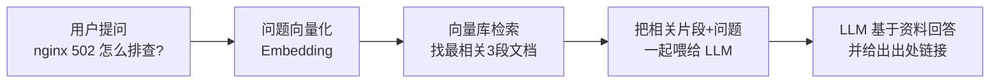

##### 1.2 三个非 RAG 不可的理由

| 痛点 | RAG 怎么解 |
|---|---|
| 幻觉（模型编造） | 答案必须基于检索到的真实文档，模型只做"组织语言" |
| 私有知识（内部 Runbook/拓扑/配置） | 这些没进公开模型训练，只能靠检索喂进去 |
| 知识过时 | 模型训练有截止日期；RAG 直接读你最新的文档文件，随时可更新 |

#### 二、文档加载与切分

##### 2.1 为什么要切分

整篇文档几百 KB，既塞不进上下文，向量检索也分不清"哪段相关"。所以要把文档**切成小块（chunk）**，每块单独向量化。

##### 2.2 chunk 大小与 overlap 经验值

| 参数 | 经验值 | 说明 |
|---|---|---|
| chunk_size（每块多少 token） | **中文 300~800 token** | 太小：上下文不完整；太大：检索不精准、浪费窗口 |
| chunk_overlap（相邻块重叠） | **chunk_size 的 10%~20%** | 避免一句话从中间被切断，导致两边都不完整 |
| 切分边界 | 尽量按标题/段落/代码块切 | 别在一个命令中间硬切 |

> 类比：切西瓜。块太大，一口啃不动（检索不精准）；块太小，没味（上下文不全）。留 overlap 是为了"接缝处也有完整内容"。

#### 三、Embedding 与向量库

##### 3.1 Embedding 是什么

**Embedding 模型把一段文字变成一串数字（向量）**，语义相近的句子向量距离也近。这样"nginx 502 怎么办"和"502 Bad Gateway 排查"虽然字面不同，向量却很接近——这就是语义检索的原理。

| Embedding 模型 | 维度 | 最大长度 | 语言 | 说明 |
|---|---|---|---|---|
| **BAAI/bge-m3** | 1024 | 8192 token | 多语言（中英都强） | 推荐主力，568M 参数，支持稠密+稀疏+多向量 |
| **BAAI/bge-large-zh-v1.5** | 1024 | 512 token | 中文 | 纯中文场景经典稳 |
| BAAI/bge-large-en-v1.5 | 1024 | 512 token | 英文 | 英文文档用 |

##### 3.2 向量库选型对比

| 对比 | Chroma | Qdrant | Milvus | pgvector |
|---|---|---|---|---|
| 定位 | 上手最快、嵌入式 | 生产级、Rust、过滤强 | 大规模、分布式 | 直接在 PostgreSQL 里加向量列 |
| 部署 | `pip install` 即用 | Docker / 单机集群 | 较重，分布式 | 现有 PG 里 `CREATE EXTENSION` |
| 适合规模 | 原型、个人、<百万 | 中小到生产、千万级 | 海量、亿级 | 已有 PG、量不大、想省一个组件 |
| 过滤/元数据 | 基础 | 强（payload 过滤） | 强 | 借 SQL 过滤，灵活 |
| 推荐版本 | chromadb 1.5.9 | 1.18.0 | 2.6.21（3.0.0 GA） | pgvector 0.8.2 |

> 个人知识库/本网站：**Chroma 起步最省事**；想上生产、要过滤和高可用：**Qdrant**；已经重度用 PostgreSQL、不想多维护一个数据库：**pgvector**。

#### 四、检索策略

| 策略 | 怎么工作 | 优缺点 |
|---|---|---|
| 纯向量检索 | 语义相似度找 top-k | 语义好，但**精确名词（指标名、报错码、命令）容易漏** |
| 纯关键词（BM25） | 传统倒排，按词频 | 精确匹配强，但不懂"意思相近" |
| **混合检索（Hybrid）** | 向量 + BM25 结果融合（RRF 排序） | 推荐：既懂语义又认精确名词 |
| **重排 Rerank** | 检索出 top-20，再用 rerank 模型精排取 top-3 | 显著提升相关性，BGE 自带 `bge-reranker` |

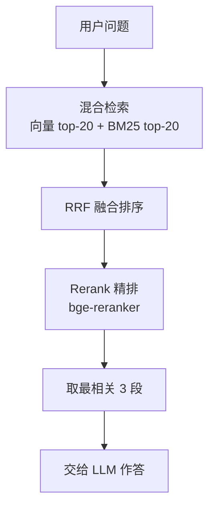

#### 五、实战：把本 VitePress 知识库接入 LLM

目标：读取本仓库 `docs/guide/**/*.md`、`docs/reference/**/*.md`，切分 → BGE 向量化 → 存进 Chroma → 问它问题能命中本站文章。

##### 5.1 安装依赖（版本写死）

```bash
python3 -m venv .venv && source .venv/bin/activate
pip install "chromadb==1.5.9"
pip install "sentence-transformers==5.1.0"
pip install "openai==1.68.2"   # 用来调你本地的 Ollama/vLLM
```

##### 5.2 建库脚本 `build_kb.py`

```python
# build_kb.py —— 扫描 docs 目录，切分、向量化、写入 Chroma
import glob, os, re
import chromadb
from sentence_transformers import SentenceTransformer

DOCS_ROOT = "/home/user/Doubao/chats/38440928658888706/static-blog/docs"
COLLECTION = "ops_kb"

# 1) 加载本地 Embedding 模型（BGE-M3，首次会自动下载约 2.2GB）
embedder = SentenceTransformer("BAAI/bge-m3")

def split_text(text, chunk_tokens=500, overlap=80):
    """极简按字符切分（中文约1.5字/token 的粗算），带重叠。生产可换 LangChain 文本切分器。"""
    text = re.sub(r"\n{3,}", "\n\n", text)
    step = int(chunk_tokens * 1.5)
    ov = int(overlap * 1.5)
    chunks = []
    for i in range(0, len(text), step - ov):
        piece = text[i:i + step]
        if piece.strip():
            chunks.append(piece)
    return chunks

# 2) 连接 Chroma（本地持久化到 ./chroma_db）
client = chromadb.PersistentClient(path="./chroma_db")
# 重建前先删旧集合，保证和文档同步
try:
    client.delete_collection(COLLECTION)
except Exception:
    pass
col = client.create_collection(COLLECTION, metadata={"hnsw:space": "cosine"})

# 3) 扫描所有 md 文件，切分、入库
files = glob.glob(os.path.join(DOCS_ROOT, "**", "*.md"), recursive=True)
ids, docs, metas = [], [], []
for fpath in files:
    rel = os.path.relpath(fpath, DOCS_ROOT)
    with open(fpath, encoding="utf-8") as f:
        content = f.read()
    for idx, chunk in enumerate(split_text(content)):
        ids.append(f"{rel}#{idx}")
        docs.append(chunk)
        metas.append({"source": rel, "chunk": idx})

# 4) 批量向量化（embeddings 自己算，直接 add 文本让 Chroma 存也行；这里显式算）
emb = embedder.encode(docs, normalize_embeddings=True).tolist()
col.add(ids=ids, documents=docs, embeddings=emb, metadatas=metas)
print(f"入库完成：{len(files)} 个文件，{len(docs)} 个 chunk")
```

跑一下：

```bash
python build_kb.py
# 入库完成：87 个文件，1234 个 chunk
```

##### 5.3 问答脚本 `ask.py`

```python
# ask.py —— 检索知识库 + 调本地 LLM 生成带出处的回答
import chromadb
from sentence_transformers import SentenceTransformer
from openai import OpenAI

embedder = SentenceTransformer("BAAI/bge-m3")
client = chromadb.PersistentClient(path="./chroma_db")
col = client.get_collection("ops_kb")

# 接本地 Ollama（OpenAI 兼容接口，见《大模型部署》）
llm = OpenAI(base_url="http://127.0.0.1:11434/v1", api_key="ollama")

def ask(question: str, k: int = 3):
    q_emb = embedder.encode([question], normalize_embeddings=True).tolist()
    res = col.query(query_embeddings=q_emb, n_results=k)
    ctx = "\n\n---\n".join(
        f"[来自 {m['source']}]\n{d}"
        for d, m in zip(res["documents"][0], res["metadatas"][0])
    )
    prompt = f"""你是运维知识库助手。只根据下面提供的资料回答，资料里没有就说"知识库中未找到"，不要编造。

参考资料：
{ctx}

用户问题：{question}
"""
    resp = llm.chat.completions.create(
        model="qwen3:8b",
        messages=[{"role": "user", "content": prompt}],
        temperature=0.2,
    )
    print(resp.choices[0].message.content)
    print("\n引用来源：", [m["source"] for m in res["metadatas"][0]])

if __name__ == "__main__":
    ask("K8s 里 pod 一直处于 CrashLoopBackOff 一般怎么排查？")
```

```bash
python ask.py
```

#### 六、本地 / 私有化方案

不想把内网文档发到公网 API？全栈本地：

| 组件 | 本地方案 | 命令 |
|---|---|---|
| Embedding | Ollama 拉本地 embedding 模型，或 sentence-transformers 跑 bge-m3 | `ollama pull bge-m3` |
| 向量库 | Chroma 本地持久化（上面就是） | 无需额外服务 |
| LLM | Ollama 跑 Qwen3，OpenAI 兼容接口 | `ollama pull qwen3:8b` |

```bash
# 一键把整条链路跑在本机，数据不出内网
ollama pull bge-m3 && ollama pull qwen3:8b
ollama serve        # 默认 127.0.0.1:11434，提供 /v1/embeddings 和 /v1/chat/completions
python build_kb.py  # 建库（把 embedder 换成调 Ollama embeddings 接口即可）
python ask.py
```

#### 七、效果评估与常见坑

| 坑 | 现象 | 解法 |
|---|---|---|
| chunk 切太大/太小 | 检索不相关或上下文不全 | 中文 300~800 token，overlap 10~20%，按标题/代码块边界切 |
| 只做向量检索 | 查指标名、报错码查不到 | 上混合检索（向量+BM25） |
| 没做 rerank | top-k 里混着不相关内容 | 加 bge-reranker 精排 |
| 文档更新了库没更新 | 问到旧答案 | 重新跑 `build_kb.py`（本示例先删集合再全量重建） |
| Embedding 和查询用了不同模型 | 向量对不上，检索全乱 | 入库和查询必须用**同一个** embedding 模型 |
| 喂太多无关片段 | LLM 被噪声带偏 | top-k 别贪多（3~5 段），加 rerank |

#### 八、常见问题排错

| 现象 | 原因 | 解决 |
|---|---|---|
| `ConnectionError` 连不上 embedding 模型 | 模型没下下来/没网 | 国内设 `export HF_ENDPOINT=https://hf-mirror.com` 再下载 |
| Chroma 报维度不匹配 | 换了 embedding 模型但库是旧向量 | 删掉 `./chroma_db` 用新模型重建 |
| 回答还是瞎编 | 没在 Prompt 里强约束"只根据资料" | Prompt 加"资料没有就说没找到，禁止编造" |
| 检索结果全是无关页面 | chunk 太大 / 元数据没带上 | 调小 chunk；打印检索文档人工看一眼相关性 |
| 首次加载 bge-m3 很慢 | 在下载 2.2GB 模型 | 耐心等，或用更小的 bge-base-zh-v1.5 |

::: warning 生产红线
- 向量库和 LLM 服务不要裸露公网：知识库可能含内网拓扑、IP、敏感配置。
- 版本写死：`chromadb==1.5.9`、embedding 模型锁定具体版本，升级 embedding 模型必须**全量重建向量库**。
- 入库前过滤敏感信息：密钥、密码、内网地址不该被 embedding 后随便检索出来。
- 私有化场景优先本地模型（Ollama），别把内网文档发到公网大模型 API。
:::

#### 相关速查

- 运维 AI Prompt 模板：[运维 AI Prompt 速查](/reference/ai-prompts)
- 本地模型怎么跑：[大模型部署](/guide/container#合并资料)
- 向量/可观测命令：[云原生命令速查](/reference/cloudnative-commands)
- RAG 在 Agent 里怎么用：[Agent 运维实战](#合并资料)
- 基础概念：[AI Agent 与 LLM 应用基础](./aiops-agent-basics)

##### 官方文档

- Chroma 官网与文档：https://www.trychroma.com/ 、PyPI https://pypi.org/project/chromadb/
- Milvus 官网与发布说明：https://milvus.io/docs/release_notes.md
- Qdrant 官网：https://qdrant.tech/
- pgvector 仓库：https://github.com/pgvector/pgvector
- BGE 模型（BAAI）：https://huggingface.co/BAAI/bge-m3 、https://huggingface.co/BAAI/bge-large-zh-v1.5（均需科学上网）；国内平替：https://hf-mirror.com/BAAI/bge-m3 、https://hf-mirror.com/BAAI/bge-large-zh-v1.5
- Ollama embeddings：https://ollama.com/blog/embedding-models

</details>

<!-- merged-guide-material:end -->
