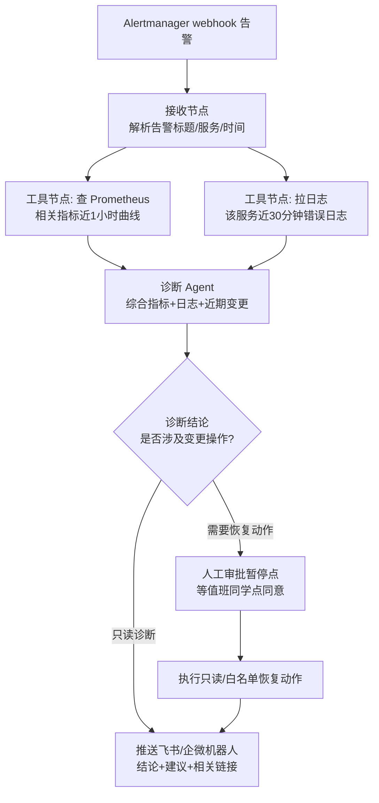
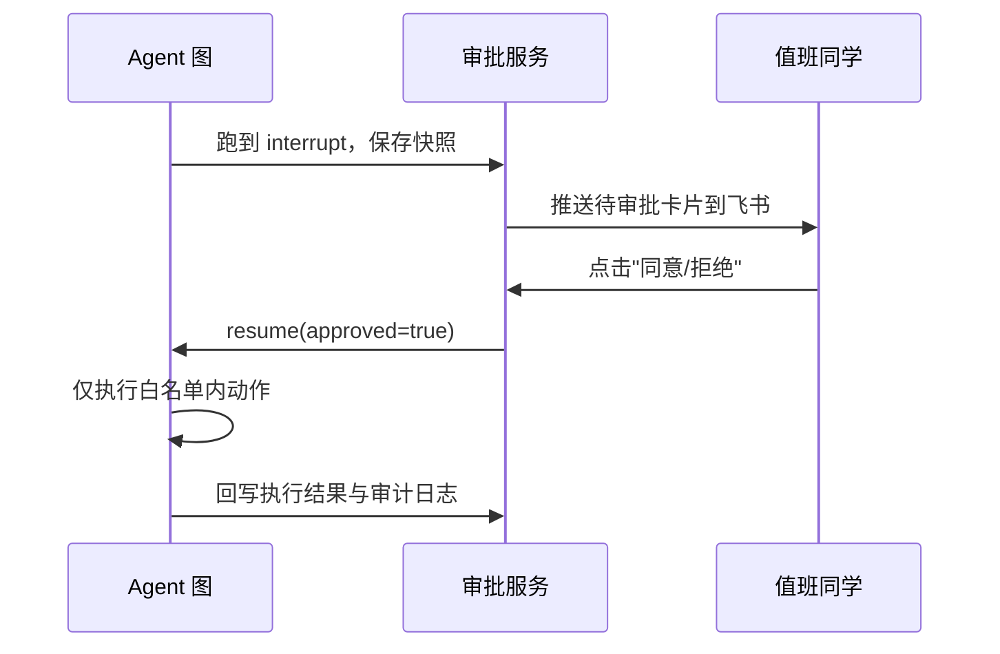

# Agent 运维实战

::: tip 本篇定位
把前面的 LLM 基础、MCP 真正落到值班场景：告警进来后 Agent 怎么自动拉日志和监控指标、给出归因结论、推送机器人；以及最关键的——哪些事能自动做、哪些必须人来拍板。给一个 LangGraph 端到端可跑骨架 + Dify/n8n 拖拽落地思路。
本篇版本：LangGraph 1.2.12、Dify v1.17.1（自托管 Docker Compose）、n8n 2.41.4。所有版本以官网当前稳定版为准。
:::

## 一、运维里 Agent 能干什么

### 1.1 小白类比：Agent 是你的"值班实习生 + 值班群"

深夜告警一响，人要做一串重复动作：登 Grafana 看曲线 → 拉最近日志 → 查最近有没有发版 → 对着 Runbook 猜原因 → 把结论贴群里。**Agent 实战，就是把这套"值班肌肉记忆"自动化成一条流水线**，人只在最后拍板。

| 场景 | Agent 具体做什么 | 自动化程度 |
|---|---|---|
| 日志分析 | 拉最近 N 分钟错误日志，归类报错类型、统计 Top 错误 | 全自动（只读） |
| 告警归因 | 结合指标 + 日志 + 近期变更，给出"最可能原因 + 置信度" | 全自动出结论，人看 |
| 故障诊断 | 按诊断树一步步查：先看指标是否异常 → 再看日志 → 再查变更 | 自动排查，结论人审 |
| 生成脚本/Runbook | 根据现象输出排查命令、生成临时恢复脚本 | 人 review 后执行 |
| 变更/恢复操作 | 重启 pod、扩容、回滚 | **半自动：必须人工审批** |

## 二、端到端示例：告警自动诊断并推群

### 2.1 整体编排



### 2.2 用 LangGraph 写这个流程（Python 骨架）

LangGraph 把流程画成"状态图"：节点是一步动作，边是流转，中间可以**中断等人审批**（`interrupt`）。下面是可跑骨架（依赖：`langgraph==1.2.12`、`langchain-openai==...`，接你自己的 OpenAI 兼容端点，比如自建 vLLM/Ollama）。

```python
# alert_diag_graph.py —— 告警自动诊断 LangGraph 骨架
from typing import TypedDict, Literal
from langgraph.graph import StateGraph, START, END
from langgraph.types import interrupt, Command

class OpsState(TypedDict):
    alert: dict          # 告警内容
    metrics: str         # 查到的指标
    logs: str            # 拉到的日志
    diagnosis: str       # 诊断结论
    need_action: bool    # 是否需要执行变更动作

def fetch_metrics(state: OpsState) -> dict:
    """查 Prometheus：这里替换成真实 PromQL 查询（可走 MCP server）。"""
    svc = state["alert"].get("labels", {}).get("service", "unknown")
    return {"metrics": f"[示例] service={svc} 错误率近30min 从0.1%升至8%，P99延迟翻倍"}

def fetch_logs(state: OpsState) -> dict:
    """拉日志：替换成对 Loki/ELK 的查询。"""
    return {"logs": "[示例] 近30min 出现 142 次 'connection refused' 到 upstream pay-svc"}

def diagnose(state: OpsState) -> dict:
    """调 LLM 综合诊断（这里用占位逻辑示意，真实接 ChatModel）。"""
    conclusion = (
        f"现象：{state['metrics']}；日志：{state['logs']}。\n"
        "初步判断：pay-svc 连接被拒，疑似下游支付服务不可用。置信度：中。"
    )
    return {"diagnosis": conclusion, "need_action": True}

def human_review(state: OpsState) -> Command:
    """高危动作前中断，等人在外部系统点同意/拒绝。"""
    decision = interrupt({
        "question": "是否允许对 pay-svc 执行只读检查 + 重启异常 pod？",
        "diagnosis": state["diagnosis"],
    })
    if decision.get("approved"):
        return Command(goto="execute_action", update={"need_action": True})
    return Command(goto="notify", update={"need_action": False})

def execute_action(state: OpsState) -> dict:
    """通过审批后才执行，且只做白名单内的动作（如重启指定 deployment）。"""
    return {"diagnosis": state["diagnosis"] + "\n[已执行] 重启 pay-svc 异常 pod（已审批）"}

def notify(state: OpsState) -> dict:
    """推送到飞书/企业微信机器人。"""
    print("=== 推送群消息 ===")
    print(state["diagnosis"])
    return {}

# 组装图
gb = StateGraph(OpsState)
gb.add_node("metrics", fetch_metrics)
gb.add_node("logs", fetch_logs)
gb.add_node("diag", diagnose)
gb.add_node("review", human_review)
gb.add_node("action", execute_action)
gb.add_node("notify", notify)

gb.add_edge(START, "metrics")
gb.add_edge("metrics", "logs")
gb.add_edge("logs", "diag")
gb.add_conditional_edges("diag",
    lambda s: "review" if s["need_action"] else "notify")
gb.add_edge("review", "action")   # human_review 内部用 Command 控制
gb.add_edge("action", "notify")
gb.add_edge("notify", END)

graph = gb.compile()
```

### 2.3 推送飞书/企业微信机器人

诊断结论推群，用机器人 webhook 就行（飞书自定义机器人/企业微信群机器人都支持 POST JSON）：

```bash
# 飞书自定义机器人 webhook（签名/关键词校验按你机器人安全设置来）
curl -X POST "https://open.feishu.cn/open-apis/bot/v2/hook/你的hook地址" \
  -H "Content-Type: application/json" \
  -d '{
    "msg_type": "text",
    "content": {"text": "【AI 告警诊断】pay-svc 错误率飙升\n初步判断：下游支付服务不可用，置信度中\n建议：查看 pay-svc 依赖的支付网关，已发起重启待审批"}
  }'
```

## 三、不想写代码：用 Dify / n8n 拖拽落地

写代码灵活但慢，团队想快速搭，用现成平台：

| 平台 | 定位 | 在本场景怎么用 |
|---|---|---|
| **Dify v1.17.1** | 可视化 LLM 工作流 + RAG + Agent，自带模型管理和知识库 | 拖拽画"开始节点→HTTP 请求(查Prom)→LLM节点(诊断)→HTTP请求(推飞书)"，LLM 节点里贴你写好的诊断 Prompt |
| **n8n 2.41.4** | 通用工作流自动化（比 Dify 更偏"系统集成"） | Webhook 节点收告警 → HTTP 节点查监控 → OpenAI/Agent 节点做诊断 → 飞书节点推消息；擅长接一堆第三方系统 |

> 选型：**主要是"LLM 编排 + 知识库"选 Dify；主要是"把一堆系统用自动化串起来"选 n8n；要代码级可控、可版本管理、可测试，选 LangGraph。** 三者底层都能接同一个 OpenAI 兼容模型端点。

Dify 自托管一条命令起（版本写死 v1.17.1）：

```bash
# 拉官方 docker-compose 并启动（多服务：api/web/worker/postgres/redis/weaviate 等）
git clone https://github.com/langgenius/dify.git
cd dify && git checkout 1.17.1
docker compose up -d
# 首次访问 http://服务器IP/install 初始化管理员账号
```

n8n 自托管（Docker，写死版本）：

```bash
docker volume create n8n_data
docker run -d --name n8n -p 5678:5678 \
  -v n8n_data:/home/node/.n8n \
  docker.n8n.io/n8nio/n8n:2.41.4
# 访问 http://服务器IP:5678
```

::: warning 注意 n8n 3.0 即将到来
n8n 3.0 计划 2026-10 发布，届时**只通过 Docker 分发**，不再支持 `npm install n8n`。现在自托管就直接用 Docker（上面的方式），别再用 npm 装，省得到时候迁移。
:::

## 四、人机协同（human-in-the-loop）与安全边界

这是运维 Agent 和"聊天玩具"最大的区别：**只读可以全自动，写操作必须人在回路。**

### 4.1 四条铁律

| 原则 | 说明 |
|---|---|
| **默认只读** | Agent 默认权限只能查指标、查日志、查配置，不能改任何东西 |
| **高危操作必须人工审批** | 重启/扩容/回滚/改配置/删资源，一律 `interrupt` 暂停，等人在审批界面点同意 |
| **全程可审计** | 每一步查了什么、调了什么、谁批的，全留日志，可回放 |
| **可回滚** | 自动执行的动作必须有对应的回滚预案，且动作范围被白名单限制（只能动本次告警关联的那个 deployment） |

### 4.2 审批怎么接进 LangGraph

LangGraph 原生支持"中断—恢复"：图跑到 `interrupt()` 就暂停，把待审批事项持久化存起来；值班同学在审批界面点了"同意"，再用 `Command(resume={"approved": true})` 把图续跑下去。这样即使服务重启，审批状态也不丢。



## 五、常见问题排错

| 现象 | 原因 | 解决 |
|---|---|---|
| Agent 诊断经常"说了等于没说" | Prompt 没要求结论先行 + 缺结构化输出 | 要求"结论放最前，给置信度，给可执行命令"；强制 JSON 输出 |
| 拉了一堆日志还是定位不准 | 日志太多太杂、没先过滤 | 先按级别/时间窗/错误关键字过滤 Top N，再喂 LLM；别整坨塞 |
| 审批后动作执行失败 | 没做权限/预检，直接执行 | 执行前先 dry-run / 预检（目标 pod 存在？在白名单内？），失败即中止并告警 |
| Dify/n8n 里 LLM 节点乱调接口 | 没限定工具白名单 | 只放开本流程需要的工具；写权限工具单独审批 |
| 一条告警触发多次重复诊断 | webhook 没做去重 | 用告警指纹做幂等，同一指纹 N 分钟内只处理一次 |
| LangGraph 服务重启后审批丢了 | 没配持久化 checkpointer | 启用 Sqlite/Postgres checkpointer，中断状态落盘 |

::: warning 生产红线
- **任何写操作不允许无人值守**：Agent 再自信，重启/回滚/改配置也必须人点同意。
- Agent 用的监控/集群账号是**只读账号**；能写的账号只在审批后的执行节点、按白名单临时取用。
- 流程必须有超时与最大步数，防止 Agent 死循环把 Prometheus 打挂。
- 版本写死：`langgraph==1.2.12`、Dify `1.17.1`、n8n 镜像 `2.41.4`，升级先在测试告警上回归。
- 推送机器人 webhook 是密钥，别硬编码进仓库，用环境变量/密钥管理（见[密钥与证书管理](./devops-secrets)）。
:::

## 相关速查

- 运维 AI Prompt 模板：[运维 AI Prompt 速查](/reference/ai-prompts)
- 云原生排障命令：[云原生命令速查](/reference/cloudnative-commands)
- 监控指标来源：[Prometheus 监控](./monitor-prometheus)
- 日志系统：[ELK 日志栈](./monitor-elk)
- Agent 接工具的标准方式：[MCP 模型上下文协议](./aiops-mcp)
- 基础概念：[AI Agent 与 LLM 应用基础](./aiops-agent-basics)

### 官方文档

- LangGraph 文档：https://langchain.com/ 、https://docs.langchain.com/
- LangGraph PyPI：https://pypi.org/project/langgraph/
- Dify 官网与自托管文档：https://dify.ai/ 、https://docs.dify.ai/
- Dify Releases（选 tag）：https://github.com/langgenius/dify/releases
- n8n 文档与 Docker 部署：https://docs.n8n.io/
- n8n Docker 镜像版本：https://hub.docker.com/r/n8nio/n8n
