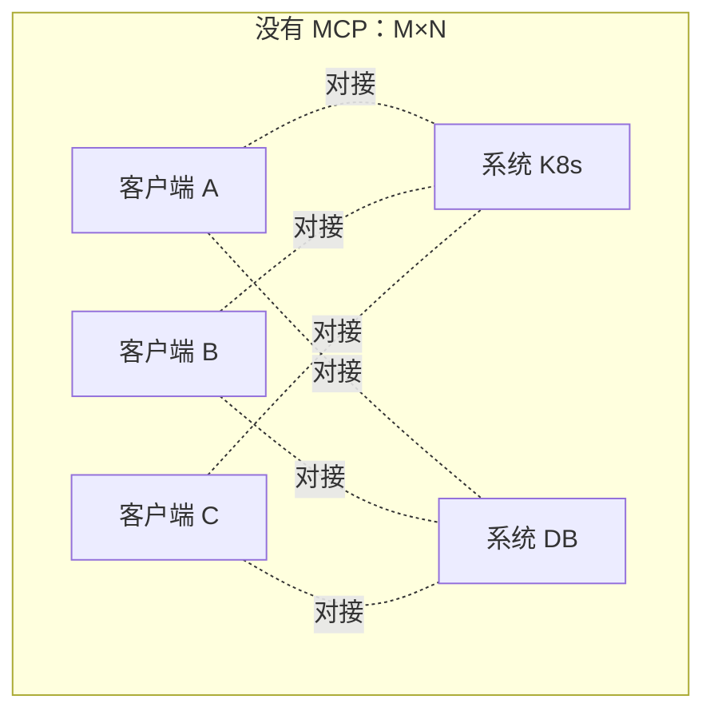
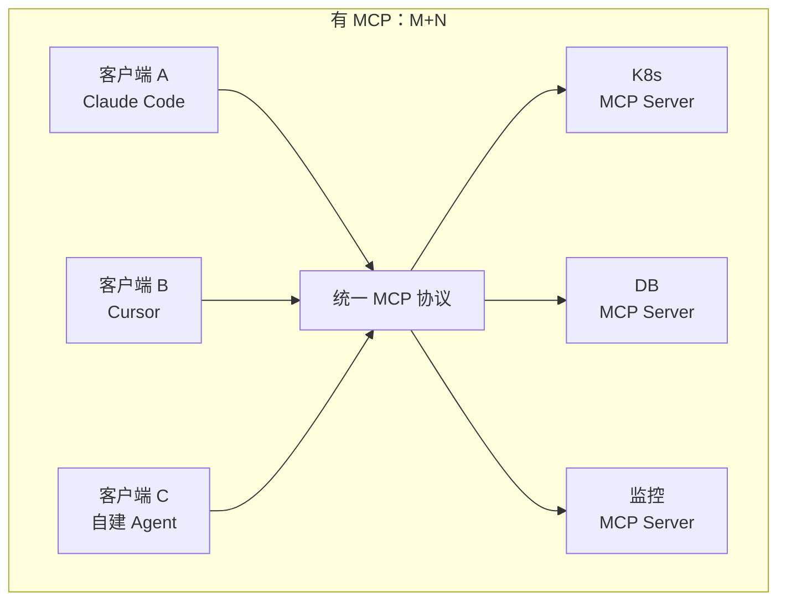
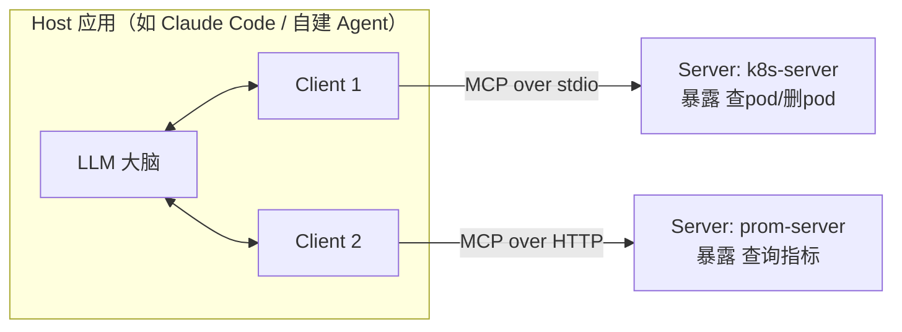
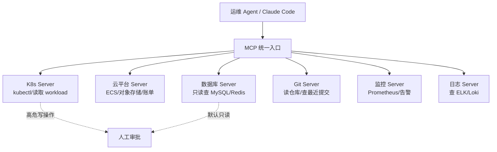

# MCP 模型上下文协议

::: tip 本篇定位
讲清楚 MCP（Model Context Protocol）到底解决什么问题、Host/Client/Server 怎么分工，并用官方 Python SDK 从零写一个能跑的运维 MCP Server（查 K8s pod、查 Prometheus 指标），让你的 Agent/Claude Code/Cursor 用一套标准接口接你内部系统。
本篇版本：MCP 规范 2026-07-28（当前稳定版）、官方 Python SDK `mcp` 2.2.0（要求 Python ≥ 3.10）、官方 TypeScript SDK `@modelcontextprotocol/sdk` 1.30.0。所有版本以官网当前稳定版为准。
:::

## 一、为什么需要 MCP

### 1.1 小白类比：M×N 集成灾难 vs USB-C 标准

假设你有 **M 个 AI 客户端**（Claude Desktop、Cursor、你自己写的 LangGraph Agent、IDE 插件……），和 **N 个内部系统**（K8s、Prometheus、MySQL、Git、飞书……）。

没有 MCP 时：每接一个新系统，每个客户端都得单独写一套对接代码。M 个客户端 × N 个系统 = **M×N 套集成**，是个平方级的噩梦。

> 类比：以前每个电器一个充电器，手机一个口、笔记本一个口、相机又一个口，包里一堆线。**USB-C 出来后，大家统一用这个口，一根线通吃。** MCP 就是 AI 世界的"USB-C 标准接口"：每个系统只要实现一次 MCP Server，所有支持 MCP 的客户端都能直接用，变成 **M + N**。





### 1.2 一句话定义

**MCP 是一个开放协议，规定了"AI 应用（Host）如何用统一的方式去发现并调用外部系统提供的工具、读取其数据、复用其提示词模板"。** 底层走 JSON-RPC。

## 二、核心概念：Host / Client / Server

| 角色 | 是谁 | 干什么 | 类比 |
|---|---|---|---|
| **Host（宿主）** | 你正在用的 AI 应用：Claude Desktop、Cursor、Claude Code、你写的 LangGraph 程序 | 拥有 LLM、决定何时调用工具 | 电脑/手机 |
| **Client（客户端）** | Host 内部的一个模块 | 负责和某个 MCP Server 握手、按协议收发消息 | 主板上的 USB-C 控制器 |
| **Server（服务端）** | 你写的/别人提供的小进程 | 对外暴露 Tools、Resources、Prompts | U 盘、移动硬盘等外设 |

> 一个 Host 可以挂**多个 Client**，每个 Client 连一个 Server。Host 里的 LLM 看到所有 Server 汇总来的"工具清单"，自己决定调哪个。



## 三、传输方式 Transport

MCP 规定了 Client 和 Server 之间怎么通信，两种主流：

| Transport | 怎么跑 | 适用 | 特点 |
|---|---|---|---|
| **stdio** | Server 是个本地子进程，Host 通过它的标准输入/输出收发 JSON-RPC | 本地开发、接本机 CLI 工具（kubectl、数据库） | 最简单，不用开端口，Server 由 Host 拉起 |
| **Streamable HTTP** | Server 跑成一个 HTTP 服务，Host 通过 URL 连 | 团队共享、远端部署、容器化 | 可远程访问、可水平扩展，2026-07-28 规范主推无状态 HTTP 核心 |

> 历史上早期还有个 **SSE（Server-Sent Events）** 单向流式传输，2026-07-28 新规范已用 **Streamable HTTP** 统一取代（无状态核心、可在普通 HTTP 基础设施上扩展），新写 Server 直接上 Streamable HTTP，别再用老 SSE 模式。

## 四、三大原语（Tools / Resources / Prompts）

MCP Server 对外能提供三类东西，外加两个进阶能力：

| 原语 | 谁来主动用 | 通俗解释 | 运维例子 |
|---|---|---|---|
| **Tools（工具）** | **LLM 自主决定**调用 | 一个"会产生副作用/会算"的函数 | `get_pods(namespace)`、`query_promql(expr)` |
| **Resources（资源）** | 由**用户/应用**指定 | 一段可读的数据/文件，只读 | 某台机器的 `/etc/nginx/nginx.conf`、某个 incident 的记录 |
| **Prompts（提示模板）** | 用户在 Host 里**显式选择** | 预定义好的提示词模板 | "帮我分析这段 nginx 报错日志"一键模板 |

| 进阶能力 | 方向 | 说明 |
|---|---|---|
| **Sampling** | Server → Host 反向 | Server 反过来请求 Host 里的 LLM 帮忙生成内容（少见） |
| **Roots** | Host → Server | Host 告诉 Server"你只能在这些目录/范围内活动"，用于沙箱边界 |

> 记忆法：**Tools 是"手"（LLM 自己会动）、Resources 是"只读资料"、Prompts 是"现成话术"。** 运维 90% 场景先用 Tools。

## 五、把运维系统接入 Agent 的全景



## 六、常用 MCP Server 盘点

| Server | 提供方 | 能干什么 | 怎么获取 |
|---|---|---|---|
| **官方参考 server 仓库** `modelcontextprotocol/servers` | 官方 | filesystem、git、github、postgres、sqlite、fetch、puppeteer 等一批官方/参考实现 | GitHub 搜 `modelcontextprotocol/servers` |
| K8s / kubectl | 社区 | 查 pod、deployment、日志、events | 社区 `kubernetes-mcp-server` 类项目 |
| Prometheus/Grafana | 社区 | 跑 PromQL、查告警面板 | Grafana 官方与社区均有 |
| 云厂商 | 官方/社区 | 查 ECS、对象存储、账单 | 各家云市场 |
| 数据库 | 官方参考 | postgres/sqlite 的只读查询 | 上述官方 servers 仓库 |

> 官方 server 仓库地址：https://github.com/modelcontextprotocol/servers （里面每个目录是一个独立 server，README 有安装与配置示例）。

## 七、动手：用官方 SDK 写一个可跑的运维 MCP Server

下面用 **Python SDK `mcp` 2.2.0** 写一个"运维助手 Server"：暴露两个工具——`list_pods`（查 K8s pod）和 `query_prometheus`（查 PromQL）。用 FastMCP 高层 API，几十行就能跑。

### 7.1 安装

```bash
# 建议建独立虚拟环境
python3 -m venv .venv && source .venv/bin/activate

# 写死版本，2.2.0 对应 2026-07-28 规范
pip install "mcp==2.2.0"
# 可选：下面示例用到的库
pip install "kubernetes==33.1.0" "requests==2.32.3"
```

### 7.2 完整代码 `ops_server.py`

```python
# ops_server.py —— 一个最小可跑的运维 MCP Server（stdio 传输）
from mcp.server.fastmcp import FastMCP

# 1) 实例化，名字会显示在客户端的 server 列表里
mcp = FastMCP("ops-helper")

# 2) 定义工具：函数 docstring 会被自动当作工具说明喂给 LLM
@mcp.tool()
def list_pods(namespace: str = "default") -> str:
    """列出指定 namespace 下的 Pod 名称与状态。只读操作。

    Args:
        namespace: Kubernetes 命名空间，默认 default
    """
    try:
        from kubernetes import client, config
        try:
            config.load_incluster_config()      # 跑在集群里时用这个
        except Exception:
            config.load_kube_config()           # 本地开发用 ~/.kube/config
        v1 = client.CoreV1Api()
        pods = v1.list_namespaced_pod(namespace)
        lines = [f"{p.metadata.name}\t{p.status.phase}" for p in pods.items]
        return "\n".join(lines) if lines else f"namespace={namespace} 没有 Pod"
    except Exception as e:
        return f"查询失败: {e}"

@mcp.tool()
def query_prometheus(promql: str, prom_url: str = "http://127.0.0.1:9090") -> str:
    """执行一条 PromQL 瞬时查询并返回结果。只读操作。

    Args:
        promql: PromQL 表达式，如 rate(node_cpu_seconds_total[5m])
        prom_url: Prometheus 地址，默认本机 9090
    """
    import requests
    r = requests.get(f"{prom_url}/api/v1/query",
                     params={"query": promql}, timeout=10)
    r.raise_for_status()
    data = r.json()["data"]["result"]
    if not data:
        return "无数据"
    out = []
    for item in data:
        metric = ",".join(f"{k}={v}" for k, v in item["metric"].items())
        out.append(f"{metric} => {item['value'][1]}")
    return "\n".join(out)

# 3) 以 stdio 方式运行（Host 会把它当本地子进程拉起）
if __name__ == "__main__":
    mcp.run(transport="stdio")
```

### 7.3 先在命令行自测（不接 Host）

```bash
# 启动自带的 MCP Inspector 可视化调试界面，浏览器里点着调工具
mcp dev ops_server.py
# 或直接命令行交互：
mcp run ops_server.py
```

`mcp dev` 会打开一个本地网页（Inspector），左边能看到 `list_pods`、`query_prometheus` 两个工具，填参数点调用，立刻看到返回——**这是调试 MCP Server 最快的方式，别一开始就塞进 Claude Desktop 猜。**

### 7.4 把它挂到 Host 里（以 Claude Desktop / Claude Code 的配置为例）

在 Host 的 MCP 配置文件里加一段（stdio 方式，告诉 Host 怎么拉起你的 Server）：

```json
{
  "mcpServers": {
    "ops-helper": {
      "command": "/绝对路径/.venv/bin/python",
      "args": ["/绝对路径/ops_server.py"]
    }
  }
}
```

重启 Host，它会自动拉起这个子进程、握手、把两个工具注入给 LLM。之后你在对话里说"看下 default 命名空间有哪些 pod"，LLM 就会自己决定调 `list_pods`。

::: details TypeScript 版本长什么样（对照）
TS SDK `@modelcontextprotocol/sdk` 1.30.0 用 `McpServer` + `registerTool`，思路完全一样：定义工具名、描述、输入 Schema，然后处理 handler。运维同学若团队是 JS/TS 技术栈可直接用，官方模板见 typescript-sdk 仓库 examples。
:::

## 八、安全边界（生产红线重点）

MCP Server 手里握着你内网的真实系统，**它就是一个能被 LLM 触发的后门**，必须上锁：

| 原则 | 怎么做 |
|---|---|
| **默认只读** | 运维查询类 Server 只暴露 `list_*`、`query_*`，不暴露 `delete`/`apply`/`scale` |
| **最小权限** | 给 Server 的 K8s token、数据库账号按 namespace/库表授权，用只读账号，别用 cluster-admin |
| **输入校验** | Server 内部对 LLM 传来的参数再校一遍（namespace 白名单、PromQL 禁止带 `[for]` 写操作之类），别信任 LLM 的"善意" |
| **高危操作人工审批** | 任何会改状态的工具，执行前必须 human-in-the-loop（见[运维实战](./aiops-agent-practice)） |
| **全程审计** | 每次工具调用的入参、返回、调用者都记日志，可回放、可追责 |
| **网络收敛** | HTTP 传输的 Server 只监听内网，前面加鉴权（2026-07-28 规范强化了 OAuth/OIDC 授权），别裸露公网 |

## 九、常见问题排错

| 现象 | 原因 | 解决 |
|---|---|---|
| Host 里看不到我写的工具 | 路径/解释器不对，Server 启动就崩了 | 先用 `mcp dev ops_server.py` 本地跑通；检查配置里 `command` 用绝对路径、venv 里的 python |
| 握手失败 / `Connection closed` | SDK 版本与 Host 期望规范不匹配 | 用 `mcp==2.2.0`；注意 v1.x（`mcp<2`）与 v2 不兼容，老项目临时用 `mcp>=1.28,<2` |
| 工具一直不被调用 | docstring/参数描述写得太笼统，LLM 不知道啥时候用 | 写清工具用途和参数含义，给例子；temperature 调低 |
| stdio 下日志打不出来 | stdio 通道被 JSON-RPC 占用，print 会污染协议 | 日志写到 stderr 或文件，不要往 stdout print |
| HTTP 方式连不上 | 没开端口 / 防火墙 / 路径不对 | 确认用 Streamable HTTP 端点；本机 `curl` 先打通；别再用已废弃的老 SSE 路径 |

::: warning 生产红线
- **永远不要给 MCP Server 生产写权限**：读和写拆成两个 Server，写那个强制走人工审批。
- 版本写死：Python 用 `mcp==2.2.0`，TypeScript 用 `@modelcontextprotocol/sdk@1.30.0`，升级前先在 Inspector 里回归。
- HTTP 传输的 Server 必须加鉴权 + 内网隔离，严禁 `0.0.0.0` 裸奔到公网。
- 每个工具都要有超时和资源上限，防止 LLM 写出一条把 Prometheus 打挂的 PromQL。
- 定期审计工具清单：没人用的 Server 及时下线，缩小攻击面。
:::

## 相关速查

- 运维 AI Prompt 与工具指令模板：[运维 AI Prompt 速查](/reference/ai-prompts)
- K8s 概念基础：[Kubernetes 集群架构](./container-k8s-01-architecture-cluster)
- 监控数据从哪来：[Prometheus 监控](./monitor-prometheus-01-intro)
- Agent 怎么编排落地：[Agent 运维实战](./aiops-agent-practice)
- 基础概念补课：[AI Agent 与 LLM 应用基础](./aiops-agent-basics)

### 官方文档

- MCP 官网与规范：https://modelcontextprotocol.io/
- 2026-07-28 规范发布说明：https://blog.modelcontextprotocol.io/posts/2026-07-28/
- 官方 Python SDK（PyPI）：https://pypi.org/project/mcp/ 、源码 https://github.com/modelcontextprotocol/python-sdk
- 官方 TypeScript SDK（npm）：https://www.npmjs.com/package/@modelcontextprotocol/sdk 、源码 https://github.com/modelcontextprotocol/typescript-sdk
- 官方参考 Server 集合：https://github.com/modelcontextprotocol/servers
