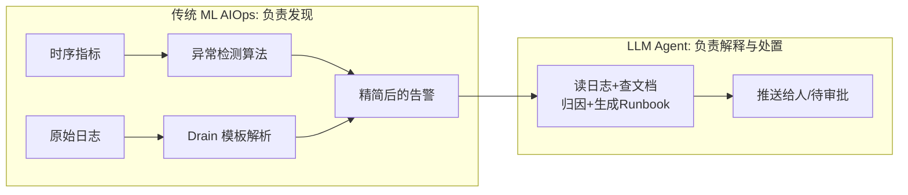
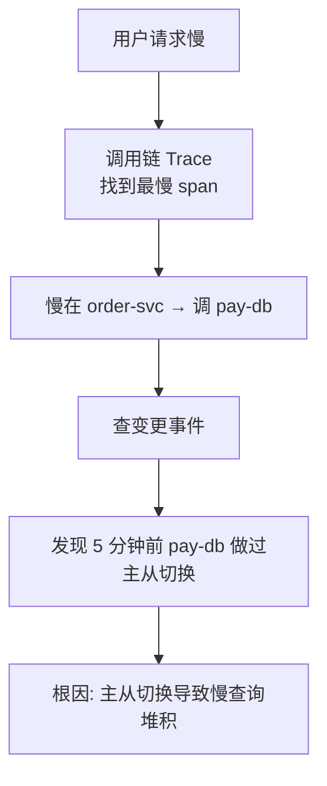

# 传统 AIOps 与机器学习

::: tip 本篇定位
在 LLM 爆火之前，AIOps 早就靠传统机器学习干了十几年活：时序异常检测、告警降噪、日志模板聚类、根因定位。本篇讲清这些方法怎么选、和 LLM Agent 怎么分工，并给一个能直接跑的 Python 时序异常检测小例子。
本篇版本：Python 3.10+、pandas 2.3.x、scikit-learn 1.5.x、Prophet 1.1.x（可选）。方法本身成熟稳定，不依赖某个快速迭代的框架。
:::

## 一、背景：AIOps 两条路线

### 1.1 小白类比：老中医 vs 新博士

- **传统 AIOps（机器学习）**：像一位"老中医"，靠几十年积累的统计/机器学习套路，对**数字信号**（CPU、QPS、延迟）做检测——规则明确、可解释、7×24 稳定跑，但它**看不懂人话**（日志、告警文本、Runbook）。
- **LLM Agent**：像一位"会读文档、会思考的新博士"，擅长读日志文本、做归因推理、生成报告，但**算统计阈值、做高频实时检测不是它的强项**（又慢又贵）。

> 结论：**两者不是替代，是搭档。** 老中医负责"发现异常"（实时、便宜、可靠），新博士负责"解释异常、给出处理建议"（读日志、查文档、写报告）。



## 二、指标时序异常检测

### 2.1 先理解：监控指标长什么样

运维指标（CPU、QPS、延迟）大多有规律：**白天高、夜里低、周末更低**，这叫"季节性"。拿昨天的值今天比，周末比工作日，阈值怎么定都不对——这就是为什么需要专门的异常检测方法。

| 方法 | 原理（通俗） | 适合 | 优点 | 缺点 |
|---|---|---|---|---|
| **3-sigma（Z-score）** | 正常数据集中在均值±3倍标准差内，超出就是异常 | 平稳、无明显周期的指标 | 最简单 | 不懂季节性，误报多 |
| **EWMA 滑动平均** | 越近的数据权重越大，用平滑曲线包上下界 | 缓慢变化的趋势指标 | 简单、实时 | 突变检测一般 |
| **同比/环比基线** | 跟上周同一时刻、昨天同一时刻比 | 有明显日/周周期的业务指标 | 贴合业务 | 需要历史基线 |
| **Prophet** | Facebook 的时序分解工具，自动拆出趋势+季节性+节假日 | 强季节性、有节假日效应 | 省心、自动建模 | 较重，非实时流处理 |
| **孤立森林 Isolation Forest** | 无监督，随机切分空间，越容易被孤立的点越异常 | 多指标联合、高维、不知道长啥样 | 多变量、无需标注 | 可解释性弱 |

### 2.2 选型速查

| 你的指标 | 推荐 |
|---|---|
| CPU/内存这种相对平稳的机器指标 | 3-sigma + EWMA 足够 |
| QPS/订单量这种强周期业务指标 | 同比环比基线，或 Prophet |
| 想多指标一起看、没有标注数据 | 孤立森林 |
| 实时流、低延迟 | 滑动窗口 + EWMA/3-sigma，别用 Prophet |

## 三、告警降噪 / 聚合 / 关联

### 3.1 小白类比：告警风暴就是"群里刷屏"

一个核心节点挂了，可能瞬间炸出几百条告警（每个下游都在喊）。人一晚上被刷屏，真正重要的反而漏了。**降噪就是把这几百条收敛成几条"值得看的"。**

| 技术 | 怎么做 | 类比 |
|---|---|---|
| **去重收敛** | 相同指纹（告警名+指标）在时间窗内只保留第一条 | 同一个人在群里重复发，折叠 |
| **时间窗聚合** | 把 N 分钟内同服务的告警合并成一条 | 把连续几条刷屏打包成一条摘要 |
| **拓扑关联** | 根据依赖拓扑，"上游 DB 挂了"派生出"下游接口超时"，只留根那条 | 找到最先倒下的那个多米诺骨牌 |
| **抑制** | 已经有更高级别告警在处理，抑制掉它派生出的低级别告警 | 大事已在处理，小事别再刷屏 |

## 四、日志异常检测

### 4.1 Drain：把半结构化日志变成模板

原始日志成千上万行，大部分是"模板 + 会变的数字/ID"。比如：

```text
connection to 10.0.0.5:5432 timed out
connection to 10.0.0.9:5432 timed out
connection to 10.0.0.2:5432 timed out
```

**Drain 算法**自动归纳成模板：`connection to <IP>:5432 timed out`，把变化部分当通配符。于是几万行日志能聚成几十种"事件类型"，哪种类型突然暴增，就是异常。

| 阶段 | 做什么 |
|---|---|
| 解析 | Drain 把日志归成模板 + 参数（IP、traceId 等抽出来） |
| 统计 | 统计每个模板在时间窗内的出现次数 |
| 检测 | 某模板计数突然远超历史基线 → 异常 |

> 这正好是 LLM 的上游：Drain 先把几万行日志压成"今天突然冒出 142 条 `connection refused` 模板"，LLM 再拿这个精炼结论去做归因，而不是直接吞几万行原始日志。

## 五、根因定位

光知道"CPU 高了"不够，要定位到"谁引起的"。两条主线：

| 方法 | 思路 |
|---|---|
| **调用链关联（Trace）** | 异常请求在哪个 span 耗时最长/报错，顺着分布式追踪图往上找入口 |
| **变更/部署关联** | 告警时间点附近有没有发版、改配置、扩容——统计"变更后 N 分钟内出问题"的概率 |



## 六、常用开源工具 / 平台

| 工具 | 干什么 | 备注 |
|---|---|---|
| **Prometheus + Alertmanager** | 指标采集 + 规则告警 + 基础降噪 | 见[Prometheus 监控](./monitor-prometheus-01-intro) |
| **ELK / Loki** | 日志存储与查询 | 见[ELK 日志栈](./monitor-elk) |
| **Drain3 / 各类 logparser** | 日志模板解析 | 纯 Python 库 |
| **单链路/可观测平台** | 调用链追踪 | 见后续 OpenTelemetry 相关文章 |
| 自建 Python 脚本 | 时序异常检测小实验 | 下面就给例子 |

> 个人/小团队别一上来就上重型 AIOps 平台。**先把 Prometheus 告警规则写好、Alertmanager 降噪配好，不够再加统计检测。**

## 七、可跑的 Python 时序异常检测小例子

下面生成一段"带日周期 + 人为注入异常"的模拟指标，用 **3-sigma** 和 **EWMA** 两种方法判异常，零外部依赖即可跑。

```python
# ts_anomaly_demo.py —— 时序异常检测最小可跑示例
import numpy as np
import pandas as pd

# 1) 造数据：24*7 个点（每 5 分钟一个点，约一周），带"白天高夜里低"的日周期
np.random.seed(42)
n = 24 * 7
t = np.arange(n)
diurnal = 50 + 30 * np.sin(2 * np.pi * (t % 24) / 24)   # 日周期基线
noise = np.random.normal(0, 3, n)                        # 随机波动
series = diurnal + noise

# 人为注入两处异常：第 100 点飙高、第 120 点骤降
series[100] += 60
series[120] -= 50

df = pd.DataFrame({"value": series})

# 2) 方法一：3-sigma（在滑动窗口里算均值/标准差）
window = 48
df["roll_mean"] = df["value"].rolling(window).mean()
df["roll_std"] = df["value"].rolling(window).std()
df["z_score"] = (df["value"] - df["roll_mean"]) / df["roll_std"]
df["anom_3sigma"] = df["z_score"].abs() > 3   # 超出 ±3σ 判异常

# 3) 方法二：EWMA 上下控制带（指数滑动平均）
ewma = df["value"].ewm(span=20).mean()
ewma_std = df["value"].rolling(20).std()
df["anom_ewma"] = (df["value"] - ewma).abs() > 3 * ewma_std

# 4) 输出异常点
print("=== 3-sigma 检测到的异常点 ===")
print(df.index[df["anom_3sigma"]].tolist())
print("=== EWMA 检测到的异常点 ===")
print(df.index[df["anom_ewma"]].tolist())
```

跑一下：

```bash
pip install "pandas==2.3.1" "numpy==2.1.3"
python ts_anomaly_demo.py
# === 3-sigma 检测到的异常点 ===
# [100, 120]
# === EWMA 检测到的异常点 ===
# [100, 120]
```

两种方法都准确抓到了我们注入的第 100、120 号异常点。生产上把 `series` 换成"从 Prometheus `/api/v1/query_range` 拉回来的真实指标"即可。

::: details 想加孤立森林 / Prophet
- 孤立森林做多变量：`from sklearn.ensemble import IsolationForest`，把多列指标拼成 DataFrame 喂 `IsolationForest(contamination=0.01).fit_predict(X)`，返回 -1 即异常。
- Prophet 做强周期：`pip install prophet==1.1.6`，`from prophet import Prophet`，要求列名 `ds`/`y`，自动给出趋势+季节性和置信区间外的点。两者都不适合高频实时流。
:::

## 八、传统 ML 与 LLM Agent 的分工总结

| 环节 | 谁来干 | 为什么 |
|---|---|---|
| 实时发现指标异常 | 传统 ML（3-sigma/EWMA/孤立森林） | 便宜、快、稳、可解释 |
| 告警去重/收敛/关联 | Alertmanager + 拓扑规则 | 工程成熟，不该让 LLM 每次重算 |
| 日志模板压缩 | Drain 等传统解析 | 确定性、低成本 |
| 读懂日志、做归因推理、写结论 | LLM Agent | 理解自然语言、会查文档 |
| 生成排查脚本/Runbook | LLM Agent | 生成式强项 |
| 执行恢复动作 | 传统自动化 + 人审批 | 确定性 + 安全 |

> 一句话：**传统 ML 负责"眼睛和耳朵"（发现），LLM Agent 负责"大脑和嘴"（理解、建议、报告），人负责"最后拍板"。**

## 九、常见问题排错

| 现象 | 原因 | 解决 |
|---|---|---|
| 误报满天飞 | 阈值写死、没考虑周期性 | 用同比环比/EWMA 动态阈值，别用固定数字 |
| 漏报 | 窗口太长、阈值太松 | 缩短检测窗口，结合多指标联合判断 |
| 告警风暴 | 没做聚合/抑制 | 配 Alertmanager group_by、抑制规则、拓扑关联 |
| Drain 把不同日志归成一类/一类拆成多类 | 相似度参数没调 | 调整 Drain 的相似度深度/阈值 |
| 孤立森林结果忽好忽坏 | contamination 设得不对 | 先按历史异常占比（如 1%）设 `contamination` |

::: warning 生产红线
- 告警是 SRE 的生命线，**异常检测误报比漏报更伤人**：宁可先松一点观察，再逐步收紧阈值。
- 任何自动"发现异常"到"自动处置"之间，必须留人工确认环节，别一检测到异常就自动重启/回滚。
- 检测脚本/规则要版本管理，阈值变更要灰度观察，别在生产环境随手改。
- 时序检测用的统计窗口要覆盖完整周期（日/周），否则周末/夜里一定误报。
:::

## 相关速查

- 运维 AI Prompt 模板：[运维 AI Prompt 速查](/reference/ai-prompts)
- 指标从哪来：[Prometheus 监控](./monitor-prometheus-01-intro)
- 日志系统：[ELK 日志栈](./monitor-elk)
- Agent 怎么接住这些告警做解释：[Agent 运维实战](./aiops-agent-practice)
- 基础概念：[AI Agent 与 LLM 应用基础](./aiops-agent-basics)

### 官方文档

- pandas 文档：https://pandas.pydata.org/docs/
- scikit-learn 孤立森林：https://scikit-learn.org/stable/modules/generated/sklearn.ensemble.IsolationForest.html
- Prophet（Facebook）：https://facebook.github.io/prophet/
- Drain 日志解析：https://github.com/logpai/logparser
- Prometheus Alertmanager 告警管理：https://prometheus.io/docs/alerting/latest/alertmanager/
