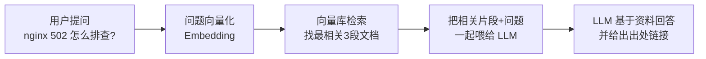
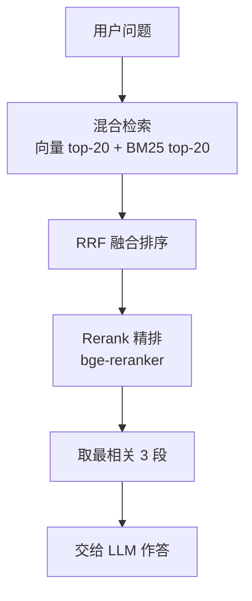

# 运维知识库与 RAG

::: tip 本篇定位
解决"大模型不知道你家私有文档、还一本正经瞎编"的问题：用 RAG（检索增强生成）把你的 VitePress 知识库、Runbook、故障记录先检索出来再喂给模型，让它**有据可依地回答**。含把本仓库 `docs/**/*.md` 全量入库、问答的完整可跑代码。
本篇版本：Chroma `chromadb` 1.5.9、Milvus 2.6.21（生产稳定，3.0.0 已 GA）、Qdrant 1.18.0、pgvector 0.8.2、Embedding 模型 BAAI/bge-m3 与 bge-large-zh-v1.5。所有版本以官网当前稳定版为准。
:::

## 一、为什么需要 RAG

### 1.1 小白类比：开卷考试 vs 闭卷瞎编

直接问大模型"我们公司 K8s 生产环境的 Pod 安全策略是什么"，它不知道你公司的内部文档，就会**闭卷瞎编一个看起来很合理的答案**——这就是"幻觉"。

**RAG = 开卷考试**：考试前，先把相关的那几页资料翻出来摆在桌上，让它**看着资料作答**，并且能告诉你"我是根据第几页说的"。



### 1.2 三个非 RAG 不可的理由

| 痛点 | RAG 怎么解 |
|---|---|
| 幻觉（模型编造） | 答案必须基于检索到的真实文档，模型只做"组织语言" |
| 私有知识（内部 Runbook/拓扑/配置） | 这些没进公开模型训练，只能靠检索喂进去 |
| 知识过时 | 模型训练有截止日期；RAG 直接读你最新的文档文件，随时可更新 |

## 二、文档加载与切分

### 2.1 为什么要切分

整篇文档几百 KB，既塞不进上下文，向量检索也分不清"哪段相关"。所以要把文档**切成小块（chunk）**，每块单独向量化。

### 2.2 chunk 大小与 overlap 经验值

| 参数 | 经验值 | 说明 |
|---|---|---|
| chunk_size（每块多少 token） | **中文 300~800 token** | 太小：上下文不完整；太大：检索不精准、浪费窗口 |
| chunk_overlap（相邻块重叠） | **chunk_size 的 10%~20%** | 避免一句话从中间被切断，导致两边都不完整 |
| 切分边界 | 尽量按标题/段落/代码块切 | 别在一个命令中间硬切 |

> 类比：切西瓜。块太大，一口啃不动（检索不精准）；块太小，没味（上下文不全）。留 overlap 是为了"接缝处也有完整内容"。

## 三、Embedding 与向量库

### 3.1 Embedding 是什么

**Embedding 模型把一段文字变成一串数字（向量）**，语义相近的句子向量距离也近。这样"nginx 502 怎么办"和"502 Bad Gateway 排查"虽然字面不同，向量却很接近——这就是语义检索的原理。

| Embedding 模型 | 维度 | 最大长度 | 语言 | 说明 |
|---|---|---|---|---|
| **BAAI/bge-m3** | 1024 | 8192 token | 多语言（中英都强） | 推荐主力，568M 参数，支持稠密+稀疏+多向量 |
| **BAAI/bge-large-zh-v1.5** | 1024 | 512 token | 中文 | 纯中文场景经典稳 |
| BAAI/bge-large-en-v1.5 | 1024 | 512 token | 英文 | 英文文档用 |

### 3.2 向量库选型对比

| 对比 | Chroma | Qdrant | Milvus | pgvector |
|---|---|---|---|---|
| 定位 | 上手最快、嵌入式 | 生产级、Rust、过滤强 | 大规模、分布式 | 直接在 PostgreSQL 里加向量列 |
| 部署 | `pip install` 即用 | Docker / 单机集群 | 较重，分布式 | 现有 PG 里 `CREATE EXTENSION` |
| 适合规模 | 原型、个人、<百万 | 中小到生产、千万级 | 海量、亿级 | 已有 PG、量不大、想省一个组件 |
| 过滤/元数据 | 基础 | 强（payload 过滤） | 强 | 借 SQL 过滤，灵活 |
| 推荐版本 | chromadb 1.5.9 | 1.18.0 | 2.6.21（3.0.0 GA） | pgvector 0.8.2 |

> 个人知识库/本网站：**Chroma 起步最省事**；想上生产、要过滤和高可用：**Qdrant**；已经重度用 PostgreSQL、不想多维护一个数据库：**pgvector**。

## 四、检索策略

| 策略 | 怎么工作 | 优缺点 |
|---|---|---|
| 纯向量检索 | 语义相似度找 top-k | 语义好，但**精确名词（指标名、报错码、命令）容易漏** |
| 纯关键词（BM25） | 传统倒排，按词频 | 精确匹配强，但不懂"意思相近" |
| **混合检索（Hybrid）** | 向量 + BM25 结果融合（RRF 排序） | 推荐：既懂语义又认精确名词 |
| **重排 Rerank** | 检索出 top-20，再用 rerank 模型精排取 top-3 | 显著提升相关性，BGE 自带 `bge-reranker` |



## 五、实战：把本 VitePress 知识库接入 LLM

目标：读取本仓库 `docs/guide/**/*.md`、`docs/reference/**/*.md`，切分 → BGE 向量化 → 存进 Chroma → 问它问题能命中本站文章。

### 5.1 安装依赖（版本写死）

```bash
python3 -m venv .venv && source .venv/bin/activate
pip install "chromadb==1.5.9"
pip install "sentence-transformers==5.1.0"
pip install "openai==1.68.2"   # 用来调你本地的 Ollama/vLLM
```

### 5.2 建库脚本 `build_kb.py`

```python
# build_kb.py —— 扫描 docs 目录，切分、向量化、写入 Chroma
import glob, os, re
import chromadb
from sentence_transformers import SentenceTransformer

DOCS_ROOT = "/home/user/Doubao/chats/38440928658888706/static-blog/docs"
COLLECTION = "ops_kb"

# 1) 加载本地 Embedding 模型（BGE-M3，首次会自动下载约 2.2GB）
embedder = SentenceTransformer("BAAI/bge-m3")

def split_text(text, chunk_tokens=500, overlap=80):
    """极简按字符切分（中文约1.5字/token 的粗算），带重叠。生产可换 LangChain 文本切分器。"""
    text = re.sub(r"\n{3,}", "\n\n", text)
    step = int(chunk_tokens * 1.5)
    ov = int(overlap * 1.5)
    chunks = []
    for i in range(0, len(text), step - ov):
        piece = text[i:i + step]
        if piece.strip():
            chunks.append(piece)
    return chunks

# 2) 连接 Chroma（本地持久化到 ./chroma_db）
client = chromadb.PersistentClient(path="./chroma_db")
# 重建前先删旧集合，保证和文档同步
try:
    client.delete_collection(COLLECTION)
except Exception:
    pass
col = client.create_collection(COLLECTION, metadata={"hnsw:space": "cosine"})

# 3) 扫描所有 md 文件，切分、入库
files = glob.glob(os.path.join(DOCS_ROOT, "**", "*.md"), recursive=True)
ids, docs, metas = [], [], []
for fpath in files:
    rel = os.path.relpath(fpath, DOCS_ROOT)
    with open(fpath, encoding="utf-8") as f:
        content = f.read()
    for idx, chunk in enumerate(split_text(content)):
        ids.append(f"{rel}#{idx}")
        docs.append(chunk)
        metas.append({"source": rel, "chunk": idx})

# 4) 批量向量化（embeddings 自己算，直接 add 文本让 Chroma 存也行；这里显式算）
emb = embedder.encode(docs, normalize_embeddings=True).tolist()
col.add(ids=ids, documents=docs, embeddings=emb, metadatas=metas)
print(f"入库完成：{len(files)} 个文件，{len(docs)} 个 chunk")
```

跑一下：

```bash
python build_kb.py
# 入库完成：87 个文件，1234 个 chunk
```

### 5.3 问答脚本 `ask.py`

```python
# ask.py —— 检索知识库 + 调本地 LLM 生成带出处的回答
import chromadb
from sentence_transformers import SentenceTransformer
from openai import OpenAI

embedder = SentenceTransformer("BAAI/bge-m3")
client = chromadb.PersistentClient(path="./chroma_db")
col = client.get_collection("ops_kb")

# 接本地 Ollama（OpenAI 兼容接口，见《大模型部署》）
llm = OpenAI(base_url="http://127.0.0.1:11434/v1", api_key="ollama")

def ask(question: str, k: int = 3):
    q_emb = embedder.encode([question], normalize_embeddings=True).tolist()
    res = col.query(query_embeddings=q_emb, n_results=k)
    ctx = "\n\n---\n".join(
        f"[来自 {m['source']}]\n{d}"
        for d, m in zip(res["documents"][0], res["metadatas"][0])
    )
    prompt = f"""你是运维知识库助手。只根据下面提供的资料回答，资料里没有就说"知识库中未找到"，不要编造。

参考资料：
{ctx}

用户问题：{question}
"""
    resp = llm.chat.completions.create(
        model="qwen3:8b",
        messages=[{"role": "user", "content": prompt}],
        temperature=0.2,
    )
    print(resp.choices[0].message.content)
    print("\n引用来源：", [m["source"] for m in res["metadatas"][0]])

if __name__ == "__main__":
    ask("K8s 里 pod 一直处于 CrashLoopBackOff 一般怎么排查？")
```

```bash
python ask.py
```

## 六、本地 / 私有化方案

不想把内网文档发到公网 API？全栈本地：

| 组件 | 本地方案 | 命令 |
|---|---|---|
| Embedding | Ollama 拉本地 embedding 模型，或 sentence-transformers 跑 bge-m3 | `ollama pull bge-m3` |
| 向量库 | Chroma 本地持久化（上面就是） | 无需额外服务 |
| LLM | Ollama 跑 Qwen3，OpenAI 兼容接口 | `ollama pull qwen3:8b` |

```bash
# 一键把整条链路跑在本机，数据不出内网
ollama pull bge-m3 && ollama pull qwen3:8b
ollama serve        # 默认 127.0.0.1:11434，提供 /v1/embeddings 和 /v1/chat/completions
python build_kb.py  # 建库（把 embedder 换成调 Ollama embeddings 接口即可）
python ask.py
```

## 七、效果评估与常见坑

| 坑 | 现象 | 解法 |
|---|---|---|
| chunk 切太大/太小 | 检索不相关或上下文不全 | 中文 300~800 token，overlap 10~20%，按标题/代码块边界切 |
| 只做向量检索 | 查指标名、报错码查不到 | 上混合检索（向量+BM25） |
| 没做 rerank | top-k 里混着不相关内容 | 加 bge-reranker 精排 |
| 文档更新了库没更新 | 问到旧答案 | 重新跑 `build_kb.py`（本示例先删集合再全量重建） |
| Embedding 和查询用了不同模型 | 向量对不上，检索全乱 | 入库和查询必须用**同一个** embedding 模型 |
| 喂太多无关片段 | LLM 被噪声带偏 | top-k 别贪多（3~5 段），加 rerank |

## 八、常见问题排错

| 现象 | 原因 | 解决 |
|---|---|---|
| `ConnectionError` 连不上 embedding 模型 | 模型没下下来/没网 | 国内设 `export HF_ENDPOINT=https://hf-mirror.com` 再下载 |
| Chroma 报维度不匹配 | 换了 embedding 模型但库是旧向量 | 删掉 `./chroma_db` 用新模型重建 |
| 回答还是瞎编 | 没在 Prompt 里强约束"只根据资料" | Prompt 加"资料没有就说没找到，禁止编造" |
| 检索结果全是无关页面 | chunk 太大 / 元数据没带上 | 调小 chunk；打印检索文档人工看一眼相关性 |
| 首次加载 bge-m3 很慢 | 在下载 2.2GB 模型 | 耐心等，或用更小的 bge-base-zh-v1.5 |

::: warning 生产红线
- 向量库和 LLM 服务不要裸露公网：知识库可能含内网拓扑、IP、敏感配置。
- 版本写死：`chromadb==1.5.9`、embedding 模型锁定具体版本，升级 embedding 模型必须**全量重建向量库**。
- 入库前过滤敏感信息：密钥、密码、内网地址不该被 embedding 后随便检索出来。
- 私有化场景优先本地模型（Ollama），别把内网文档发到公网大模型 API。
:::

## 相关速查

- 运维 AI Prompt 模板：[运维 AI Prompt 速查](/reference/ai-prompts)
- 本地模型怎么跑：[大模型部署](./container-llm)
- 向量/可观测命令：[云原生命令速查](/reference/cloudnative-commands)
- RAG 在 Agent 里怎么用：[Agent 运维实战](./aiops-agent-practice)
- 基础概念：[AI Agent 与 LLM 应用基础](./aiops-agent-basics)

### 官方文档

- Chroma 官网与文档：https://www.trychroma.com/ 、PyPI https://pypi.org/project/chromadb/
- Milvus 官网与发布说明：https://milvus.io/docs/release_notes.md
- Qdrant 官网：https://qdrant.tech/
- pgvector 仓库：https://github.com/pgvector/pgvector
- BGE 模型（BAAI）：https://huggingface.co/BAAI/bge-m3 、https://huggingface.co/BAAI/bge-large-zh-v1.5（均需科学上网）；国内平替：https://hf-mirror.com/BAAI/bge-m3 、https://hf-mirror.com/BAAI/bge-large-zh-v1.5
- Ollama embeddings：https://ollama.com/blog/embedding-models
