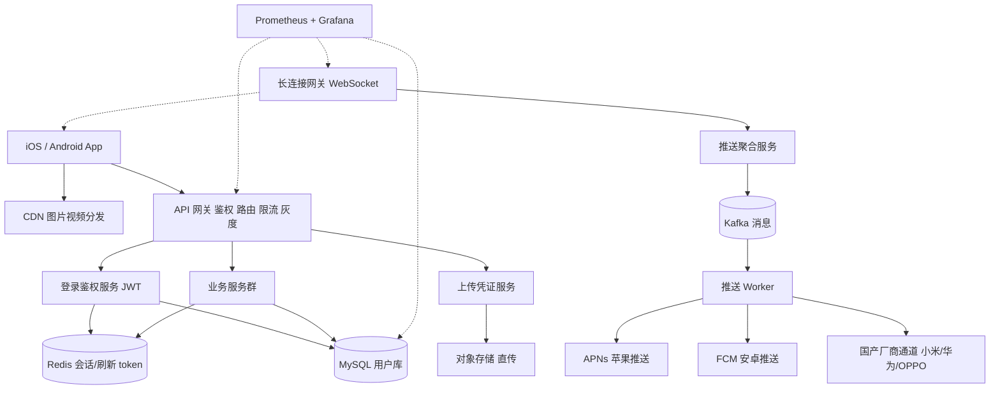

# 架构实战 · 移动 App 后端

::: tip 本篇定位
讲清一款 C 端移动 App 的后端：**JWT 登录鉴权体系、长连接消息推送、图片/视频上传、版本灰度、弱网体验**。方法见 [架构方法论](./architecture-methodology)、[容量估算](./architecture-capacity-sizing)、[高可用蓝图](./architecture-ha-blueprints)，网关见 [Nginx](./services-web-nginx)。
:::

## 一、业务特点与规模估算

典型场景：一款内容/社交类移动 App（iOS+Android），用户量大、在线靠长连接、图片视频上传下载占带宽大头，必须考虑**弱网、版本碎片化、推送到达率**。

| 指标 | 假设值 | 说明 |
|---|---|---|
| 注册用户 | 1000 万 | 累计 |
| DAU | 300 万 | 晚 8~11 点高峰 |
| 峰值在线长连接 | 100 万 | 推送/WebSocket 常驻 |
| 峰值 API QPS | 8000 | 接口读写 |
| 消息推送量 | 5 亿条/天 | 系统+互动通知 |
| 图片视频上传 | 20 TB/天 | 用户 UGC |
| 带宽峰值 | 2 Gbps | 媒体下载走 CDN |
| 版本数量 | 同时在线 20+ 个版本 | 灰度兼容负担 |

**核心结论**：后端挑战是**海量长连接维持 + 大文件上传下载 + 推送到达率 + 弱网与多版本兼容**，纯 API 计算压力反而不大。

### 1.1 容量推算自洽

| 推算项 | 计算 | 结果 |
|---|---|---|
| 平均 API QPS | DAU 300 万 × 人均 20 请求 ÷ 86400 | ≈ 70 QPS |
| 峰值 API QPS | 平均 × 110 倍（晚间 3 小时集中） | ≈ 8000 QPS |
| 长连接网关数量 | 单机维持 15 万连接，100 万在线 + 冗余 | 8 台 |
| 推送 TPS | 5 亿条 ÷ 86400 ≈ 5800，晚间峰值 ×5 | ≈ 3 万 TPS，靠 Kafka 削峰 |
| 上传带宽 | 20TB/天 ÷ 86400 ≈ 230MB/s 平均，峰值 ×8 | 峰值 ≈ 2Gbps，走 OSS 直传不经业务机 |

> 长连接和媒体带宽才是大头，业务 API 本身 8 个服务副本足够。

## 二、总体架构图



分层：接入层（CDN+API 网关+长连接网关）→ 应用服务（鉴权/业务/上传）→ 缓存/消息/数据库/对象存储 → 推送（聚合 APNs/FCM/厂商通道）→ 监控。

## 三、服务器清单

| 角色 | 数量 | CPU(核) | 内存 | 数据盘 | 带宽 | 软件 / 职责 |
|---|---|---|---|---|---|---|
| CDN/OSS | 云 | - | - | - | 按量 | 媒体分发 + 上传存储 |
| API 网关 | 4 | 8 | 16G | ESSD 200G | 200Mbps | APISIX，JWT 校验/灰度；见 [Nginx](./services-web-nginx) |
| 长连接网关 | 8 | 16 | 32G | ESSD 200G | 500Mbps | WebSocket 维持百万长连接，单机 15 万 |
| 登录鉴权服务 | 3 | 8 | 16G | ESSD 100G | 内网 | JWT 签发/刷新 |
| 业务服务群 | 8 | 16 | 32G | ESSD 200G | 内网 | 内容/关系/互动等 |
| 上传凭证服务 | 2 | 4 | 8G | ESSD 100G | 内网 | 签发 OSS 直传 STS |
| 推送聚合/Worker | 4 | 8 | 16G | ESSD 200G | 100Mbps | 对接各推送通道 |
| MySQL 主从 | 2主2从 | 16 | 64G | ESSD PL2 1T | 内网 | 用户/业务库；见 [MySQL](./data-mysql) |
| Redis Cluster | 6(3主3从) | 8 | 32G | ESSD 200G | 内网 | 会话/在线状态/缓存；见 [Redis](./data-redis) |
| Kafka | 3 | 8 | 16G | ESSD 1T | 内网 | 推送事件；见 [Kafka](./data-kafka) |
| 监控 | 2 | 8 | 32G | ESSD 1T | 50Mbps | Prometheus/Grafana；见 [SLO](./monitor-slo) |

**合计自建约 45 台**。与规模自洽：8 台长连接网关按单机 12~15 万连接承载 100 万在线，业务服务 8 副本扛 8000 QPS。

## 四、服务依赖与各自解决的问题

| 服务 | 解决什么问题 | 与谁交互 | 同步/异步 |
|---|---|---|---|
| API 网关 | 统一入口、JWT 校验、按版本灰度、限流 | 后端服务 | 同步 |
| 登录鉴权服务 | 账号登录、签发 access/refresh token、刷新 | MySQL、Redis | 同步 |
| 长连接网关 | 维持 App 长连接，服务端下行推送 | 推送服务、Redis 在线状态 | 长连 |
| 业务服务 | 内容/互动核心逻辑 | MySQL、Redis | 同步 |
| 上传凭证服务 | 下发 OSS STS 临时凭证，客户端直传 | OSS | 同步签发 |
| 推送聚合服务 | 按设备 token 选通道、去重、重试 | Kafka、各推送通道 | 异步 |
| MySQL | 用户/业务数据 | 各服务 | 同步读写，主从异步复制 |
| Redis | 会话、refresh token、在线状态计数 | 鉴权/长连接 | 同步 |
| OSS/CDN | 媒体存储与分发 | 客户端 | 直传/直下 |

## 五、关键设计点与坑 / 注意事项

1. **JWT 登录态设计**：access token 短命（2 小时）+ refresh token 长命（30 天，存 Redis 可吊销）。JWT 无状态校验快，但**登出/踢下线必须靠 Redis 黑名单或 refresh token 白名单**，否则签出去的 token 无法作废。多端登录设备管理用 refresh token 集合。
2. **推送到达率**：安卓国内必须走**厂商通道（华为/小米/OPPO/vivo）**，自建长连接在系统杀后台后必死；iOS 走 APNs。推送服务按机型/版本路由到对应通道，失败重试 + 补推。到达率是 App 命门。
3. **图片/视频上传**：客户端向凭证服务要 STS，**直传 OSS**，不经业务服务器，省带宽；大文件分片上传 + 断点续传，失败只重传分片。上传后回调业务服务登记。
4. **弱网优化**：接口轻量化、分页、数据预取/本地缓存；图片 WebP + 多尺寸 CDN 自适应；超时与重试由客户端幂等键控制，避免重复提交。
5. **版本灰度与兼容**：网关按 App 版本号 Header 路由（`v1/v2` 接口并存）；新接口先灰度 1% 用户，老版本兼容期内不删老接口；强制升级最低版本开关。
6. **长连接保活**：心跳间隔（30~60s）平衡电量与连接数；网关节点扩缩容时连接平滑迁移。

### 5.1 JWT 登录态流转

```text
登录(账号密码) → 签发 access_token(2h) + refresh_token(30h天,存Redis)
access 过期 → 带 refresh 调刷新接口 → 校验 Redis 白名单 → 发新 access
登出/踢下线 → 删除 Redis 中该 refresh → access 到期即失效
```

> access_token 不存服务端（无状态），所以登出不能立刻让它失效；真正可控的是 refresh_token，access 短命把窗口压到 2 小时。

### 5.2 推送通道路由策略

| 平台 | 通道 | 说明 |
|---|---|---|
| iOS | APNs | 唯一官方通道 |
| 国产安卓 | 华为/小米/OPPO/vivo 厂商通道 | 系统级保活，到达率高，必须按机型路由 |
| 海外安卓 | FCM | 国内不可用，国内 App 不用 |

> 自建 WebSocket 长连接只做「App 打开时」的实时消息；后台被杀后的离线推送全靠厂商通道，这是到达率的关键。

## 六、安全与高可用

- **边界防护**：网关 WAF + 限流；上传接口校验文件类型/大小，防恶意文件；推送通道证书/密钥保密。
- **鉴权授权**：JWT 网关统一校验；敏感操作二次校验；refresh token 可吊销。
- **数据加密**：全链路 HTTPS/TLS；密码 bcrypt；手机号脱敏；OSS 私有桶 + 签名 URL。
- **消除单点**：网关/业务多副本；长连接网关多节点；MySQL 主从；Redis Cluster；推送 Worker 多副本。
- **降级预案**：推送通道挂了走备用通道；长连接网关挂了，App 自动切轮询短连接兜底。
- **多可用区**：长连接/业务跨可用区，避免单机房故障全量掉线。

### 6.1 关键监控指标

| 指标 | 告警阈值 | 说明 |
|---|---|---|
| 推送到达率 | < 90% | 通道或 token 失效，查路由 |
| 长连接在线数 | 突降 > 20% | 网关节点故障 |
| API P99 RT | > 800ms | 慢接口定位 |
| Kafka 推送积压 | > 50 万条 | Worker 消费跟不上 |
| 上传成功率 | < 97% | 弱网或 OSS 异常 |
| 各版本崩溃率 | > 0.5% | 某版本质量问题，灰度回滚 |

## 七、上线后可能出现的状况与应对

| 类别 | 征兆 | 处置 |
|---|---|---|
| 性能类 | 接口 RT 高 | 慢接口加缓存、优化 SQL；网关看是哪个下游慢 |
| 性能类 | 长连接网关 CPU 高/连接数涨 | 扩长连接节点；检查心跳是否过频 |
| 容量类 | Redis 内存涨快 | 会话/token 过期策略调整，拆分大 key |
| 容量类 | OSS 上行带宽超支 | 检查视频上传是否被滥用，加上传频控/审核 |
| 故障类 | 某推送通道全挂 | 切备用厂商通道，补推失败消息，监控到达率 |
| 故障类 | 长连接网关节点挂 | SLB 摘流，App 心跳重连到其他节点 |
| 故障类 | 网关全部 5xx | 查配置发布/证书过期，快速回滚 |
| 故障类 | MySQL 主挂 | 提升从库，登录/业务短时重试 |
| 故障类 | 推送大面积延迟 | 查 Kafka 积压与推送 Worker 消费速度，扩容 |
| 版本问题 | 某新版本用户集中报错 | 网关按版本号紧急降级/回滚，热修复或强制升级 |
| 弱网问题 | 低端机/弱网用户上传失败多 | 客户端加重试与断点续传提示，OSS 分片调优 |
| 数据类 | 登录态异常/被挤下线 | 查 Redis refresh token 集合是否误清，核对踢人逻辑 |
| 数据类 | 主从延迟大 | 登录后读用户信息回主库，避免新登录读不到 |
| 数据类 | 推送重复/丢失 | 按消息 ID 去重，失败重试 + T+1 对账到达数 |
| 性能类 | 图片视频加载慢 | CDN 命中率查，切 WebP/多尺寸，预热热门内容 |
| 故障类 | OSS STS 凭证服务挂 | 缓存短期凭证，扩容，临时延长凭证有效期 |
| 故障类 | 长连接网关连接数打满 | 紧急加节点，心跳超时收紧，踢空闲连接 |
| 版本问题 | 老版本 App 强制升级后仍有人用 | 网关对低于最低版本的请求返回引导升级页 |
| 弱网问题 | 接口在弱网下重复提交 | 客户端幂等键 + 服务端去重，loading 防重复点击 |
| 数据类 | 某用户被异地登录盗号 | 检测异常登录地，强制下线，该 refresh 加入黑名单 |
| 故障类 | APNs/厂商证书过期 | 证书到期前 30 天告警，自动续传，过期会导致全量推送失败 |
| 性能类 | 登录接口晚间风暴 | 登录服务多副本，Redis 会话缓存，验证码防刷 |
| 容量类 | 长连接网关内存涨 | 每连接内存占用监控，扩节点，清理僵尸连接 |
| 故障类 | 客户端上传大视频卡死 | 改分片直传 OSS，设置分片大小与超时，断点续传 |
| 版本问题 | 灰度 1% 用户暴露 bug | 网关按灰度比例快速收回，全量回滚该版本 |
| 性能类 | 图片列表接口慢 | 列表只返回缩略图 URL，详情再加载原图，CDN 自适应 |
| 故障类 | 某厂商通道 token 失效 | 推送服务自动刷新通道 token，失败重试并告警 |
| 容量类 | 短视频日增存储过大 | 转码多清晰度 + 冷数据降存储层，热门走 CDN 缓存 |
| 数据类 | 用户上传违规内容 | 上传后异步审核，命中即下架并通知，不阻塞正常上传 |
| 故障类 | 长连接网关节点扩容断连 | 优雅下线，客户端心跳自动重连新节点，连接平滑迁移 |
| 性能类 | 晚间推送风暴 | 全员推送分级错峰，Kafka 削峰，避免瞬时打满通道 |
| 故障类 | 客户端 token 大面积失效 | 检查 refresh 白名单是否误清，登录态策略回滚 |
| 容量类 | 推送通道日配额耗尽 | 营销推送降级，系统通知优先，错峰次日补发 |
| 故障类 | CDN 厂商节点故障 | 切备用 CDN 域名，媒体临时回源兜底 |

### 7.1 演进路线

DAU 破千万后：长连接网关按地域就近接入；推送做专区/全员广播分级限流；上传接 PCDN 进一步降带宽；多版本兼容矩阵做成自动化测试。核心始终是到达率与弱网体验。

---

**相关阅读**：[架构方法论](./architecture-methodology) · [容量估算](./architecture-capacity-sizing) · [高可用蓝图](./architecture-ha-blueprints) · [Nginx](./services-web-nginx) · [MySQL](./data-mysql) · [Redis](./data-redis) · [Kafka](./data-kafka) · [SLO](./monitor-slo)
