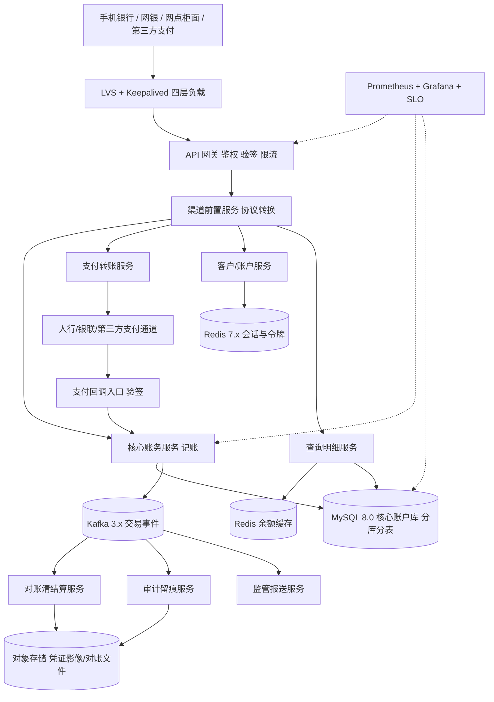

# 架构实战 · 银行核心系统（强一致 / 对账 / 两地三中心 / 等保）

::: tip 本篇定位
讲清一套持牌金融机构的核心联机链路：**渠道接入→前置→核心账务→支付通道→对账清结算**，重点攻克**资金强一致、分布式事务、幂等防重放、对账冲正、审计留痕、两地三中心 RPO≈0、等保三级**。方法见 [架构方法论](./architecture-methodology)、[容量估算](./architecture-capacity-sizing)、[高可用蓝图](./architecture-ha-blueprints)。

> 阅读对象：有互联网高并发经验、想转行金融/政企的 SRE。本文假设你已了解 [MySQL 分库](./data-mysql) 与 [Redis](./data-redis)，重点讲金融特有的"钱与合规"约束。
:::

## 一、业务特点与规模估算

金融系统与互联网最大的区别：**可用性与一致性 > 延迟与吞吐**，一切为"钱不能错、不能丢、可追溯"让步。

| 指标 | 日常 | 峰值（发薪日/大促转账） | 说明 |
|---|---|---|---|
| 个人客户累计 | 3000 万 | - | 实名+KYC |
| 日活 DAU | 100 万 | 300 万 | 手机银行为主 |
| 联机交易 TPS | 2000 | 8000 | 转账/缴费/支付核心写链路 |
| 联机查询 QPS | 1 万 | 5 万 | 余额/明细查询读多 |
| 日交易笔数 | 800 万 | 2500 万 | 含代扣、代发 |
| 账户余额/流水库 | 增量 20GB/天 | - | 核心流水需留存 15 年 |
| 单笔交易 RT 要求 | ≤ 300ms | ≤ 1s | 核心账务链路 |
| 系统可用性 | 99.99% | 99.99% | 核心年化停机 ≤ 52 分钟 |
| RPO / RTO | RPO≈0 / RTO≤30min | - | 两地三中心硬性指标 |

**核心结论**：读流量靠缓存与读副本，**资金写链路必须强一致**，绝不用"最终一致"对付余额；所有交易全程留痕、可对账、可冲正。

### 1.1 容量推演（数字如何自洽）

| 推演项 | 计算 | 结论 |
|---|---|---|
| 核心账务服务所需副本 | 8000 TPS ÷ 单副本约 1200 TPS ≈ 6.7，留 30% 冗余 | 8 副本 |
| MySQL 分库数 | 单库稳写 1000 TPS，8000 TPS 需 8 库 | 8 主库（按客户号哈希） |
| 单库连接/内存 | 每主库约 300 应用连接 + InnoDB buffer pool 占内存 60% | 32C128G |
| Redis 容量 | 会话+令牌约 5000 万 key × 1KB ≈ 50GB，主从高可用 | 3 主 3 从分片 |
| 流水增长 | 20GB/天 × 365 × 留存 15 年 ≈ 110TB，冷热分离 | 历史库+对象存储归档 |
| 同城复制带宽 | 峰值 8000 TPS × 平均 2KB  redo ≈ 16MB/s 写入复制量 | 裸光纤 1Gbps 足够 |

> 原则：**金融按"稳态 + 30% 冗余"配，不按极限压测配**；机器宁多不可挤，因为核心系统扩容窗口极短、变更极慎重。

## 二、总体架构图



### 2.1 一笔转账的强一致交易链路

```mermaid
flowchart TD
    A["用户发起转账 请求号 clientReqId"] --> B["网关验签+限流+黑名单"]
    B --> C["前置服务 校验账户与限额"]
    C --> D["核心服务 开启本地事务"]
    D --> E["冻结转出方余额 幂等键查重"]
    E --> F{"扣款账务成功?"}
    F -->|失败| G["拒绝 返回余额不足"]
    F -->|成功| H["记账到过渡户 调支付通道"]
    H --> I{"通道同步结果"}
    I -->|成功| J["落账转入方 提交本地事务"]
    I|超时| K["悬挂 进入待对账 主动查询"]
    I -->|明确失败| L["解冻回滚 本地事务回滚"]
    J --> M["发交易事件 对账+审计+报送"]
    K --> N["对账任务轮询 最终一致冲正"]
```

关键点：**本地事务管内部两户记账，跨通道部分用 TCC/悬挂+对账兜底**；绝不让"通道成功、本行落账失败"这种钱不平的状态长期存在，靠 T+0 准实时对账与冲正收敛。

> 注意：交易链路上的每个写操作都必须带全局唯一流水号（`txn_id`），它是幂等、对账、审计、冲正四件事共同的关联键；没有流水号的交易等于"裸奔"。

## 三、服务器清单

| 角色 | 数量 | CPU(核) | 内存 | 系统盘/数据盘(类型/容量/IOPS) | 带宽(内网/外网) | 每台装什么 |
|---|---|---|---|---|---|---|
| 四层负载 | 2(主备) | 16 | 32G | ESSD 100G / 系统盘 | 外网 500Mbps 多线BGP | LVS+Keepalived；见 [LVS](./services-lvs-keepalived) |
| API 网关 | 4 | 16 | 32G | ESSD 200G | 外网 500Mbps | APISIX/Nginx，验签限流 |
| 渠道前置 | 4 | 16 | 32G | ESSD 200G | 内网 | 协议转换、路由 |
| 核心账务服务 | 8 | 32 | 64G | ESSD PL2 300G / 3万IOPS | 内网 | 记账/冻结/落账，多副本 |
| 支付转账服务 | 4 | 16 | 32G | ESSD 200G | 外网 200Mbps | 对接通道、回调验签 |
| 客户/账户服务 | 4 | 16 | 32G | ESSD 200G | 内网 | 开户/实名/限额 |
| 查询明细服务 | 4 | 16 | 32G | ESSD 200G | 内网 | 余额/流水查询 |
| 对账清结算 | 4 | 16 | 32G | ESSD 500G | 内网 | 对账/冲正/清算 |
| 审计/监管报送 | 2 | 8 | 16G | ESSD 500G | 内网 | 留痕/报文生成 |
| MySQL 核心账户库 | 8主16从 | 32 | 128G | ESSD PL2 2T / 5万IOPS | 内网 | 按客户号分 8 库；见 [MySQL](./data-mysql) |
| MySQL 流水/历史库 | 4主4从 | 16 | 64G | ESSD PL2 4T | 内网 | 冷热分离，历史归档 |
| Redis Cluster | 6(3主3从) | 16 | 64G | ESSD 200G | 内网 | 会话/令牌/余额缓存；见 [Redis](./data-redis) |
| Kafka | 5 | 16 | 64G | ESSD 2T | 内网 | 交易事件/审计；见 [Kafka](./data-kafka) |
| 对象存储 MinIO | 4 | 16 | 64G | HDD 8T×4 | 内网 | 凭证影像/对账文件 |
| 监控 | 2 | 8 | 32G | ESSD 1T | 100Mbps | Prometheus/Grafana；见 [SLO](./monitor-slo) |
| 同城灾备中心 | 1套同构 | - | - | - | 裸光纤复制 | 核心库半同步/存储复制，RPO≈0 |
| 异地灾备中心 | 1套精简 | - | - | - | 专线异步复制 | 日终批量复制，RPO≤15min |

**合计生产自建约 70 台（不含同城/异地灾备同构资源）**。与规模自洽：核心账务 8 副本扛削峰后 8000 TPS 的记账压力，MySQL 按客户号分 8 库把单库写 TPS 压到 1000 量级，符合金融库稳为主的策略。

### 3.1 为什么这样配（自洽说明）

- **核心账务服务 8 副本**：单副本稳定处理约 1200 TPS（本地事务+行锁），8×1200≈9600 TPS，覆盖 8000 峰值并留冗余；该服务是 CPU+锁密集型，故给 32C64G。
- **MySQL 8 主 16 从**：一主两从，从库承接查询与灾备；半同步复制保证主库宕机不丢已确认事务；32C128G 主要喂 InnoDB Buffer Pool（占 60%≈76G）。
- **Redis 3 主 3 从**：会话/令牌/余额缓存总量约 50GB，分片后单主内存压力小，主从切换对缓存类可接受（重建即可）。
- **带宽**：金融外网流量不大（报文小），瓶颈在数据库内网复制与存储 IOPS，故数据盘选 ESSD PL2 高 IOPS 而非大带宽。

### 3.2 关键中间件版本（2026 现状）

| 组件 | 选型版本 | 说明 |
|---|---|---|
| MySQL | 8.0.36+ | 窗口函数、原子 DDL、并行复制；金融库少用 8.4 LTS 以保稳定 |
| Redis | 7.2.x | Cluster 分片，避免大 key 与热 key |
| Kafka | 3.7.x | 交易事件缓冲，acks=all + 副本 3 |
| K8s | 1.30.x | 无状态服务容器化，有状态数据库虚机部署；见 [K8s](./container-k8s-01-architecture-cluster) |
| JDK | 17 LTS | 核心服务运行时，G1/ZGC |

## 四、服务依赖与各自解决的问题

| 服务 | 解决什么问题 | 与谁交互 | 同步/异步 |
|---|---|---|---|
| LVS+Keepalived | 四层入口高可用，主备切换 | 网关 | 同步转发 |
| API 网关 | 统一验签、TLS 卸载、限流、黑名单 | 前置 | 同步 |
| 渠道前置 | 多渠道协议转换、报文组装 | 核心/支付/账户 | 同步 |
| 核心账务 | 唯一记账入口，冻结/落账/冲正 | MySQL、Kafka | 本地事务同步写库 |
| 支付转账 | 对接人行/银联，回调验签 | 外部通道、Kafka | 同步调通道，异步回调 |
| 客户/账户 | 实名、KYC、限额、开户 | MySQL、Redis | 同步 |
| 查询明细 | 余额/流水读多 | Redis、MySQL 从库 | 同步读，读写分离 |
| 对账清结算 | 行内/通道对账，差错处理与冲正 | Kafka、MySQL、OSS | 异步消费+T+0批量 |
| 审计报送 | 全程留痕、监管报文 | Kafka、OSS | 异步，不可篡改 |

> **同步/异步边界铁律**：凡是动钱的链路（记账、扣款、落账）一律**同步+本地事务**，必须等数据库提交成功才返回用户；凡是"事后"的动作（审计、报送、通知、对账）一律**异步走 Kafka**，绝不让用户为写审计日志多等 100ms。

## 五、关键设计点与坑 / 注意事项

1. **强一致优先**：账户余额这类资金字段，读也要读主或读已提交，绝不能容忍主从延迟导致"余额扣了却看到旧数"。对延迟敏感的记账查询一律走主库。
2. **分布式事务选型**：行内两户记账用**本地事务**；跨系统（本行↔通道）用 **TCC**（Try 冻结 / Confirm 落账 / Cancel 解冻），长流程清算用 **Saga**。严禁用本地消息表去"最终一致"一笔真实扣款。
3. **幂等与防重放**：每笔交易带客户端 `clientReqId` + 服务端流水号双重去重；回调、批量、重试全部幂等。接口加时间戳+nonce 防重放，签名验签防篡改。
4. **悬挂与空回滚**：TCC 必须处理"Try 没到、Cancel 先到"的悬挂，和"空 Cancel"；用事务状态表记录分支状态。
5. **对账与冲正**：T+0 准实时对账（行内账务 vs 通道报文），T+1 全量对账；差错走**冲正交易**原路退回，绝不允许"手工改库"。
6. **审计留痕**：所有交易、登录、后台操作写不可篡改日志（只追加、哈希链、异地保存），留存 15 年，满足等保与监管。
7. **灰度与回滚**：核心系统变更走灰度（先 1% 渠道/网点），备好一键回滚与**交易旁路**；大版本必须在窗口内发布，拒绝无回滚方案上线。
8. **监管报送**：反洗钱（AML）、大额可疑、1104 报表按监管报文规范生成，字段错误会被监管退回，要有独立校验服务。
9. **热点账户**：手续费过渡户、公共手续费户是全系统写热点，行锁会打满。做法：拆分多个过渡户（`transit_001..N`）分摊写，日终汇总。
10. **批量与联机隔离**：日终批处理（结息、对账、清算）与联机交易抢库资源，必须用独立库实例或低峰窗口跑，避免白天批量拖垮联机 TPS。
11. **多活 vs 主备**：核心账务一般不做"双活写"（冲突难处理），而是"同城热备 + 异地冷备"，故障切换而非同时写。
12. **压测与演练**：核心系统上线前必须做全链路压测（影子库/影子表隔离流量），每季度做一次同城切换、每年一次异地切换演练，形成剧本。

## 六、安全与高可用

- **网络分区**：核心区、DMZ 前置区、办公区严格隔离，防火墙白名单；核心库不直接暴露，只允许账务服务访问（见 [iptables](./linux-security-iptables)）。
- **加密**：全链路 TLS/国密 SM2/SM4；存储敏感字段加密（身份证、卡号）；密钥 KMS/HSM 托管，定期轮换。
- **两地三中心**：生产中心 + 同城灾备（裸光纤，存储/数据库半同步，**RPO≈0**）+ 异地灾备（专线异步，RPO≤15min）；每年至少两次**灾备切换演练**。
- **消除单点**：LVS 主备、网关多副本、MySQL 一主多从+分库、Redis Cluster、Kafka 多副本。
- **准入与权限**：运维走堡垒机 + 双人复核；后台操作 RBAC，资金类操作强制二次审批；见 [堡垒机](./monitor-jumpserver)。
- **数据脱敏**：测试/开发环境使用脱敏数据，生产数据不出内网；日志中的卡号、身份证号落盘前掩码。
- **等保三级**：物理安全、访问控制、入侵检测、日志审计、数据备份恢复逐项达标，定期测评。
- **RPO/RTO 设计**：同城用数据库半同步复制（主库提交需至少一个同城从库收到 binlog），宕机切换**不丢已确认交易（RPO≈0）**；异地用 binlog 异步归档，容忍分钟级丢失。切换目标 RTO≤30 分钟，靠预演练与自动化脚本达成。
- **变更窗口与熔断**：核心系统只在业务低峰（如 0:00–4:00）变更；一旦监控到账务错误率超阈值，自动熔断写交易、切只读保护资金安全。

## 七、上线后可能出现的状况与应对

| 类别 | 征兆 | 处置 |
|---|---|---|
| 性能类 | 核心记账 RT 飙高、超时增多 | 查慢 SQL 与行锁等待；定位热点账户（如公共过渡户）；临时降级非核心查询 |
| 性能类 | Redis 余额缓存击穿，DB 压力突增 | 热点 key 预热+互斥重建；记账查询临时读主限流 |
| 容量类 | MySQL 单库写 TPS 逼近上限 | 检查分库键是否倾斜；热点客户再分片；历史流水归档到历史库 |
| 容量类 | Kafka 对账事件积压 | 扩分区与对账消费组；排查冲正服务卡死 |
| 故障类 | API 网关卡 | LVS 自动摘流，流量切其他网关；下调限流保护后端 |
| 故障类 | 核心 MySQL 主库宕机 | 按预案提升同城从库，应用切连；期间冻结非必要写，演练过的切换 ≤30min |
| 故障类 | 支付通道回调中断 | 主动查单任务轮询在途交易，状态不丢；对账兜底 |
| 故障类 | 同城机房断网 | DNS/负载切异地灾备，公告渠道，事后补数核对 |
| 流量突增 | 发薪日/双十一转账洪峰 | 网关限流+排队；非查询接口降级；核心库读主限流 |
| 扩容 | 客户量增长分库不足 | 按客户号再哈希扩库，双写迁移，停写窗口短割接 |
| 降级预案 | 外部通道全挂 | 转账交易暂停，余额查询/缴费仍可用；公告+工单 |
| 数据类 | 对账发现长短款 | 自动生成差错单，走冲正交易原路处理；禁止直接改库 |
| 数据类 | 主从延迟导致查询不一致 | 延迟敏感请求读主；监控 seconds_behind_master 告警 |
| 数据类 | 备份/恢复失败 | 定期恢复演练验证备份可用性；异地备份保留多份 |
| 合规类 | 监管报文校验失败 | 报送服务拦截报错，人工复核字段后重报，留痕 |
| 性能类 | 批量结息拖慢联机 | 批量切到独立只读实例/历史库跑，限制并发 |
| 故障类 | Redis 集群脑裂 | 暂停缓存强一致读主；修复集群后重建缓存 |
| 故障类 | MinIO/对象存储盘满 | 清理过期影像，扩容磁盘，对账文件转冷存储 |
| 容量类 | 审计日志暴增打满 Kafka | 审计异步落 OSS，Kafka 只做缓冲；扩分区 |
| 数据类 | 冲正后仍不平 | 挂起人工差错处理流程，双人复核，禁止技术直接改库 |
| 故障类 | K8s 节点漂移导致账务服务重调度 | 有状态账务数据库不上 K8s；无状态副本重建后从 Redis/DB 恢复会话 |
| 容量类 | 历史流水库膨胀 | 冷热分离，超 1 年流水归档到对象存储，在线库只留近 6 个月 |

### 7.1 分级响应

- **P0（资金风险/核心不可用）**：5 分钟内升级，自动熔断 + 切换同城灾备，通知业务与合规。
- **P1（部分渠道慢/非核心故障）**：30 分钟内处置，降级非必要功能。
- **P2（容量告警/慢查询）**：工作时间处理，纳入下一个变更窗口。

---

**相关阅读**：[架构方法论](./architecture-methodology) · [容量估算](./architecture-capacity-sizing) · [高可用蓝图](./architecture-ha-blueprints) · [MySQL](./data-mysql) · [Redis](./data-redis) · [Kafka](./data-kafka) · [LVS+Keepalived](./services-lvs-keepalived) · [K8s 架构](./container-k8s-01-architecture-cluster) · [SLO](./monitor-slo) · [容量与容灾](./sre-capacity-dr)
