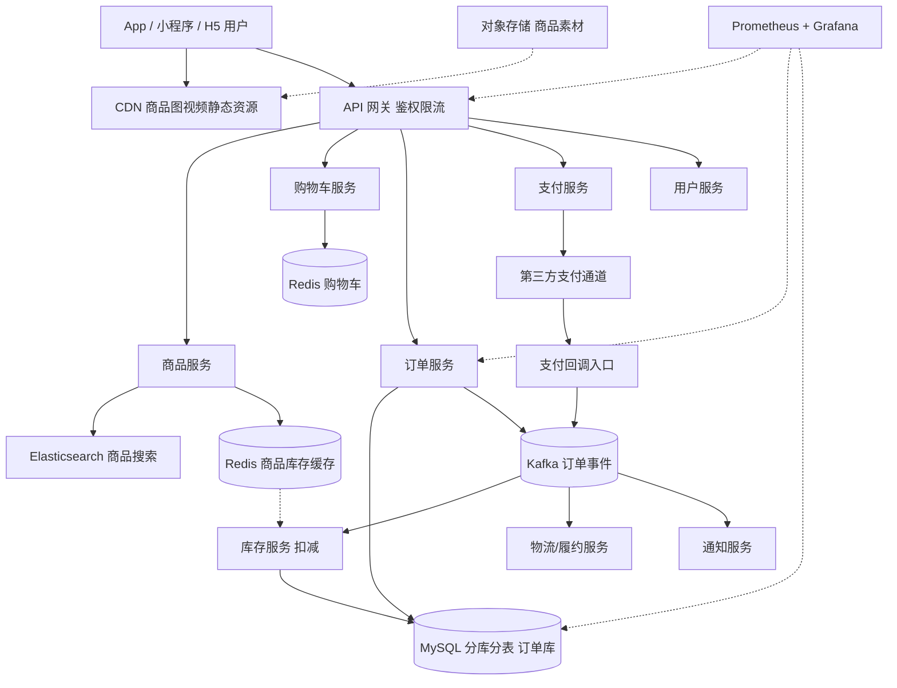
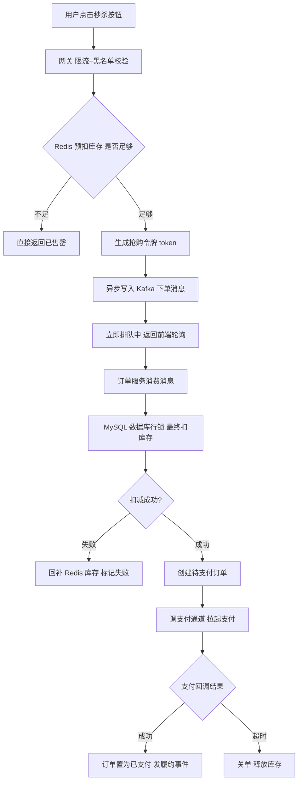

# 架构实战 · 电商系统（秒杀/下单/库存/支付/履约）

::: tip 本篇定位
讲清一套中型电商的核心链路：**商品→购物车→下单→库存→支付→履约**，重点攻克**秒杀瞬间 5 万 QPS、库存超卖、分布式事务、支付回调幂等、对账**。方法见 [架构方法论](./architecture-methodology)、[容量估算](./architecture-capacity-sizing)、[高可用蓝图](./architecture-ha-blueprints)。
:::

## 一、业务特点与规模估算

| 指标 | 日常 | 大促/秒杀峰值 | 说明 |
|---|---|---|---|
| 注册用户 | 2000 万 | - | 累计 |
| 日活 DAU | 200 万 | 800 万 | 大促当天 |
| 峰值在线 | 50 万 | 150 万 | 长连接 + 短请求 |
| 浏览商品 QPS | 5000 | 3 万 | 详情页读多 |
| 下单 TPS | 1000 | 2 万（秒杀） | 核心写链路 |
| 支付 TPS | 800 | 1.5 万 | 受支付通道限制 |
| 商品 SKU | 500 万 | - | 含 SKU/SPU |
| 日订单量 | 50 万 | 300 万 | 大促单日 |
| 订单/交易库 | 增量 10GB/天 | - | 需分库分表 |
| 带宽峰值 | 300 Mbps | 2 Gbps | 商品图/视频走 CDN |

**核心结论**：读流量靠 CDN+缓存扛，**写链路（下单/支付）必须削峰**，库存绝不能在数据库行锁里硬扛秒杀。

### 1.1 容量推算自洽过程

| 推算项 | 计算 | 结果 |
|---|---|---|
| 日常下单 TPS | 日订单 50 万 ÷ 86400 × 高峰系数 6 | ≈ 350 TPS，取 1000 留余量 |
| 秒杀实际写库 TPS | 2 万请求经 Kafka 削峰，按数据库能扛 2000 TPS | 消费端限速 2000 TPS |
| 分库数量 | 单库 MySQL 安全写 TPS ≈ 3000，秒杀 2000 × 冗余 | 分 8 库，单库峰值 ≈ 250 TPS |
| 订单表分片 | 8 库 × 8 表 = 64 表，按用户 ID 取模 | 热点用户分散 |
| Redis 库存内存 | 500 万 SKU × 每个 key 200 字节 | ≈ 1GB，32G 内存极宽松 |
| ES 集群 | 500 万 SKU 索引，3 副本 | 3 节点够 |

> 关键：**2 万 TPS 是请求量，不是写库量**。经过 Redis 预扣拦截无效请求、Kafka 削峰限速后，真正落到 MySQL 的写只有 2000 TPS，8 个库均匀分摊毫无压力。

## 二、总体架构图



### 2.1 秒杀 / 下单流程



关键点：**Redis 预扣库存挡住 99% 流量，Kafka 削峰把写库 TPS 压到数据库能承受的量级，MySQL 行锁做最终一致性扣减**，绝不让 2 万 TPS 直接打数据库。

## 三、服务器清单

| 角色 | 数量 | CPU(核) | 内存 | 数据盘 | 带宽 | 软件 / 职责 |
|---|---|---|---|---|---|---|
| CDN/OSS | 云 | - | - | - | 按量 | 商品素材、静态资源 |
| API 网关 | 4 | 8 | 16G | ESSD 200G | 100Mbps | APISIX/Nginx，鉴权限流；见 [Nginx](./services-web-nginx) |
| 商品服务 | 4 | 8 | 16G | ESSD 100G | 内网 | 详情、SKU |
| 购物车服务 | 2 | 8 | 16G | ESSD 100G | 内网 | 读写 Redis |
| 订单服务 | 6 | 16 | 32G | ESSD 200G | 内网 | 下单核心，多副本 |
| 库存服务 | 4 | 16 | 32G | ESSD 200G | 内网 | 扣减/回补 |
| 支付服务 | 3 | 8 | 16G | ESSD 100G | 内网 | 对接通道、回调 |
| 用户服务 | 2 | 8 | 16G | ESSD 100G | 内网 | 会员/地址 |
| 履约/通知 Worker | 4 | 8 | 16G | ESSD 100G | 内网 | 消费 Kafka |
| MySQL 订单库 | 8(4主4从) | 16 | 64G | ESSD PL2 1T / 1万IOPS | 内网 | 分 8 库 64 表；见 [MySQL](./data-mysql) |
| MySQL 商品/用户库 | 2主2从 | 16 | 64G | ESSD PL2 500G | 内网 | 读多 |
| Redis Cluster | 6(3主3从) | 8 | 32G | ESSD 200G | 内网 | 库存/购物车/热点；见 [Redis](./data-redis) |
| Kafka | 5 | 16 | 32G | ESSD 1T | 内网 | 下单/履约事件；见 [Kafka](./data-kafka) |
| Elasticsearch | 3 | 16 | 64G | ESSD 2T | 内网 | 商品搜索 |
| 监控 | 2 | 8 | 32G | ESSD 1T | 50Mbps | Prometheus/Grafana；见 [SLO](./monitor-slo) |

**合计自建约 60 台**。与规模自洽：订单服务 6 副本扛 2 万 TPS 削峰后的实际写库压力，MySQL 分 8 库把单库 TPS 压到可承受范围。

## 四、服务依赖与各自解决的问题

| 服务 | 解决什么问题 | 与谁交互 | 同步/异步 |
|---|---|---|---|
| 网关 | 统一鉴权、限流、黑名单、灰度 | 全部后端 | 同步 |
| 商品服务 | 详情/价格，读多 | Redis、ES、MySQL 从 | 同步读 |
| 购物车 | 加购/改数量 | Redis | 同步 |
| 订单服务 | 下单核心事务 | Kafka、MySQL | 异步削峰写库 |
| 库存服务 | 预扣/实扣/回补，防超卖 | Redis、MySQL | 异步消费 + DB 行锁 |
| 支付服务 | 拉起支付、验签回调 | 支付通道、Kafka | 同步调通道，异步回调 |
| Kafka | 下单/履约/通知解耦削峰 | 各服务 | 异步 |
| ES | 商品搜索/筛选 | 商品服务 | 同步查，数据 Canal 同步 |
| 履约服务 | 推物流、扣库存后发货 | Kafka、外部物流 API | 异步 |

## 五、关键设计点与坑 / 注意事项

1. **超卖与库存扣减**：Redis 预扣（Lua 原子 `decr`）+ MySQL 最终扣（`update stock set num=num-1 where sku=? and num>0`）。两层都要判断，绝不能只减 Redis 就认为成功。支付超时关单要**回补库存**。
2. **热点 key / 热点商品**：秒杀商品是 Redis 热点 key，单分片打满。做法：库存预热到本地缓存 + Redis，或对热点 key 做分片（`sku:1:a/b/c` 分摊计数）。
3. **幂等**：下单用 `用户ID+商品ID` 或客户端请求号做幂等键；**支付回调必须幂等**（同一回调重试多次只处理一次），用订单号 + 状态机判断。
4. **分布式事务**：下单扣库存与创建订单跨库，不用强一致分布式事务，用**本地消息表 + Kafka 最终一致**，失败重试 + 对账兜底。
5. **限流降级**：网关按用户/商品限流；秒杀开始前屏蔽商品详情页非必要推荐、评价接口；降级页兜底。
6. **对账**：T+1 与支付通道、物流对账，差异订单入人工核查表。支付通道回调可能丢，必须有**主动查单补偿任务**轮询未支付订单。
7. **价格**：下单时价格以服务端为准，绝不信任前端传价；优惠计算单独服务，防止叠加漏洞。

### 5.1 库存预扣 Lua 脚本（保证原子）

```lua
-- KEYS[1]=库存key  ARGV[1]=购买数量
local stock = tonumber(redis.call('GET', KEYS[1]))
local need  = tonumber(ARGV[1])
if stock == nil or stock < need then
    return -1                  -- 库存不足，拒绝
end
redis.call('DECRBY', KEYS[1], need)
return stock - need            -- 返回剩余库存，成功
```

> Redis 单线程执行 Lua 是原子的，不会出现「判断够、减的时候被抢」。返回 -1 直接售罄，挡住 99% 无效流量。真正落库扣减由订单服务消费 Kafka 后用 `where num > 0` 的乐观行锁完成，双保险防超卖。

### 5.2 订单状态机

```
待支付 --支付成功--> 已支付 --履约--> 已发货 --收货--> 已完成
   |                     |
   +--超时关单(30分钟)--> 已取消，回补库存
```

> 状态只能单向流转，每次流转带状态条件判断，重复回调（如支付通道重试）命中已有「已支付」状态直接返回成功，天然幂等。

## 六、安全与高可用

- **边界防护**：网关限流 + WAF；秒杀接口加签名/验证码防脚本刷单；支付回调验签（RSA）。
- **鉴权授权**：用户 JWT/SESSION；后台管理 RBAC + 堡垒机。
- **数据加密**：HTTPS 全站；手机号/身份证脱敏存储；支付密钥 KMS 托管。
- **消除单点**：网关/各服务多副本；MySQL 主从+分库；Redis Cluster；Kafka 多副本。
- **熔断降级**：Sentinel/网关熔断，下游挂了返回降级页（见 [SLO](./monitor-slo)）。
- **多可用区**：服务跨 2 可用区，MySQL 半同步复制保证不丢单。

## 七、上线后可能出现的状况与应对

| 类别 | 征兆 | 处置 |
|---|---|---|
| 性能类 | 下单接口 RT 飙高 | 查 Kafka 积压、订单库慢 SQL；临时扩订单服务副本 |
| 性能类 | Redis 热点 key CPU 100% | 定位热点 SKU，本地缓存兜底，热点 key 分片 |
| 容量类 | MySQL 单库 TPS 过高 | 检查分库键是否倾斜，热点商品订单集中→再分片 |
| 容量类 | Kafka 磁盘满/积压 | 扩分区、扩容消费组，排查某个消费服务卡死 |
| 故障类 | 网关挂 | 多副本 SLB 摘流；限流阈值临时下调保护后端 |
| 故障类 | Redis Cluster 某主挂 | 哨兵/Cluster 自动故障转移，期间该分片写失败重试 |
| 故障类 | MySQL 主库挂 | 提升从库，应用切连；大促期提前演练切换 |
| 故障类 | 支付通道回调全挂 | 主动查单任务兜底，已支付订单状态不丢 |
| 大促流量 | 秒杀开始瞬间 QPS 暴增 | Redis 预扣拦截，前端排队页，关闭非核心接口 |
| 数据类 | 超卖投诉 | 立即下架商品，核对 Redis 与 DB 库存差异，补偿订单 |
| 数据类 | 库存不一致（Redis 减了 DB 没减成） | 对账任务扫描，回补或补单，加死信告警 |
| 数据类 | 主从延迟大 | 大促写多读多延迟飙升，读回主或延迟敏感请求直主 |
| 数据类 | 支付回调丢失 | 主动查单补偿，T+1 对账差异入人工表 |
| 性能类 | 购物车读取慢 | 购物车全在 Redis，慢多为大 key（购物车商品过多），分页加载 |
| 故障类 | ES 集群挂 | 搜索降级为分类浏览，商品详情仍可用， Canal 暂停 |
| 故障类 | 某微服务发布后 OOM | 快速回滚上一版本，排查是否大促缓存未清理 |
| 容量类 | 订单库磁盘增长快 | 历史订单归档到冷库，当月数据留热库 |
| 大促流量 | 优惠券被刷/并发领取 | 优惠券接口限流 + 领取上限，库存预热 Redis |
| 数据类 | 重复下单 | 客户端幂等键重复命中，直接返回已有订单，不重复扣库存 |
| 数据类 | 关单后库存未回补 | 定时扫描超时未支付订单，回补 Redis+DB，死信告警 |

---

**相关阅读**：[架构方法论](./architecture-methodology) · [容量估算](./architecture-capacity-sizing) · [高可用蓝图](./architecture-ha-blueprints) · [MySQL](./data-mysql) · [Redis](./data-redis) · [Kafka](./data-kafka) · [K8s 架构](./container-k8s-01-architecture-cluster) · [SLO](./monitor-slo)
