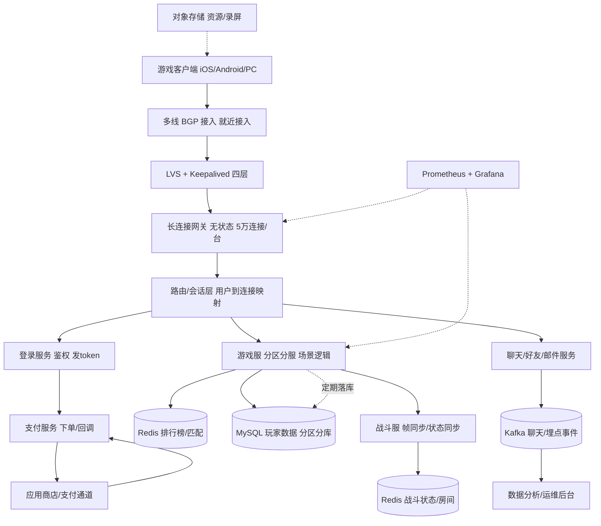
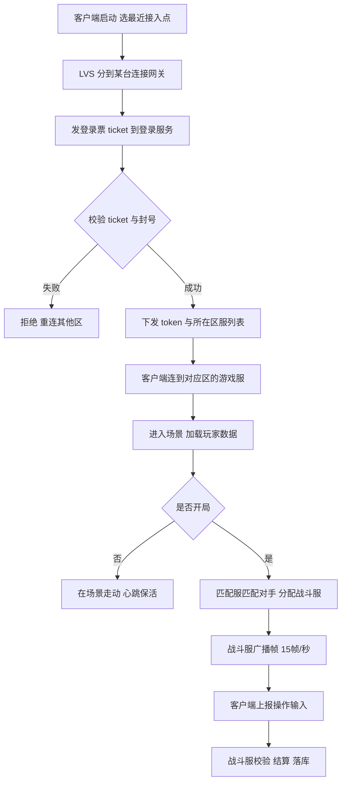

# 架构实战 · 游戏后端（长连接 / 分区分服 / 战斗同步）

::: tip 本篇定位
讲清一款中型 MMO/竞技手游的后端：**登录→长连接接入→分区分服→战斗同步→排行榜→支付**，重点攻克**百万长连接、低延迟战斗、帧同步 vs 状态同步、网络抖动重连、防作弊、开服合服**。方法见 [架构方法论](./architecture-methodology)、[容量估算](./architecture-capacity-sizing)、[高可用蓝图](./architecture-ha-blueprints)。

> 阅读对象：做过 Web 后端、想转游戏/实时长连接方向的 SRE。游戏后端的核心心智是**连接数与延迟优先，数据库反而是配角**。
:::

## 一、业务特点与规模估算

游戏后端与互联网最大的区别：**长连接常驻 + 强实时**，玩家对延迟敏感（战斗高 50ms 就输），开服/活动是脉冲式洪峰。

| 指标 | 日常 | 峰值（开服/版本活动） | 说明 |
|---|---|---|---|
| 注册用户 | 5000 万 | - | 累计 |
| 日活 DAU | 300 万 | 800 万 | 周末/活动 |
| 同时在线 CCU | 40 万 | 100 万 | 长连接常驻 |
| 长连接数 | 40 万 | 100 万 | TCP/WebSocket |
| 登录 QPS | 5000 | 3 万 | 开服瞬间登录洪峰 |
| 支付 TPS | 1000 | 5000 | 首充/活动 |
| 战斗帧率 | 15-20 帧/秒 | 同 | 帧同步 |
| 分区数量 | 50 个区 | 扩到 80 区 | 每区约 2 万 CCU |
| 单条战斗包 | 0.2-0.5KB | 同 | 小包高频 |
| 外网带宽峰值 | 3 Gbps | 8 Gbps | 战斗小包为主 |

**核心结论**：瓶颈不是数据库，而是**接入层的连接数与战斗带宽**；用分区分服把状态隔离到单服，避免全局共享状态。

### 1.1 容量推演

| 推演项 | 计算 | 结论 |
|---|---|---|
| 接入网关数量 | 100 万连接 ÷ 单机 5 万连接 = 20 台 | 20 台长连接网关 |
| 单机连接内存 | 每连接 socket buffer + 会话约 1.5MB | 5 万连接 ≈ 75G 内存，故配 128G |
| 战斗下行带宽 | 30 万在战斗 × 20KB/s ≈ 6GB/s | 20 台网关每台约 300Mbps，峰值 1Gbps |
| 游戏服数量 | 80 区 × 每区 1 组逻辑服 | 80 组战斗/场景服 |
| 登录扩容 | 3 万 QPS ÷ 单机 5000 QPS | 8 台登录服 |

## 二、总体架构图

### 2.1 登录与战斗流程

关键点：**接入层无状态，路由层维护 `userId → 连接在哪台网关` 映射**；玩家断线重连时靠路由层找到新网关、再回游戏服恢复会话。

> 战斗是 UDP 还是 TCP？竞技小包常用 **KCP/UDP**（低延迟、允许丢包重传），聊天/登录走 TCP；具体看引擎与手感要求，别一刀切用 HTTP 长轮询。

## 三、服务器清单

| 角色 | 数量 | CPU(核) | 内存 | 数据盘(类型/容量) | 带宽(外网/内网) | 每台装什么 |
|---|---|---|---|---|---|---|
| 多线 BGP/LVS | 4(主备集群) | 16 | 32G | ESSD 100G | 外网 10Gbps 多线 | LVS+Keepalived；见 [LVS](./services-lvs-keepalived) |
| 长连接网关 | 20 | 32 | 128G | ESSD 200G | 外网 1Gbps/台 | 无状态，5 万连接/台 |
| 路由/会话层 | 6 | 16 | 64G | ESSD 200G | 内网 | 连接映射，Redis 存会话 |
| 登录服务 | 8 | 16 | 32G | ESSD 100G | 外网 200Mbps | 鉴权、发 token |
| 游戏服(场景/逻辑) | 80 | 16 | 32G | ESSD 200G | 内网 | 每区一组，玩家状态 |
| 战斗服 | 40 | 16 | 32G | ESSD 100G | 内网 | 帧同步/状态同步 |
| 聊天/好友/邮件 | 6 | 8 | 16G | ESSD 100G | 内网 | 聊天广播 |
| 排行榜/匹配 | 4 | 16 | 64G | ESSD 100G | 内网 | Redis ZSet 排行榜 |
| 支付服务 | 3 | 8 | 16G | ESSD 100G | 外网 100Mbps | 下单、回调验签 |
| MySQL 玩家库 | 16(8主8从) | 16 | 64G | ESSD PL2 1T | 内网 | 按区分库；见 [MySQL](./data-mysql) |
| Redis Cluster | 9(5主4从) | 16 | 64G | ESSD 200G | 内网 | 会话/排行榜/房间；见 [Redis](./data-redis) |
| Kafka | 3 | 16 | 32G | ESSD 1T | 内网 | 聊天/埋点；见 [Kafka](./data-kafka) |
| 对象存储 | 云 | - | - | - | 按量 | 资源包/录屏 |
| 监控 | 2 | 8 | 32G | ESSD 1T | 100Mbps | Prometheus/Grafana；见 [SLO](./monitor-slo) |

**合计约 200 台**（80 区游戏服占大头，这正是分区分服的代价：状态隔离但机器多）。与规模自洽：20 台网关扛 100 万连接，每区独立 MySQL 库互不影响。

### 3.1 为什么这样配（自洽说明）

- **长连接网关 20 台**：单台 32C128G 承载 5 万长连接。每连接约 1.5MB（socket 收发缓冲 + 会话状态），5 万 ≈ 75G，留余量。这是连接数约束，不是 CPU 约束。
- **战斗带宽**：在战斗玩家约 30 万，每客户端下行约 20KB/s（15 帧 × 0.3KB + 状态同步），合计约 6GB/s，分摊到 20 台网关每台约 300Mbps，峰值活动时约 1Gbps，故外网配 1Gbps/台。
- **游戏服 80 组**：分区分服，每区一组逻辑服 + 战斗服；单区 CCU 2 万时单服 CPU/内存吃紧就加开分线，不全局扩容。
- **数据库按区分库**：每区玩家数据独立 MySQL 实例，单库 TPS 可控，合服/迁移按区操作。

### 3.2 关键中间件版本（2026 现状）

| 组件 | 选型版本 | 说明 |
|---|---|---|
| MySQL | 8.0.36+ | 玩家数据按区分库；见 [MySQL](./data-mysql) |
| Redis | 7.2.x | 会话/排行榜 ZSet/战斗房间；见 [Redis](./data-redis) |
| Kafka | 3.7.x | 聊天、埋点异步；见 [Kafka](./data-kafka) |
| K8s | 1.30.x | 登录/聊天等无状态服务容器化；游戏服因有状态+热更常虚机部署；见 [K8s](./container-k8s-01-architecture-cluster) |
| 接入协议 | TCP/WebSocket + Protobuf | 小包高频，自定义 TCP 协议比 HTTP 省开销 |

## 四、服务依赖与各自解决的问题

| 服务 | 解决什么问题 | 与谁交互 | 同步/异步 |
|---|---|---|---|
| LVS/网关 | 连接接入、TLS、心跳 | 客户端、路由层 | 同步转发 |
| 路由层 | userId→连接映射，断线重连定位 | Redis、网关 | 同步查映射 |
| 登录服务 | 鉴权、封号、发 token | MySQL、Redis、支付 | 同步 |
| 游戏服 | 单区场景逻辑、玩家状态 | MySQL、Redis、战斗服 | 同步短连接内部调用 |
| 战斗服 | 帧同步/状态广播、战斗结算 | Redis 房间、游戏服 | 高频广播(异步帧) |
| 聊天/好友 | 聊天广播、社交关系 | Kafka、Redis | 广播异步 |
| 排行榜/匹配 | 实时排行、匹配组队 | Redis ZSet | 同步读，定时写库 |
| 支付服务 | 充值下单、回调验签 | 商店通道、MySQL | 同步下单，异步回调 |

> **实时边界**：战斗帧广播是高频 UDP/TCP 短包，**绝不走 MQ**（延迟受不了）；聊天、埋点、日志这类可容忍秒级的才走 Kafka。玩家状态以游戏服内存为准，Redis/MySQL 只是缓存与持久化。

## 五、关键设计点与坑 / 注意事项

1. **帧同步 vs 状态同步**：竞技对战（少人、强公平）用**帧同步**——只广播玩家操作输入，各端自算，包小、可回放，但对一致性要求高；大世界/MMO 用**状态同步**——服务器广播实体状态，开发简单但带宽大。别用错。
2. **网络抖动重连**：玩家切后台、弱网断线，重连时要**恢复战斗帧进度**（断线前最后收到的帧号），战斗服缓存最近 N 秒帧；超过窗口没回来才判逃跑。
3. **防作弊**：服务器是唯一权威，客户端上报的伤害/坐标全部服务端校验；关键数值（金币、战力）以服务器为准；检测加速/透视用行为统计+录像回放；作弊封号走黑名单。
4. **排行榜热点**：全服排行榜是 Redis 热点 key。做法：分段 ZSet（按战力区间分桶）+ 定时合并 Top N，避免一个 key 扛全部更新。
5. **热更新**：游戏逻辑频繁改，战斗服要支持**不停机热更**（脚本层 Lua/JS 热更，引擎层不动），避免发版重启服务器踢人。
6. **开服洪峰**：开服瞬间几万玩家同时登录+进游戏，登录服和网关先限流排队，游戏服预热（开服前预建区服、加载配置），数据库连接池提前撑大。
7. **合服**：老区玩家少了要合服，核心是**玩家 ID/公会 ID 冲突合并 + 数据迁移 + 唯一索引处理**，合服停服窗口操作，事后校验资产不丢。
8. **全区全服 vs 分区分服**：分区分服社交隔离、好扩容，但玩家不能跨服；要做跨服玩法（跨服战场）就抽一组全局服，通过路由把玩家转发过去，别把所有数据塞一个库。
9. **心跳与连接保活**：长连接必须有心跳（如 15-30 秒一次），NAT 超时前发心跳保活；网关主动清理僵死连接，防止连接数被假连接占满。
10. **战斗帧缓存**：战斗服内存缓存最近 5-10 秒的帧（用于断线重连补帧），不能无限缓存，老帧及时淘汰，否则内存爆。
11. **数据落库时机**：玩家金币/战力等敏感操作即时落库，普通场景状态几秒一次快照；既保证不丢档，又不把 MySQL 写爆。
12. **协议压缩**：战斗小包高频，用 Protobuf + 可选压缩，减少带宽；但压缩会增 CPU，弱网带宽紧张时才开。

## 六、安全与高可用

- **就近接入**：多线 BGP + LVS，玩家连最近的接入点降延迟；网关无状态可随时扩缩。
- **连接平滑迁移**：网关卡机时，客户端自动重连其他网关，路由层更新映射，不影响游戏服状态（状态在游戏服/Redis）。
- **过载保护**：登录/网关限流，战斗服满员拒绝新匹配；Redis/MySQL 连接池熔断；见 [SLO](./monitor-slo)。
- **消除单点**：LVS 主备、网关多副本、游戏服从区服级别冗余（关键区双活）、MySQL 主从、Redis Cluster。
- **数据落库**：玩家数据不能只在内存，游戏服**定期快照 + 关键操作即时落库**，服重启从 MySQL/Redis 恢复。
- **故障切换**：某区游戏服挂，该区玩家重连到备机或临时维护公告；跨服玩法不受影响。
- **多线 BGP**：电信/联通/移动多线接入，避免跨网延迟；北方联通、南方电信用户就近接入。
- **过载保护**：网关按连接数限流，单区游戏服 CCU 到阈值拒绝新进入，避免一个区拖垮整套。
- **监控重点**：连接数、战斗 RT、网关带宽、单区 CCU、Redis 命中率，见 [SLO](./monitor-slo)。

## 七、上线后可能出现的状况与应对

| 类别 | 征兆 | 处置 |
|---|---|---|
| 性能类 | 战斗延迟飙高、帧丢包 | 查战斗服 CPU 与网关带宽；扩容战斗服，把战斗房间迁出 |
| 性能类 | Redis 排行榜 key CPU 打满 | 分段 ZSet，合并 TopN，读请求走缓存 |
| 容量类 | 长连接数逼近网关上限 | 加网关实例，客户端重连分散；观察单机连接数 |
| 容量类 | 单区 CCU 超游戏服承载 | 该区拆分/加开分线，引导玩家分流 |
| 故障类 | 某台网关卡 | LVS 摘流，客户端重连其他网关；路由层更新映射 |
| 故障类 | 路由层 Redis 挂 | 会话短暂丢失，玩家重新登录；切从库 |
| 故障类 | 某区游戏服宕机 | 该区临时维护公告，从快照恢复，玩家重连 |
| 故障类 | MySQL 玩家库主库挂 | 提升从库，该区短暂停写，恢复后追数据 |
| 开服活动 | 开服登录洪峰 3 万 QPS | 登录排队+限流，游戏服预热，DB 连接池撑大 |
| 扩容合服 | 老区玩家萎缩 | 规划合服：停服窗口迁移数据，ID 冲突合并，校验资产 |
| 降级预案 | 聊天/排行榜非核心服务挂 | 关闭聊天广播，排行榜用缓存旧数据，战斗不受影响 |
| 数据类 | 玩家资产异常（金币凭空多） | 回档到最近快照，查作弊，录像回放取证 |
| 数据类 | 战斗结算与客户端不一致 | 以服务器结算为准，客户端纠正，排查作弊 |
| 故障类 | 支付回调丢失 | 主动查单补偿，未到账订单补发货 |
| 安全类 | 检测到批量作弊 | 黑名单封号，封设备/IP，热更反作弊规则 |
| 性能类 | 聊天广播刷爆网关 | 限流+消息合并，大群消息降级为拉取 |
| 容量类 | Kafka 聊天积压 | 扩分区，排查消费端；聊天可丢历史不阻塞实时 |
| 故障类 | 匹配服务挂 | 匹配排队暂停，已有战斗不受影响；恢复后继续匹配 |
| 数据类 | 合服后玩家资产对不上 | 合服前全量备份，迁移后脚本校验资产总额，差异人工补偿 |
| 故障类 | 对象存储资源包下载失败 | CDN 回源兜底，客户端走降级资源 |
| 性能类 | 登录服务 RT 高 | 查 ticket 校验慢、Redis 会话热点；扩容登录服 |
| 容量类 | Redis 房间 key 膨胀 | 战斗结束即清理房间 key，加 TTL 自动过期 |
| 故障类 | K8s 节点重启影响无状态服务 | 多副本反亲和，Pod 漂移自动重建，状态不丢 |
| 数据类 | 玩家回档投诉 | 核对快照时间点，补偿丢失资产，修复落库逻辑 |
| 故障类 | 某游戏服内存泄漏 | 热更修复或摘流重启，玩家重连，状态从快照恢复 |
| 容量类 | 跨服战场全局服压力大 | 拆多组跨服服，按战力区间分流 |
| 性能类 | 弱网玩家卡顿拖累全队 | 帧同步下卡顿端影响公平性，按规则判定挂机/掉线托管 |
| 故障类 | 支付通道某商店回调挂 | 该商店暂停充值，其他商店正常；主动查单补偿 |

### 7.1 分级响应

- **P0（全服登不进/战斗全卡）**：5 分钟升级，限流保护，查网关/路由层是否雪崩；公告安抚。
- **P1（单区故障/支付不到账）**：30 分钟处置，该区维护公告，支付主动查单补偿。
- **P2（容量告警/慢查询/排行榜抖动）**：工作时间处理，纳入下次开服前优化。

> 游戏行业特殊点：**玩家在游戏里出问题会立刻刷屏骂客服**，所以公告、补偿（发邮件钻石）要快，技术处置与客服安抚并行。
>
> 容量与容灾的通用方法见 [容量与容灾](./sre-capacity-dr)。

---

**相关阅读**：[架构方法论](./architecture-methodology) · [容量估算](./architecture-capacity-sizing) · [高可用蓝图](./architecture-ha-blueprints) · [MySQL](./data-mysql) · [Redis](./data-redis) · [Kafka](./data-kafka) · [LVS+Keepalived](./services-lvs-keepalived) · [K8s 架构](./container-k8s-01-architecture-cluster) · [SLO](./monitor-slo) · [容量与容灾](./sre-capacity-dr)
