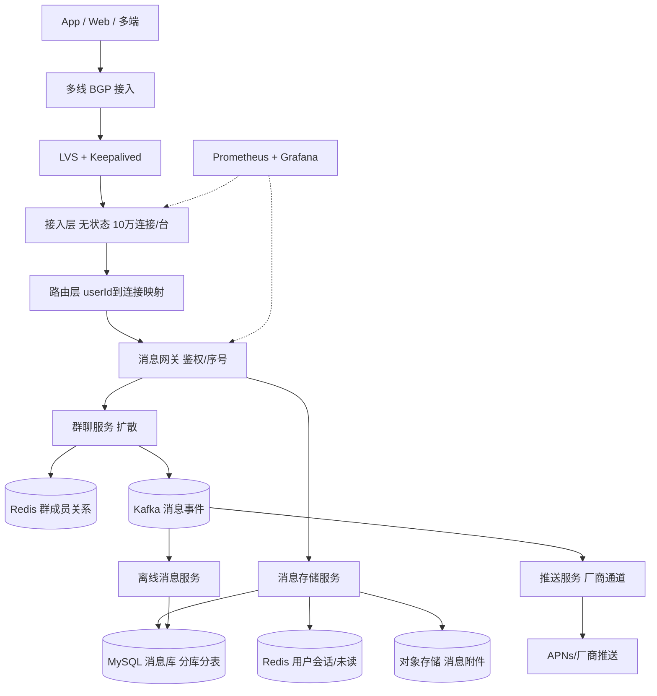
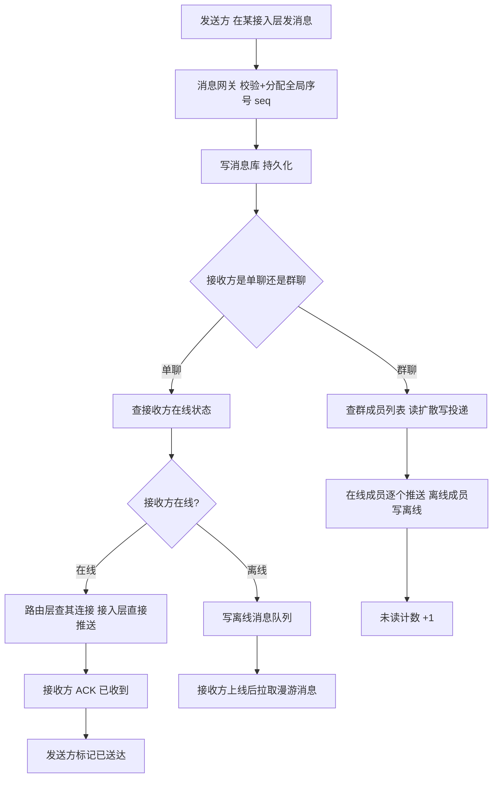

# 架构实战 · IM 即时通讯（长连接 / 消息路由 / 群聊扩散）

::: tip 本篇定位
讲清一款社交/企业 IM 的后端：**长连接接入→消息路由→存储投递→群聊扩散→离线漫游→多端同步→推送**，重点攻克**海量长连接、消息可靠与有序、写扩散 vs 读扩散、大群、多端一致性**。方法见 [架构方法论](./architecture-methodology)、[容量估算](./architecture-capacity-sizing)、[高可用蓝图](./architecture-ha-blueprints)。

> 阅读对象：做过短连接 Web 后端、想转 IM/长连接方向的 SRE。IM 的核心心智是**先落库后投递、按会话序号保序、大群读扩散**。
:::

## 一、业务特点与规模估算

IM 的本质：**海量常驻长连接 + 海量小消息**，要求消息不丢、不重、不乱序、多端一致。

| 指标 | 日常 | 峰值 | 说明 |
|---|---|---|---|
| 注册用户 | 1 亿 | - | 累计 |
| 日活 DAU | 2000 万 | 3000 万 | |
| 同时在线长连接 | 300 万 | 500 万 | 常驻 |
| 上行消息 QPS | 8 万 | 20 万 | 用户发消息 |
| 下行投递 QPS | 20 万 | 60 万 | 群聊扩散放大 |
| 日消息量 | 20 亿 | 50 亿 | 含群消息 |
| 单聊大小群 | 大群 500-2000 人 | 十万人大群 | 读扩散场景 |
| 离线消息漫游 | 7 天 | - | 新设备登录拉取 |
| 外网带宽峰值 | 5 Gbps | 12 Gbps | 消息包小 |

**核心结论**：瓶颈在**接入层连接数与消息扩散放大**；大群必须读扩散，否则一条消息要写库 N 次。

### 1.1 容量推演

| 推演项 | 计算 | 结论 |
|---|---|---|
| 接入层数量 | 500 万连接 ÷ 单机 10 万 = 50 台 | 50 台接入网关 |
| 单机连接内存 | 每连接约 1MB（IM 心跳稀疏，缓冲小） | 10 万连接 ≈ 100G，配 128G |
| 下行放大 | 20 万上行 × 平均扩散 3 = 60 万下行 | 扩散系数决定投递量 |
| 消息库写 TPS | 60 万下行 ÷ 分库后单库 5000 | 分 12 库 |
| 带宽 | 500 万在线 × 2KB/s ≈ 10Gbps | 50 台每台约 200Mbps |

## 二、总体架构图

### 2.1 一条消息的投递流程

关键点：**消息先落库再投递**（不丢），全局序号 `seq` 保证有序与去重；在线走长连接推送，离线写库等上线拉取，App 在后台则走厂商推送。

> 为什么"先落库"而不是"先投递"？因为投递会失败（接收方不在线、网络抖动），落库是唯一可靠事实来源；先投递后落库一旦写库失败，消息就凭空消失了。

## 三、服务器清单

| 角色 | 数量 | CPU(核) | 内存 | 数据盘(类型/容量) | 带宽(外网/内网) | 每台装什么 |
|---|---|---|---|---|---|---|
| LVS/BGP | 4 | 16 | 32G | ESSD 100G | 外网 10Gbps 多线 | LVS+Keepalived；见 [LVS](./services-lvs-keepalived) |
| 接入层网关 | 50 | 32 | 128G | ESSD 200G | 外网 1Gbps/台 | 无状态，10 万连接/台 |
| 路由层 | 6 | 16 | 64G | ESSD 200G | 内网 | 连接映射，Redis 存 |
| 消息网关 | 12 | 16 | 32G | ESSD 200G | 内网 | 鉴权/序号/投递 |
| 消息存储服务 | 12 | 16 | 32G | ESSD 200G | 内网 | 消息读写 |
| 群聊服务 | 8 | 16 | 32G | ESSD 200G | 内网 | 扩散/成员关系 |
| 离线消息服务 | 6 | 8 | 16G | ESSD 100G | 内网 | 漫游拉取 |
| 推送服务 | 4 | 8 | 16G | ESSD 100G | 外网 100Mbps | 对接厂商通道 |
| MySQL 消息库 | 24(12主12从) | 16 | 64G | ESSD PL2 2T | 内网 | 按会话分 12 库；见 [MySQL](./data-mysql) |
| Redis Cluster | 9(5主4从) | 16 | 64G | ESSD 200G | 内网 | 会话/未读/群成员；见 [Redis](./data-redis) |
| Kafka | 5 | 16 | 64G | ESSD 2T | 内网 | 消息事件/推送；见 [Kafka](./data-kafka) |
| 对象存储 | 云 | - | - | - | 按量 | 图片/语音/视频附件 |
| 监控 | 2 | 8 | 32G | ESSD 1T | 100Mbps | Prometheus/Grafana；见 [SLO](./monitor-slo) |

**合计约 140 台**（50 台接入层占大头，这是海量长连接的代价）。与规模自洽：50 台网关扛 500 万连接，消息库分 12 库把单库写 TPS 压到 5000。

### 3.1 为什么这样配（自洽说明）

- **接入层 50 台**：单台 32C128G 承载 10 万长连接。IM 心跳稀疏（30-60 秒一次）、消息包小，每连接内存约 1MB，10 万 ≈ 100G。这是连接数约束。
- **扩散放大**：上行 20 万消息，群聊平均扩散系数 3，下行投递 60 万；大群读扩散避免一条消息写 N 份库。
- **消息库分 12 库**：按会话 ID 哈希分库，单库写 TPS 约 5000，符合 MySQL 8.0 稳态。
- **带宽**：500 万在线人均 2KB/s，总约 10Gbps，分摊 50 台每台约 200Mbps，故外网 1Gbps/台留足余量。

### 3.2 关键中间件版本（2026 现状）

| 组件 | 选型版本 | 说明 |
|---|---|---|
| MySQL | 8.0.36+ | 消息库分库分表；见 [MySQL](./data-mysql) |
| Redis | 7.2.x | 路由映射/未读/群成员；见 [Redis](./data-redis) |
| Kafka | 3.7.x | 消息事件、推送异步；见 [Kafka](./data-kafka) |
| K8s | 1.30.x | 无状态服务容器化；接入层因长连接常虚机/独占部署；见 [K8s](./container-k8s-01-architecture-cluster) |
| 推送 | APNs / 国内厂商通道 | 国产 ROM 后台保活差，必须依赖厂商推送 |

## 四、服务依赖与各自解决的问题

| 服务 | 解决什么问题 | 与谁交互 | 同步/异步 |
|---|---|---|---|
| 接入层 | 维持长连接、收发消息 | 客户端、路由层 | 同步转发 |
| 路由层 | userId→连接在哪台网关 | Redis、接入层 | 同步查映射 |
| 消息网关 | 鉴权、分配全局序号、去重 | MySQL、Redis、群聊 | 同步写库后投递 |
| 消息存储 | 消息持久化、漫游拉取 | MySQL、Redis | 同步写 |
| 群聊服务 | 群成员关系、扩散策略 | Redis、Kafka | 扩散异步化 |
| 离线服务 | 离线消息存储与拉取 | MySQL | 异步 |
| 推送服务 | App 后台/离线推送 | 厂商通道、Kafka | 异步 |

> **同步/异步边界**：消息落库是同步（不丢），在线推送走长连接（实时），推送/离线/回执走 Kafka（可容忍秒级）。绝不能让"等厂商推送 ACK"阻塞用户发消息的返回。

## 五、关键设计点与坑 / 注意事项

1. **连接层无状态 + 路由层**：接入层不存任何用户状态（可随时重启/扩缩），`userId→连接` 映射放 Redis；用户连到哪台网关由路由层决定，断线重连不影响消息。
2. **全局序号与有序**：每个会话（单聊/群聊）维护单调递增 `seq`，接收方按 seq 排序、去重（重复消息丢弃）。**不能用时间戳排序**，时钟漂移会乱序。
3. **写扩散 vs 读扩散**：
   - **写扩散**（小群）：发消息时给每个群成员各写一份收件箱。读快写慢，适合小群（<100 人）。
   - **读扩散**（大群）：消息只存一份，群成员关系存 Redis，读时按群拉。写快读慢，适合大群。
   - 实践按群人数阈值切换：小群写扩散，大群读扩散。
4. **可靠投递与 ACK**：消息先落库再投递；接收方 ACK 才标记送达，未 ACK 重试；发送方看到"已送达/已读"靠回执。
5. **离线与漫游消息**：用户离线时消息写离线队列，上线后按 seq 拉取增量；漫游 7 天支持多设备切换不丢历史。
6. **已读回执**：接收方上报已读位置（`read_seq`），发送方展示"已读"；回执本身要轻量，不能反向打爆链路。
7. **多端同步**：一个用户多端在线，消息要同步推到所有端；踢下线策略（手机+电脑同时在线 vs 互踢）要产品定义。
8. **推送通道**：App 在后台/杀进程时，长连接断，走厂商推送（APNs/华为/小米/OPPO 等）；国产 ROM 后台保活差，必须依赖厂商通道。
9. **消息去重**：客户端重试、网络重发会导致重复，靠 `msgId + seq` 幂等去重。
10. **海量群**：超级大群（万人）不能写扩散到每个人，读扩散 + 分页拉取；群成员变更要更新 Redis 关系缓存。
11. **消息顺序保证范围**：单会话内有序，跨会话不保证（也不需要）；发送方多端并发发消息时，以服务端落库 seq 为准。
12. **附件与媒体**：图片/语音/视频先走对象存储，消息里只存 URL；缩略图异步生成，不阻塞消息链路。
13. **禁言/审核/敏感词**：消息网关前置内容审核（同步快审 + 异步复审），命中敏感词拦截或替换。
14. **消息撤回**：撤回是一条特殊系统消息（撤回指令），客户端按 `msgId` 把原消息替换为"对方撤回了一条消息"，服务端更新存储。

## 六、安全与高可用

- **就近接入**：多线 BGP + LVS，用户连最近接入点；接入层无状态可快速扩缩。
- **连接平滑迁移**：接入层重启时，客户端重连其他网关，路由层更新映射，消息不丢（已落库）。
- **过载保护**：接入层按连接数限流，消息网关按用户限流防刷；Redis/MySQL 连接池熔断；见 [SLO](./monitor-slo)。
- **消除单点**：LVS 主备、接入层多副本、路由层 Redis Cluster、MySQL 主从分库、Kafka 多副本。
- **消息不丢**：先落库后投递，MySQL 主从半同步；库宕机切从，消息已持久化。
- **故障切换**：某接入层挂，其上连接全部重连；某消息库挂，对应会话短暂不可用，切从恢复。
- **多端一致性**：多端在线都收消息；踢人策略由路由层协调，避免多端状态不一致。
- **监控重点**：连接数、投递成功率、消息 RT、Kafka 积压、未读对账差异，见 [SLO](./monitor-slo)。
- **容量与容灾**：接入层可水平扩展，消息库分库水平拆分；通用方法见 [容量与容灾](./sre-capacity-dr)。

## 七、上线后可能出现的状况与应对

| 类别 | 征兆 | 处置 |
|---|---|---|
| 性能类 | 消息 RT 高、送达慢 | 查消息库慢 SQL、Kafka 积压；扩容消息网关 |
| 性能类 | Redis 路由映射 CPU 打满 | 拆分 key、本地缓存路由、扩容路由层 |
| 容量类 | 连接数逼近网关上限 | 加接入层实例，客户端重连分散 |
| 容量类 | MySQL 消息库写 TPS 过高 | 检查分库键倾斜；大群读扩散减轻写放大 |
| 故障类 | 某接入层网关卡 | LVS 摘流，其上连接重连其他网关 |
| 故障类 | 路由层 Redis 挂 | 连接映射短暂丢失，用户重新登录重连 |
| 故障类 | 消息库主库宕机 | 提升从库，对应会话短暂停写，恢复追数据 |
| 故障类 | Kafka 积压 | 扩分区/消费组，排查推送服务卡死 |
| 故障类 | 厂商推送通道挂 | 切其他通道，或暂存待推，恢复后补发 |
| 流量突增 | 节日红包/群消息洪峰 | 网关限流，非核心（已读回执）降级 |
| 扩容 | 用户增长连接数不够 | 水平加接入层，无需停服 |
| 降级预案 | 群消息/推送挂 | 单聊仍可用；群消息降级为上线后拉取 |
| 数据类 | 消息重复/乱序 | 客户端按 seq 去重排序；修序号生成逻辑 |
| 数据类 | 离线消息丢失 | 查落库是否成功，补发漫游，修写库逻辑 |
| 数据类 | 未读计数不准 | 对账任务扫描，按 seq 重算未读 |
| 性能类 | 大群消息风暴打满写库 | 切换读扩散，群消息限流，合并下发 |
| 故障类 | 对象存储附件下载失败 | CDN 回源兜底，消息文本仍可读 |
| 容量类 | 离线消息库膨胀 | 7 天后自动清理，冷数据归档 OSS |
| 故障类 | K8s 接入 Pod 漂移 | 多副本反亲和，连接重连，消息已落库不丢 |
| 安全类 | 检测到批量刷屏/广告 | 网关限流+封号，敏感词拦截 |
| 性能类 | 已读回执风暴 | 回执合并上报，高频会话采样，不每条都回 |
| 故障类 | 多端同步状态错乱 | 踢人策略收敛到路由层，强制重连同步 |
| 容量类 | 消息库单表过大 | 按时间分表/归档，历史消息走漫游拉取 |
| 数据类 | 群成员关系与 Redis 缓存不一致 | 以 MySQL 关系表为准，缓存失效重建 |
| 故障类 | 接入层 SSL 证书过期 | 提前 30 天告警，低峰更换，灰度验证 |
| 降级预案 | 内容审核服务挂 | 先放行文本消息、异步复审，避免消息链路阻塞 |
| 性能类 | 拉取漫游消息 RT 高 | 索引优化 + 分页，热点会话读 Redis 缓存 |
| 容量类 | Kafka 磁盘满 | 扩分区与保留策略，排查死信积压 |
| 故障类 | 某消息库分库整体故障 | 切从库，该分库对应会话短暂不可用，恢复后追数据 |

### 7.1 分级响应

- **P0（全平台发不出消息）**：5 分钟升级，查接入层/消息网关是否雪崩，限流保护，公告。
- **P1（单群异常/推送不到/离线拉取失败）**：30 分钟处置，降级非核心链路。
- **P2（容量告警/慢查询/未读偏差）**：工作时间处理，对账任务兜底。

> IM 的体感：用户最敏感的是"消息明明发了对方没收到"，所以监控要盯**投递成功率**这个 SLI，低于阈值立即告警，见 [SLO](./monitor-slo)。

---

**相关阅读**：[架构方法论](./architecture-methodology) · [容量估算](./architecture-capacity-sizing) · [高可用蓝图](./architecture-ha-blueprints) · [MySQL](./data-mysql) · [Redis](./data-redis) · [Kafka](./data-kafka) · [LVS+Keepalived](./services-lvs-keepalived) · [K8s 架构](./container-k8s-01-architecture-cluster) · [SLO](./monitor-slo) · [容量与容灾](./sre-capacity-dr)
