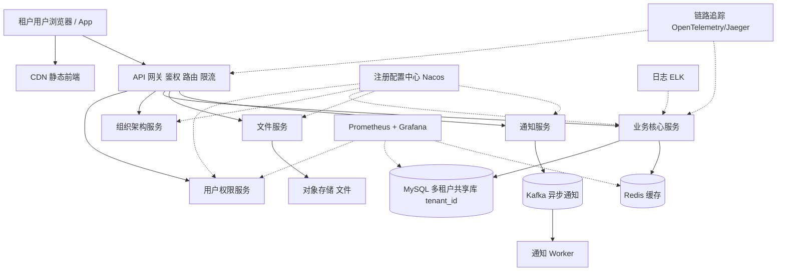

# 架构实战 · 微服务与 SaaS 多租户平台

::: tip 本篇定位
讲清一套中型 SaaS 产品的微服务底座：**服务怎么拆、注册配置、网关、链路追踪、可观测**，以及 SaaS 的命门——**租户隔离、资源争抢、租户级配额**。方法见 [架构方法论](./architecture-methodology)、[容量估算](./architecture-capacity-sizing)、[高可用蓝图](./architecture-ha-blueprints)，容器编排见 [K8s 架构](./container-k8s-01-architecture-cluster)。
:::

## 一、业务特点与规模估算

典型场景：一套面向中小企业的协同办公/CRM SaaS，2000 家付费租户，每家 10~500 个账号。多租户意味着**一个大共享池，但必须按租户隔离数据与资源**。

| 指标 | 假设值 | 说明 |
|---|---|---|
| 付费租户数 | 2000 家 | 头部 50 家占 60% 流量 |
| 注册企业用户 | 5 万 | 累计账号 |
| 日活 | 10 万 | 工作日 9~18 点高峰 |
| 峰值 QPS | 3000 | 上班打卡/集中登录 |
| 在线用户 | 8 万 | 长连接 |
| 微服务数量 | 30 个 | 用户/权限/组织/业务/文件/通知等 |
| 数据量 | 500 GB 业务库 | 多租户共享库，按 tenant_id 隔离 |
| 带宽峰值 | 300 Mbps | 文件上传下载 |

**核心结论**：复杂度不在并发，而在**拆分治理 + 多租户隔离 + 可观测**——一个头部租户跑批任务不能把全平台拖死。

### 1.1 容量推算自洽

| 推算项 | 计算 | 结果 |
|---|---|---|
| 平均 QPS | 日活 10 万 × 人均 15 请求 ÷ 86400 | ≈ 17 QPS |
| 峰值 QPS | 平均 × 180 倍（上班 2 小时集中） | ≈ 3000 QPS |
| Worker 需求 | 30 服务 × 每服务 2 实例 × 0.5 核 | 8 台 16C Worker 跑满后 HPA 扩 |
| 单租户峰值 | 头部租户 500 账号同时在线 ≈ 200 QPS | 占总量 7%，但必须隔离 |
| 数据库 | 500GB，年增 200GB | 1T ESSD，按 tenant_id 建联合索引 |

> 3000 QPS 对 K8s 集群毫无压力，真正要防的是「头部租户单租户打爆共享池」。

## 二、总体架构图



分层：接入层（CDN+网关）→ 应用服务（K8s 上的 30 个微服务）→ 注册配置（Nacos）→ 缓存/消息/数据库/对象存储 → 可观测（监控/日志/链路追踪三位一体）。

## 三、服务器清单

| 角色 | 数量 | CPU(核) | 内存 | 数据盘 | 带宽 | 软件 / 职责 |
|---|---|---|---|---|---|---|
| K8s Master | 3 | 8 | 16G | ESSD 200G | 内网 | K8s 1.30 控制面；见 [K8s 架构](./container-k8s-01-architecture-cluster) |
| K8s Worker | 8 | 16 | 64G | ESSD 500G | 内网 | 跑 30 个微服务 Pod |
| API 网关 | 3 | 8 | 16G | ESSD 100G | 100Mbps | APISIX 集群 |
| Nacos 注册配置 | 3 | 8 | 16G | ESSD 200G | 内网 | 注册 + 配置中心集群 |
| MySQL 主从 | 2主2从 | 16 | 64G | ESSD PL2 1T | 内网 | 多租户共享库；见 [MySQL](./data-mysql) |
| Redis | 3主3从 | 8 | 32G | ESSD 200G | 内网 | 缓存/会话；见 [Redis](./data-redis) |
| Kafka | 3 | 8 | 16G | ESSD 500G | 内网 | 通知/事件；见 [Kafka](./data-kafka) |
| Elasticsearch | 3 | 16 | 32G | ESSD 1T | 内网 | 日志/全文检索 |
| OSS | 云 | - | - | - | 按量 | 租户文件 |
| 监控栈 | 2 | 8 | 32G | ESSD 1T | 50Mbps | Prometheus/Grafana；见 [SLO](./monitor-slo) |
| 链路追踪 | 1 | 8 | 16G | ESSD 500G | 内网 | Jaeger/Tempo |

**合计自建约 30 台**。与规模自洽：8 台 Worker 跑 30 个低峰常驻微服务，K8s HPA 按 CPU 自动扩缩容应对上班高峰。

## 四、服务依赖与各自解决的问题

| 服务 | 解决什么问题 | 与谁交互 | 同步/异步 |
|---|---|---|---|
| API 网关 | 统一入口、JWT 鉴权、路由转发、按租户限流 | 所有微服务 | 同步 |
| 注册配置中心 | 服务发现、动态配置（开关/限流参数）不下线发布 | 所有微服务 | 长连订阅 |
| 用户权限服务 | 登录、RBAC、token 校验 | MySQL、Redis | 同步 |
| 业务核心服务 | 主业务逻辑 | MySQL、Redis、其他服务 | 同步 RPC + 异步事件 |
| 文件服务 | 上传下载直传 OSS | OSS、CDN | 同步签名 |
| 通知服务 | 站内信/邮件/企微 | Kafka、外部通道 | 异步 |
| MySQL | 业务数据持久化（带 tenant_id） | 各服务 | 同步读写，主从异步复制 |
| Redis | 会话、租户级缓存 | 各服务 | 同步 |
| 可观测三件套 | 指标/日志/链路定位慢调用与故障 | 全链路 | 异步采集 |

## 五、关键设计点与坑 / 注意事项

1. **租户隔离模型**：本方案用**共享库 + `tenant_id` 行级隔离**（成本最优）。必须在所有 SQL 强制带 `tenant_id`，推荐用 MyBatis 拦截器自动拼接，**杜绝跨租户数据泄露**。头部大客户可后续迁独立库。
2. **资源争抢（ noisy neighbor）**：某租户跑批量导入/报表，会吃光 Worker CPU 和数据库连接。做法：租户级并发限流 + 配额（QPS/存储/API 调用量），重任务隔离到独立线程池/K8s namespace，大租户单独节点池。
3. **租户级配额**：按套餐限制账号数、存储容量、API 调用次数；网关层按 `tenant_id` 做令牌桶限流。
4. **服务拆分粒度**：不要一上来拆 30 个，先按业务域拆，避免分布式事务满天飞。跨服务调用尽量异步事件。
5. **配置与开关**：Nacos 管动态配置（灰度开关、限流阈值），改配置不发版；但配置变更要审计 + 回滚。
6. **链路追踪**：一个请求跨 5 个服务出问题，没有 traceId 根本查不动。全链路透传 traceId，慢调用可视化。
7. **多租户备份与恢复**：备份要能按租户恢复，不能整库回滚影响所有客户。

### 5.1 三种多租户隔离模型对比

| 模型 | 数据隔离 | 成本 | 适用 |
|---|---|---|---|
| 独立库（一租户一库） | 最强 | 最高 | 头部大客户/合规要求高 |
| 共享库 + tenant_id 行级 | 中（靠代码） | 最低 | 本方案，中小租户 |
| 共享库 + 独立 Schema | 中 | 中 | 折中，迁移麻烦 |

> 本方案先用共享库跑量，给头部大客户预留「迁独立库」的扩展点：业务表主键都带 `tenant_id`，迁移时按租户导库即可。

### 5.2 租户限流示意（网关层）

```text
请求进入网关 → 解析 JWT 取 tenant_id
→ 查该租户套餐配额（Redis）
→ 令牌桶：超限直接返回 429 + 友好提示
→ 转发到对应服务
```

## 六、安全与高可用

- **边界防护**：网关 WAF + 按租户限流；管理后台独立域名 + 堡垒机。
- **鉴权授权**：JWT 网关统一校验；数据级 RBAC，所有查询强制 `tenant_id`。
- **数据加密**：HTTPS；租户敏感字段加密；OSS 按租户前缀隔离 + 签名 URL。
- **消除单点**：K8s 多副本反亲和；Nacos 3 节点；MySQL 主从；Redis Cluster；Kafka 3 副本。
- **熔断降级**：某下游服务挂，网关/熔断组件返回降级，不拖垮整个调用链。
- **多可用区**：Worker 跨可用区调度，MySQL 半同步。

### 6.1 关键监控指标

| 指标 | 告警阈值 | 说明 |
|---|---|---|
| 接口 P99 RT | > 500ms | 跨服务慢调用，用 traceId 定位下游 |
| 按租户 QPS | 单租户 > 配额 80% | 触发限流预警 |
| K8s Pod 重启次数 | > 3 次/10 分钟 | CrashLoop，回滚 |
| MySQL 连接数 | > 最大连接 80% | 连接池泄露或扩容 |
| Nacos 服务列表 | 实例数异常 | 服务上下线异常 |
| 跨租户访问拦截 | 出现即告警 | 可能数据泄露，紧急排查 |

## 七、上线后可能出现的状况与应对

| 类别 | 征兆 | 处置 |
|---|---|---|
| 性能类 | 某接口跨服务 RT 高 | 用链路追踪定位是哪个下游慢，加缓存/优化慢 SQL |
| 性能类 | 某租户整体慢 | noisy neighbor，查该租户是否在跑批，限流/隔离 |
| 容量类 | K8s Worker CPU 长期高 | HPA 未生效→查指标；扩容 Worker 节点 |
| 容量类 | MySQL 连接数打满 | 连接池配置过大/泄露，定位泄露服务，扩库或加中间件 |
| 故障类 | Nacos 挂 | 服务间已有本地缓存路由，短时可用；尽快恢复集群 |
| 故障类 | 网关挂 | 多副本自动切换；检查证书/配置错误导致全部 502 |
| 故障类 | 某微服务 Pod CrashLoop | 看日志/就绪探针，回滚版本，流量切走 |
| 故障类 | MySQL 主挂 | 提升从库，确认 `tenant_id` 数据无丢失 |
| 故障类 | Redis 挂 | 缓存失效直查库，限流保护，按租户限流防雪崩 |
| 大促/活动 | 大租户全员集中登录 | 网关按租户限流，登录服务扩副本，验证码降刷 |
| 扩容 | 新租户激增 | K8s HPA 自动扩业务服务；数据库评估再分库 |
| 数据类 | 跨租户数据泄露投诉 | 紧急排查拦截器是否漏加 tenant_id，紧急修 + 审计日志 |
| 数据类 | 慢 SQL 拖库 | 开启慢查询日志，热点报表迁 ES/只读从库 |
| 数据类 | 主从延迟 | 延迟敏感读回主库，大租户批量任务错峰 |
| 性能类 | 某租户批量导入导致全平台卡顿 | 触发租户级并发上限，重任务隔离到独立线程池 |
| 故障类 | ES 日志集群磁盘满 | 日志保留策略缩短，冷日志转 OSS，停掉非关键 debug 日志 |
| 故障类 | 配置中心发错配置 | Nacos 配置一键回滚历史版本，灰度先小流量验证 |
| 容量类 | OSS 某租户存储超套餐 | 配额告警，通知租户清理，超限后只读禁止上传 |
| 数据类 | 某租户数据误删 | 按租户从备份恢复（不影响其他租户），先恢复到临时库再核对 |
| 故障类 | 某微服务雪崩拖垮上游 | 熔断该服务，上游返回降级数据，快速定位根因服务 |
| 性能类 | 通知服务发邮件慢拖垮 | 通知全异步 Kafka，不阻塞主链路，慢只影响通知时效 |
| 故障类 | Redis Cluster 大 key 阻塞 | 拆分大 key，热 key 本地缓存，避免单 key 打满单线程 |
| 容量类 | 新签大客户需独立库 | 按预留扩展点把该租户数据迁独立库，网关路由到新库 |
| 故障类 | 日志爆量打满 ES | 降级采样、缩短保留期，关闭无谓的访问日志 |
| 性能类 | 报表接口慢 | 报表走只读从库或预聚合，不在线查明细 |
| 容量类 | 通知邮件/短信超套餐 | 按租户配额限流，营销通知合并发送 |
| 故障类 | 配置推送导致全量 500 | Nacos 回滚到上一版本，灰度配置先在小流量验证 |
| 性能类 | 跨服务 RPC 串行调用慢 | 改并行调用或异步事件，缩短调用链 |
| 容量类 | 某租户文件数暴涨 | 配额告警，临时冻结该租户上传，引导清理 |
| 故障类 | 长连接/推送延迟 | 查 Kafka 积压，推送 Worker 扩容，按通道分级限流 |
| 性能类 | 首次登录慢 | 预热用户权限缓存，JWT 校验本地化，减少 RPC |
| 故障类 | 某 Worker 反复重启 | 看日志 OOM/配置错误，回滚镜像版本，隔离坏节点 |

### 7.1 演进路线

租户数破 5000、单库压力上来后：共享库按租户维度水平分库；头部大客户迁独立库；引入服务网格做细粒度熔断；可观测从 Prometheus 扩展到全链路 profiling。先把隔离与配额做扎实，再谈拆分。

---

**相关阅读**：[架构方法论](./architecture-methodology) · [容量估算](./architecture-capacity-sizing) · [高可用蓝图](./architecture-ha-blueprints) · [K8s 架构](./container-k8s-01-architecture-cluster) · [MySQL](./data-mysql) · [Redis](./data-redis) · [Kafka](./data-kafka) · [SLO](./monitor-slo)
