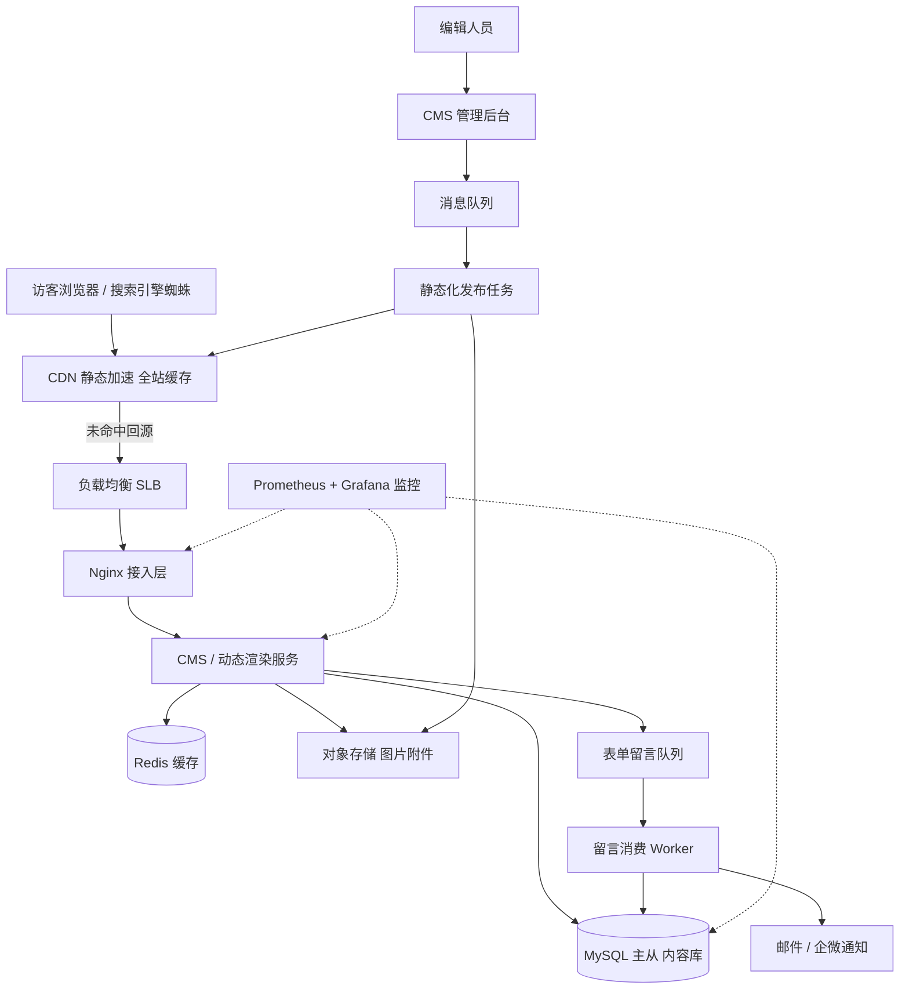

# 架构实战 · 企业官网与内容资讯站

::: tip 本篇定位
面向「企业官网 + 内容资讯/博客/新闻」这类**读多写极少**的站点，讲清一套够用、省钱、好维护的架构：CMS 后台写稿、发布时静态化、CDN 扛读流量、MySQL 存内容、Redis 做缓存、表单留言异步落库。配套方法见 [架构方法论](./architecture-methodology)、[容量估算](./architecture-capacity-sizing)、[高可用蓝图](./architecture-ha-blueprints)。
:::

## 一、业务特点与规模估算

典型场景：一家 B2B 科技公司官网（首页、产品页、解决方案、关于我们）+ 一个技术资讯/博客频道（每周更新 5~10 篇长文），外加「联系我们 / 预约演示」表单。这类站点 95% 以上请求是**只读**，写操作只有编辑在后台发文章、访客提交表单两类。

| 指标 | 假设值 | 说明 |
|---|---|---|
| 注册/登录用户 | 50 万 | 官网大多不登录，这里指 CMS 作者 + 表单留资用户 |
| 日活 UV | 3 万 | 工作日白天 B 端流量为主 |
| 日 PV | 15 万 | 人均浏览 5 个页面 |
| 峰值 QPS | 800 | 早 10 点/下午 2 点两篇文章被行业媒体转载时冲高 |
| 峰值在线 | 5000 | 长连接少，主要是短 HTTP 请求 |
| 文章/页面总量 | 5 万篇 | 累计 5 年，单篇含图约 2MB |
| 图片/附件素材 | 2 TB | 全部走对象存储 + CDN |
| 表单提交峰值 | 50 QPS | 大促/发布会当天留资涌入 |
| 出口带宽峰值 | 200 Mbps | 静态资源走 CDN 后，回源带宽只需很小 |

**核心结论**：这不是高并发系统，**把静态资源全部推到 CDN、动态回源压到最低、数据库几乎不被直查**，就赢了一大半。

### 1.1 容量怎么推出来的

| 推算项 | 计算 | 结果 |
|---|---|---|
| 平均 QPS | 日 PV 15 万 ÷ 86400 ≈ 1.7 | 1.7 QPS |
| 峰值 QPS | 平均 × 40 倍系数（白天集中） | ≈ 800 QPS |
| 回源 QPS | CDN 命中率按 90% 算 | 源站仅 ≈ 80 QPS |
| 出带宽 | 峰值 800 QPS × 平均页面 100KB（含 CDN 缓存命中后仅回源小流量） | 回源 ≈ 20 Mbps，CDN 侧另计 |
| MySQL 容量 | 5 万篇 × 单篇含正文 5KB + 元数据 | ≈ 5GB，500G 盘用不到 2% |
| 年存储增长 | 每周 8 篇 × 2MB ≈ 8MB/周 | 一年 ≈ 400MB，图片素材另算 |

> 要点：**真正打在源站和数据库上的流量，比表面 PV 小一个数量级**。这也是为什么官网类项目 2 台 4C8G 应用 + 1 主 1 从 MySQL 就够，钱应该花在 CDN 和 OSS 上。

## 二、总体架构图



分层说明：接入层（SLB+Nginx）→ CDN → 应用服务（CMS/动态渲染）→ 缓存（Redis）→ 消息（Kafka/RocketMQ）→ 数据库（MySQL 主从）→ 对象存储（OSS）→ 监控（Prometheus/Grafana）。SEO 关键在于**页面可被蜘蛛抓取、URL 友好、有 SSR/静态化**，所以架构上刻意把详情页做成静态 HTML 推到 CDN。

## 三、服务器清单

| 角色 | 数量 | CPU(核) | 内存 | 系统盘/数据盘 | 带宽 | 安装软件 / 承担职责 |
|---|---|---|---|---|---|---|
| CDN 节点 | 云厂商 | - | - | - | 按流量计费 | 全站静态缓存、图片/JS/CSS/HTML 边缘分发 |
| 负载均衡 SLB | 2(主备) | 2 | 4G | ESSD 100G | 50Mbps | 四层/七层负载，跨可用区 |
| Nginx 接入层 | 2 | 4 | 8G | ESSD 100G | 20Mbps | 反向代理、HTTPS 卸载、gzip、缓存、限流；见 [Nginx 实战](./services-web-nginx) |
| CMS/动态应用 | 2 | 4 | 8G | ESSD 100G | 10Mbps | CMS 后台 + 动态渲染，Java/Node |
| 静态化发布 Worker | 1 | 4 | 8G | ESSD 100G | 10Mbps | 消费发布消息，渲染 HTML 推 OSS |
| 留言消费 Worker | 1 | 2 | 4G | ESSD 100G | 5Mbps | 消费表单队列，落库 + 发通知 |
| MySQL 主 | 1 | 8 | 32G | ESSD PL1 500G / 5000 IOPS | 内网 | 内容库写；见 [MySQL](./data-mysql) |
| MySQL 从 | 1 | 8 | 32G | ESSD PL1 500G | 内网 | 读分担 + 备份源 |
| Redis | 1主1从 | 4 | 8G | ESSD 100G | 内网 | 页面缓存、CMS 会话；见 [Redis](./data-redis) |
| Kafka | 3 | 4 | 8G | ESSD 200G | 内网 | 发布事件 + 表单队列；见 [Kafka](./data-kafka) |
| 对象存储 OSS | 云 | - | - | 标准型无限 | - | 图片附件 + 静态 HTML 托管 |
| 监控 | 1 | 4 | 8G | ESSD 500G | 10Mbps | Prometheus + Grafana + 日志；见 [SLO](./monitor-slo) |

**合计自建约 14 台**（CDN/OSS/SLB 为云服务不计入）。与规模自洽：800 QPS 下 Nginx+应用各 2 台绰绰有余，MySQL 8C32G 对读多写少的内容库非常宽松。

## 四、服务依赖与各自解决的问题

| 服务 | 解决什么问题 | 与谁交互 | 同步/异步 |
|---|---|---|---|
| CDN | 把 95% 读流量挡在边缘，源站几乎不被打 | 访客/蜘蛛 ↔ 回源 Nginx | 同步请求，未命中才回源 |
| Nginx | HTTPS 卸载、压缩、边缘缓存、限流 | SLB ↔ 应用 | 同步反向代理 |
| CMS 应用 | 后台写稿、动态页面渲染 | MySQL 主、Redis | 同步查库/查缓存 |
| Redis | 热门文章页缓存、降库压力 | CMS 应用 | 同步读，旁路缓存 |
| MySQL 主从 | 文章/页面/留言持久化 | CMS 写主、读可走从 | 同步写主，异步主从复制 |
| Kafka | 解耦「发布」与「留言通知」 | CMS/Worker | 异步 |
| 静态化 Worker | 文章发布后渲染成 HTML 推 OSS+刷新 CDN | Kafka、OSS | 异步消费 |
| 留言 Worker | 表单留言落库 + 邮件/企微通知 | Kafka、MySQL、邮件 | 异步消费 |
| OSS | 图片附件与静态文件存储 | CDN、Worker | 同步上传/下载 |
| Prometheus | 各层指标、告警 | 全部节点 | 异步采集 |

**一次发布的完整时序**：编辑在后台点发布 → CMS 写一条「待发布」记录到 MySQL 主 → 发一条「文章发布事件」到 Kafka → 静态化 Worker 消费，拉取正文渲染成 HTML → 上传 OSS → 调 CDN 刷新对应 URL → 回写发布状态。整条链路除了「写记录」是同步，其余全部异步，编辑几乎无感。

**访客读一篇文章的时序**：浏览器请求 URL → CDN 命中直接返回（90%+）→ 未命中才回源 Nginx → 查 Redis 缓存 → 未命中再查 MySQL 从库 → 回填 Redis 返回。数据库在正常情况下每天被直查的次数很少。

## 五、关键设计点与坑 / 注意事项

1. **静态化与缓存一致性**：文章修改后必须**刷新对应 CDN 缓存 + 失效 Redis key**，否则线上看到旧版本。做法是发布事件带 URL 列表，Worker 调 CDN 刷新接口。
2. **SEO 细节**：URL 用 `/news/2026/09/xxx.html` 静态化；详情页要有 `<title>`/description/canonical；面包屑 + 结构化数据；开 gzip/HTTP2；移动端适配。蜘蛛 UA 不要被限流误伤。
3. **表单留言防刷**：访客表单是机器人重灾区。必须加**验证码（如滑块）、接口限流、蜜罐字段**，留言先入 Kafka，Worker 识别垃圾后再落库，避免脏数据直接进 CRM。
4. **图片处理**：用户上传图不要直接存原图给 CDN，走 OSS 图片处理裁剪多尺寸，WebP 格式，省带宽。
5. **不要让后台 CMS 暴露公网**：管理端走 VPN/堡垒机 + IP 白名单，单独子域名 `admin.xxx.com`。
6. **备份**：MySQL 每日全备 + binlog，OSS 跨区域复制；静态化文件可随时重新渲染，无需备份。
7. **发布与回滚**：CMS 应用用蓝绿发布（两个版本各 2 台，SLB 切流）。文章内容误发不回滚代码，直接在后台改回再触发一次发布事件即可。
8. **SEO 监控指标**：关注收录量、关键词排名、蜘蛛抓取量、页面加载速度（Core Web Vitals）。这些通过站长平台 + 前端监控看，不进业务监控。
9. **表单留言安全**：留言内容做 XSS 过滤（存展示都要转义），不要把留言直接渲染到后台 HTML，防止后台被打 XSS。
10. **国际化/多语言**：若有多语言站点，按语言路径 `/en/news/` 静态化，hreflang 标签标注，避免重复内容惩罚。

### 5.1 典型配置参考（Nginx 关键片段）

```nginx
location ~* \.(html|css|js|png|jpg|webp)$ {
    proxy_cache cache_one;
    proxy_cache_valid 200 10m;
    limit_req zone=static burst=50 nodelay;
}
location = /api/contact {
    limit_req zone=form burst=10 nodelay;   # 表单单独严格限流
    proxy_pass http://cms_upstream;
}
```

> 静态资源走 CDN，Nginx 只做兜底回源缓存；`/api/contact` 这类写接口单独限流，防止机器人刷库。

## 六、安全与高可用

- **边界防护**：CDN 侧开 WAF、防 CC；Nginx 限流（`limit_req`）；后台 IP 白名单 + VPN。
- **鉴权授权**：CMS 后台账号 + 角色（作者/审核/管理员），表单留言无需登录。
- **数据加密**：全站 HTTPS（Let's Encrypt 或云证书），MySQL 盘加密，密码 bcrypt 存储。
- **消除单点**：Nginx/应用各 2 台挂 SLB；MySQL 主从 + 故障切换；Redis 主从；Kafka 3 副本。
- **降级预案**：数据库挂了，CDN/Redis 里的静态页仍能读；Redis 挂了直查 MySQL（已限流保护）。
- **多可用区**：SLB/Nginx/应用跨 2 个可用区，OSS 多副本。

### 6.1 故障切换与限流降级清单

| 层级 | 单点风险 | 消除手段 | 故障时降级动作 |
|---|---|---|---|
| CDN | 厂商整体故障 | 备一家 CDN，DNS 可切 | 切备用 CDN 或临时回源 |
| Nginx | 单台宕机 | SLB 健康检查摘流 | 剩余节点顶住 |
| 应用 | 单实例 OOM | 两实例 + 自动拉起 | 静态页仍可读 |
| MySQL | 主库宕机 | MHA/Orchestrator 自动切从 | 切 VIP，写短暂失败 |
| Redis | 缓存失效 | 主从 | 直查 MySQL + 限流兜底 |
| Kafka | 队列宕 | 3 副本 | 表单先落本地，恢复后补投 |

### 6.2 关键监控指标

| 指标 | 告警阈值 | 说明 |
|---|---|---|
| CDN 回源率 | > 15% | 缓存命中率下降，查缓存规则 |
| Nginx 5xx 率 | > 1% | 应用层故障 |
| MySQL 慢查询 | > 10 条/分钟 | 慢 SQL 增多 |
| MySQL 主从延迟 | > 10s | 读一致性风险 |
| Kafka 消费积压 | > 10000 条 | Worker 处理不过来 |
| 表单提交失败率 | > 5% | 留言链路异常 |

## 七、上线后可能出现的状况与应对

| 类别 | 征兆 | 处置 |
|---|---|---|
| 性能类 | 文章详情页打开慢 | 命中率低→查 CDN 回源率；回源高→延长缓存 TTL、热点页预热 |
| 性能类 | MySQL CPU 高 | 看慢查询，后台列表/全文检索拖库→加索引或迁 ES，读走从库 |
| 容量类 | 磁盘上涨快 | 多为日志/图片，图片迁 OSS，日志切分 + 定期清理 |
| 容量类 | OSS 流量超预算 | 检查是否被外链盗图，开 Referer 防盗链 + 带宽告警 |
| 故障类 | Nginx 一台挂 | SLB 自动摘流，剩余一台顶住；尽快拉起替换 |
| 故障类 | MySQL 主库挂 | 切换从库为主（见 [高可用蓝图](./architecture-ha-blueprints)），应用连接串切 VIP |
| 故障类 | Redis 挂 | 旁路缓存失效，直查 MySQL，靠 Nginx 限流兜底 |
| 故障类 | Kafka 挂 | 发布/留言暂停（表单先写本地文件补偿），不影响线上读 |
| 活动流量 | 发布会文章被刷屏 | CDN 扛，提前预热该 URL，必要时临时扩容回源 |
| 数据类 | 留言丢失 | 查 Kafka 积压与 Worker 消费失败重试，死信表人工补 |
| 数据类 | 主从延迟 | 监控 seconds_behind_master，延迟大时读回主库，排查大事务 |
| 数据类 | 误删文章 | 用 binlog/每日备份恢复到时间点，静态页重新发布 |
| 性能类 | 谷歌/百度蜘蛛抓取过频压垮源站 | 对蜘蛛 UA 单独限流或限速，sitemap 控制抓取频率，重要页面保持长缓存 |
| 故障类 | HTTPS 证书过期全站打不开 | 证书过期监控提前 30 天告警，自动续期（acme.sh），备一份手动续期脚本 |
| 故障类 | CDN 厂商故障大面积回源失败 | 切换备用 CDN 厂商 DNS 解析，或临时回源直出静态页 |
| 容量类 | 留言/垃圾数据暴涨占满库 | 垃圾留言定期清理，Kafka 队列积压告警，Worker 并发临时调大 |
| 活动流量 | 被恶意刷表单留资 | 触发限流阈值，临时开更强验证码，IP 黑名单 |
| 数据类 | 静态页与后台内容不一致 | 触发全量重新发布任务，对比 CDN 上 HTML 与 DB 内容，强制刷新 |
| 故障类 | 从库延迟导致访客看到旧文章 | 发布后延迟敏感请求读主，或等待复制追平再切流 |
| 性能类 | 后台编辑器卡顿 | 后台管理端不走 CDN，检查后台接口慢查询，独立扩容 |
| 容量类 | 文章库历史归档 | 3 年前文章迁冷备库，线上只留近 2 年热数据 |
| 故障类 | 留言 Worker 宕机丢通知 | 消息未落死信表，Worker 重启后从 Kafka 位点重消费 |

### 7.1 演进路线

流量再涨 10 倍时：详情页全静态化推 CDN，源站只留后台写接口；MySQL 读多写少可加 ES 做全文检索；CMS 容器化上 K8s，按 CPU 自动扩缩容（见 [K8s 架构](./container-k8s-01-architecture-cluster)）。

---

**相关阅读**：[架构方法论](./architecture-methodology) · [容量估算](./architecture-capacity-sizing) · [高可用蓝图](./architecture-ha-blueprints) · [MySQL](./data-mysql) · [Redis](./data-redis) · [Nginx](./services-web-nginx) · [SLO](./monitor-slo)
