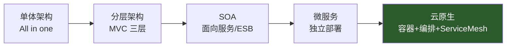

# 架构设计方法论

::: tip 本篇定位
架构设计不是画图炫技，而是**在一堆互相打架的目标之间做取舍**。本篇讲清楚：架构师要同时平衡哪六个目标、架构从单体到云原生是怎么一步步演进的（每一步为什么要演进、代价是什么）、CAP/BASE/一致性到底怎么选、高并发下"三板斧"（限流/降级/熔断）怎么配套使用，以及一套可落地的架构设计流程。配套阅读：[容量估算](./architecture-capacity-sizing)、[高可用与容灾](./architecture-ha-blueprints)、[SLO](./monitor-slo)。
:::

## 一、架构师要同时达成的六个目标

小白类比：盖房子，不能只追求"结实"（不然成本上天），也不能只追求"便宜"（不然地震就塌）。架构就是在**结实、快、能加房间、防火、省钱、能监控**这六件事之间找平衡。

| 目标 | 一句话定义 | 核心手段 | 典型衡量指标 |
|---|---|---|---|
| 高可用（HA） | 系统出故障的时间尽量少 | 冗余、故障转移、无状态化、降级 | 可用性 SLA（如 99.95%）、RTO/RPO |
| 高性能 | 响应快、吞吐大 | 缓存、异步、连接池、读写分离、SQL/索引优化 | 接口 P99 延迟、QPS/TPS |
| 可扩展 | 业务涨了能"加机器"就扛住 | 无状态水平扩展、分库分表、微服务拆分 | 扩容后线性提升比、扩缩容耗时 |
| 安全 | 数据不被偷、不被篡改、不被拖库 | 认证鉴权、加密、最小权限、审计、WAF | 安全事件数、漏扫通过率 |
| 可控成本 | 不过度设计、钱花在刀刃上 | 按规模选型、弹性伸缩、资源利用率优化 | 单 QPS 成本、资源空闲率 |
| 可观测 | 出问题能快速看见、定位 | 指标/日志/链路三件套、告警、SLO | 平均定位时间 MTTR、告警有效率 |

> **关键认知**：这六个目标永远互相冲突。比如"为了高可用做多副本"会增加"成本"；"为了性能把数据放缓存"会牺牲"一致性/安全"。架构设计的本质不是"全都要"，而是**说清楚你放弃了什么、为什么**。

## 二、架构演进：单体 → 分层 → SOA → 微服务 → 云原生

没有最好的架构，只有**最适合当前团队规模和业务阶段**的架构。演进的核心驱动力永远是：**人变多了、代码库变大了、流量变高了**。

| 阶段 | 适用团队/规模 | 优点 | 缺点 / 痛点 | 什么时候该往下一阶段走 |
|---|---|---|---|---|
| **单体** Monolith | 1~5 人初创、日活几千 | 开发部署简单、调试方便、没有分布式开销 | 代码库一大就编译慢、牵一发动全身、技术栈锁定、单点故障影响全局 | 代码库多人并行开发频繁冲突、一次发布要全量回归 |
| **分层**（经典三层） | 5~20 人、日活几万 | 职责清晰（表现/业务/数据）、可按层优化、便于分工 | 还是一个部署包，层间调用是进程内调用，无法独立扩展某一层 | 只有某一层（如应用层）扛不住，想单独扩容它 |
| **SOA** | 20~100 人、有多个业务线 | 服务复用、统一 ESB 总线、系统集成 | ESB 是重量级单点、耦合仍重、治理复杂 | ESB 成为瓶颈和单点、想让服务真正独立部署 |
| **微服务** Microservices | 100+ 人、多团队、日活百万级 | 服务独立部署/扩缩/技术选型、故障隔离、团队自治 | 分布式复杂度爆炸（网络、一致性、运维成本）、链路长 | 团队超过两个 Pizza Team、发布互相排队 |
| **云原生** Cloud Native | 大规模、多环境、追求弹性与交付效率 | 容器化一致环境、K8s 自动编排、弹性伸缩、声明式 API、可观测 | 学习曲线陡、平台本身也要运维、小团队用不动 | 已经有十几个微服务、环境管理和发布成为瓶颈 |

> **反模式提醒**：业务还在日 PV 10 万级别就上来一整套微服务 + K8s + ServiceMesh，是典型的**过度设计**——分布式带来的故障和运维成本，远超它能带来的收益。先单体跑通、出现真实痛点再拆。

## 三、数据一致性与通信模式

### 3.1 CAP 取舍

分布式系统不可能同时完美满足三者，必须**二保一、牺牲一个**：

| 维度 | 含义 | 大白话 |
|---|---|---|
| C（Consistency） | 一致性：所有节点同一时刻看到相同数据 | 大家看到的数一模一样 |
| A（Availability） | 可用性：每个请求都能拿到非错响应 | 随时来请求都有人理 |
| P（Partition tolerance） | 分区容忍：网络断成两截还能跑 | 机房网线断了也不彻底死 |

**网络分区在现实中必然发生（P 必须保）**，所以实际是在 C 和 A 之间选：

| 取舍 | 选它意味着 | 典型代表 | 适用场景 |
|---|---|---|---|
| CP | 分区时拒绝部分请求保一致 | ZooKeeper、etcd、HBase | 配置中心、分布式锁、库存扣减这类"错了更糟"的 |
| AP | 分区时先可用，数据稍后对齐 | Cassandra、DynamoDB、Eureka（早期） | 购物车、Feed 流、社交点赞这类"短暂不一致能忍"的 |
| CA | （单机/单节点才谈得上） | 传统单机 MySQL | 没做分布式时天然近似 CA |

### 3.2 BASE 与强 / 最终一致性

BASE 是 AP 路线的落地哲学：**基本可用（Basically Available）、软状态（Soft state）、最终一致（Eventually consistent）**。

| 一致性模型 | 含义 | 代价 | 典型场景 |
|---|---|---|---|
| 强一致性 | 写完立刻能读到最新值 | 性能低、要同步等所有副本 | 账户余额、扣库存、转账 |
| 最终一致性 | 写完允许短暂旧，副本后台对齐 | 业务要容忍短暂不一致 | 浏览数、点赞数、订单状态同步 |
| 读己之写 / 会话一致性 | 我自己写完自己立刻能读到 | 折中 | 发帖后自己立刻看到 |

### 3.3 同步 vs 异步通信

| 维度 | 同步（HTTP/RPC 直连） | 异步（消息队列 MQ） |
|---|---|---|
| 调用方式 | 调用方阻塞等响应 | 发完消息就走，结果 later |
| 优点 | 简单、实时、调用方马上知道成败 | 削峰填谷、解耦、容错好、下游慢不拖垮上游 |
| 缺点 | 强耦合、下游拖慢会拖垮上游、级联失败 | 不能立刻拿结果、要处理消息重复/丢失、链路不直观 |
| 适用 | 下单后立刻要扣减结果 | 下单后发积分、发短信、推统计、日志采集 |

> 经验：**能异步就异步**。一个写操作里，主链路（扣钱扣库存）走同步，周边动作（通知、积分、风控、报表）全部丢 MQ 异步化，是高并发系统的标配。

## 四、高并发三板斧：限流 / 降级 / 熔断

小白类比：饭馆爆满时——**限流**（门口发号，超了不接待新客）、**降级**（贵宾室暂停供水果，先保住主力菜品）、**熔断**（某道菜的后厨一直出问题，干脆先不接这道菜的单，等它恢复）。三者都是为了**保住核心链路，牺牲边角功能**。

| 手段 | 解决什么 | 常见实现 | 关键参数 |
|---|---|---|---|
| **限流** | 流量超过系统承载，直接挡掉多余请求 | 计数器、滑动窗口、漏桶、令牌桶；网关层（Nginx limit_req / Sentinel） | 阈值 QPS、拒绝策略（直接拒/排队） |
| **降级** | 非核心功能出问题或压力大时主动关掉 | 开关配置中心、页面静态化、返回兜底数据 | 降级开关、兜底返回值 |
| **熔断** | 下游持续失败时，快速失败不再调用，给下游喘息 | 熔断器（Closed→Open→Half-Open）；Sentinel/Resilience4j | 错误率阈值、熔断时长、半开探测次数 |

三板斧之外，还有六个配套保护，缺一个都可能在高压下雪崩：

| 配套机制 | 作用 | 一句话原则 |
|---|---|---|
| **资源隔离** | 线程池/信号量隔离，防止一个慢接口占满全部线程 | 不同业务用不同线程池，互不拖累（舱壁模式） |
| **超时 Timeout** | 调用必须有超时，绝不无限等 | 每次 RPC/HTTP 调用都设超时，且内层 < 外层 |
| **重试 Retry** | 偶发失败自动重试 | 只重试幂等操作、有限次、加退避，配熔断防止重试风暴 |
| **幂等 Idempotency** | 同一请求重复执行结果一致 | 用唯一请求号/业务主键去重，否则重试会重复扣钱 |
| **回压 Backpressure** | 下游处理不过来时反向告诉上游慢点 | MQ 消费限速、TCP 接收窗口，别把内存撑爆 |
| **缓存** | 把读请求挡在数据库前面 | 多级缓存（本地 + Redis），配过期与击穿/穿透/雪崩防护 |

> 这一块的组件落地见 [Spring Cloud 全家桶（Sentinel）](./data-spring-cloud) 与 [Kafka](./data-kafka)。

## 五、架构设计流程（从需求到评审）

一套可复用的六步流程，避免"上来就画框框"：

| 步骤 | 做什么 | 产出物 | 关键问题 |
|---|---|---|---|
| 1. 需求澄清 | 搞清楚业务要做什么、规模多大 | 需求文档、用户故事 | 这功能给谁用？日活/订单量大概多少？ |
| 2. 定关键非功能指标 | 把"要快/要稳"变成数字 | NFR 表：QPS、延迟 P99、可用性 RTO/RPO、数据量级 | 能容忍多慢？能容忍丢多少数据？ |
| 3. 技术选型 | 据规模选合适组件，不炫技 | 选型对比表（含备选方案） | 单机够不够？要不要缓存/分库？成熟度还是性能优先？ |
| 4. 画架构图 | 分层图、时序图、部署图 | C4 / 架构图、关键链路时序 | 请求从进来到落库经过哪几层？ |
| 5. 容量评估 | 算要多少台机器、多大带宽 | 容量清单（见[容量估算](./architecture-capacity-sizing)） | 峰值 QPS 多少？单机扛多少？留多少余量？ |
| 6. 评审与演进 | 拉上 SRE/DBA/安全一起挑刺 | 评审纪要、风险清单、落地排期 | 单点在哪？怎么回滚？故障演练过吗？ |

> **流程要点**：第 2 步（把非功能指标量化）最容易被跳过，却是后面所有选型和容量计算的输入。没有数字，"高可用"只是一句口号。

## 六、延伸阅读

- 机器到底该买多少：[容量估算与服务器选型](./architecture-capacity-sizing)
- 怎么让系统挂一台还能跑：[高可用与容灾模式](./architecture-ha-blueprints)
- 容量观测与弹性伸缩：[SLO 实践](./monitor-slo)、[Prometheus](./monitor-prometheus-01-intro)
- 数据库高可用细节：[MySQL 进阶与高可用](./data-mysql-advanced)
- 容器与编排基础：[K8s 架构与集群](./container-k8s-01-architecture-cluster)
- 容量规划与灾备专题：[容量规划、高可用与灾备](./sre-capacity-dr)
