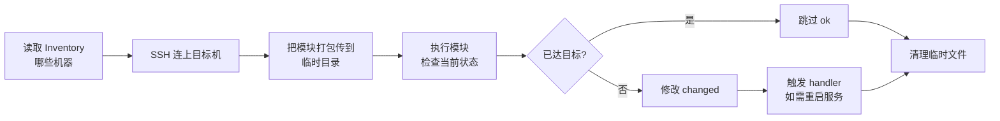

# Ansible 运维自动化工具

::: tip 本篇定位
用 Ansible 做批量主机配置管理：一台控制机，通过 SSH 远程成百上千台服务器上装软件、建用户、下发配置、起服务，**不需要在被管机器上装任何客户端**。
本篇版本：ansible-core 2.21（2026 年 5 月 GA，当前补丁 2.21.4），以 RHEL/Rocky 9 为主线演示，Ubuntu/Debian 差异单独标注。
:::

## 一、简介

### 1.1 小白类比：Ansible 是什么

想象你管着 50 台服务器。现在要在每台上面装一个 `vim-enhanced`、建一个 `deploy` 用户、把公钥贴进去。

- **手动做法**：一台台 SSH 登录，敲同样的命令，重复 50 遍。漏一台、错一步都得重来。
- **写脚本做法**：写个 bash 脚本循环跑，但脚本里全是"假设机器状态正常"的硬编码，遇到"已经装过了怎么办""服务名不一样怎么办"就抓瞎。

**Ansible 就是把"在很多台机器上要做的事"写成一份描述，然后由它替你通过 SSH 远程执行。** 你只管写"最终想要长什么样"，它负责"现在长什么样 → 怎么变成想要的样子"。

### 1.2 无 Agent 架构（最核心特点）

很多自动化工具（如 Puppet、Zabbix agent）都要求在**每台被管机器上装一个常驻客户端（Agent）**，由它连回中心服务器。Ansible 反其道而行：

```
   控制节点（你这台笔记本/堡垒机）
   ansible / playbook
        │
        │ ① SSH 连接（标准 22 端口）
        ▼
   ┌─────────┐  ┌─────────┐  ┌─────────┐
   │ web01   │  │ web02   │  │ db01    │   被管主机（node）
   │ 无 agent│  │ 无 agent│  │ 无 agent│   只有 openssh
   └─────────┘  └─────────┘  └─────────┘
```

- **控制节点（Control Node）**：装了 Ansible 的那台机器，通常是你的运维笔记本或堡垒机。
- **被管节点（Managed Node）**：被操作的服务器，**上面不需要装 Ansible**，只要能被 SSH 连上、有 Python 3 即可（现代 Linux 默认都有）。
- **通信方式**：控制节点通过 **SSH** 把模块（module，一个 Python 脚本）临时推到被管机器的临时目录，执行完就删掉。

> 类比：Ansible 像你本人远程登录每台机器帮你干活，干完就走，不留痕迹；Agent 方案像在每台机器上安个常驻管家，你下命令它执行。

**为什么无 Agent 是优点**：新机器上线不用先装客户端，断网时被管机器上没有"等着连回中心"的进程，安全面更小。代价是：大规模（上千台）时 SSH 并发连接数是瓶颈，且要求控制节点能直连所有被管机器。

### 1.3 工作原理：声明式 + 幂等

两个词必须先懂：

- **声明式（Declarative）**：你写"我要 `/etc/nginx/nginx.conf` 长这样"，而不是"先 `cp` 再 `sed` 改三行"。Ansible 自己对比当前状态和目标状态。
- **幂等（Idempotent）**：同一段 Playbook 跑 1 次和跑 10 次，结果一样。已经是目标状态的机器，Ansible 会跳过（报告 `ok` 而非 `changed`）。

执行一条任务时，Ansible 内部做了什么：



### 1.4 Inventory：主机清单

Ansible 怎么知道"有哪些机器、它们叫什么、用什么用户名登录"？靠一个叫 **Inventory（主机清单）** 的文件，默认是 `/etc/ansible/hosts`，也可以用 `-i` 指定自定义文件。

最简形式（INI 风格）：

```ini
# /etc/ansible/hosts

[web]                 # 组名 web，下面是这组里的主机
web01 ansible_host=10.0.0.11
web02 ansible_host=10.0.0.12

[db]
db01 ansible_host=10.0.0.13

[all:vars]            # 所有主机共用的变量
ansible_user=root
ansible_port=22
```

也可以用 YAML 风格（更清晰，推荐）：

```yaml
# inventory.yml
all:
  children:
    web:
      hosts:
        web01:
          ansible_host: 10.0.0.11
        web02:
          ansible_host: 10.0.0.12
    db:
      hosts:
        db01:
          ansible_host: 10.0.0.13
  vars:
    ansible_user: root
```

| 概念 | 含义 |
|---|---|
| 组（group） | 把同类主机归组，如 `web`、`db`，方便批量操作一组 |
| 主机别名 | `web01` 是别名，`ansible_host` 才是真实 IP |
| `ansible_user` | SSH 登录用户名 |
| `ansible_port` | SSH 端口，非 22 时要写 |
| `ansible_ssh_private_key_file` | 指定私钥路径 |

> 用 `ansible-inventory --list -i inventory.yml` 可以校验清单解析结果。

## 二、安装与准备

### 2.1 在控制节点安装 Ansible

Ansible 只装在**控制节点**上。被管机器不用装。

::: code-group
```bash [RHEL/Rocky 9（AppStream 仓库）]
dnf install -y ansible-core
# RHEL 9 AppStream 自带 ansible-core（2.16.x 系列，随系统补丁更新）
# 想要 2.21 最新版，用 pip 安装（见下方 pip 方式）
ansible --version
```
```bash [Ubuntu 24.04（apt）]
sudo apt update
sudo apt install -y ansible
# Ubuntu 仓库里的 ansible 版本偏旧；要新版推荐用 pip
```
```bash [pip（推荐，各发行版通用，装最新 2.21）]
# 建议用虚拟环境，避免污染系统 Python
python3 -m venv ~/ansible-venv
source ~/ansible-venv/bin/activate
pip install --upgrade pip
pip install ansible-core
ansible --version
# ansible-core 2.21.4  # ← 以 pypi 当前稳定版为准
```
:::

::: tip ansible-core 与 ansible（社区版）的区别
`ansible-core` 只含最核心模块；`pip install ansible` 会再带上一大堆官方集合（community.general 等）。日常运维装 `ansible-core` + 按需 `ansible-galaxy collection install` 即可，RHEL 系默认装的就是 ansible-core。
:::

### 2.2 配置 SSH 免密登录

Ansible 靠 SSH 干活，**先让控制节点能免密 SSH 到所有被管机器**，否则每次都要输密码。

```bash
# ① 控制节点生成密钥（一路回车）
ssh-keygen -t ed25519 -C "ansible-control"

# ② 把公钥分发到每台被管机（会要求输入一次密码）
ssh-copy-id root@10.0.0.11
ssh-copy-id root@10.0.0.12
ssh-copy-id root@10.0.0.13

# ③ 验证免密
ssh root@10.0.0.11 "hostname"
# web01     ← 不用输密码就返回主机名，说明成功
```

> 没有 `ssh-copy-id` 的精简环境，可以手动：`cat ~/.ssh/id_ed25519.pub | ssh root@10.0.0.11 "mkdir -p ~/.ssh && cat >> ~/.ssh/authorized_keys && chmod 600 ~/.ssh/authorized_keys"`。

### 2.3 ansible.cfg：Ansible 配置文件

Ansible 启动时会按顺序找配置文件，优先级：环境变量 `ANSIBLE_CONFIG` > 当前目录 `./ansible.cfg` > `~/.ansible.cfg` > `/etc/ansible/ansible.cfg`。

在你自己的项目目录下建一个 `ansible.cfg`（推荐，把配置跟着项目走）：

```ini
# ./ansible.cfg
[defaults]
inventory = ./inventory.yml          # 默认主机清单
remote_user = root                   # 默认 SSH 用户
host_key_checking = False            # 首次连接不弹 yes/no（实验环境方便；生产建议开启）
forks = 15                           # 并发线程数，默认 5，机器多可调大
timeout = 30                         # SSH 超时
interpreter_python = auto_silent     # 自动找被管机的 python3，不啰嗦

[privilege_escalation]
become = True                        # 默认提权
become_method = sudo
become_user = root
become_ask_pass = False
```

::: warning 生产环境不要关 host_key_checking
上面 `host_key_checking = False` 只适合内网实验。生产环境关闭它会失去对中间人攻击的校验，建议保持 `True`，首次连接时把主机指纹加入 `~/.ssh/known_hosts`。
:::

### 2.4 连通性测试

```bash
ansible all -m ping
```

预期输出（`pong` 表示成功）：

```text
10.0.0.11 | SUCCESS => {
    "changed": false,
    "ping": "pong"        ← 收到 pong 就说明 SSH 通、Python 在
}
10.0.0.12 | SUCCESS => { "changed": false, "ping": "pong" }
10.0.0.13 | SUCCESS => { "changed": false, "ping": "pong" }
```

如果报 `Permission denied`，去查 SSH 免密有没有配好；报 `Failed to connect`，查网络和防火墙。

## 三、Ad-Hoc 命令

**Ad-Hoc（临时命令）**就是"一次性、不保存"的批量操作，适合临时干活：比如"所有机器看下磁盘""批量重启某服务"。语法：

```bash
ansible <主机或组> -m <模块> -a '<参数>' [-f 并发数] [-i 清单]
```

- `-m` 指定模块（module），不写默认是 `command`。
- `-a` 传给模块的参数。
- 常用额外参数：`-b`（become 提权）、`--limit`（限定某台）、`-f 20`（并发 20）。

### 3.1 常用模块速查

| 模块 | 作用 | 典型用法 |
|---|---|---|
| `ping` | 检查连通性 | `ansible all -m ping` |
| `command` | 执行 shell 命令（不经过 shell，不支持管道/重定向） | `ansible web -a 'uptime'` |
| `shell` | 执行命令（经过 shell，支持管道、重定向） | `ansible web -a 'cat /etc/redhat-release \| head'` |
| `copy` | 把控制节点文件拷到远端 | `ansible web -m copy -a 'src=./a.conf dest=/tmp/a.conf'` |
| `file` | 创建/删除文件目录、改权限属主 | `ansible web -m file -a 'path=/data state=directory mode=0755'` |
| `dnf`/`yum` | RHEL 系装包 | `ansible web -m dnf -a 'name=vim-enhanced state=present'` |
| `apt` | Debian 系装包 | `ansible web -m apt -a 'name=vim state=present'` |
| `service`/`systemd` | 管理服务 | `ansible web -m systemd -a 'name=nginx state=started enabled=yes'` |
| `user` | 建/删用户 | `ansible all -m user -a 'name=deploy shell=/bin/bash'` |
| `group` | 建组 | `ansible all -m group -a 'name=ops'` |
| `authorized_key` | 下发 SSH 公钥 | 见 3.3 实战 |

### 3.2 实战：几条常用 Ad-Hoc

```bash
# ① 看所有机器的内核和负载
ansible all -m command -a 'uname -r'
ansible all -m command -a 'uptime'

# ② 在 web 组批量装 vim-enhanced（RHEL 系）
ansible web -m dnf -a 'name=vim-enhanced state=present' -b

# ③ 建目录 /data，权限 755
ansible all -m file -a 'path=/data state=directory mode=0755 owner=root' -b

# ④ 把本地 nginx.conf 拷到 web 组，并属主设为 nginx
ansible web -m copy -a 'src=./nginx.conf dest=/etc/nginx/nginx.conf owner=root mode=0644 backup=yes' -b
# backup=yes：远端已有同名文件时先备份成 nginx.conf.12345.bak

# ⑤ 启动并开机自启 nginx
ansible web -m systemd -a 'name=nginx state=started enabled=yes daemon_reload=yes' -b

# ⑥ 批量重启（谨慎！）
ansible all -a '/sbin/reboot' -b
```

`copy` 模块的典型输出：

```text
10.0.0.11 | CHANGED => {
    "changed": true,
    "dest": "/etc/nginx/nginx.conf",
    "md5sum": "d41d8cd98f00b204e9800998ecf8427e",
    "backup_file": "/etc/nginx/nginx.conf.1717000000.bak"
}
# 第二次再跑同样命令 → changed: false（幂等，文件没变就不动）
```

::: details command 和 shell 有什么区别？
`command` 不经过远端 shell，**不能用管道 `|`、重定向 `>`、变量 `$HOME`、通配符**，更安全；`shell` 经过 bash，能用这些，但要小心命令注入。能用 `command` 就别用 `shell`。
:::

### 3.3 批量下发 SSH 公钥

```bash
ansible all -m authorized_key -a 'user=root state=manage key="{{ lookup("file", "~/.ssh/id_ed25519.pub") }}"' -b
# lookup 是 Ansible 的模板函数，直接读取控制节点上的公钥内容写进远端 authorized_keys
```

::: details RHEL 系 vs Debian 系装包差异
| 操作 | RHEL/Rocky | Ubuntu/Debian |
|---|---|---|
| 装包模块 | `dnf`（旧版 `yum`） | `apt` |
| 刷新缓存 | `dnf` 模块自动处理 | 需 `apt` 模块加 `update_cache=yes` |
| 示例 | `-a 'name=nginx state=present'` | `-a 'name=nginx state=present update_cache=yes'` |
| 服务管理 | `systemd` | `systemd`（一样） |

apt 装包示例：`ansible web -m apt -a 'name=nginx state=present update_cache=yes force_apt_get=yes' -b`
:::

## 四、Playbook

Ad-Hoc 适合一次性小活；要保存、复用、版本管理，就用 **Playbook**。它是一个 YAML 文件，把"要在哪些机器上、按顺序做哪些事"写成代码。

### 4.1 最简单的 Playbook

```yaml
# site.yml
- name: 批量初始化 web 服务器          # 整份 Play 的名字
  hosts: web                          # 对哪组机器执行
  become: true                        # 提权到 root
  tasks:                              # 任务列表，从上往下依次执行
    - name: 安装 vim-enhanced
      dnf:
        name: vim-enhanced
        state: present

    - name: 确保 nginx 已启动并开机自启
      systemd:
        name: nginx
        state: started
        enabled: yes
```

运行：

```bash
ansible-playbook site.yml
```

输出要点：

```text
PLAY [批量初始化 web 服务器] ********
TASK [Gathering Facts] **************   ← Ansible 自动收集远端信息（os/内存/IP）
ok: [10.0.0.11]
TASK [安装 vim-enhanced] ************
ok: [10.0.0.11]                        ← 已装过 = ok，不会重复装
TASK [确保 nginx 已启动] ************
changed: [10.0.0.11]                   ← 这次真的改了
PLAY RECAP **************************
10.0.0.11 : ok=3  changed=1  unreachable=0  failed=0
```

> 三个最常用的试运行参数：`--syntax-check`（只查语法不执行）、`--check`（干跑，不真改）、`--list-hosts`（看会作用在哪些机器）。**生产改动前先 `--check`。**

### 4.2 YAML 写法要点

- 缩进用空格（**不能用 Tab**），同级对齐。
- 列表用 `- `，字典用 `key: value`。
- 变量用两个花括号包裹引用（即把变量名套在双花括号里）；整行结果是变量时要加引号，例如 `when: ansible_os_family == "RedHat"`。
- 注释用 `#`。

### 4.3 变量（vars）

变量让一份 Playbook 适配多套环境：

```yaml
- name: 变量示例
  hosts: web
  become: true
  vars:                      # Play 级变量
    app_port: 8080
    app_user: deploy
  tasks:
    - name: 用变量创建用户
      user:
        name: "{{ app_user }}"
        shell: /bin/bash

    - name: 打印变量（debug 调试用）
      debug:
        msg: "将要在端口 {{ app_port }} 上启动应用"
```

变量来源优先级（高 → 低）：命令行 `-e` > inventory 组/主机变量 > Play 里的 `vars`。可以单独放一个 `vars/main.yml` 用 `vars_files` 引入。

### 4.4 Handlers：改动了才触发的动作

很多任务是"改了配置文件，就要重启服务"。但如果配置文件没变，就不该重启。**handler 就是"只有 task 报告 changed 时才触发"的任务**，且无论被 notify 多少次，最后只执行一次。

```yaml
tasks:
  - name: 下发 nginx 配置
    copy:
      src: nginx.conf.j2
      dest: /etc/nginx/nginx.conf
    notify:               # 只有本 task changed 了才通知
      - reload nginx

  - name: 安装 nginx
    dnf:
      name: nginx
      state: present

handlers:
  - name: reload nginx
    systemd:
      name: nginx
      state: reloaded
```

> handler 在**所有 tasks 跑完之后**才统一执行，不是被 notify 立刻跑。

### 4.5 条件判断 when

根据远端实际情况决定做不做，最典型的是按发行版分支：

```yaml
tasks:
  - name: RHEL 系装 nginx
    dnf:
      name: nginx
      state: present
    when: ansible_os_family == "RedHat"

  - name: Debian 系装 nginx
    apt:
      name: nginx
      state: present
      update_cache: yes
    when: ansible_os_family == "Debian"
```

常用条件：`ansible_os_family`（RedHat/Debian）、`ansible_distribution`（Rocky/Ubuntu）、`ansible_memtotal_mb`（内存大小）、某个变量是否定义 `when: myvar is defined`。

### 4.6 循环 loop

要批量建多个用户、装多个包，别复制粘贴任务，用 `loop`：

```yaml
tasks:
  - name: 一次性装多个常用包
    dnf:
      name: "{{ item }}"          # item 是循环里每一项
      state: present
    loop:
      - vim-enhanced
      - git
      - wget
      - net-tools
      - bash-completion

  - name: 批量建用户（字典循环）
    user:
      name: "{{ item.name }}"
      groups: "{{ item.group }}"
      shell: /bin/bash
    loop:
      - { name: deploy, group: ops }
      - { name: monitor, group: ops }
```

## 五、Roles 角色

当 Playbook 越来越大（几十个任务、一堆模板），全塞一个 yml 就乱了。**Role 就是把"某一类功能"拆成标准目录结构，便于复用、分享。** 比如把"装 Nginx"做成一个 role，任何项目都能引用。

### 5.1 标准目录结构

```bash
ansible-galaxy init roles/nginx        # 一键生成标准骨架
```

生成的结构：

```text
roles/nginx/
├── tasks/          # main.yml 是入口，主要任务写这
│   └── main.yml
├── handlers/       # main.yml，handler 定义
│   └── main.yml
├── templates/      # Jinja2 模板（.j2）
│   └── nginx.conf.j2
├── files/          # 要 copy 的静态文件
├── vars/           # main.yml，role 内部变量
│   └── main.yml
├── defaults/       # main.yml，默认变量（优先级最低，可被覆盖）
│   └── main.yml
└── meta/           # main.yml，role 依赖、作者信息
    └── main.yml
```

### 5.2 在 Playbook 里调用 role

```yaml
# site.yml
- name: 初始化 web 节点
  hosts: web
  become: true
  roles:
    - nginx          # 等价于执行 roles/nginx/tasks/main.yml
    - role: common
      vars:          # 覆盖 role 默认变量
        app_port: 8080
```

> 好处：一个 `roles/nginx` 在项目 A、B、C 里都能 `roles:` 引一下，不用到处复制粘贴。这就是"把运维配置代码化、模块化"。

## 六、进阶

### 6.1 template 模板（Jinja2）

`copy` 只能原封不动拷文件；`template` 会先把模板里两个花括号包裹的变量渲染成真实值再下发。典型场景：根据不同机器的内存调整 Nginx worker 数。

```jinja2
{# roles/nginx/templates/nginx.conf.j2 #}
user nginx;
worker_processes auto;          {# 模板里注释用 {# #}，变量用 {{ }} #}
worker_connections {{ worker_connections | default(1024) }};

http {
    server {
        listen {{ app_port }};
        server_name {{ ansible_fqdn }};
    }
}
```

```yaml
tasks:
  - name: 渲染并下发 nginx.conf
    template:
      src: nginx.conf.j2
      dest: /etc/nginx/nginx.conf
    notify: reload nginx
```

### 6.2 Vault 加密（管理敏感信息）

密码、密钥不能明文写进 Git。**ansible-vault** 可以加密整个 yml 文件：

```bash
# 加密一个变量文件（会提示设密码）
ansible-vault encrypt vars/secrets.yml

# 编辑加密文件（输密码后用 vim 打开）
ansible-vault edit vars/secrets.yml

# 运行时传入 vault 密码
ansible-playbook site.yml --ask-vault-pass
# 或把密码写进文件（注意权限 600）
ansible-playbook site.yml --vault-password-file ~/.vault_pass
```

加密后的文件是一串密文，可以安全提交到 Git，谁也看不到里面的真实密码。

### 6.3 Galaxy：别人写好的角色仓库

Ansible Galaxy 是官方角色共享站（类似 Docker Hub 之于镜像）。别什么都自己写：

```bash
# 搜索别人写好的 nginx 角色
ansible-galaxy search nginx

# 安装到本地 roles/
ansible-galaxy install geerlingguy.nginx

# 也可以用 requirements.yml 批量安装（可提交 Git）
cat > requirements.yml <<'EOF'
roles:
  - geerlingguy.nginx
  - geerlingguy.docker
EOF
ansible-galaxy install -r requirements.yml
```

### 6.4 最佳实践

- **永远先 `--syntax-check` 再 `--check` 干跑**，确认无误再真跑。
- 用 `--limit web01` 先在一台机器上验证，再放量到整组。
- 任务要幂等：能用模块就别用 `shell` 跑一堆 `sed`。
- 敏感信息全部走 Vault，别提交明文。
- Playbook 放进 Git 管理，每次改动可 review、可回滚。
- 目录推荐：`inventory/`（分环境 inventory）、`roles/`、`group_vars/`（按组放变量）、`site.yml` 总入口。

## 七、完整实战：批量初始化 Linux 主机

把前面所有知识点串起来——一个能直接用的初始化 Playbook：装常用包、建部署用户、下发 SSH 公钥、调系统参数、启动服务。

项目目录：

```text
init/
├── ansible.cfg
├── inventory.yml
├── site.yml
├── files/
│   └── id_ed25519.pub        # 团队部署公钥
└── templates/
    └── limits.conf.j2
```

**inventory.yml**：

```yaml
all:
  children:
    web:
      hosts:
        web01: { ansible_host: 10.0.0.11 }
        web02: { ansible_host: 10.0.0.12 }
  vars:
    ansible_user: root
    app_user: deploy
```

**site.yml**（完整可复制）：

```yaml
- name: 批量初始化新 Linux 主机
  hosts: all
  become: true
  gather_facts: true
  vars:
    common_pkgs:
      - vim-enhanced
      - git
      - wget
      - curl
      - net-tools
      - bash-completion
      - htop
      - chronyd
  tasks:
    # 1. 装常用软件包（按发行版走不同包管理器）
    - name: RHEL 系安装常用包
      dnf:
        name: "{{ common_pkgs }}"
        state: present
      when: ansible_os_family == "RedHat"

    - name: Debian 系安装常用包
      apt:
        name: "{{ common_pkgs }}"
        state: present
        update_cache: yes
      when: ansible_os_family == "Debian"

    # 2. 建部署用户和 ops 组
    - name: 创建 ops 组
      group:
        name: ops
        state: present

    - name: 创建部署用户
      user:
        name: "{{ app_user }}"
        group: ops
        shell: /bin/bash
        append: yes

    # 3. 下发团队 SSH 公钥到 deploy 用户
    - name: 下发公钥到 deploy 用户
      authorized_key:
        user: "{{ app_user }}"
        state: present
        key: "{{ lookup('file', 'files/id_ed25519.pub') }}"

    # 4. 给 deploy 配 sudo 免密
    - name: 配置 deploy sudo 免密
      copy:
        dest: /etc/sudoers.d/deploy
        content: "{{ app_user }} ALL=(ALL) NOPASSWD:ALL\n"
        mode: "0440"
        validate: 'visudo -cf %s'     # 写完先用 visudo 校验语法

    # 5. 调系统句柄数（用模板渲染）
    - name: 下发 limits 配置
      template:
        src: templates/limits.conf.j2
        dest: /etc/security/limits.d/99-custom.conf
      notify: 提示重新登录生效

    # 6. 启动时间同步服务
    - name: 启动并启用 chronyd
      systemd:
        name: chronyd
        state: started
        enabled: yes
      when: ansible_os_family == "RedHat"

  handlers:
    - name: 提示重新登录生效
      debug:
        msg: "limits 已更新，重新登录后生效"
```

**templates/limits.conf.j2**：

```jinja2
# Ansible 下发，不要手动改
*  soft  nofile  65535
*  hard  nofile  65535
*  soft  nproc   32768
*  hard  nproc   65535
```

执行：

```bash
cd init/
ansible-playbook --syntax-check site.yml     # 1. 查语法
ansible-playbook --check site.yml            # 2. 干跑预演
ansible-playbook --limit web01 site.yml      # 3. 先拿一台试
ansible-playbook site.yml                    # 4. 全量执行
```

成功后在 web01 上验证：

```bash
ssh deploy@10.0.0.11 "id; sudo whoami"
# uid=1001(deploy) gid=1001(ops) groups=1001(ops)
# root            ← sudo 免密生效
```

## 八、注意事项与排错

| 报错现象 | 原因 | 修复 |
|---|---|---|
| `Failed to connect to the host via ssh` | 网络不通/SSH 端口错/免密没配 | 先 `ssh root@IP` 手动通，再用 Ansible |
| `Permission denied (publickey,password)` | 被管机禁用了密码或密钥不对 | 检查 `authorized_keys` 权限（700 目录、600 文件） |
| `Unsupported parameters for (dnf) module` | 老系统用了 yum 模块 | RHEL8+ 用 `dnf`，7 用 `yum` |
| `Could not find python` | 被管机没 Python | `dnf install python3` 或装 `libselinux-python` |
| 任务一直卡住 | host_key_checking 弹了交互 | 实验环境关 `host_key_checking` |
| YAML 报语法错 | 用了 Tab 缩进/冒号后没空格 | 全部改空格缩进，冒号后留一个空格 |

::: warning 生产红线
- 永远不要在没 `--check`、没 `--limit` 单台验证的情况下直接对全量主机跑高危操作（重启、关服务、改防火墙）。
- 改 `/etc/sudoers`、`fstab`、防火墙这类"改错起不来"的配置，务必用 `validate` 参数或改完保留一个会话再退出，避免把自己锁在外面。
:::

## 相关速查

- [Linux 命令速查](/reference/linux-commands)
- 容器与镜像：[Docker 命令速查](/reference/docker-commands)

### 官方文档

- Ansible 官方文档：https://docs.ansible.com/
- ansible-core 安装指南：https://docs.ansible.com/projects/ansible-core/en/latest/installation_guide/
- 模块索引（查某个模块怎么用）：https://docs.ansible.com/ansible/latest/module_plugin_guide/
- Ansible Galaxy（角色仓库）：https://galaxy.ansible.com/
- Ansible 最新发布与维护周期：https://docs.ansible.com/projects/ansible/latest/reference_appendices/release_and_maintenance.html
