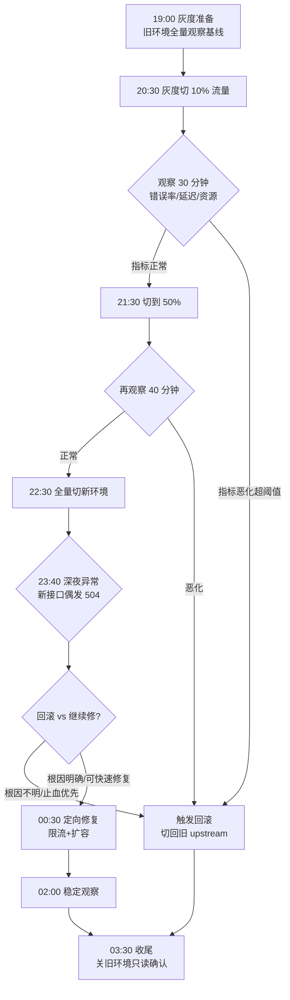

# 割接 / 上线夜全记录

::: tip 本篇定位
把一次"跨 Nginx + K8s + 数据库主从切换 + DNS"的大版本割接，从傍晚准备到凌晨收尾，按真实时间线重放一遍。重点不是命令，而是**每个时间点我在担心什么、怎么决策、回滚按钮什么时候按下去**。
适合：第一次独立扛割接、害怕上线夜、想知道"别人上线时到底在干嘛"的运维与 SRE。
:::

> 本文是第一人称复合案例。系统名、公司名、人名、IP、密钥均为化名；Nginx、Kubernetes、MySQL 的行为是真实的，具体数值按典型生产环境设定。

## 一、上线夜到底在怕什么

先讲个大白话。上线（割接）这件事，本质是**在业务还在跑的时候，把它从一套旧家当搬到一套新家当**。搬家你会怕什么？怕打碎东西、怕钥匙丢了、怕搬完发现新家电插不上电。运维割接怕的一模一样：

- **怕搬过去东西不能用**：新版本有 bug、配置没对齐。
- **怕搬不回来**：回滚路径没验证过，真出事退不回去。
- **怕搬一半卡住**：流量切到一半，新旧各扛一半，数据两边写。

所以老运维上线夜的信条只有一句：**我不是在赌新版能成，我是在保证任何时刻都能退回旧版。**

## 二、割接前的准备（下午 14:00–18:00）

### 2.1 割接方案里必须写死的东西

一份能让人睡着觉的割接方案，下面这几项缺一不可（模板见[运维文档模板](/reference/ops-templates)）：

| 要素 | 必须写清楚 | 我的习惯 |
|---|---|---|
| 变更范围 | 动哪些系统、哪些域名、哪些库表 | 圈出清单，不在清单内的一律不动 |
| 时间窗口 | 开始时间、最晚完成时间、最晚回滚时间 | 设"硬止损"：到点没成必须回滚 |
| 回滚预案 | 每一步对应的回滚动作、谁来执行、验证方法 | 回滚命令提前贴进群，不临时翻笔记 |
| 回滚触发条件 | 什么指标恶化到什么程度就回滚 | 写死阈值，不靠感觉 |
| 数据迁移 | 旧库→新库怎么迁、怎么校验、谁是主 | 先全量再增量，切换前确认无延迟 |
| 值守分工 | 谁盯 Nginx、谁盯 K8s、谁盯数据库、谁对外沟通 | 现场不重叠、不缺人 |

### 2.2 白天做掉的检查清单

这些白天就该做完，绝不留到深夜现做：

```bash
# 1) 新环境基础确认：版本、配置、连通性
kubectl get nodes -o wide                 # 节点 Ready、版本对
kubectl -n prod get pods                  # 新服务 pod 全 Running/Ready

# 2) 配置文件先预检，别等 reload 才报错
nginx -t -c /etc/nginx/nginx.conf         # 返回 syntax is ok / test is successful

# 3) 数据库主从状态：切换前必须确认从库延迟为 0
mysql -e "SHOW REPLICA STATUS\G" | grep -E "Seconds_Behind_Source|Replica_IO_Running|Replica_SQL_Running"
# 期望：Seconds_Behind_Source = 0，两个 Running 都是 Yes

# 4) DNS TTL：提前把要切的域名 TTL 调小，这样切换时生效快、回退也快
dig +short TTL api.example.com            # 割接前 24h 就把 TTL 从 86400 调到 300
```

::: warning TTL 是上线夜最容易被坑的一件事
如果域名 TTL 还是默认的 86400（1 天），你深夜切了 DNS，**有一半用户明天早上才生效**——那你这一夜等于白熬，还回退不了。TTL 必须在割接前一天就调小到 300 秒以内，观察一天缓存稳定了，才敢动。
:::

### 2.3 回滚预案提前"预演"过

光写回滚命令没用，我会在测试环境**真的执行一遍回滚**，确认：

- Nginx 切回旧 upstream 后 `nginx -s reload` 能成功、502 消失。
- K8s 把新版本 Deployment 扩到 0、旧版本恢复，`kubectl rollout undo` 能一把退回去。
- 数据库如果做了主从切换，**回滚要重新把旧主切回去**，这一步最危险——所以我尽量把"切主"放在最后、且提前确认延迟为 0。

## 三、割接时间线（19:00 – 次日 04:00）

下面是那晚的真实推进。我用当时的时间线写。



### 3.1 傍晚：先建立"正常长什么样"（19:00）

动手前我先把旧环境的基线记下来：错误率、P99 延迟、CPU、连接数。**没有基线，等下你根本不知道"现在算不算异常"。**

```bash
# 记录旧环境基线（Prometheus 面板当时的读数，这里用命令行示意）
curl -s "http://prom:9090/api/v1/query?query=rate(http_requests_total{code=~'5..'}[5m])"
curl -s "http://prom:9090/api/v1/query?query=histogram_quantile(0.99,rate(http_request_duration_seconds_bucket[5m]))"
```

### 3.2 灰度：10%（20:30）

不在 DNS 上一刀切，而是在 Nginx 上按比例灰度。旧 upstream 扛 90%，新服务扛 10%：

```nginx
upstream backend_old { server 10.0.0.11:8080; }
upstream backend_new { server 10.0.0.21:8080; }

location /api/ {
    proxy_pass http://backend_new;
    # 先只放 10%，其余走旧版——用 split_clients 按 hash 分流
}
```

```bash
nginx -t && nginx -s reload      # reload 不中断现有连接，这就是为什么用 reload 不用 restart
```

### 3.3 深夜异常：23:40，新接口开始偶发 504

前两段（10%、50%）都很顺。全量切过去一个多小时后，告警群开始刷：新接口 `/api/order` 偶发 504，P99 延迟从 200ms 飙到 3s。

当时群里的反应很真实：

- 开发："是不是 DB 慢了？我加个索引？"
- 我（看监控）："CPU 才 40%，DB 连接数没满，错误集中在少数 pod。"

我做的第一件事**不是急着修，而是先看最近变更和现场**：

```bash
# 1) 看哪些 pod 在报错——发现是新扩容出来的那批 pod
kubectl -n prod get pods -o wide | grep Error

# 2) 进去看日志
kubectl -n prod logs <pod> --tail=100 | grep -iE "timeout|pool|connection|refused"

# 3) 发现：新服务连 Redis 的连接池参数太小，高并发下拿不到连接，请求排队到超时
```

### 3.4 决策：回滚 vs 继续修（00:00–00:20）

这是整个夜晚最关键的 20 分钟。群里两派：

| 选项 | 理由 | 风险 |
|---|---|---|
| **立刻回滚** | 止血最快，用户无感 | 等于今晚白干，要再约窗口；且根因没定位，下次还犯 |
| **继续修** | 根因已基本明确（连接池） | 修的过程中用户持续 504，每多一分钟都是损失 |

我的决策逻辑写在下面这段——它就是"**先止血、再根治**"。

::: tip 回滚决策三问
1. **根因明确吗？** 不明确 → 先回滚，别在生产上边猜边改。
2. **能在硬止损时间前修好吗？** 修要 2 小时，但硬止损是 01:00 → 回滚。
3. **止血动作是否可逆、风险低？** 能先扩容/限流临时扛住，就不用整体回滚。
:::

那晚的实际选择：**不整体回滚，先做低风险止血**——把那批问题 pod 扩容、同时在网关层对 `/api/order` 临时限流，给老请求留缓冲；然后热更新连接池配置滚动重启。因为根因明确、止血动作可逆、错误率还没到"全站不可用"。

```bash
# 止血：扩容（新 pod 会用修好的连接池配置）
kubectl -n prod scale deployment order-svc --replicas=6

# 观察：确认 504 回落、P99 回基线
kubectl -n prod rollout status deployment/order-svc
```

## 四、沟通与心态

上线夜最被低估的是沟通。我那晚定了三条规矩：

1. **一个人对外发声**：所有"现在到哪一步、有没有问题"只由我在群里同步，避免七嘴八舌。
2. **有结论再说，没结论别制造恐慌**：发现 504 后，我先在群里说"已定位为连接池，正在止血，预期 15 分钟内恢复"，而不是只甩一个"出事了"。
3. **到点硬止损**：我给自己设了 01:00 回滚红线——如果止血 15 分钟没下来，无条件回滚。红线的意义是**让你在恐慌里有个不靠情绪的决定**。

心态上一句实话：**上线夜手抖是正常的，但手别快过脑子。** 每敲一条命令前默念一遍"这条命令回车之后会发生什么、错了怎么退"。

## 五、凌晨收尾与事后待办（03:30 之后）

异常在 01:20 前完全恢复，之后是漫长的稳定观察期。收尾时做这些：

- **旧环境别急着删**：切完再观察至少一个完整业务高峰（那晚到第二天白天），旧环境保持"只读/可随时切回"，确认无回流问题才下线。
- **数据库主从关系固化**：确认新主稳定、旧主降级为只读从库，不再切来切去。
- **DNS 保持低 TTL 几天**：观察期内先不把 TTL 调回 86400，万一要回退还能快速生效。

事后待办（第二天复盘用，模板见[事故管理与无指责复盘](./sre-incident)）：

| 待办 | 负责人 | 目的 |
|---|---|---|
| 连接池参数补进压测基线 | 开发/SRE | 下次上线前压测暴露，不等到深夜 |
| 补一条"新 pod 连接池"监控告警 | SRE | 连接池使用率超 80% 提前报警 |
| 把这次止血动作写进割接剧本 | SRE | 下次值班直接抄，不临场想 |
| 复盘会：为什么灰度期没暴露 | 全体 | 10%/50% 流量下并发不够，没触发连接池瓶颈 |

## 六、常见问题排错

| 现象 | 可能原因 | 处理 |
|---|---|---|
| reload 后 502 突然增多 | 新 upstream 后端没起来就接流量 | 灰度前先确认新 pod Ready；`nginx -t` 通过再 reload |
| 切了 DNS 用户没变化 | TTL 太大 / 本地缓存 | 提前一天调小 TTL；用 `dig @114.114.114.114` 核对权威记录 |
| 数据库切换后写报错 | 旧主还被当成写入口 | 切主前停写、确认 `Seconds_Behind_Source=0`、应用切新主 |
| 灰度正常全量就崩 | 低并发没压到瓶颈（如连接池） | 压测要按峰值的 1.5 倍；全量前多看一个高峰段 |
| 回滚后仍异常 | 回滚不彻底（数据已写新主） | 回滚预案要含数据层；不可逆变更绝不轻易做 |

::: warning 生产红线
- **任何"不可逆"操作（删库、清表、强制切主）前，先确认备份可用且回滚路径已验证。**
- 到了硬止损时间还没成，无条件回滚——"再等等"是上线夜最贵的三个字。
- 旧环境在观察期内绝不下线，保持可秒级切回。
- 别在业务高峰窗口做割接；深夜也要保证有一个完整高峰可观察。
:::

## 相关速查

- 割接 / 上线 / 应急逐项清单：[运维 Checklist 大全](/reference/ops-checklists)
- 复盘与事故管理方法论：[事故管理与无指责复盘](./sre-incident)
- 容量规划与灾备切换：[容量规划、高可用与灾备](./sre-capacity-dr)
- 另一个告警风暴夜的故事：[值班惊魂：一次告警风暴的真实处置](./blog-oncall-thriller)
- K8s 发布与回滚命令：[kubectl 命令速查](/reference/kubectl-commands)

### 官方文档

- Nginx 负载均衡与健康检查：https://docs.nginx.com/nginx/admin-guide/load-balancer/http-load-balancer/
- Kubernetes 滚动更新与回滚：https://kubernetes.io/docs/concepts/workloads/controllers/deployment/#rolling-back-a-deployment
- MySQL 复制状态检查（SHOW REPLICA STATUS）：https://dev.mysql.com/doc/refman/8.0/en/show-replica-status.html
- DNS TTL 说明：https://en.wikipedia.org/wiki/Time_to_live#DNS_records（需科学上网）；国内平替：https://help.aliyun.com/zh/dns/pubz-how-to-modify-ttl-time
