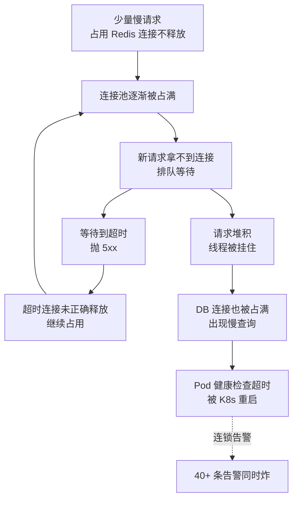

# 值班惊魂：一次告警风暴的真实处置

::: tip 本篇定位
还原一次深夜被告警轰炸的完整经历：告警雪崩、先怀疑错方向、信息收集与告警收敛、根因（连接池耗尽）、止血与根治。
适合：刚独立值班、一看到告警电话就心跳加速、不知道"几十条告警同时响先看哪条"的运维。
:::

> 第一人称复合案例，系统/人名/IP 均为化名。技术行为（连接池、慢 SQL、告警规则）是真实的。

## 一、先讲那晚发生了什么

凌晨 02:47，手机连环震。不是一条两条，是**十分钟内 40 多条告警**一起炸进来：接口超时、5xx 比例飙升、P99 延迟拉满、Pod 重启、Redis 连接数高、DB 慢查询……群里瞬间十几条消息，值班的我从床上弹起来，第一反应是懵的。

这种"告警风暴"的特点是：**表象是一堆症状，根因往往只有一个。** 你要做的不是一条条去摁，而是在噪声里找到那个最先倒下的多米诺骨牌。

## 二、第一阶段：误判（02:50–03:00）

我坦白，我一开始判断错了。

看到"Redis 连接数高 + DB 慢查询"，我本能反应：**是不是有人刷接口、被打了？** 甚至已经准备去查 Nginx 访问日志里有没有异常 IP。

```bash
# 当时准备跑的（事后证明方向错了）
tail -f /var/log/nginx/access.log | awk '{print $1}' | sort | uniq -c | sort -rn | head
```

还好我忍住没动手封 IP——因为如果真是恶意流量，那应该看到某个 IP 巨量请求；但日志里 QPS 并没有暴涨，只是**请求开始排队变慢**。方向错了。

::: danger 最危险的操作：在根因不明时"手快"
误判为攻击就去封 IP、去限流，可能把正常用户一起掐了；误判为 DB 挂了就去重启主库，可能让本来还能扛的系统彻底倒。**根因不明时，宁可先收集证据，别做有副作用的操作。**
:::

## 三、第二阶段：信息收集与告警收敛（03:00–03:15）

我做了三件事，把"40 条告警"收敛成"1 个问题"：

### 3.1 找"最早的那条"

告警是有因果的。我把告警按**触发时间排序**，找最早那一条——往往它就是第一张倒下的骨牌，后面的都是连锁反应。

那晚最早的告警是：**`order-svc` 的 HTTP 5xx 比例在 02:47 突破阈值**，比 Redis、DB 告警早了整整 2 分钟。说明是应用层先出问题，再把后面拖垮。

### 3.2 看黄金三指标

回到监控大盘，不看满屏面板，只看三个：

| 指标 | 那晚读数 | 说明 |
|---|---|---|
| QPS | 平稳，没暴涨 | 排除被刷 |
| 错误率 | 02:47 起从 0.1% 飙到 12% | 问题在应用 |
| 资源（CPU/内存） | CPU 35%、内存正常 | 不是资源耗尽 |

### 3.3 看应用日志和连接池

```bash
kubectl -n prod logs deploy/order-svc --since=30m | grep -iE "timeout|pool|cannot get|wait" | tail -30
```

日志里大量这条：

```text
Could not get a resource from the pool, waiting... (Redis connection pool exhausted)
```

根因浮出水面：**应用连 Redis 的连接池被占满了，新请求拿不到连接就一直等，等到超时抛 5xx；超时的连接又没正确释放，恶性循环。** 后面 DB 慢查询、Pod 重启都是"请求堆积"的连带结果。



## 四、第三阶段：止血与根治（03:15–03:40）

### 4.1 先止血（可逆、低风险）

根因是连接池耗尽，最快的止血是**扩容 + 重启一批 pod，把占着死连接的进程清掉**，同时在网关层对该服务临时限流，别让更多请求涌进来排队：

```bash
# 1) 网关层限流：先给 order-svc 降压（Nginx limit_req 示意）
#    临时把 QPS 限住，避免雪崩放大

# 2) 滚动重启：清掉占着死连接的 pod（重启会重建连接池）
kubectl -n prod rollout restart deployment/order-svc

# 3) 适度扩容，给连接池总量留余量
kubectl -n prod scale deployment/order-svc --replicas=8
```

重启后 5xx 立刻回落——这也反向验证了根因：问题在进程内连接状态，不在基础设施。

### 4.2 再根治

止血只是让用户能用，根治要回答"连接池为什么会被占满"。顺着日志查：

- 当晚 02:30 有一次**小版本配置发布**，把 Redis 连接池大小从 200 调成了 50（本意是"省资源"），但峰值并发需要 300。
- 应用代码里 Redis 异常分支**没有正确 close 连接**，个别慢请求泄漏的连接不归还，慢慢把池耗光。

根治动作：

| 动作 | 目的 |
|---|---|
| 连接池大小调回合理值并压测确认 | 容量按峰值 1.5 倍配 |
| 修复异常分支连接泄漏（try/finally 归还） | 不再泄漏 |
| 加"连接池使用率 > 80%"告警 | 下次提前 10 分钟报警，不等用户报错 |
| 配置变更走灰度 + 可回滚 | 深夜配置别裸改 |

## 五、这次值班的心得

1. **告警风暴里，先找最早的那条，而不是最响的那条。** 最响的往往是受害者。
2. **QPS 没涨却全员变慢，优先怀疑"资源被占住不释放"，而不是"被打了"。**
3. **根因不明前不做有副作用的操作**（封 IP、重启主库）。
4. **止血要可逆**：扩容、重启、限流都是可回退的；根治留给白天清醒时做。
5. **那晚真正救我的，是"连接池使用率"这个我后来补上的监控**——它在下次故障提前了 10 分钟报警。

::: warning 值班红线
- 值班手机保持音量，但别被告警牵着鼻子乱操作；先花 5 分钟看时间线和三指标。
- 任何"重启数据库主库""删流量""切集群"这类高风险动作，先在群里说清楚再做，并确认回滚路径。
- 告警规则要治理：同一个根因炸 40 条，说明告警没做收敛和依赖抑制，长期会"狼来了"。
:::

## 相关速查

- 排障时怎么一步步推理、分层排查：[信息不全时的排障推理框架](./blog-troubleshooting-reasoning)
- 值班该背下来的现场法则：[现场经验法则与"土办法"](./blog-field-rules)
- SLO 与错误预算、告警怎么定阈值：[SLO/SLI、错误预算与 Burn Rate](./monitor-slo)
- 主机性能命令（看连接数/慢查询）：[Linux 性能排查](./linux-performance)
- 真实故障案例：[排障案例](/cases/troubleshooting)

### 官方文档

- Redis 连接池与资源管理：https://redis.io/docs/latest/develop/
- Kubernetes 滚动重启 Deployment：https://kubernetes.io/docs/concepts/workloads/controllers/deployment/#rolling-update-deployment
- Nginx 限流模块 limit_req：https://nginx.org/en/docs/http/ngx_http_limit_req_module.html
