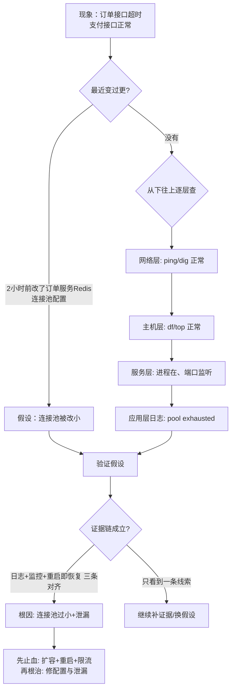

# 信息不全时的排障推理框架

::: tip 本篇定位
当监控还没来得及告诉你根因、一堆现象互相矛盾时，怎么靠一套**可复用的推理框架**把问题推出来：分层排查、二分法、最近变更优先、假设-验证、证据链、先止血后根治。
适合：遇到过"查了两小时还在原地打转"的运维，想把排障从"碰运气"变成"有方法"。
:::

## 一、先说人话：排障到底在干嘛

排障不是"把命令敲一遍试试"，而是**侦探破案**。现场给你的线索是零散的：A 服务超时、B 报连接拒绝、C 磁盘满了。你要做的是从这些线索里**重建出那条因果链**——谁先出问题、谁是被连累的。

新手排障像翻字典：从 A 查到 Z，挨个试。老手排障像侦探：先问"昨晚谁动过现场"（最近变更），再按"从下往上"过一遍楼层（分层），然后不断"砍掉一半不可能"（二分法）。

## 二、分层排查：从下往上，别跳层

一个请求要经过很多层才到用户。出问题时，**从最底层开始逐层确认"这一层通不通"**，能通就往上走，不通就就地解决。别一上来就怀疑应用代码——八成问题在你看不见的下层。

| 层 | 该问的问题 | 常用命令 |
|---|---|---|
| 网络 | 通不通？DNS 对不对？丢包吗？ | `ping`、`dig`、`telnet`/`nc -vz`、`mtr`、`ss -tnp` |
| 主机 | CPU/内存/磁盘/inode/负载正常吗？ | `top`、`df -h`、`df -i`、`free -h` |
| 服务 | 进程在吗？端口监听吗？日志报错吗？ | `systemctl status`、`ss -lntup`、`journalctl` |
| 应用 | 应用本身报错吗？线程/连接池满吗？ | 应用日志、`jstack`、连接池监控 |
| 数据库 | 慢查询？锁等待？连接数满？主从延迟？ | `SHOW PROCESSLIST`、`EXPLAIN`、`SHOW REPLICA STATUS` |

::: tip 为什么从下往上
因为下层是上层的前提。网络不通，你查应用代码查破头也没用。**逐层排除，能把搜索空间指数级缩小。**
:::

## 三、四个核心推理武器

### 3.1 最近变更优先（First, ask what changed）

> 故障八成跟"最近动过的东西"有关。

我排障第一句话永远是：**"这次故障前，我们改了什么？"** 发布、配置变更、扩容、换了个 DNS、甚至隔壁组动了防火墙。把最近 24 小时的变更列出来，往往根因就在里面。

```bash
# 快速收集"最近变更"线索
kubectl -n prod rollout history deployment/<svc>     # K8s 最近发布
grep -i "config" /var/log/messages                    # 配置变更
last                                                  # 谁登录过
```

### 3.2 二分法：每次砍掉一半

不要"换一个配置重启一下试试"，要**设计能一刀切开嫌疑范围的验证**。

例：用户说"网站打不开"。不要从头点到尾，先问：

- 是所有人打不开，还是只有某个地区？→ 砍掉一半人群。
- 是首页打不开，还是只有登录后？→ 砍掉一半功能。
- 是所有机器都这样，还是某几台？→ 砍掉一半机器。

每问一个问题，嫌疑范围砍一半。十次之后你就锁定了。

### 3.3 假设-验证（Hypothesis-Driven）

每查一步，先在脑子里说一句："**我假设是 X，那么我应该能看到 Y；如果看不到 Y，假设被证伪。**"

- 假设：磁盘满了导致写失败。→ 验证：`df -h`，看是不是 100%。
- 假设：是 DB 慢导致接口慢。→ 验证：抓接口慢的时间点，`SHOW PROCESSLIST` 看有没有对应慢查询。

**关键：每个假设都要能被证伪。** 不能证伪的假设（"可能是玄学"）不要拿来当结论。

### 3.4 证据链：别用单点证据下结论

一条线索可能是巧合，三条互相印证的线索才是证据链。比如"连接池耗尽"这个结论，要有：

1. 应用日志反复报 `pool exhausted`；
2. 监控上连接池使用率 100%；
3. 重启后立刻恢复（反向印证是进程内状态问题）。

三条对齐，才敢下结论动刀。

## 四、一次完整推理还原

假设场景：**凌晨订单接口大面积超时，但支付接口正常。**



推理过程：

1. **先问变更**：2 小时前有人把订单服务的 Redis 连接池从 200 调到 50。→ 强嫌疑。
2. **逐层确认**：网络通、主机正常、进程在 → 问题在应用层。
3. **假设-验证**：假设连接池太小 → 看监控，连接池使用率 100%、等待队列堆积。
4. **证据链**：日志报 pool exhausted + 监控 100% + 重启后立刻恢复 = 三条对齐。
5. **决策**：先止血（扩容/重启/限流），再根治（调回配置、修连接泄漏、加预警）。

## 五、先止血，后根治

这是贯穿所有排障的总原则。区分两个动作：

| | 止血（现在做） | 根治（清醒后做） |
|---|---|---|
| 目的 | 让用户先能用 | 让问题不再犯 |
| 风险 | 低、可逆 | 可能涉及代码/架构 |
| 手段 | 扩容、重启、限流、切流量、降级 | 改配置、修 bug、补监控、改架构 |

**不要在凌晨 3 点一边止血一边改代码根治**——你手是抖的，改错了雪上加霜。先让系统活下来，把根因和证据记下来，白天清醒时再根治。

::: warning 排障红线
- 根因不明时，不做不可逆、有副作用的操作（重启主库、清数据、切集群）。
- 每次动系统前先留现场：保存日志、`ss -s`、`df`、`jstack` 快照，别把证据"重启"没了。
- 一个人排障容易钻牛角尖，卡住 30 分钟没进展就拉第二个人进来对一遍思路。
- 先止血后根治；凌晨只做可逆动作。
:::

## 六、常见误区

| 误区 | 后果 | 正确做法 |
|---|---|---|
| 从应用代码开始猜 | 浪费时间，问题在下层 | 从网络/主机层逐层往上 |
| 一次试好几个改动 | 不知道哪个起效、哪个有害 | 一次只验证一个假设 |
| 不查最近变更 | 错过最明显的根因 | 开口先问"昨晚谁动过" |
| 看到一条告警就下结论 | 把受害者当根因 | 凑齐三条证据再动刀 |
| 急着重启清现场 | 证据没了，复发时抓瞎 | 重启前先快照日志与状态 |

## 相关速查

- 真实值班风暴复盘：[值班惊魂：一次告警风暴的真实处置](./blog-oncall-thriller)
- 排障时背下来的经验法则：[现场经验法则与"土办法"](./blog-field-rules)
- 主机性能排查命令：[Linux 性能排查](./linux-performance)
- 事故复盘方法：[事故管理与无指责复盘](./sre-incident)
- 更多真实案例：[排障案例](/cases/troubleshooting)

### 官方文档

- Linux 网络排查工具 mtr/tcpdump：https://www.geekdirective.com/linux-network-troubleshooting/
- MySQL 慢查询与进程列表：https://dev.mysql.com/doc/refman/8.0/en/slow-query-log.html
- Kubernetes 调试 Pod：https://kubernetes.io/docs/tasks/debug/debug-application/debug-pods/
