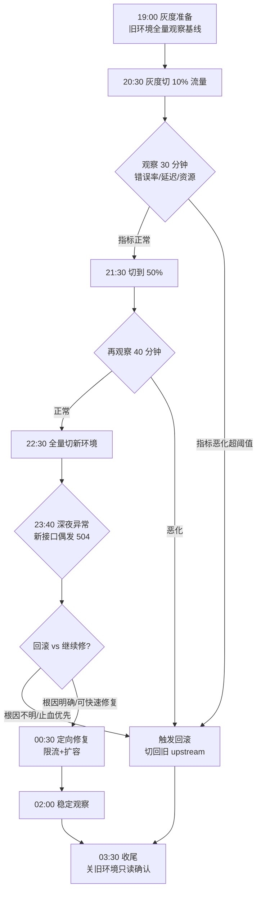
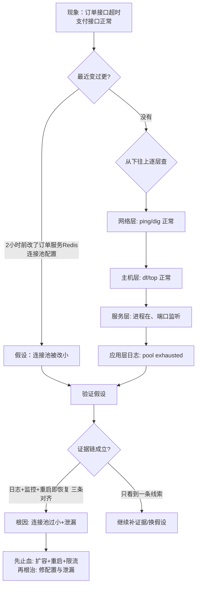

# 运维手记

> 这是一个老 SRE 的实战笔记：上线夜的煎熬、值班被告警轰炸的凌晨、踩过的坑、反复验证过的"土办法"，以及真正在生产里跑过的脚本。与第一阶段的"教科书"内容互补——这里不讲原理，只讲**当时怎么想的、怎么做的、后来怎么补的**。
> 所有案例均为第一人称复合案例，公司名、人名、IP、密钥一律化名或泛指。

## 文章索引

### 现场故事

::: idx

| 文章 | 解决什么问题 | 状态 |
|---|---|---|
| [割接 / 上线夜全记录](#合并资料) | 一次跨 Nginx + K8s + 数据库主从 + DNS 的割接，从傍晚准备到凌晨收尾的完整时间线与"回滚 vs 修复"决策 | ✅ 已完成 |
| [值班惊魂：一次告警风暴的真实处置](./blog-oncall-thriller) | 告警轰炸下先误判方向、再收敛定位根因（连接池耗尽）、止血与根治的全过程 | ✅ 已完成 |
| [典型踩坑实录（短案例集）](./blog-war-stories) | 12 条短小踩坑：误删、inode 满、时区、缓存雪崩、连接数打满、改配置没 reload、通配符误伤…… | ✅ 已完成 |

:::

### 排障方法论

::: idx

| 文章 | 解决什么问题 | 状态 |
|---|---|---|
| [信息不全时的排障推理框架](#合并资料) | 高压、信息不全下怎么分层排查、用二分法、最近变更优先、假设-验证、先止血后根治 | ✅ 已完成 |
| [现场经验法则与"土办法"](./blog-field-rules) | 30 条排障/操作/安全/沟通的经验法则：先看最近变更、重启前留现场、删除前先移动观察…… | ✅ 已完成 |

:::

### 实战脚本集

::: idx

| 文章 | 解决什么问题 | 状态 |
|---|---|---|
| [巡检 / 自愈 / 批量操作脚本集](#合并资料) | 批量主机巡检、阈值巡检、服务异常自愈拉起、带白名单与二次确认的批量执行 | ✅ 已完成 |
| [备份 / 清理 / 证书巡检脚本集](#合并资料) | 日志切割清理、带校验和与轮转的备份、证书到期巡检、数据一致性校验 | ✅ 已完成 |

:::

### 硬核实战专题

::: idx

| 文章 | 解决什么问题 | 状态 |
|---|---|---|
| [性能调优实战全流程](/guide/expert-tough-cases#合并资料) | USE/RED、wrk/vegeta/k6 压测、四类瓶颈定位、调优参数与前后对比 | ✅ 已完成 |
| [高并发 / 限流降级与流量调度](/guide/expert-tough-cases#合并资料) | 容量评估、令牌桶/漏桶/滑动窗口、熔断降级、灰度与多活 GSLB | ✅ 已完成 |
| [疑难杂症专题](./expert-tough-cases) | 内存泄漏、fd/连接耗尽、OOM、卡顿、丢包重传、时钟、脑裂 | ✅ 已完成 |
| [安全应急响应](./expert-security-incident) | 被入侵/挖矿/木马/webshell 的隔离、取证、清除、溯源与加固闭环 | ✅ 已完成 |
| [从零落地监控自动化 SRE](/guide/expert-tough-cases#合并资料) | 小公司/传统企业分阶段落地路径、优先级取舍与开源选型 | ✅ 已完成 |
| [生产配置最佳实践模板](/reference/ops-templates#合并资料) | Nginx/MySQL/Redis/K8s/内核参数模板，逐项注释为什么这么设 | ✅ 已完成 |

:::

## 命令速查

- 上线 / 巡检 / 应急 / 割接的逐项核对清单：[运维 Checklist 大全](/reference/ops-templates#运维检查清单)
- 变更割接 / 故障报告 / 复盘 / 交接的文档模板：[运维文档模板](/reference/ops-templates)
- 让 AI 帮你排障、写脚本、复盘的提示词：[运维 AI Prompt 速查](/reference/ai-prompts)
- 日常命令随查：[Linux 命令速查](/reference/linux-commands)
- 真实故障案例库：[排障案例](/cases/)

<!-- merged-guide-material:start -->
## 合并资料

> 原先单独成页的同主题内容已收进本页；默认折叠，点开看原页全文。

<details>
<summary><strong>割接 / 上线夜全记录 — 本文是第一人称复合案例。系统名、公司名、人名、IP、密钥均为化名；Nginx、Kubernetes、MySQL 的行为是真实的，具体数值按典型生产环境设定。</strong></summary>

::: tip 本篇定位
把一次"跨 Nginx + K8s + 数据库主从切换 + DNS"的大版本割接，从傍晚准备到凌晨收尾，按真实时间线重放一遍。重点不是命令，而是**每个时间点我在担心什么、怎么决策、回滚按钮什么时候按下去**。
适合：第一次独立扛割接、害怕上线夜、想知道"别人上线时到底在干嘛"的运维与 SRE。
:::

> 本文是第一人称复合案例。系统名、公司名、人名、IP、密钥均为化名；Nginx、Kubernetes、MySQL 的行为是真实的，具体数值按典型生产环境设定。

#### 一、上线夜到底在怕什么

先讲个大白话。上线（割接）这件事，本质是**在业务还在跑的时候，把它从一套旧家当搬到一套新家当**。搬家你会怕什么？怕打碎东西、怕钥匙丢了、怕搬完发现新家电插不上电。运维割接怕的一模一样：

- **怕搬过去东西不能用**：新版本有 bug、配置没对齐。
- **怕搬不回来**：回滚路径没验证过，真出事退不回去。
- **怕搬一半卡住**：流量切到一半，新旧各扛一半，数据两边写。

所以老运维上线夜的信条只有一句：**我不是在赌新版能成，我是在保证任何时刻都能退回旧版。**

#### 二、割接前的准备（下午 14:00–18:00）

##### 2.1 割接方案里必须写死的东西

一份能让人睡着觉的割接方案，下面这几项缺一不可（模板见[运维文档模板](/reference/ops-templates)）：

| 要素 | 必须写清楚 | 我的习惯 |
|---|---|---|
| 变更范围 | 动哪些系统、哪些域名、哪些库表 | 圈出清单，不在清单内的一律不动 |
| 时间窗口 | 开始时间、最晚完成时间、最晚回滚时间 | 设"硬止损"：到点没成必须回滚 |
| 回滚预案 | 每一步对应的回滚动作、谁来执行、验证方法 | 回滚命令提前贴进群，不临时翻笔记 |
| 回滚触发条件 | 什么指标恶化到什么程度就回滚 | 写死阈值，不靠感觉 |
| 数据迁移 | 旧库→新库怎么迁、怎么校验、谁是主 | 先全量再增量，切换前确认无延迟 |
| 值守分工 | 谁盯 Nginx、谁盯 K8s、谁盯数据库、谁对外沟通 | 现场不重叠、不缺人 |

##### 2.2 白天做掉的检查清单

这些白天就该做完，绝不留到深夜现做：

```bash
# 1) 新环境基础确认：版本、配置、连通性
kubectl get nodes -o wide                 # 节点 Ready、版本对
kubectl -n prod get pods                  # 新服务 pod 全 Running/Ready

# 2) 配置文件先预检，别等 reload 才报错
nginx -t -c /etc/nginx/nginx.conf         # 返回 syntax is ok / test is successful

# 3) 数据库主从状态：切换前必须确认从库延迟为 0
mysql -e "SHOW REPLICA STATUS\G" | grep -E "Seconds_Behind_Source|Replica_IO_Running|Replica_SQL_Running"
# 期望：Seconds_Behind_Source = 0，两个 Running 都是 Yes

# 4) DNS TTL：提前把要切的域名 TTL 调小，这样切换时生效快、回退也快
dig +short TTL api.example.com            # 割接前 24h 就把 TTL 从 86400 调到 300
```

::: warning TTL 是上线夜最容易被坑的一件事
如果域名 TTL 还是默认的 86400（1 天），你深夜切了 DNS，**有一半用户明天早上才生效**——那你这一夜等于白熬，还回退不了。TTL 必须在割接前一天就调小到 300 秒以内，观察一天缓存稳定了，才敢动。
:::

##### 2.3 回滚预案提前"预演"过

光写回滚命令没用，我会在测试环境**真的执行一遍回滚**，确认：

- Nginx 切回旧 upstream 后 `nginx -s reload` 能成功、502 消失。
- K8s 把新版本 Deployment 扩到 0、旧版本恢复，`kubectl rollout undo` 能一把退回去。
- 数据库如果做了主从切换，**回滚要重新把旧主切回去**，这一步最危险——所以我尽量把"切主"放在最后、且提前确认延迟为 0。

#### 三、割接时间线（19:00 – 次日 04:00）

下面是那晚的真实推进。我用当时的时间线写。



##### 3.1 傍晚：先建立"正常长什么样"（19:00）

动手前我先把旧环境的基线记下来：错误率、P99 延迟、CPU、连接数。**没有基线，等下你根本不知道"现在算不算异常"。**

```bash
# 记录旧环境基线（Prometheus 面板当时的读数，这里用命令行示意）
curl -s "http://prom:9090/api/v1/query?query=rate(http_requests_total{code=~'5..'}[5m])"
curl -s "http://prom:9090/api/v1/query?query=histogram_quantile(0.99,rate(http_request_duration_seconds_bucket[5m]))"
```

##### 3.2 灰度：10%（20:30）

不在 DNS 上一刀切，而是在 Nginx 上按比例灰度。旧 upstream 扛 90%，新服务扛 10%：

```nginx
upstream backend_old { server 10.0.0.11:8080; }
upstream backend_new { server 10.0.0.21:8080; }

location /api/ {
    proxy_pass http://backend_new;
    # 先只放 10%，其余走旧版——用 split_clients 按 hash 分流
}
```

```bash
nginx -t && nginx -s reload      # reload 不中断现有连接，这就是为什么用 reload 不用 restart
```

##### 3.3 深夜异常：23:40，新接口开始偶发 504

前两段（10%、50%）都很顺。全量切过去一个多小时后，告警群开始刷：新接口 `/api/order` 偶发 504，P99 延迟从 200ms 飙到 3s。

当时群里的反应很真实：

- 开发："是不是 DB 慢了？我加个索引？"
- 我（看监控）："CPU 才 40%，DB 连接数没满，错误集中在少数 pod。"

我做的第一件事**不是急着修，而是先看最近变更和现场**：

```bash
# 1) 看哪些 pod 在报错——发现是新扩容出来的那批 pod
kubectl -n prod get pods -o wide | grep Error

# 2) 进去看日志
kubectl -n prod logs <pod> --tail=100 | grep -iE "timeout|pool|connection|refused"

# 3) 发现：新服务连 Redis 的连接池参数太小，高并发下拿不到连接，请求排队到超时
```

##### 3.4 决策：回滚 vs 继续修（00:00–00:20）

这是整个夜晚最关键的 20 分钟。群里两派：

| 选项 | 理由 | 风险 |
|---|---|---|
| **立刻回滚** | 止血最快，用户无感 | 等于今晚白干，要再约窗口；且根因没定位，下次还犯 |
| **继续修** | 根因已基本明确（连接池） | 修的过程中用户持续 504，每多一分钟都是损失 |

我的决策逻辑写在下面这段——它就是"**先止血、再根治**"。

::: tip 回滚决策三问
1. **根因明确吗？** 不明确 → 先回滚，别在生产上边猜边改。
2. **能在硬止损时间前修好吗？** 修要 2 小时，但硬止损是 01:00 → 回滚。
3. **止血动作是否可逆、风险低？** 能先扩容/限流临时扛住，就不用整体回滚。
:::

那晚的实际选择：**不整体回滚，先做低风险止血**——把那批问题 pod 扩容、同时在网关层对 `/api/order` 临时限流，给老请求留缓冲；然后热更新连接池配置滚动重启。因为根因明确、止血动作可逆、错误率还没到"全站不可用"。

```bash
# 止血：扩容（新 pod 会用修好的连接池配置）
kubectl -n prod scale deployment order-svc --replicas=6

# 观察：确认 504 回落、P99 回基线
kubectl -n prod rollout status deployment/order-svc
```

#### 四、沟通与心态

上线夜最被低估的是沟通。我那晚定了三条规矩：

1. **一个人对外发声**：所有"现在到哪一步、有没有问题"只由我在群里同步，避免七嘴八舌。
2. **有结论再说，没结论别制造恐慌**：发现 504 后，我先在群里说"已定位为连接池，正在止血，预期 15 分钟内恢复"，而不是只甩一个"出事了"。
3. **到点硬止损**：我给自己设了 01:00 回滚红线——如果止血 15 分钟没下来，无条件回滚。红线的意义是**让你在恐慌里有个不靠情绪的决定**。

心态上一句实话：**上线夜手抖是正常的，但手别快过脑子。** 每敲一条命令前默念一遍"这条命令回车之后会发生什么、错了怎么退"。

#### 五、凌晨收尾与事后待办（03:30 之后）

异常在 01:20 前完全恢复，之后是漫长的稳定观察期。收尾时做这些：

- **旧环境别急着删**：切完再观察至少一个完整业务高峰（那晚到第二天白天），旧环境保持"只读/可随时切回"，确认无回流问题才下线。
- **数据库主从关系固化**：确认新主稳定、旧主降级为只读从库，不再切来切去。
- **DNS 保持低 TTL 几天**：观察期内先不把 TTL 调回 86400，万一要回退还能快速生效。

事后待办（第二天复盘用，模板见[事故管理与无指责复盘](./sre-incident)）：

| 待办 | 负责人 | 目的 |
|---|---|---|
| 连接池参数补进压测基线 | 开发/SRE | 下次上线前压测暴露，不等到深夜 |
| 补一条"新 pod 连接池"监控告警 | SRE | 连接池使用率超 80% 提前报警 |
| 把这次止血动作写进割接剧本 | SRE | 下次值班直接抄，不临场想 |
| 复盘会：为什么灰度期没暴露 | 全体 | 10%/50% 流量下并发不够，没触发连接池瓶颈 |

#### 六、常见问题排错

| 现象 | 可能原因 | 处理 |
|---|---|---|
| reload 后 502 突然增多 | 新 upstream 后端没起来就接流量 | 灰度前先确认新 pod Ready；`nginx -t` 通过再 reload |
| 切了 DNS 用户没变化 | TTL 太大 / 本地缓存 | 提前一天调小 TTL；用 `dig @114.114.114.114` 核对权威记录 |
| 数据库切换后写报错 | 旧主还被当成写入口 | 切主前停写、确认 `Seconds_Behind_Source=0`、应用切新主 |
| 灰度正常全量就崩 | 低并发没压到瓶颈（如连接池） | 压测要按峰值的 1.5 倍；全量前多看一个高峰段 |
| 回滚后仍异常 | 回滚不彻底（数据已写新主） | 回滚预案要含数据层；不可逆变更绝不轻易做 |

::: warning 生产红线
- **任何"不可逆"操作（删库、清表、强制切主）前，先确认备份可用且回滚路径已验证。**
- 到了硬止损时间还没成，无条件回滚——"再等等"是上线夜最贵的三个字。
- 旧环境在观察期内绝不下线，保持可秒级切回。
- 别在业务高峰窗口做割接；深夜也要保证有一个完整高峰可观察。
:::

#### 相关速查

- 割接 / 上线 / 应急逐项清单：[运维 Checklist 大全](/reference/ops-templates#运维检查清单)
- 复盘与事故管理方法论：[事故管理与无指责复盘](./sre-incident)
- 容量规划与灾备切换：[容量规划、高可用与灾备](./sre-capacity-dr)
- 另一个告警风暴夜的故事：[值班惊魂：一次告警风暴的真实处置](./blog-oncall-thriller)
- K8s 发布与回滚命令：[kubectl 命令速查](/reference/kubectl-commands)

##### 官方文档

- Nginx 负载均衡与健康检查：https://docs.nginx.com/nginx/admin-guide/load-balancer/http-load-balancer/
- Kubernetes 滚动更新与回滚：https://kubernetes.io/docs/concepts/workloads/controllers/deployment/#rolling-back-a-deployment
- MySQL 复制状态检查（SHOW REPLICA STATUS）：https://dev.mysql.com/doc/refman/8.0/en/show-replica-status.html
- DNS TTL 说明：https://en.wikipedia.org/wiki/Time_to_live#DNS_records（需科学上网）；国内平替：https://help.aliyun.com/zh/dns/pubz-how-to-modify-ttl-time

</details>

<details>
<summary><strong>备份 / 清理 / 证书巡检脚本集 — 4 个数据保全类脚本：日志切割清理、带校验和与轮转的备份、证书到期巡检、数据一致性校验。每个给「场景 → 完整带注释代码 → 用法 → 边界与风险」。</strong></summary>

::: tip 本篇定位
4 个数据保全类脚本：日志切割清理、带校验和与轮转的备份、证书到期巡检、数据一致性校验。每个给「场景 → 完整带注释代码 → 用法 → 边界与风险」。
所有 Shell 已通过 `bash -n`、Python 已通过 `python3 -m py_compile`，备份与数据校验脚本已做本地功能验证。
:::

#### 脚本一：日志按大小 / 天数切割清理

**场景**：应用日志持续增长，单文件超过 100MB 就轮转，备份日志保留 14 天自动删旧。

```bash
#!/usr/bin/env bash
# log_clean.sh — 日志按大小与天数切割清理。
# 场景：某个目录下的应用日志持续增长，超过大小就轮转，超过天数就删旧文件。
set -u

LOG_DIR="${1:-/var/log/myapp}"
MAX_SIZE_MB="${MAX_SIZE_MB:-100}"      # 单文件超过此大小则轮转
KEEP_DAYS="${KEEP_DAYS:-14}"          # 保留天数

[[ -d "$LOG_DIR" ]] || { echo "目录不存在: $LOG_DIR" >&2; exit 1; }

ts() { date '+%Y%m%d-%H%M%S'; }

# 1) 按大小轮转：超过 MAX_SIZE_MB 的日志，截断成 .1 备份
for f in "$LOG_DIR"/*.log; do
  [[ -f "$f" ]] || continue
  size_kb=$(du -k "$f" | awk '{print $1}')
  max_kb=$(( MAX_SIZE_MB * 1024 ))
  if (( size_kb >= max_kb )); then
    # 截断而非 rm：正在写的进程句柄不丢，空间立即释放
    cp "$f" "${f}.$(ts).bak"
    : > "$f"
    echo "轮转: $f -> ${f}.$(ts).bak"
  fi
done

# 2) 按天数清理：删除 mtime 超过 KEEP_DAYS 的 .bak 日志
find "$LOG_DIR" -name "*.bak" -type f -mtime "+${KEEP_DAYS}" -print -delete
```

**用法**：

```bash
chmod +x log_clean.sh
./log_clean.sh /var/log/myapp
# 接 cron：每天凌晨跑一次
# 0 3 * * * /opt/log_clean.sh /var/log/myapp
```

**边界与风险**：

- 生产更推荐系统自带的 `logrotate`（支持压缩、postrotate reload），这个脚本适合没有 logrotate 或自定义需求的场景。
- `: > "$f"` 截断能立即释放空间且不影响正在写的进程；**别用 `rm`**，否则句柄不释放、空间不回收（见[踩坑实录](./blog-war-stories)第 4 条）。

#### 脚本二：自动备份 + 完整性校验 + 轮转 + 失败告警

**场景**：每天备份业务目录，打包后生成校验和、立即回读验证、只留最近 7 份，失败就推告警。

```bash
#!/usr/bin/env bash
# backup.sh — 自动备份 + 完整性校验 + 保留轮转 + 失败告警。
# 场景：把某个目录打包备份，生成校验和，只保留最近 N 份，失败则推告警。
set -u

SRC="${SRC:-/data/myapp}"                 # 要备份的目录
DST="${DST:-/backup/myapp}"               # 备份存放目录
KEEP="${KEEP:-7}"                        # 保留最近份数
WEBHOOK="${WEBHOOK:-}"                    # 失败告警地址（可空）

[[ -d "$SRC" ]] || { echo "源目录不存在: $SRC" >&2; exit 1; }
mkdir -p "$DST"

ts() { date '+%Y%m%d-%H%M%S'; }
stamp="$(ts)"
ARCHIVE="$DST/backup-$stamp.tar.gz"

fail() {
  echo "[FAIL] $1" >&2
  [[ -n "$WEBHOOK" ]] && curl -s -m 5 -X POST "$WEBHOOK" \
    -H 'Content-Type: application/json' \
    -d "{\"msgtype\":\"text\",\"text\":{\"content\":\"[备份失败][$(hostname)] $1\"}}" || true
  exit 1
}

# 1) 打包
tar -czf "$ARCHIVE" -C "$(dirname "$SRC")" "$(basename "$SRC")" || fail "tar 打包失败: $ARCHIVE"

# 2) 生成校验和
sha256sum "$ARCHIVE" > "$ARCHIVE.sha256" || fail "生成校验和失败"

# 3) 立即回读校验（验证备份本身没坏）
if ! (cd "$DST" && sha256sum -c "$(basename "$ARCHIVE").sha256" >/dev/null 2>&1); then
  rm -f "$ARCHIVE" "$ARCHIVE.sha256"
  fail "备份校验失败，已删除坏包"
fi

# 4) 保留轮转：只留最近 KEEP 份（按文件名时间排序）
ls -1t "$DST"/backup-*.tar.gz 2>/dev/null | tail -n +$(( KEEP + 1 )) | while read -r old; do
  rm -f "$old" "$old.sha256"
done

echo "[OK] 备份完成: $ARCHIVE ($(du -h "$ARCHIVE" | awk '{print $1}'))"
```

**用法**：

```bash
SRC=/data/myapp DST=/backup/myapp KEEP=7 bash backup.sh
# 数据库备份：先 mysqldump 导出成 sql 文件，再走本脚本打包
```

**边界与风险**：

::: warning 备份三问
- **备份了不等于能恢复**：定期做一次"从备份恢复到测试机"的演练，否则备份只是心理安慰。
- **备份目录别和源目录在同一台机器同一块盘**，机器/磁盘坏了备份一起没；重要数据异地或异盘。
- `KEEP` 份数要结合备份大小算容量，别把备份盘写满反噬业务。
:::

#### 脚本三：证书 / 域名到期天数巡检

**场景**：定期扫一批域名证书，剩余不足 30 天就告警，别让证书深夜过期（见[踩坑实录](./blog-war-stories)第 10 条）。

```python
#!/usr/bin/env python3
"""cert_expiry.py — 证书到期天数巡检。

用法:
    python3 cert_expiry.py example.com 443 example.org 443
    python3 cert_expiry.py --warn 30 example.com 443
超过 warn 天则打印 WARNING 并以非 0 退出（接告警/cron）。
依赖：系统 openssl 命令。
"""
import argparse
import subprocess
import sys
from datetime import datetime, timezone


def cert_expiry_days(host: str, port: int) -> int:
    """通过 openssl 拿到证书到期时间，返回距今天的天数。"""
    cmd = (
        f"echo | openssl s_client -connect {host}:{port} -servername {host} 2>/dev/null "
        f"| openssl x509 -noout -enddate"
    )
    out = subprocess.run(["bash", "-c", cmd], capture_output=True, text=True)
    # 输出形如：notAfter=Jan  1 12:00:00 2027 GMT
    line = out.stdout.strip()
    if not line.startswith("notAfter="):
        raise RuntimeError(f"无法获取 {host}:{port} 证书: {out.stderr or line}")
    expires = line.split("=", 1)[1].strip()
    dt = datetime.strptime(expires, "%b %d %H:%M:%S %Y %Z").replace(tzinfo=timezone.utc)
    return (dt - datetime.now(timezone.utc)).days


def main():
    ap = argparse.ArgumentParser(description="证书到期巡检")
    ap.add_argument("--warn", type=int, default=30, help="提前多少天告警")
    ap.add_argument("targets", nargs="+", help="host port 成对给出，如 example.com 443")
    args = ap.parse_args()

    if len(args.targets) % 2 != 0:
        print("目标需按 host port 成对给出", file=sys.stderr)
        sys.exit(2)

    bad = 0
    pairs = list(zip(args.targets[0::2], args.targets[1::2]))
    for host, port in pairs:
        try:
            days = cert_expiry_days(host, int(port))
        except Exception as e:  # noqa: BLE001
            print(f"[ERROR] {host}:{port} {e}")
            bad += 1
            continue
        if days < args.warn:
            print(f"[WARNING] {host}:{port} 证书 {days} 天后到期 (< {args.warn})")
            bad += 1
        else:
            print(f"[OK] {host}:{port} 证书剩余 {days} 天")

    sys.exit(1 if bad else 0)


if __name__ == "__main__":
    main()
```

**用法**：

```bash
python3 cert_expiry.py --warn 30 example.com 443 api.example.com 443
# 接 cron：每周一跑，超阈值退出码 1 接告警
```

**边界与风险**：

- 依赖能出网访问目标 443（内网证书要在能访问内网的机器上跑）。
- 域名/证书的统一台账见[密钥与证书管理](/guide/devops-cicd-advanced#合并资料)。

#### 脚本四：数据一致性校验（校验和 / 行数比对）

**场景**：主从切换后、或备份恢复后，要确认两份目录数据是否一致。脚本逐文件算 sha256，文本文件额外比对行数。

```python
#!/usr/bin/env python3
"""data_check.py — 数据一致性校验。

场景：主从切换后 / 备份恢复后，要确认两份数据一致。
本脚本对比两个目录下同名文件的 sha256，并对纯文本数据文件做行数比对。
退出码：0 = 一致；1 = 发现不一致；2 = 用法/环境错误。
"""
import argparse
import hashlib
import os
import sys


def sha256_of(path: str, chunk: int = 1 << 20) -> str:
    h = hashlib.sha256()
    with open(path, "rb") as f:
        while True:
            buf = f.read(chunk)
            if not buf:
                break
            h.update(buf)
    return h.hexdigest()


def line_count(path: str) -> int:
    with open(path, "rb") as f:
        return sum(1 for _ in f)


def main():
    ap = argparse.ArgumentParser(description="目录数据一致性校验")
    ap.add_argument("dir_a", help="基准目录（如新主）")
    ap.add_argument("dir_b", help="对比目录（如旧主/备份）")
    args = ap.parse_args()

    if not (os.path.isdir(args.dir_a) and os.path.isdir(args.dir_b)):
        print("两个参数都必须是目录", file=sys.stderr)
        sys.exit(2)

    files_a = {f for f in os.listdir(args.dir_a) if os.path.isfile(os.path.join(args.dir_a, f))}
    files_b = {f for f in os.listdir(args.dir_b) if os.path.isfile(os.path.join(args.dir_b, f))}

    problems = 0

    # 1) 文件清单差异
    only_a = files_a - files_b
    only_b = files_b - files_a
    for f in sorted(only_a):
        print(f"[DIFF] 仅在基准目录存在: {f}")
        problems += 1
    for f in sorted(only_b):
        print(f"[DIFF] 仅在对比目录存在: {f}")
        problems += 1

    # 2) 同名文件做校验和 + 行数比对
    for f in sorted(files_a & files_b):
        pa, pb = os.path.join(args.dir_a, f), os.path.join(args.dir_b, f)
        if sha256_of(pa) != sha256_of(pb):
            print(f"[DIFF] 内容不一致: {f}")
            problems += 1
            continue
        # 文本文件额外比对行数，快速定位差异规模
        if f.endswith((".txt", ".csv", ".sql", ".log")):
            la, lb = line_count(pa), line_count(pb)
            if la != lb:
                print(f"[DIFF] {f} 行数不同: 基准 {la} vs 对比 {lb}")
                problems += 1
            else:
                print(f"[OK] {f} 校验和一致（{la} 行）")
        else:
            print(f"[OK] {f} 校验和一致")

    if problems:
        print(f"[RESULT] {problems} 处不一致")
        sys.exit(1)
    print("[RESULT] 两份数据一致")


if __name__ == "__main__":
    main()
```

**用法**：

```bash
python3 data_check.py /data/new-master /data/old-master
# 一致退出 0，不一致退出 1，可接告警/变更流程
```

**边界与风险**：

- 大文件全量算 sha256 会读全量磁盘，大数据量（几十 GB）建议在业务低峰跑，或只校验关键表/文件。
- 数据库层面的一致性更推荐 `mysqldump | md5sum` 按表比对，或用主库 `CHECKSUM TABLE`；本脚本适合文件型数据。

#### 相关速查

- 巡检/自愈/批量操作的另一组脚本：[巡检 / 自愈 / 批量操作脚本集](#合并资料)
- 为什么要做备份与灾备：[容量规划、高可用与灾备](./sre-capacity-dr)
- 密钥与证书的统一管理：[密钥与证书管理](/guide/devops-cicd-advanced#合并资料)
- 备份/割接/灾备清单：[运维 Checklist 大全](/reference/ops-templates#运维检查清单)

##### 官方文档

- GNU tar 备份：https://www.gnu.org/software/tar/manual/html_node/tar-tutorial.html
- sha256sum 校验：https://man7.org/linux/man-pages/man1/sha256sum.1.html
- OpenSSL s_client 检查证书：https://www.openssl.org/docs/manmaster/man1/openssl-s_client.html
- logrotate：https://man7.org/linux/man-pages/man8/logrotate.8.html

</details>

<details>
<summary><strong>巡检 / 自愈 / 批量操作脚本集 — 4 个真正在生产里用过的脚本：批量主机巡检、阈值巡检、服务自愈拉起、带白名单与二次确认的批量执行。每个都给「场景 → 完整带注释代码 → 用法 → 边界与风险」。</strong></summary>

::: tip 本篇定位
4 个真正在生产里用过的脚本：批量主机巡检、阈值巡检、服务自愈拉起、带白名单与二次确认的批量执行。每个都给「场景 → 完整带注释代码 → 用法 → 边界与风险」。
所有 Shell 已通过 `bash -n`、Python 已通过 `python3 -m py_compile` 自检。
:::

#### 脚本一：批量主机巡检（CPU/内存/磁盘/端口）

**场景**：新接一批机器，或日常巡检，要一次性看每台机器的负载、内存、磁盘、关键端口是否在听，而不是一台台 ssh 上去敲。

```bash
#!/usr/bin/env bash
# batch_inspect.sh — 批量主机巡检（CPU/内存/磁盘/关键端口）
# 依赖：本机可通过 ssh 免密登录到目标主机；主机清单每行一个： user@host[:port]
set -u

HOSTS_FILE="${1:-hosts.txt}"          # 主机清单文件
SSH_USER="${SSH_USER:-ops}"            # 默认登录用户
SSH_OPTS="-o ConnectTimeout=5 -o StrictHostKeyChecking=no"

if [[ ! -f "$HOSTS_FILE" ]]; then
  echo "用法: $0 <hosts.txt>" >&2
  exit 1
fi

# 在远端执行的巡检命令：CPU/负载、内存、磁盘、关键端口
REMOTE_CMD='
echo "== 负载 =="; uptime
echo "== 内存 =="; free -h | awk "/Mem:/{print \$3\"/\"\$2\" used\"}"
echo "== 磁盘 =="; df -h --output=target,pcent | grep -vE "tmpfs|overlay"
echo "== 关键端口 =="; for p in 80 443 22 3306 6379; do
  ss -lnt 2>/dev/null | awk "{print \$4}" | grep -qE "[:.]$p\$" && echo "port $p LISTEN" || echo "port $p --";
done
'

while IFS= read -r line; do
  [[ -z "$line" || "$line" =~ ^# ]] && continue
  host="$line"
  port_arg=""
  if [[ "$host" == *:* ]]; then          # 支持 user@host:2222
    port_arg="-p ${host##*:}"
    host="${host%:*}"
  fi
  echo "################ $host ################"
  # shellcheck disable=SC2086
  ssh $SSH_OPTS $port_arg "${SSH_USER}@${host}" "$REMOTE_CMD" || echo "[!] $host ssh 失败"
done < "$HOSTS_FILE"
```

**用法**：

```bash
# hosts.txt 每行一台，可写 10.0.0.11 或 10.0.0.11:2222
chmod +x batch_inspect.sh
./batch_inspect.sh hosts.txt
```

**边界与风险**：

- 依赖 ssh 免密（密钥）；首次务必先用 `ssh ops@host` 手动验证能通，别脚本批量卡密码提示。
- `StrictHostKeyChecking=no` 方便但放弃了主机指纹校验，生产建议改用 `known_hosts` 预登记。
- 机器数量大时串行 ssh 会慢，可加 `&` + `wait` 并发，但别一次并发几百把自己 sshd 打爆。

#### 脚本二：阈值巡检（磁盘/inode/句柄/连接数）

**场景**：要把巡检接进 cron，超阈值就以非 0 退出、触发告警。纯 Python、无第三方依赖，直接读 `/proc` 和 `df`。

```python
#!/usr/bin/env python3
"""threshold_inspect.py — 本机阈值巡检：磁盘使用率、inode、句柄、TCP 连接数。

无第三方依赖，直接读 /proc 与 df。超阈值打印 WARNING 并以非 0 退出（便于接告警/cron）。
"""
import argparse
import os
import subprocess
import sys


def disk_usage(threshold: int):
    """检查各挂载点磁盘块使用率，返回超阈值的点列表。"""
    bad = []
    # 用 df 拿到所有挂载点（含独立分区），更贴近运维实际
    out = subprocess.run(["df", "--output=target,pcent"], capture_output=True, text=True)
    for line in out.stdout.splitlines()[1:]:
        line = line.strip()
        if not line:
            continue
        mount, pcent = line.rsplit(" ", 1)
        if mount in ("tmpfs", "overlay", "devtmpfs"):
            continue
        used = int(pcent.rstrip("%"))
        if used >= threshold:
            bad.append((mount, used))
    return bad


def inode_usage(threshold: int):
    """df -i 检查 inode 使用率。"""
    bad = []
    out = subprocess.run(["df", "-i", "--output=target,itotal,ipcent"],
                          capture_output=True, text=True)
    for line in out.stdout.splitlines()[1:]:
        parts = line.split()
        if len(parts) < 3:
            continue
        mount, total, pcent = parts[0], parts[1], parts[2]
        if int(total) == 0:
            continue
        used = int(pcent.rstrip("%"))
        if used >= threshold:
            bad.append((mount, used))
    return bad


def fd_count(pid: str) -> int:
    """某进程打开的句柄数。"""
    try:
        return len(os.list(f"/proc/{pid}/fd"))
    except (FileNotFoundError, PermissionError):
        return -1


def tcp_established() -> int:
    """统计 TCP ESTABLISHED 连接数。"""
    count = 0
    for proto in ("tcp", "tcp6"):
        try:
            with open(f"/proc/net/{proto}") as f:
                for i, line in enumerate(f):
                    if i == 0:
                        continue
                    if line.split()[3] == "01":  # 01 = ESTABLISHED
                        count += 1
        except FileNotFoundError:
            pass
    return count


def main():
    ap = argparse.ArgumentParser(description="本机阈值巡检")
    ap.add_argument("--disk", type=int, default=85, help="磁盘使用率阈值%%")
    ap.add_argument("--inode", type=int, default=85, help="inode 使用率阈值%%")
    ap.add_argument("--conn", type=int, default=20000, help="TCP ESTABLISHED 连接数阈值")
    args = ap.parse_args()

    problems = 0

    for mount, used in disk_usage(args.disk):
        print(f"[WARNING] 磁盘 {mount} 使用率 {used}% >= {args.disk}%")
        problems += 1

    for mount, used in inode_usage(args.inode):
        print(f"[WARNING] inode {mount} 使用率 {used}% >= {args.inode}%")
        problems += 1

    conn = tcp_established()
    if conn >= args.conn:
        print(f"[WARNING] TCP ESTABLISHED = {conn} >= {args.conn}")
        problems += 1
    else:
        print(f"[OK] TCP ESTABLISHED = {conn}")

    # 举例：检查指定业务进程句柄数
    pid_file = "/run/order-svc.pid"
    if os.path.exists(pid_file):
        pid = open(pid_file).read().strip()
        fds = fd_count(pid)
        print(f"[INFO] 业务进程 {pid} 句柄数 = {fds}")
        if fds > 1000:
            print(f"[WARNING] 进程 {pid} 句柄数 {fds} > 1000，疑似 fd 泄漏")
            problems += 1

    if problems:
        print(f"[RESULT] {problems} 项超阈值")
        sys.exit(1)
    print("[RESULT] 全部正常")


if __name__ == "__main__":
    main()
```

**用法**：

```bash
python3 threshold_inspect.py                 # 默认阈值 85% / 20000 连接
python3 threshold_inspect.py --disk 90 --conn 50000   # 自定义阈值
# 接 cron：超阈值退出码为 1，可对接监控/告警
```

**边界与风险**：

- `--conn` 阈值要按机器规格定，大机器几万连接正常，别设太低导致误报。
- 句柄巡检依赖业务把 pid 写到 `/run/order-svc.pid`；没有 pid 文件就跳过，不会报错。
- 真正的监控建议用 Prometheus node_exporter，这个脚本适合没有监控系统的小机器做兜底。

#### 脚本三：告警自愈（服务异常自动拉起并通知）

**场景**：关键小服务偶尔自己挂掉，等用户报障才发现太晚。用 cron 每分钟探一次，挂了自动 `systemctl restart`，并把结果推到机器人。

```bash
#!/usr/bin/env bash
# self_heal.sh — 告警自愈：检测 systemd 服务异常，自动拉起并通知。
# 用法: ./self_heal.sh <service-name>
# 由 cron 每 1 分钟执行；仅在服务"退出/未运行"时重启，避免反复抖动。
set -u

SVC="${1:-}"
WEBHOOK="${WEBHOOK:-}"          # 通知机器人地址，留空则只写日志
LOG="/var/log/self_heal.log"

[[ -z "$SVC" ]] && { echo "用法: $0 <service-name>" >&2; exit 1; }

ts() { date '+%Y-%m-%d %H:%M:%S'; }

# 判断服务是否 active
if systemctl is-active --quiet "$SVC"; then
  exit 0                        # 正常，不打扰
fi

# 不在线 -> 记录并尝试拉起
echo "$(ts) [ALERT] $SVC 未运行，尝试重启" >> "$LOG"
systemctl restart "$SVC"
sleep 3

if systemctl is-active --quiet "$SVC"; then
  msg="✅ 自愈成功: $SVC 已自动拉起"
else
  msg="❌ 自愈失败: $SVC 重启后仍异常，请人工介入"
fi
echo "$(ts) $msg" >> "$LOG"

# 通知（curl 失败不影响主流程）
if [[ -n "$WEBHOOK" ]]; then
  curl -s -m 5 -X POST "$WEBHOOK" \
       -H 'Content-Type: application/json' \
       -d "{\"msgtype\":\"text\",\"text\":{\"content\":\"[$(hostname)] $msg\"}}" || true
fi
```

**用法**：

```bash
# crontab -e 加一行，每分钟探一次
* * * * * WEBHOOK=https://oapi.dingtalk.com/robot/send?key=xxx /opt/self_heal.sh order-svc
```

**边界与风险**：

::: danger 自愈不是万能药
- 服务如果是"启动即崩"（配置错误/依赖挂了），自愈会每分钟重启一次，白白刷日志。**务必加"重启失败则不再自动重启、转人工"的逻辑**（本脚本已在重启失败时发告警，但不会退避）。
- 对有状态服务（数据库、MQ）不要盲目自动重启，先告警人工判断。
- webhook 地址是敏感信息，别硬编码进脚本提交到 Git，用环境变量或配置文件注入。
:::

#### 脚本四：批量执行 / 分发（白名单 + 二次确认）

**场景**：要在多台机器上执行同一条命令（reload Nginx、清理缓存）。最怕一条命令扫到不该动的机器。这个脚本内置白名单过滤 + 演练模式 + 二次确认。

```bash
#!/usr/bin/env bash
# batch_exec.sh — 带白名单与二次确认的批量执行。
# 用法:
#   ./batch_exec.sh hosts.txt "systemctl reload nginx"
#   DRY_RUN=1 ./batch_exec.sh hosts.txt "rm -rf /tmp/old"   # 只演练不执行
# 安全设计：目标主机必须命中白名单；执行前打印计划并要求输入 yes。
set -u

HOSTS_FILE="${1:-}"
CMD="${2:-}"
# 白名单：只有命中这些网段/主机才允许操作（按需改成自己的）
ALLOW_REGEX='^ops-[0-9]+\.internal$|^10\.0\.(11|21)\.'

[[ -z "$HOSTS_FILE" || -z "$CMD" ]] && {
  echo "用法: $0 <hosts.txt> \"<要执行的命令>\"" >&2; exit 1; }
[[ -f "$HOSTS_FILE" ]] || { echo "找不到 $HOSTS_FILE" >&2; exit 1; }

# 1) 收集并过滤命中白名单的主机
targets=()
while IFS= read -r line; do
  [[ -z "$line" || "$line" =~ ^# ]] && continue
  host="${line%%:*}"                 # 去掉可能的 :port
  if [[ "$host" =~ $ALLOW_REGEX ]]; then
    targets+=("$line")
  else
    echo "[BLOCK] $host 不在白名单，跳过" >&2
  fi
done < "$HOSTS_FILE"

[[ ${#targets[@]} -eq 0 ]] && { echo "没有可执行的目标主机" >&2; exit 1; }

echo "即将在 ${#targets[@]} 台主机上执行:"
echo "  命令: $CMD"
printf '  目标: %s\n' "${targets[@]}"

# 2) 二次确认（非交互环境可用 FORCE=1 跳过，但建议保留）
if [[ "${DRY_RUN:-0}" == "1" ]]; then
  echo "[DRY_RUN] 仅演练，不实际执行"
  exit 0
fi
if [[ "${FORCE:-0}" != "1" ]]; then
  read -r -p "确认执行？输入 yes 继续: " ans
  [[ "$ans" == "yes" ]] || { echo "已取消"; exit 1; }
fi

# 3) 逐台执行，单台失败不影响其他
for t in "${targets[@]}"; do
  port_arg=""
  host="$t"
  if [[ "$t" == *:* ]]; then port_arg="-p ${t##*:}"; host="${t%:*}"; fi
  echo "==> $host"
  # shellcheck disable=SC2086
  ssh -o ConnectTimeout=5 $port_arg "ops@${host}" "$CMD" \
    && echo "   [ok]" || echo "   [fail]"
done
```

**用法**：

```bash
# 先演练：只打印会在哪些机器执行什么，不动手
DRY_RUN=1 ./batch_exec.sh hosts.txt "systemctl reload nginx"

# 确认无误后正式执行（会要求输入 yes）
./batch_exec.sh hosts.txt "systemctl reload nginx"
```

**边界与风险**：

- `ALLOW_REGEX` 必须改成自己环境的网段/命名，否则一台都匹配不上（或误匹配）。
- 危险命令（`rm`、`drop`、`reboot`）建议强制先 `DRY_RUN`，并在变更窗口双人复核。
- 远端命令是字符串拼接执行，别把用户输入直接塞进来，避免注入。

#### 相关速查

- 备份/清理/证书巡检的另一组脚本：[备份 / 清理 / 证书巡检脚本集](#合并资料)
- 这些脚本背后的现场法则：[现场经验法则与"土办法"](./blog-field-rules)
- 上线/巡检/应急清单：[运维 Checklist 大全](/reference/ops-templates#运维检查清单)
- 主机性能命令随查：[Linux 命令速查](/reference/linux-commands)
- 用 Ansible 做更工程化的批量管理：[Ansible](/services/cicd/ansible)

</details>

<details>
<summary><strong>信息不全时的排障推理框架 — 当监控还没来得及告诉你根因、一堆现象互相矛盾时，怎么靠一套可复用的推理框架把问题推出来：分层排查、二分法、最近变更优先、假设-验证、证据链、先止血后根治。</strong></summary>

::: tip 本篇定位
当监控还没来得及告诉你根因、一堆现象互相矛盾时，怎么靠一套**可复用的推理框架**把问题推出来：分层排查、二分法、最近变更优先、假设-验证、证据链、先止血后根治。
适合：遇到过"查了两小时还在原地打转"的运维，想把排障从"碰运气"变成"有方法"。
:::

#### 一、先说人话：排障到底在干嘛

排障不是"把命令敲一遍试试"，而是**侦探破案**。现场给你的线索是零散的：A 服务超时、B 报连接拒绝、C 磁盘满了。你要做的是从这些线索里**重建出那条因果链**——谁先出问题、谁是被连累的。

新手排障像翻字典：从 A 查到 Z，挨个试。老手排障像侦探：先问"昨晚谁动过现场"（最近变更），再按"从下往上"过一遍楼层（分层），然后不断"砍掉一半不可能"（二分法）。

#### 二、分层排查：从下往上，别跳层

一个请求要经过很多层才到用户。出问题时，**从最底层开始逐层确认"这一层通不通"**，能通就往上走，不通就就地解决。别一上来就怀疑应用代码——八成问题在你看不见的下层。

| 层 | 该问的问题 | 常用命令 |
|---|---|---|
| 网络 | 通不通？DNS 对不对？丢包吗？ | `ping`、`dig`、`telnet`/`nc -vz`、`mtr`、`ss -tnp` |
| 主机 | CPU/内存/磁盘/inode/负载正常吗？ | `top`、`df -h`、`df -i`、`free -h` |
| 服务 | 进程在吗？端口监听吗？日志报错吗？ | `systemctl status`、`ss -lntup`、`journalctl` |
| 应用 | 应用本身报错吗？线程/连接池满吗？ | 应用日志、`jstack`、连接池监控 |
| 数据库 | 慢查询？锁等待？连接数满？主从延迟？ | `SHOW PROCESSLIST`、`EXPLAIN`、`SHOW REPLICA STATUS` |

::: tip 为什么从下往上
因为下层是上层的前提。网络不通，你查应用代码查破头也没用。**逐层排除，能把搜索空间指数级缩小。**
:::

#### 三、四个核心推理武器

##### 3.1 最近变更优先（First, ask what changed）

> 故障八成跟"最近动过的东西"有关。

我排障第一句话永远是：**"这次故障前，我们改了什么？"** 发布、配置变更、扩容、换了个 DNS、甚至隔壁组动了防火墙。把最近 24 小时的变更列出来，往往根因就在里面。

```bash
# 快速收集"最近变更"线索
kubectl -n prod rollout history deployment/<svc>     # K8s 最近发布
grep -i "config" /var/log/messages                    # 配置变更
last                                                  # 谁登录过
```

##### 3.2 二分法：每次砍掉一半

不要"换一个配置重启一下试试"，要**设计能一刀切开嫌疑范围的验证**。

例：用户说"网站打不开"。不要从头点到尾，先问：

- 是所有人打不开，还是只有某个地区？→ 砍掉一半人群。
- 是首页打不开，还是只有登录后？→ 砍掉一半功能。
- 是所有机器都这样，还是某几台？→ 砍掉一半机器。

每问一个问题，嫌疑范围砍一半。十次之后你就锁定了。

##### 3.3 假设-验证（Hypothesis-Driven）

每查一步，先在脑子里说一句："**我假设是 X，那么我应该能看到 Y；如果看不到 Y，假设被证伪。**"

- 假设：磁盘满了导致写失败。→ 验证：`df -h`，看是不是 100%。
- 假设：是 DB 慢导致接口慢。→ 验证：抓接口慢的时间点，`SHOW PROCESSLIST` 看有没有对应慢查询。

**关键：每个假设都要能被证伪。** 不能证伪的假设（"可能是玄学"）不要拿来当结论。

##### 3.4 证据链：别用单点证据下结论

一条线索可能是巧合，三条互相印证的线索才是证据链。比如"连接池耗尽"这个结论，要有：

1. 应用日志反复报 `pool exhausted`；
2. 监控上连接池使用率 100%；
3. 重启后立刻恢复（反向印证是进程内状态问题）。

三条对齐，才敢下结论动刀。

#### 四、一次完整推理还原

假设场景：**凌晨订单接口大面积超时，但支付接口正常。**



推理过程：

1. **先问变更**：2 小时前有人把订单服务的 Redis 连接池从 200 调到 50。→ 强嫌疑。
2. **逐层确认**：网络通、主机正常、进程在 → 问题在应用层。
3. **假设-验证**：假设连接池太小 → 看监控，连接池使用率 100%、等待队列堆积。
4. **证据链**：日志报 pool exhausted + 监控 100% + 重启后立刻恢复 = 三条对齐。
5. **决策**：先止血（扩容/重启/限流），再根治（调回配置、修连接泄漏、加预警）。

#### 五、先止血，后根治

这是贯穿所有排障的总原则。区分两个动作：

| | 止血（现在做） | 根治（清醒后做） |
|---|---|---|
| 目的 | 让用户先能用 | 让问题不再犯 |
| 风险 | 低、可逆 | 可能涉及代码/架构 |
| 手段 | 扩容、重启、限流、切流量、降级 | 改配置、修 bug、补监控、改架构 |

**不要在凌晨 3 点一边止血一边改代码根治**——你手是抖的，改错了雪上加霜。先让系统活下来，把根因和证据记下来，白天清醒时再根治。

::: warning 排障红线
- 根因不明时，不做不可逆、有副作用的操作（重启主库、清数据、切集群）。
- 每次动系统前先留现场：保存日志、`ss -s`、`df`、`jstack` 快照，别把证据"重启"没了。
- 一个人排障容易钻牛角尖，卡住 30 分钟没进展就拉第二个人进来对一遍思路。
- 先止血后根治；凌晨只做可逆动作。
:::

#### 六、常见误区

| 误区 | 后果 | 正确做法 |
|---|---|---|
| 从应用代码开始猜 | 浪费时间，问题在下层 | 从网络/主机层逐层往上 |
| 一次试好几个改动 | 不知道哪个起效、哪个有害 | 一次只验证一个假设 |
| 不查最近变更 | 错过最明显的根因 | 开口先问"昨晚谁动过" |
| 看到一条告警就下结论 | 把受害者当根因 | 凑齐三条证据再动刀 |
| 急着重启清现场 | 证据没了，复发时抓瞎 | 重启前先快照日志与状态 |

#### 相关速查

- 真实值班风暴复盘：[值班惊魂：一次告警风暴的真实处置](./blog-oncall-thriller)
- 排障时背下来的经验法则：[现场经验法则与"土办法"](./blog-field-rules)
- 主机性能排查命令：[Linux 性能排查](/guide/linux#合并资料)
- 事故复盘方法：[事故管理与无指责复盘](./sre-incident)
- 更多真实案例：[排障案例](/cases/)

##### 官方文档

- Linux 网络排查工具 mtr/tcpdump：https://www.geekdirective.com/linux-network-troubleshooting/
- MySQL 慢查询与进程列表：https://dev.mysql.com/doc/refman/8.0/en/slow-query-log.html
- Kubernetes 调试 Pod：https://kubernetes.io/docs/tasks/debug/debug-application/debug-pods/

</details>

<!-- merged-guide-material:end -->
