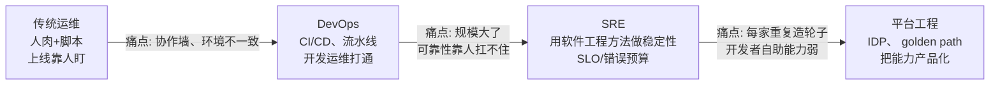
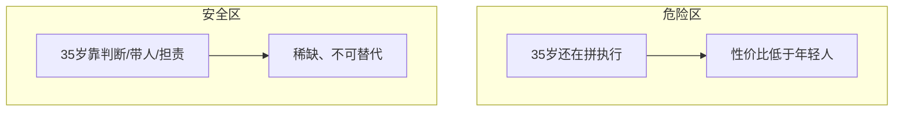
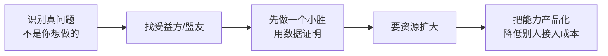

# 行业观点：演进、AI 冲击、核心竞争力、35 岁、影响力

::: tip 本篇定位
这篇是我对行业的**明确表态**，不是和稀泥。
回答几个大家最焦虑的问题：运维这条线是怎么演化的？AI 到底会替代谁？什么能力反而更值钱？"35 岁"要不要怕？怎么建立影响力、怎么推动变革？
每个判断都给理由，你可以不同意，但建议想清楚再反驳我。
:::

## 一、运维 → DevOps → SRE → 平台工程：为什么会这么演化

先给我的核心判断：**这条演化线不是"概念替代"，而是"每一次都在消灭上一代最痛的那个问题"。**

| 阶段 | 解决的核心矛盾 | 标志性产物 |
|---|---|---|
| 传统运维 | 服务器的部署和维护 | 脚本、夜班、人肉发布 |
| DevOps | 开发和运维之间的"扔过墙" | CI/CD 流水线、基础设施即代码 |
| SRE | 规模上来后，可靠性不能靠人堆 | SLO、错误预算、无指责复盘 |
| 平台工程 | 每个团队重复搭同一套能力 | 内部开发者平台（IDP）、自助式 golden path |

**我的观点**：很多人焦虑"是不是又要被新概念淘汰"。不是。**它们是叠加关系，不是替代表。** DevOps 的 CI/CD 能力、SRE 的稳定性方法论、平台工程的产品化思维，是一层层往上叠的。你不会被"SRE 淘汰运维"，你只会被"**既懂稳定性、又能写代码、还能把能力产品化**"的人淘汰。详见 [平台工程与 IDP](./devops-platform-engineering)。

## 二、AI 与 Agent 对运维岗位的冲击（这部分我态度鲜明）

直接给结论：

> **AI 会大规模替代"重复性的运维操作"，但不会替代"对复杂系统负责的人"。焦虑没用，关键是判断清楚自己站在哪一边。**

### 2.1 哪些工作大概率会被替代 / 大幅缩水

| 正在被 AI/Agent 吃掉的工作 | 原因 |
|---|---|
| 固定套路的排障（"报错 X 就执行 Y"） | Agent 已能检索知识库 + 自动执行，见 [Agent 运维实战](./aiops-agent-practice) |
| 批量改配置、查日志、写重复脚本 | LLM 生成脚本的能力已经很强，见 [AI Prompt 模板](/reference/ai-prompts) |
| 写文档、整理巡检报告的初稿 | 这是 LLM 最成熟的能力 |
| 简单的告警分诊、一线 L1 答疑 | RAG + 知识库就能顶上，见 [运维知识库与 RAG](./aiops-rag) |

### 2.2 哪些能力反而更值钱

| 更值钱的能力 | 为什么 |
|---|---|
| **判断复杂系统出了什么问题** | 系统是脏的、信息不全、相互耦合，AI 给的是概率，人要担责拍板 |
| **设计和维护 AI 用的知识库 / Agent 工作流** | 会用 Agent 做运维的人，替代不会用的人，而不是 AI 替代所有人 |
| **对业务和 SLO 的理解** | AI 不知道"这次抖动能不能忍"，只有懂错误预算的人知道 |
| **担责与信任** | 大错发生时，组织要的是一个能扛事、能复盘的人，不是一个 Bot |

::: warning 我的明确态度
**"运维会被 AI 取代"是个半真半假的话。** 真相是：被取代的是"**只会做重复性操作的那部分工作**"。如果你过去五年的成长是"会的命令更多了、会操作的系统更多了"——危险，这部分正是 AI 最强的。如果你的成长是"能定义问题、能对结果负责、能设计系统"——安全，而且 AI 是你的杠杆。
**正确的姿势不是害怕，而是抢着把 AI 用起来，让自己一个人干过去三个人的活。**
:::

## 三、不可替代的核心竞争力（我的三个判断）

把上面收敛成三条我坚信的核心竞争力：

1. **复杂系统的判断力。**
   线上故障永远是"信息不全 + 多系统耦合 + 时间压力"的组合。AI 能给线索，但**"先查哪、赌哪个方向、要不要回滚"**这种带风险的拍板，需要你长期积累的系统直觉。这种判断力来自你处理过多少真实的复杂故障——没有捷径。

2. **担责与信任。**
   技术再好，出事时组织第一个问的是"这事谁能负责"。**愿意扛事、并且过往判断大体靠谱的人**，会被组织反复授权。这是专家和高级工程师最本质的差别（见 [能力台阶](./career-levels)）。

3. **跨人协作的推动力。**
   越往高走，问题越不是"技术问题"，而是"别人为什么不配合"。能把目标翻译成别人愿意接的活、能拉着跨团队一起把事做成——这个能力在 AI 时代反而更稀缺，因为 AI 不能替你建立人际信任。

## 四、理性看"35 岁"

这是大家最焦虑的，我给一个不煽动、也不灌鸡汤的判断：

**"35 岁危机"的本质不是年龄歧视，而是"性价比陷阱"。**

- 如果你 35 岁还在和 25 岁的年轻人拼"熬夜、拼命令熟练度、拼人肉值班"——那你确实危险，因为你更贵、精力更差、可替代性更强。
- 如果你 35 岁的价值是"**能解决年轻人解决不了的复杂问题、能带团队、能对结果负责、能影响跨团队**"——那市场非常缺你，年龄根本不是问题。

我的具体建议：
1. **不要把自己锚定在"执行型"路径上**。执行是年轻人的主场，越往后越亏。
2. **尽早积累"代表作 + 影响力"**：公开输出、带过人、推成过跨团队的事。这些是年龄的盟友，不是敌人。
3. **保留财务安全垫**：理性看 35 岁不是恐吓，是提醒你早点有存款、早点有议价权。
4. **身体是基础设施**：长期熬夜值班是消耗品，见 [防 burnout](./career-learning-system)。

::: tip 一句表态
**怕 35 岁没用，怕的是"35 岁的自己和 25 岁时没有本质差别"。** 持续往上走的人，35 岁是黄金期；停在原地的人，25 岁就已经有危机了。
:::

## 五、如何建立技术影响力

影响力不是"网红"，是"**你的判断和输出被对的人看见、引用、信任**"。可操作的路径：

| 方式 | 怎么做 | 收益 |
|---|---|---|
| 写技术博客 | 把你踩过的坑、做过的优化写成文（本站就是例子） | 被同行搜到、引用、建立专业形象 |
| 内部分享 | 定期在团队/公司做技术分享 | 在组织内建立"这块他懂"的标签 |
| 开源/工具化 | 把内部好用的工具抽象成开源 | 直接带来行业能见度 |
| 参与社区 | 回答问题、参与会议、写文章 | 人脉 + 行业判断力 |

> 关键认知：**影响力是复利。** 前两年写东西没人看很正常，但持续输出会让你在面试、跳槽、被挖、合作时，被人主动想起。这也是为什么我强烈建议"每做完一个项目就写点东西"——见 [持续学习与沉淀](./career-learning-system)。

## 六、向上与跨团队推动变革的方法

这是从高级到专家最难过的一关（见 [能力台阶瓶颈 C](./career-levels)）。给一套实战打法：

1. **先找"谁会受益"，而不是先写"完美方案"。** 你的稳定性平台，谁的指标会变好？让受益方替你说话，比你自己喊有用十倍。
2. **先拿小胜，再要资源。** 没人会为一个 PPT 级的想法批预算，但会为"已经在一个业务线上省了 30% 成本"的结果扩大投入。
3. **用对方的语言说话。** 对业务讲"上线更稳、少丢钱"，对开发讲"自助、少找运维"，对老板讲"成本和效率"。不要只讲技术多先进。
4. **降低别人的接入成本。** 平台/规范推不动，往往不是方向错，而是"别人接入太麻烦"。把接入成本降到最低，推广就成了。
5. **挡事。** 带人/带团队时，能替团队挡住不合理的需求、无意义的会议——这是建立信任最快的方式。

## 相关速查

- 你现在在哪个台阶、怎么突破：[能力台阶与突破](./career-levels)
- 把判断力和代表作落到简历与面试：[求职实战](./career-jobhunt)
- 平台工程到底在做什么：[平台工程与 IDP](./devops-platform-engineering)
- AI/Agent 怎么用在运维上：[AI Agent 基础](./aiops-agent-basics)、[Agent 运维实战](./aiops-agent-practice)
- 稳定性方法论（判断力的根基）：[SLO 与错误预算](./monitor-slo)、[事故管理与无指责复盘](./sre-incident)

### 官方文档

- Google SRE Book（稳定性与责任模型）：https://sre.google/sre-book/table-of-contents/（需科学上网）；国内平替：https://blog.csdn.net/sanhewuyang/article/details/162757718
- DORA 研究（DevOps/平台工程效能基准）：https://dora.dev/research/
- CNCF 全景（判断技术方向）：https://cncf.io/projects/
- Backstage / IDP 理念（平台工程）：https://backstage.io/docs/overview/
