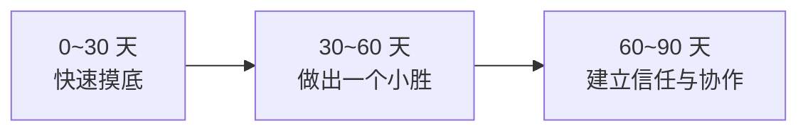

# 求职实战：简历 / 面试 / 谈薪 / 选 offer / 试用期 / 转行

::: tip 本篇定位
把"找下一份工作"拆成可操作的六件事：**简历怎么量化写、面试怎么准备、谈薪怎么开口、怎么选 offer、试用期 90 天怎么立足、转行怎么补短板**。
全部基于运维 / SRE 的真实语境，不教鸡汤，给能直接套用的改写示例和话术。
:::

运维求职最吃亏的一点：**很多人干了很多事，但写出来像"打杂流水账"**。面试官看不到价值，offer 自然上不去。这篇的核心就一件事——把你做过的事，翻译成对方能听懂、能信、能量化的语言。

## 一、简历：用 STAR + 量化成果写项目

### 1.1 为什么运维简历一定要量化

面试官在简历上只花 10 秒扫一段项目。"负责系统运维"这种描述，等于什么都没说。**运维成果必须落到四类指标上**，这是本专栏反复强调的：

| 指标类别 | 具体可量化的东西 |
|---|---|
| 可用性 | 可用性从 X%→Y%、重大故障数、MTTR 从 X 分钟→Y 分钟 |
| 效率 | 单次操作从 X 分钟→Y 分钟、人天节省、发布频率 |
| 成本 | 云成本下降 X%、资源利用率提升、缩容省了多少钱 |
| 自动化率 | 手工操作占比从 X%→Y%、自愈覆盖、脚本复用次数 |

### 1.2 STAR 结构

- **S（Situation 背景）**：当时什么情况/痛点。
- **T（Task 任务）**：你要解决什么目标。
- **A（Action 行动）**：你具体做了什么（用了什么技术、怎么设计的）。
- **R（Result 结果）**：量化成果。

### 1.3 改写前后对照（重点，直接抄结构）

**改写前（典型的差简历）：**

```
负责公司 K8s 集群运维，处理线上告警，做过监控和发布自动化，
参与了几次故障处理，会用 Ansible、Prometheus、Golang。
```

问题：全是"负责""参与""会用"，没有规模、没有结果、没有你个人的贡献。

**改写后（同一段经历，STAR + 量化）：**

```
主导 200+ 节点 K8s 集群（承载 40+ 微服务、日均 5000 万请求）的稳定性治理：
- 【可用性】搭建 Prometheus + Alertmanager 告警体系并做告警收敛，
  无效告警占比从 60% 降到 15%，核心系统月度可用性从 99.9% 提升到 99.95%，
  P1 故障平均恢复时间（MTTR）从 45 分钟缩短到 12 分钟。
- 【效率】用 Ansible + 自研 Python 工具把发布流程自动化，
  发布耗时从 40 分钟降到 8 分钟，发布频率从每周 1 次提升到每天 3 次。
- 【成本】通过资源画像 + 弹性伸缩治理空闲资源，云资源月成本下降 28%。
- 【自动化】编写 30+ 个巡检/自愈脚本，团队手工操作占比从 70% 降到 25%。
```

::: tip 数字拿不准怎么办
没有精确数时，用**区间或保守估计**（"约""下降近三成"），但一定要有量级。宁可写"约 30%"，也不要写"大幅提升"。面试被追问时，能讲清怎么算出来的即可。
:::

### 1.4 简历的几个硬规则

- **一页原则**：8 年以内一页纸够了，重点是最近 3 年。
- **技术栈放最后，别堆名词**："熟悉 Linux/网络/K8s/Prometheus/Go/Python/MySQL/Redis"这种罗列没有任何区分度。
- **不要写"精通"**：写"精通"等于邀请面试官往死里问，建议用"熟练""了解"分级。
- **删掉所有形容词**："具有良好的沟通能力""责任心强"——用结果证明，不要自夸。

## 二、面试准备

::: warning 关于本站面经
本站面经与题库位于**私有专区**，公开版出于隐私与合规考虑不直接链接（避免死链与泄露真实面经）。**面试准备见你的私有面试专区**；本节只讲公开可复用的准备方法。
:::

### 2.1 分三块准备

| 模块 | 怎么准备 | 示例 |
|---|---|---|
| 八股基础 | 按方向过：Linux、网络、K8s、中间件 | TCP 三次握手、K8s 调度流程、MySQL 索引 |
| 项目深挖 | 把简历上每个数字都准备好"怎么算的、踩了什么坑" | 你说 MTTR 12 分钟，要能讲清一次真实排障全过程 |
| 场景/系统设计 | 给一个线上问题，现场给方案 | "让你设计一个监控告警系统""数据库突然慢了怎么查" |

### 2.2 项目深挖的高频追问（务必提前准备）

- 这个项目**最难的点**是什么？如果重来你会怎么做？
- 为什么选这个技术方案，而不是另一个？
- 出过什么线上事故？你怎么定位的？事后怎么整改的？
- 你的方案**有什么代价/局限**？（能主动说局限的人最加分）

### 2.3 面试当天的心态

- 不会的题**不要硬编**。说"这块我没深入用过，但我的思路是……"比瞎掰强一百倍——运维最忌讳的就是不懂装懂，面试官一眼看穿。
- 反问环节准备 2~3 个：团队现在最大的稳定性挑战是什么？这个岗位是新增还是补人？技术栈未来方向？

## 三、谈薪策略与话术

### 3.1 三条原则

1. **先让对方出价**：HR 问期望，先反问"这个岗位的预算范围是多少"，不要先亮底牌。
2. **用现有 offer/其他机会做锚**：手里有别的 offer 时，议价能力完全不同。
3. **总包视角谈**：base、年终奖、股票/期权、签字费、补贴分开算，别只盯月薪。

### 3.2 可直接用的话术

```
被问期望薪资时：
"我目前更看重这个岗位的方向和团队，薪资方面希望能在我现在总包
基础上有合理的提升（例如 20%~30%），具体可以看整体 package 再聊。"

对方报价低于预期时：
"这个数字和我的预期还有一点差距。我手上也有其他机会，但我更倾向
贵司，如果能在 [base / 年终奖 / 签字费] 上调整到 X，我可以尽快定下来。"

拿到 offer 想再争取时（礼貌但明确）：
"谢谢认可。我非常想加入，但目前这个 offer 的总包和我预期有差距，
是否还有调整空间？我可以在 X 天内给最终答复。"
```

::: danger 谈薪红线
- 不要在没确定意向时就开始疯狂压价，姿态要专业。
- 不要撒谎伪造别的 offer（背调/谈崩风险高），但可以说"在看其他机会"。
- 一旦谈定，不要反复变卦。
:::

## 四、怎么选 offer / 公司 / 团队 / 赛道

给决策用的对比框架（建议列成表打分）：

| 维度 | 看什么 | 为什么重要 |
|---|---|---|
| 团队 | 直属领导水平、团队氛围、是否核心业务 | 直接决定你三年后的能力 |
| 业务 | 是不是赚钱的主线业务 | 边缘业务的运维最容易被裁、也学不到东西 |
| 技术 | 技术栈先进度、有没有 SRE/平台工程投入 | 决定简历含金量 |
| 成长 | 能不能接触到更大规模/更复杂系统 | 平台期比低薪更可怕 |
| 稳定性 | 公司经营状况、这个岗位是新增还是替补 | 频繁跳槽对你伤害极大 |
| 薪资 | 总包、涨薪机制 | 重要但通常不是第一决策项 |

> 我的倾向性建议（有观点）：**30 岁前，"能否让你接触到更大规模/更复杂系统"优先于薪资。** 平台的规模（机器数量、流量、系统复杂度）会直接抬高你下一份工作的议价起点。同样是 SRE，管 50 台和管 5000 台，简历完全不是一个价。

## 五、试用期 90 天如何立足



- **0~30 天**：别急着改东西。先把系统架构、值班流程、历史故障、关键人关系摸清楚。文档优先看，少说话多问。
- **30~60 天**：主动做一件**低风险但有可见度**的小事——比如补上一个缺失的监控、整理一份文档、修一个长期没人管的告警。**第一个"小胜"最关键**，它决定别人对你的初始印象。
- **60~90 天**：开始建立协作关系，理解直属领导的痛点，在关键会议上能接得住话。试用期的本质是**证明"把你招进来是对的"**，而不是证明你多牛。

::: tip 试用期最容易踩的坑
新人一上来就大刀阔斧改老系统。**先证明你能稳定接手，再谈优化。** 信任没建立之前，你的"优化"在别人眼里可能是"风险"。
:::

## 六、转行如何补短板

### 6.1 跨方向转运维（从开发/测试/网工/硬件等）

| 来源方向 | 你的优势 | 要补的短板 |
|---|---|---|
| 开发转运维 | 会写代码（这是巨大优势） | 缺线上稳定性思维、生产环境体感、Linux/网络底层 |
| 测试转运维 | 熟悉业务链路 | 缺部署、架构、自动化脚本能力 |
| 网工转运维 | 网络功底扎实 | 缺系统层、容器、云、编程 |

补短板路径：先把 Linux/网络/监控打基础 → 跟一次完整的上线和故障 → 用 [Python 运维自动化](./sre-python) 写几个脚本 → 理解 [SLO/稳定性](./monitor-slo) 的思维方式。

### 6.2 运维转 SRE / 平台工程

这是最常见也最推荐的路径。两者的核心差别：

| 维度 | 传统运维 | SRE / 平台工程 |
|---|---|---|
| 工作方式 | 手动救火、人肉运维 | 用工程化手段消灭手工操作 |
| 核心技能 | 系统/网络熟练 | 编程 + 平台设计 + 稳定性工程 |
| 产出物 | 报告、操作记录 | 工具、平台、自动化、体系 |

要补的短板（按优先级）：
1. **编程能力**：至少 Python 熟练（见 [Python 运维自动化](./sre-python)），再了解一门 Go。
2. **CI/CD 与 GitOps**：见 [CI/CD 进阶](./devops-cicd-advanced)、[GitOps](./automation-gitops)。
3. **平台工程思维**：理解内部开发者平台（IDP），见 [平台工程与 IDP](./devops-platform-engineering)。
4. **稳定性方法论**：SLO、错误预算、无指责复盘（见 [SRE 事故管理](./sre-incident)）。

::: tip 转行的关键
**不要"先学完再转"，要"边做边转"。** 在现岗位上主动把运维工作做成自动化、做成工具——你就已经在干 SRE 的活了，简历自然能写出来。转型不是换公司那一刻完成的，是你在现岗位上越界做出来的。
:::

## 相关速查

- 你现在在哪个台阶、下一级怎么破：[能力台阶与突破](./career-levels)
- AI 时代哪些岗位会变、你的价值在哪：[行业观点](./career-industry-views)
- 持续学习与信息源：[持续学习与沉淀](./career-learning-system)
- 面试时讲事故/复盘的素材：[事故管理与无指责复盘](./sre-incident)
- 写脚本的转行基本功：[Python 运维自动化](./sre-python)
- 用 AI 帮你改简历、做面试模拟：[运维 AI Prompt 模板](/reference/ai-prompts)

### 官方文档

- Google SRE Book（SRE 岗位的官方定义）：https://sre.google/sre-book/table-of-contents/（需科学上网）；国内平替：https://blog.csdn.net/sanhewuyang/article/details/162757718
- DORA 研究（DevOps/SRE 效能基准）：https://dora.dev/research/
