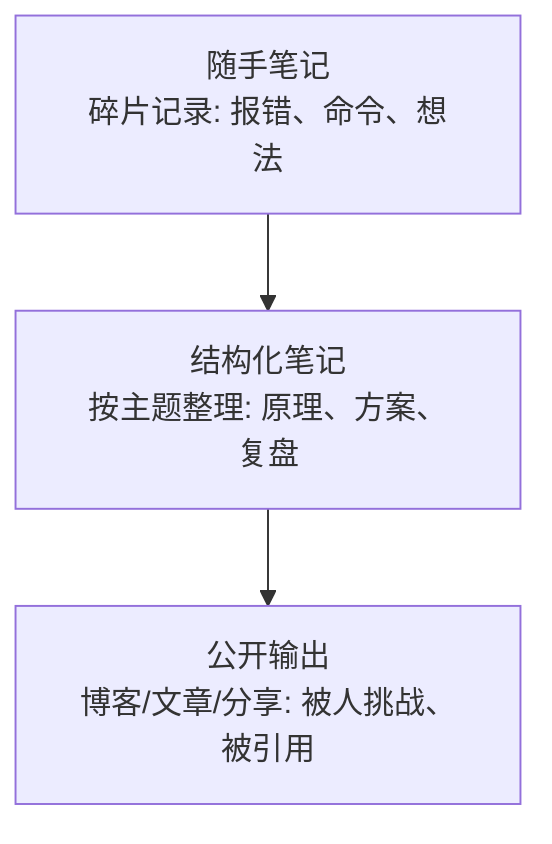

# 持续学习与沉淀：知识管理、时间精力、工具箱、书单与信息源

::: tip 本篇定位
运维是个"学不完"的行当：新技术一年一茬，不学会掉队，硬学会 burnout。
这篇解决：**怎么把经验沉淀成可复用的知识、怎么管时间精力不被榨干、个人工具箱该备什么、读什么书、从哪获取高质量信息、怎么经营人脉。**
:::

## 一、知识沉淀与输出：别让经验只留在脑子里

运维最大的浪费是：**处理过几十个故障、踩过一堆坑，三个月后全忘了，下次重新踩。** 沉淀不是文艺活动，是让你的经验可复用、可检索、可变现。

### 1.1 三层沉淀模型

| 层级 | 载体 | 频率 | 作用 |
|---|---|---|---|
| 随手笔记 | 备忘录/笔记软件 | 随时 | 不漏掉任何一个"原来如此" |
| 结构化笔记 | 知识库（本站即一例） | 每周整理 | 把碎片串成体系 |
| 公开输出 | 博客/分享 | 每月 | 被外界检验，倒逼深度 |

### 1.2 RAG：把你的知识库变成能问答的助手

把笔记喂给本地/私有知识库，做一个"**问我自己的经验**"的 RAG 系统，是这两年最值得做的个人项目。原理和落地见 [运维知识库与 RAG](./aiops-rag)。好处：以前翻笔记要回忆"我当时写在哪了"，现在直接问"上次那个 OOM 最后怎么解决的"。

> 我的建议：**先有沉淀，再谈 RAG。** 知识库本身是空的，RAG 再强也没用。日常先养成随手记的习惯，半年后你的语料就有价值了。

### 1.3 写博客的正确姿势

- **不要等"写得完美"才发**。一篇"真实踩坑 + 怎么解决"的流水账，比十篇正确的废话有价值。
- **把每次故障/优化都当素材**：发生了什么 → 我怎么查的 → 根因 → 整改。这就是现成的好文章（见 [事故复盘模板](/reference/ops-templates)）。
- 写作本身就是最好的学习：**写不清楚，说明你没想清楚。**

## 二、时间与精力管理：防 burnout

运维 = 长期值班 + 随时被打断 + 线上压力。精力管理比时间管理更重要。

### 2.1 几个务实原则

| 问题 | 做法 |
|---|---|
| 被打断就一天没了 | 每天留一段"不接消息"的深度时间（哪怕 1 小时），用于学习/自动化 |
| 值班消耗巨大 | 排班合理化、把重复告警收敛掉，**别用肉身扛本可以自动化的事** |
| 学不动 | 不要贪多，一次主攻一个方向（见 [能力台阶](./career-levels)） |
| 长期高压 | 定期止损：连续救火时，先治理"为什么总起火"，而不是一直扑 |

::: danger 关于 burnout
**持续性的疲惫、对线上麻木、觉得"就这样了"——这是 burnout 的信号，不是你不够努力。**
信号出现时：先保证睡眠和运动（这是基础设施，不是奢侈）、把能自动化的重复劳动自动化、必要时和领导谈排班/职责调整。**一个被榨干的 SRE 对生产是危险的**——疲劳状态下的割接和回滚决策最容易出大事。
:::

### 2.2 精力分配的建议比例

> 关键：**如果 100% 都在"值班/交付"，你就是在原地消耗。** 必须硬挤出那 15%~25% 用于深耕和沉淀——这才是你下一份工作、下一个台阶的来源。

## 三、个人工具箱（软硬件）

给自己备一套"到哪都能干活"的工具箱，避免每次从零开始。

### 3.1 软件工具

| 类别 | 工具 | 用途 |
|---|---|---|
| 终端/SSH | 终端模拟器、SSH 配置、密钥管理 | 高效连服务器 |
| 笔记/知识 | Markdown 笔记库（本站就是 VitePress 知识库的例子） | 沉淀 |
| 容器/本地环境 | 本地 Docker、kind/minikube | 练 K8s 不花钱 |
| 抓包/排障 | Wireshark、tcpdump、curl Postman 系 | 网络与接口排障 |
| AI 辅助 | 本地 LLM / 云 LLM + 你的 Prompt 库 | 写脚本、查报错，见 [AI Prompt 模板](/reference/ai-prompts) |
| Git 工作流 | 见 [Git 命令与协作](/reference/git-commands) | 所有脚本的版本管理 |

### 3.2 硬件/工作环境（有观点的建议）

- **双屏是运维的生产力标配**：一边看监控/日志，一边敲命令。
- **键盘鼠标人体工学**：每天敲几万次，手腕和腰是长期资本（这也是防 burnout 的一部分）。
- **家里能远程干活的环境**：值班/应急时，一个稳定的远程接入比什么都重要。

## 四、书单与优质信息源

### 4.1 书单（按方向，挑经典，不堆砌）

| 方向 | 书 | 解决什么 |
|---|---|---|
| SRE | 《Site Reliability Engineering》《The SRE Workbook》 | 稳定性方法论的源头 |
| DevOps/效能 | 《Accelerator (深耕研发效能)》《The DevOps Handbook》 | 效能与组织 |
| 架构/系统 | 《Designing Data-Intensive Applications》 | 分布式与数据系统的底层认知 |
| Linux/性能 | 《Linux 性能优化实战》《BPF 之巅》 | 性能与可观测（配合 [eBPF](./linux-ebpf)） |
| 沟通/管理 | 《人性的弱点》《关键对话》《非暴力沟通》 | 跨团队推动、带人（见 [推动变革](./career-industry-views)） |
| 编程 | 一本 Python + 一门系统语言（Go） | 转型 SRE/平台工程 |

::: tip 读书方法
**不要囤书。** 一本《SRE》啃透 + 在工作里用起来，胜过刷十本的目录。读完立刻在团队里找一个能落地的点——这是把书变成能力的唯一路径。
:::

### 4.2 优质信息源（比刷短视频靠谱）

| 类型 | 来源 |
|---|---|
| 官方博客/文档 | 各大云厂商与开源项目的官方博客、changelog、release notes |
| 标准与规范 | CNCF、OpenTelemetry、DORA 等 |
| 社区 | 知名运维/SRE 技术博客、高质量技术社区 |
| 会议 | KubeCon、QCon 等的公开演讲录像 |
| 研究报告 | DORA 年度报告（团队效能行业基准） |

> 我的建议：**把信息源收窄到 5~10 个高质量的，比关注 200 个号有用。** 运维学习的敌人不是"信息太少"，而是"碎片太多、体系太少"。

## 五、社区与人脉

人脉不是饭局，是"**你遇到问题时能请教、你找机会时有人想起你**"。

- **先给后得**：在社区认真回答问题、分享你的经验，别人自然会记住你。
- **线下/会议**：一年去一两次高质量技术会议，认识同方向的人——这对你判断行业、找工作都有帮助。
- **前同事网络**：离职的同事是你最宝贵的人脉，保持联系。很多好机会是前同事递过来的。
- **影响力的复利**：持续写东西（见 1.3），会让"被人想起"这件事自动发生。

## 相关速查

- 学习是为了上台阶：[能力台阶与突破](./career-levels)
- 学的东西怎么变成 offer：[求职实战](./career-jobhunt)
- 行业往哪走、AI 怎么用：[行业观点](./career-industry-views)
- 把知识库做成 RAG：[运维知识库与 RAG](./aiops-rag)
- 写脚本的基本功：[Python 运维自动化](./sre-python)
- 文档模板与清单（沉淀的工具）：[运维文档模板](/reference/ops-templates)、[Checklist 大全](/reference/ops-checklists)

### 官方文档

- Google SRE Book：https://sre.google/sre-book/table-of-contents/（需科学上网）；国内平替：https://blog.csdn.net/sanhewuyang/article/details/162757718
- DORA 研究报告：https://dora.dev/research/
- OpenTelemetry 文档：https://opentelemetry.io/docs/
- CNCF 项目全景：https://cncf.io/projects/
