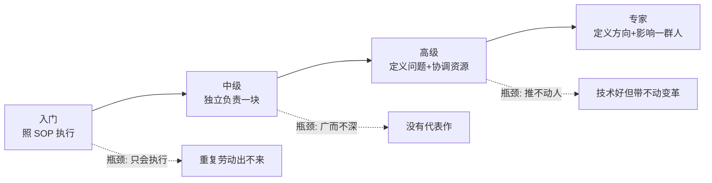
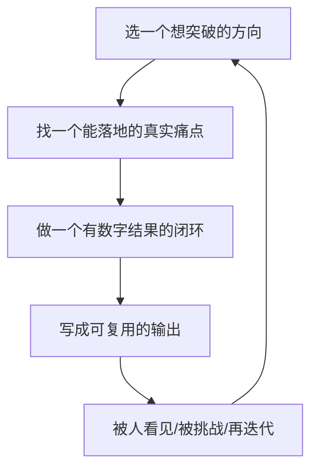

# 能力台阶与突破：从入门到专家的真实路径

::: tip 本篇定位
这篇解决一个问题：**"我现在到底在哪一级？下一级长什么样？卡在哪、怎么破？"**
面向 0~8 年的运维 / SRE。不画虚的能力矩阵，只写每个台阶在**技术深度、系统设计、业务理解、沟通带人、影响力**上的可观察表现，以及每个阶段最常见的瓶颈。
:::

很多人做了五六年还在"高级执行工程师"——不是不努力，而是**从没把自己当前级别的隐性要求拆出来，也没有主动选择下一级的练习项目**。台阶不是靠年限熬出来的，是靠"做完一件能被上一级认可的事"抬上去的。

## 一、先建立一个朴素的模型

我习惯用一句话区分四个台阶：

| 台阶 | 一句话定义 | 别人对你的预期 |
|---|---|---|
| 入门（L1~L2） | 给我明确的步骤，我能稳稳做完且不出错 | 照着 SOP 执行、如实汇报 |
| 中级（L3） | 给我一个目标，我能独立拆方案、踩坑自己爬出来 | 独立负责一块、不再事事请示 |
| 高级（L4~L5） | 给我一个模糊的问题，我能定义它、协调资源解决它 | 一块业务的技术负责人 |
| 专家（L6+） | 我能定义"什么问题值得解决"，并让一群人按我的判断走 | 跨团队的技术权威 / 方向制定者 |

> 关键认知：**每一级的核心矛盾不是"多会几个工具"，而是"责任边界和判断权的扩大"。** 工具是台阶的副产品，不是台阶本身。

## 二、四个台阶的具体表现（逐维度拆）

### 2.1 入门 → 中级（L1~L3）：从"听话照做"到"独立闭环"

| 维度 | 入门（L1~L2） | 中级（L3） |
|---|---|---|
| 技术深度 | 会部署、会按文档排常见错；不理解为什么这么配 | 能讲清原理：为什么这个内核参数、为什么这个超时设置 |
| 系统设计 | 不碰 | 能在已有架构上做合理选型（中间件版本、扩容方案） |
| 业务理解 | 知道自己管的是哪几个系统 | 知道这些系统支撑哪条业务链路、高峰期在几点、哪些是钱 |
| 沟通带人 | 如实报状态 | 能把一个故障的来龙去脉讲清楚、写清楚 |
| 影响力 | —— | 把重复操作写成脚本/文档，让别人也能复用 |

**这一级最典型的瓶颈：一直做重复执行。**
表现：天天在发布、重启、扩容、搬机器，忙但简历上写不出任何一件"做成的事"。

突破方法：
1. **给自己手上重复 3 次以上的事写一个脚本或 SOP**，这就是你的第一个代表作（参考 [Python 运维自动化](./sre-python)）。
2. **主动接一次完整的、从方案到上线到复盘的小项目**——哪怕只是把一个系统的监控从 0 搭起来。
3. 每做完一件事，逼自己写一段"如果重来我会怎么做"。

### 2.2 中级 → 高级（L3~L5）：从"把事做完"到"定义问题并推动"

| 维度 | 中级（L3） | 高级（L4~L5） |
|---|---|---|
| 技术深度 | 单点精通（K8s / 网络 / 数据库挑一两块） | 能跨层定位：网络→系统→应用→存储的全链路推理 |
| 系统设计 | 在既有框架内做方案 | 能独立设计一套方案并权衡取舍（成本 vs 可用性 vs 复杂度） |
| 业务理解 | 知道链路和高峰 | 能和产品/业务对话，用稳定性数据影响业务节奏 |
| 沟通带人 | 讲清一个故障 | 能带 1~3 个初级，做 code review、给方向、挡事 |
| 影响力 | 本团队复用 | 方案被其他团队采用，能在评审会上说服别人 |

**这一级最典型的瓶颈有两个：**

- **广度够但没深度（"什么都懂一点，深挖就虚"）。** 面试一深挖 eBPF 原理、MySQL 锁机制、TCP 重传细节就卡壳。
  → 突破：选 **1~2 个方向打穿**。把本专栏的 [eBPF](./linux-ebpf)、[性能分析](./linux-performance)、[网络排障](./linux-network) 当成主线，做到能讲清原理、能在生产用过、能回答"为什么"。深度代表作比十个"了解过"值钱得多。

- **能搞定事但推不动人（"技术很好，但是个孤岛"）。** 方案写得漂亮，别的团队不配合，最后不了了之。
  → 突破：这是从高级到专家最难过的一关，本质是**影响力而非技术**，后面 2.3 展开。

### 2.3 高级 → 专家（L5~L6）：从"解决问题"到"定义问题"

| 维度 | 高级（L5） | 专家（L6+） |
|---|---|---|
| 技术深度 | 跨层精通 | 在某个领域有行业级判断，能预判趋势、做技术雷达 |
| 系统设计 | 设计单点架构 | 设计平台/体系（IDP、可观测体系、稳定性治理） |
| 业务理解 | 影响业务节奏 | 能用技术语言翻译商业问题，参与战略级决策 |
| 沟通带人 | 带小团队 | 影响跨几十人的虚拟团队、能做组织级变革 |
| 影响力 | 团队间 | 公司内乃至行业内被指名求助，有公开输出 |

**这一级的瓶颈：担责与信任。** 专家和高级的差别往往不在技术，而在"**出了大问题别人敢不敢让你拍板、组织敢不敢把方向交给你**"。这靠的是长期的**判断一致性**——你做过的关键决策，事后看大概率是对的。

## 三、三类经典瓶颈的突破方法（重点）

这三类是我在不同人身上反复看到的，单独展开：

### 瓶颈 A：一直做重复执行，简历没有"代表作"

| 信号 | 突破动作 |
|---|---|
| 说不出过去一年独立做成的一件事 | 主动认领一个"从 0 到 1"的小项目 |
| 天天救火但没有预防 | 把一次根因整改成**机制**（告警治理、自愈、自动化），而不是修完就完 |
| 工作内容像流水账 | 每件事问自己：**它让哪个指标变好了？**（可用性、效率、成本） |

> 代表作不一定是大系统。**"把发布故障率从 5% 降到 0.5%"、"把某类巡检从 2 小时自动化到 5 分钟"**——这种带数字的小闭环，比"参与了某某平台"有力得多。怎么量化见 [求职实战](./career-jobhunt)。

### 瓶颈 B：广而不深，面试深挖就虚

| 信号 | 突破动作 |
|---|---|
| 会用 kubectl，但讲不清 kube-proxy、调度器原理 | 选主线打穿，见 [K8s 系列](./container-k8s-01-architecture-cluster) |
| 用过监控，但讲不清指标采集原理、Cardinality 问题 | 见 [OpenTelemetry](./monitor-opentelemetry)、[Prometheus](./monitor-prometheus) |
| 故障靠经验猜，没有方法论 | 建立结构化排障框架，见 [排障推理框架](./blog-troubleshooting-reasoning) |

刻意练习的办法：**每个方向做一个"费曼输出"**——对着空白页把这个方向从原理到实战讲一遍，讲不下去的地方就是你的空洞。写完发出来，被人挑战的部分再补。

### 瓶颈 C：能搞定事，但推不动人（最关键的一关）

| 信号 | 突破动作 |
|---|---|
| 方案写得好，评审会被否或没人跟进 | 先找**盟友和靠山**，而不是先完美方案 |
| 觉得"我有理为什么别人不配合" | 理解对方的 KPI 和恐惧，用**他的语言**说话 |
| 一个人硬扛所有事 | 学会"把目标翻译成别人愿意接的活" |

具体方法（详见 [行业观点：推动变革](./career-industry-views)）：
1. **先拿一个小胜**，用数据证明方向对，再要资源扩大。
2. **找到受益方**：你的稳定性方案，谁的指标会变好？让他替你说话。
3. **降低别人的接入成本**：平台/工具类变革，永远先解决"别人用起来有多省事"，而不是"架构多先进"。

## 四、刻意练习与如何主动争取项目机会

能力台阶不会自动跳，你需要**主动设计练习场**。

几个可复制的"练习项目"模板：

| 想练的能力 | 可以主动争取的事 | 产出的数字 |
|---|---|---|
| 自动化与开发 | 把团队最高频的手工操作自动化 | 单次耗时从 X 分钟→Y 分钟 |
| 稳定性治理 | 做一次告警收敛 + 错误预算治理 | 无效告警占比、MTTR、可用性 |
| 系统设计 | 给一个业务做主从/高可用/容量方案 | 支撑峰值 QPS、资源成本下降 |
| 推动影响 | 主导一次跨团队的规范落地 | 接入团队数、违规率下降 |

::: tip 一个反直觉的建议
**不要等"被分配高级的事"才练高级的能力。** 多数公司的问题是：你没做出高级的事，就不给你高级的责任；你不先在中级岗位上"超标交付"，就永远停在中级。**越级的事，往往是自己先认领、先做出结果，头衔才跟上。**
:::

## 五、给不同阶段的一句话路线图

- **1~2 年（入门）**：把手上的活做稳、做熟，至少写一个能复用的脚本/SOP，搞懂一个系统的全链路。
- **3~4 年（中级）**：选 1~2 个方向打穿，独立闭环一个带数字的代表作，能把复杂故障讲清楚。
- **5~7 年（高级）**：练跨层系统设计与人的协作，主动推一件跨团队的事，开始有公开输出。
- **8 年+（专家）**：建立判断一致性与组织信任，定义方向而不仅是执行方向。

## 相关速查

- 怎么把这些台阶写成简历、怎么面试：[求职实战](./career-jobhunt)
- 怎么持续不掉队、建立学习系统：[持续学习与沉淀](./career-learning-system)
- 从零在小公司搭起一套稳定性体系的完整实战：[expert-from-zero（从零落地监控自动化 SRE）](./expert-from-zero)
- 排障时的结构化思考：[排障推理框架](./blog-troubleshooting-reasoning)
- 写脚本的基本功：[Python 运维自动化](./sre-python)

### 官方文档

- Google SRE Book（成熟工程师的责任模型参考）：https://sre.google/sre-book/table-of-contents/（需科学上网）；国内平替：https://blog.csdn.net/sanhewuyang/article/details/162757718
- DORA 研究（团队与效能的行业基准）：https://dora.dev/research/
- CNCF 云原生成熟度全景（判断技术方向）：https://cncf.io/projects/
