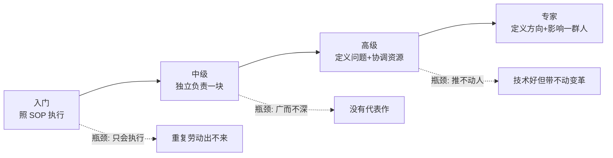
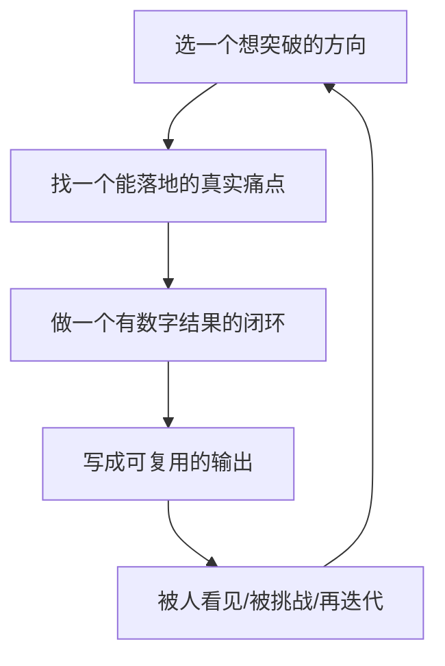
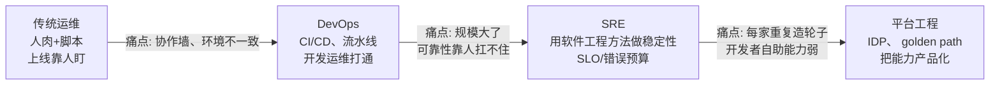
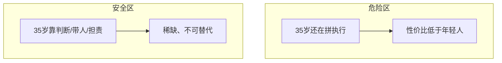
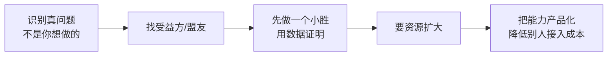
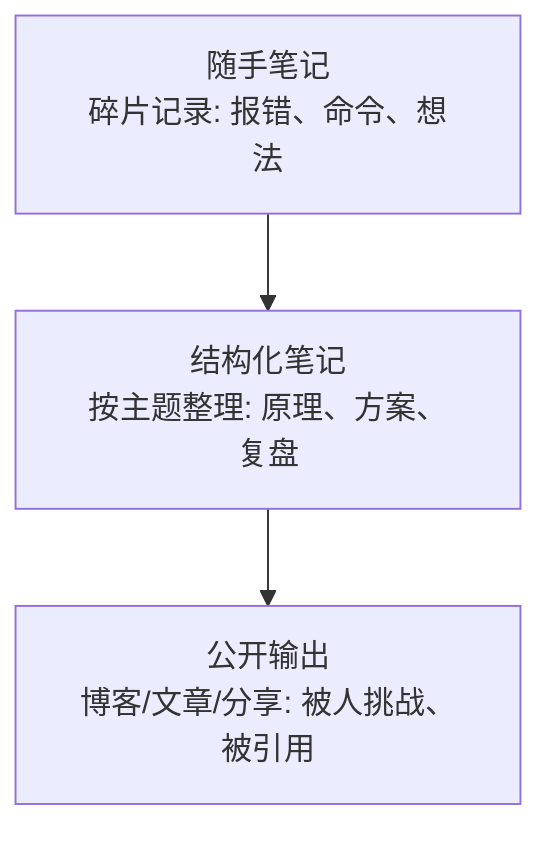
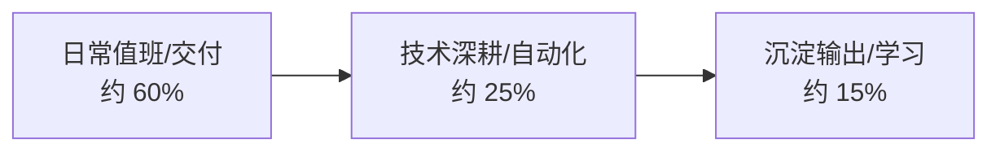

# 能力台阶与突破：从入门到专家的真实路径

::: tip 本篇定位
这篇解决一个问题：**"我现在到底在哪一级？下一级长什么样？卡在哪、怎么破？"**
面向 0~8 年的运维 / SRE。不画虚的能力矩阵，只写每个台阶在**技术深度、系统设计、业务理解、沟通带人、影响力**上的可观察表现，以及每个阶段最常见的瓶颈。
:::

很多人做了五六年还在"高级执行工程师"——不是不努力，而是**从没把自己当前级别的隐性要求拆出来，也没有主动选择下一级的练习项目**。台阶不是靠年限熬出来的，是靠"做完一件能被上一级认可的事"抬上去的。

## 一、先建立一个朴素的模型

我习惯用一句话区分四个台阶：

| 台阶 | 一句话定义 | 别人对你的预期 |
|---|---|---|
| 入门（L1~L2） | 给我明确的步骤，我能稳稳做完且不出错 | 照着 SOP 执行、如实汇报 |
| 中级（L3） | 给我一个目标，我能独立拆方案、踩坑自己爬出来 | 独立负责一块、不再事事请示 |
| 高级（L4~L5） | 给我一个模糊的问题，我能定义它、协调资源解决它 | 一块业务的技术负责人 |
| 专家（L6+） | 我能定义"什么问题值得解决"，并让一群人按我的判断走 | 跨团队的技术权威 / 方向制定者 |

> 关键认知：**每一级的核心矛盾不是"多会几个工具"，而是"责任边界和判断权的扩大"。** 工具是台阶的副产品，不是台阶本身。

## 二、四个台阶的具体表现（逐维度拆）

### 2.1 入门 → 中级（L1~L3）：从"听话照做"到"独立闭环"

| 维度 | 入门（L1~L2） | 中级（L3） |
|---|---|---|
| 技术深度 | 会部署、会按文档排常见错；不理解为什么这么配 | 能讲清原理：为什么这个内核参数、为什么这个超时设置 |
| 系统设计 | 不碰 | 能在已有架构上做合理选型（中间件版本、扩容方案） |
| 业务理解 | 知道自己管的是哪几个系统 | 知道这些系统支撑哪条业务链路、高峰期在几点、哪些是钱 |
| 沟通带人 | 如实报状态 | 能把一个故障的来龙去脉讲清楚、写清楚 |
| 影响力 | —— | 把重复操作写成脚本/文档，让别人也能复用 |

**这一级最典型的瓶颈：一直做重复执行。**
表现：天天在发布、重启、扩容、搬机器，忙但简历上写不出任何一件"做成的事"。

突破方法：
1. **给自己手上重复 3 次以上的事写一个脚本或 SOP**，这就是你的第一个代表作（参考 [Python 运维自动化](/services/cicd/ansible)）。
2. **主动接一次完整的、从方案到上线到复盘的小项目**——哪怕只是把一个系统的监控从 0 搭起来。
3. 每做完一件事，逼自己写一段"如果重来我会怎么做"。

### 2.2 中级 → 高级（L3~L5）：从"把事做完"到"定义问题并推动"

| 维度 | 中级（L3） | 高级（L4~L5） |
|---|---|---|
| 技术深度 | 单点精通（K8s / 网络 / 数据库挑一两块） | 能跨层定位：网络→系统→应用→存储的全链路推理 |
| 系统设计 | 在既有框架内做方案 | 能独立设计一套方案并权衡取舍（成本 vs 可用性 vs 复杂度） |
| 业务理解 | 知道链路和高峰 | 能和产品/业务对话，用稳定性数据影响业务节奏 |
| 沟通带人 | 讲清一个故障 | 能带 1~3 个初级，做 code review、给方向、挡事 |
| 影响力 | 本团队复用 | 方案被其他团队采用，能在评审会上说服别人 |

**这一级最典型的瓶颈有两个：**

- **广度够但没深度（"什么都懂一点，深挖就虚"）。** 技术一深挖 eBPF 原理、MySQL 锁机制、TCP 重传细节就卡壳。
  → 突破：选 **1~2 个方向打穿**。把本专栏的 [eBPF](/guide/linux#合并资料)、[性能分析](/guide/linux#合并资料)、[网络排障](./linux-network) 当成主线，做到能讲清原理、能在生产用过、能回答"为什么"。深度代表作比十个"了解过"值钱得多。

- **能搞定事但推不动人（"技术很好，但是个孤岛"）。** 方案写得漂亮，别的团队不配合，最后不了了之。
  → 突破：这是从高级到专家最难过的一关，本质是**影响力而非技术**，后面 2.3 展开。

### 2.3 高级 → 专家（L5~L6）：从"解决问题"到"定义问题"

| 维度 | 高级（L5） | 专家（L6+） |
|---|---|---|
| 技术深度 | 跨层精通 | 在某个领域有行业级判断，能预判趋势、做技术雷达 |
| 系统设计 | 设计单点架构 | 设计平台/体系（IDP、可观测体系、稳定性治理） |
| 业务理解 | 影响业务节奏 | 能用技术语言翻译商业问题，参与战略级决策 |
| 沟通带人 | 带小团队 | 影响跨几十人的虚拟团队、能做组织级变革 |
| 影响力 | 团队间 | 公司内乃至行业内被指名求助，有公开输出 |

**这一级的瓶颈：担责与信任。** 专家和高级的差别往往不在技术，而在"**出了大问题别人敢不敢让你拍板、组织敢不敢把方向交给你**"。这靠的是长期的**判断一致性**——你做过的关键决策，事后看大概率是对的。

## 三、三类经典瓶颈的突破方法（重点）

这三类是我在不同人身上反复看到的，单独展开：

### 瓶颈 A：一直做重复执行，简历没有"代表作"

| 信号 | 突破动作 |
|---|---|
| 说不出过去一年独立做成的一件事 | 主动认领一个"从 0 到 1"的小项目 |
| 天天救火但没有预防 | 把一次根因整改成**机制**（告警治理、自愈、自动化），而不是修完就完 |
| 工作内容像流水账 | 每件事问自己：**它让哪个指标变好了？**（可用性、效率、成本） |

> 代表作不一定是大系统。**"把发布故障率从 5% 降到 0.5%"、"把某类巡检从 2 小时自动化到 5 分钟"**——这种带数字的小闭环，比"参与了某某平台"有力得多。

### 瓶颈 B：广而不深，面试深挖就虚

| 信号 | 突破动作 |
|---|---|
| 会用 kubectl，但讲不清 kube-proxy、调度器原理 | 选主线打穿，见 [K8s 系列](/services/container/kubernetes/01-理论) |
| 用过监控，但讲不清指标采集原理、Cardinality 问题 | 见 [OpenTelemetry](/guide/monitor#合并资料)、[Prometheus](/services/observability/prometheus/01-理论) |
| 故障靠经验猜，没有方法论 | 建立结构化排障框架，见 [排障推理框架](/guide/blog#合并资料) |

刻意练习的办法：**每个方向做一个"费曼输出"**——对着空白页把这个方向从原理到实战讲一遍，讲不下去的地方就是你的空洞。写完发出来，被人挑战的部分再补。

### 瓶颈 C：能搞定事，但推不动人（最关键的一关）

| 信号 | 突破动作 |
|---|---|
| 方案写得好，评审会被否或没人跟进 | 先找**盟友和靠山**，而不是先完美方案 |
| 觉得"我有理为什么别人不配合" | 理解对方的 KPI 和恐惧，用**他的语言**说话 |
| 一个人硬扛所有事 | 学会"把目标翻译成别人愿意接的活" |

具体方法（详见 [行业观点：推动变革](#合并资料)）：
1. **先拿一个小胜**，用数据证明方向对，再要资源扩大。
2. **找到受益方**：你的稳定性方案，谁的指标会变好？让他替你说话。
3. **降低别人的接入成本**：平台/工具类变革，永远先解决"别人用起来有多省事"，而不是"架构多先进"。

## 四、刻意练习与如何主动争取项目机会

能力台阶不会自动跳，你需要**主动设计练习场**。

几个可复制的"练习项目"模板：

| 想练的能力 | 可以主动争取的事 | 产出的数字 |
|---|---|---|
| 自动化与开发 | 把团队最高频的手工操作自动化 | 单次耗时从 X 分钟→Y 分钟 |
| 稳定性治理 | 做一次告警收敛 + 错误预算治理 | 无效告警占比、MTTR、可用性 |
| 系统设计 | 给一个业务做主从/高可用/容量方案 | 支撑峰值 QPS、资源成本下降 |
| 推动影响 | 主导一次跨团队的规范落地 | 接入团队数、违规率下降 |

::: tip 一个反直觉的建议
**不要等"被分配高级的事"才练高级的能力。** 多数公司的问题是：你没做出高级的事，就不给你高级的责任；你不先在中级岗位上"超标交付"，就永远停在中级。**越级的事，往往是自己先认领、先做出结果，头衔才跟上。**
:::

## 五、给不同阶段的一句话路线图

- **1~2 年（入门）**：把手上的活做稳、做熟，至少写一个能复用的脚本/SOP，搞懂一个系统的全链路。
- **3~4 年（中级）**：选 1~2 个方向打穿，独立闭环一个带数字的代表作，能把复杂故障讲清楚。
- **5~7 年（高级）**：练跨层系统设计与人的协作，主动推一件跨团队的事，开始有公开输出。
- **8 年+（专家）**：建立判断一致性与组织信任，定义方向而不仅是执行方向。

## 相关速查

- 怎么持续不掉队、建立学习系统：[持续学习与沉淀](#合并资料)
- 从零在小公司搭起一套稳定性体系的完整实战：[expert-from-zero（从零落地监控自动化 SRE）](/guide/expert-tough-cases#合并资料)
- 排障时的结构化思考：[排障推理框架](/guide/blog#合并资料)
- 写脚本的基本功：[Python 运维自动化](/services/cicd/ansible)

### 官方文档

- Google SRE Book（成熟工程师的责任模型参考）：https://sre.google/sre-book/table-of-contents/（需科学上网）；国内平替：https://blog.csdn.net/sanhewuyang/article/details/162757718
- DORA 研究（团队与效能的行业基准）：https://dora.dev/research/
- CNCF 云原生成熟度全景（判断技术方向）：https://cncf.io/projects/

<!-- merged-guide-material:start -->
## 合并资料

> 原先单独成页的同主题内容已收进本页；默认折叠，点开看原页全文。

<strong>行业观点：演进、AI 冲击、核心竞争力、35 岁、影响力 — 行业观点：演进、AI 冲击、核心竞争力、35 岁、影响力：这篇是我对行业的明确表态，不是和稀泥。。含关键步骤、验证与常见坑。</strong>

::: tip 本篇定位
这篇是我对行业的**明确表态**，不是和稀泥。
回答几个大家最焦虑的问题：运维这条线是怎么演化的？AI 到底会替代谁？什么能力反而更值钱？"35 岁"要不要怕？怎么建立影响力、怎么推动变革？
每个判断都给理由，你可以不同意，但建议想清楚再反驳我。
:::

#### 一、运维 → DevOps → SRE → 平台工程：为什么会这么演化

先给我的核心判断：**这条演化线不是"概念替代"，而是"每一次都在消灭上一代最痛的那个问题"。**

| 阶段 | 解决的核心矛盾 | 标志性产物 |
|---|---|---|
| 传统运维 | 服务器的部署和维护 | 脚本、夜班、人肉发布 |
| DevOps | 开发和运维之间的"扔过墙" | CI/CD 流水线、基础设施即代码 |
| SRE | 规模上来后，可靠性不能靠人堆 | SLO、错误预算、无指责复盘 |
| 平台工程 | 每个团队重复搭同一套能力 | 内部开发者平台（IDP）、自助式 golden path |

**我的观点**：很多人焦虑"是不是又要被新概念淘汰"。不是。**它们是叠加关系，不是替代表。** DevOps 的 CI/CD 能力、SRE 的稳定性方法论、平台工程的产品化思维，是一层层往上叠的。你不会被"SRE 淘汰运维"，你只会被"**既懂稳定性、又能写代码、还能把能力产品化**"的人淘汰。详见 [平台工程与 IDP](/guide/devops-cicd-advanced#合并资料)。

#### 二、AI 与 Agent 对运维岗位的冲击（这部分我态度鲜明）

直接给结论：

> **AI 会大规模替代"重复性的运维操作"，但不会替代"对复杂系统负责的人"。焦虑没用，关键是判断清楚自己站在哪一边。**

##### 2.1 哪些工作大概率会被替代 / 大幅缩水

| 正在被 AI/Agent 吃掉的工作 | 原因 |
|---|---|
| 固定套路的排障（"报错 X 就执行 Y"） | Agent 已能检索知识库 + 自动执行，见 [Agent 运维实战](/guide/aiops-agent-basics#合并资料) |
| 批量改配置、查日志、写重复脚本 | LLM 生成脚本的能力已经很强，见 [AI Prompt 模板](/reference/ai-prompts) |
| 写文档、整理巡检报告的初稿 | 这是 LLM 最成熟的能力 |
| 简单的告警分诊、一线 L1 答疑 | RAG + 知识库就能顶上，见 [运维知识库与 RAG](/guide/aiops-agent-basics#合并资料) |

##### 2.2 哪些能力反而更值钱

| 更值钱的能力 | 为什么 |
|---|---|
| **判断复杂系统出了什么问题** | 系统是脏的、信息不全、相互耦合，AI 给的是概率，人要担责拍板 |
| **设计和维护 AI 用的知识库 / Agent 工作流** | 会用 Agent 做运维的人，替代不会用的人，而不是 AI 替代所有人 |
| **对业务和 SLO 的理解** | AI 不知道"这次抖动能不能忍"，只有懂错误预算的人知道 |
| **担责与信任** | 大错发生时，组织要的是一个能扛事、能复盘的人，不是一个 Bot |

::: warning 我的明确态度
**"运维会被 AI 取代"是个半真半假的话。** 真相是：被取代的是"**只会做重复性操作的那部分工作**"。如果你过去五年的成长是"会的命令更多了、会操作的系统更多了"——危险，这部分正是 AI 最强的。如果你的成长是"能定义问题、能对结果负责、能设计系统"——安全，而且 AI 是你的杠杆。
**正确的姿势不是害怕，而是抢着把 AI 用起来，让自己一个人干过去三个人的活。**
:::

#### 三、不可替代的核心竞争力（我的三个判断）

把上面收敛成三条我坚信的核心竞争力：

1. **复杂系统的判断力。**
   线上故障永远是"信息不全 + 多系统耦合 + 时间压力"的组合。AI 能给线索，但**"先查哪、赌哪个方向、要不要回滚"**这种带风险的拍板，需要你长期积累的系统直觉。这种判断力来自你处理过多少真实的复杂故障——没有捷径。

2. **担责与信任。**
   技术再好，出事时组织第一个问的是"这事谁能负责"。**愿意扛事、并且过往判断大体靠谱的人**，会被组织反复授权。这是专家和高级工程师最本质的差别（见 [能力台阶](./career-levels)）。

3. **跨人协作的推动力。**
   越往高走，问题越不是"技术问题"，而是"别人为什么不配合"。能把目标翻译成别人愿意接的活、能拉着跨团队一起把事做成——这个能力在 AI 时代反而更稀缺，因为 AI 不能替你建立人际信任。

#### 四、理性看"35 岁"

这是大家最焦虑的，我给一个不煽动、也不灌鸡汤的判断：

**"35 岁危机"的本质不是年龄歧视，而是"性价比陷阱"。**

- 如果你 35 岁还在和 25 岁的年轻人拼"熬夜、拼命令熟练度、拼人肉值班"——那你确实危险，因为你更贵、精力更差、可替代性更强。
- 如果你 35 岁的价值是"**能解决年轻人解决不了的复杂问题、能带团队、能对结果负责、能影响跨团队**"——那市场非常缺你，年龄根本不是问题。

我的具体建议：
1. **不要把自己锚定在"执行型"路径上**。执行是年轻人的主场，越往后越亏。
2. **尽早积累"代表作 + 影响力"**：公开输出、带过人、推成过跨团队的事。这些是年龄的盟友，不是敌人。
3. **保留财务安全垫**：理性看 35 岁不是恐吓，是提醒你早点有存款、早点有议价权。
4. **身体是基础设施**：长期熬夜值班是消耗品，见 [防 burnout](#合并资料)。

::: tip 一句表态
**怕 35 岁没用，怕的是"35 岁的自己和 25 岁时没有本质差别"。** 持续往上走的人，35 岁是黄金期；停在原地的人，25 岁就已经有危机了。
:::

#### 五、如何建立技术影响力

影响力不是"网红"，是"**你的判断和输出被对的人看见、引用、信任**"。可操作的路径：

| 方式 | 怎么做 | 收益 |
|---|---|---|
| 写技术博客 | 把你踩过的坑、做过的优化写成文（本站就是例子） | 被同行搜到、引用、建立专业形象 |
| 内部分享 | 定期在团队/公司做技术分享 | 在组织内建立"这块他懂"的标签 |
| 开源/工具化 | 把内部好用的工具抽象成开源 | 直接带来行业能见度 |
| 参与社区 | 回答问题、参与会议、写文章 | 人脉 + 行业判断力 |

> 关键认知：**影响力是复利。** 前两年写东西没人看很正常，但持续输出会让你在交流、跳槽、被挖、合作时，被人主动想起。这也是为什么我强烈建议"每做完一个项目就写点东西"——见 [持续学习与沉淀](#合并资料)。

#### 六、向上与跨团队推动变革的方法

这是从高级到专家最难过的一关（见 [能力台阶瓶颈 C](./career-levels)）。给一套实战打法：

1. **先找"谁会受益"，而不是先写"完美方案"。** 你的稳定性平台，谁的指标会变好？让受益方替你说话，比你自己喊有用十倍。
2. **先拿小胜，再要资源。** 没人会为一个 PPT 级的想法批预算，但会为"已经在一个业务线上省了 30% 成本"的结果扩大投入。
3. **用对方的语言说话。** 对业务讲"上线更稳、少丢钱"，对开发讲"自助、少找运维"，对老板讲"成本和效率"。不要只讲技术多先进。
4. **降低别人的接入成本。** 平台/规范推不动，往往不是方向错，而是"别人接入太麻烦"。把接入成本降到最低，推广就成了。
5. **挡事。** 带人/带团队时，能替团队挡住不合理的需求、无意义的会议——这是建立信任最快的方式。

#### 相关速查

- 你现在在哪个台阶、怎么突破：[能力台阶与突破](./career-levels)
- 平台工程到底在做什么：[平台工程与 IDP](/guide/devops-cicd-advanced#合并资料)
- AI/Agent 怎么用在运维上：[AI Agent 基础](./aiops-agent-basics)、[Agent 运维实战](/guide/aiops-agent-basics#合并资料)
- 稳定性方法论（判断力的根基）：[SLO 与错误预算](./monitor-slo)、[事故管理与无指责复盘](./sre-incident)

##### 官方文档

- Google SRE Book（稳定性与责任模型）：https://sre.google/sre-book/table-of-contents/（需科学上网）；国内平替：https://blog.csdn.net/sanhewuyang/article/details/162757718
- DORA 研究（DevOps/平台工程效能基准）：https://dora.dev/research/
- CNCF 全景（判断技术方向）：https://cncf.io/projects/
- Backstage / IDP 理念（平台工程）：https://backstage.io/docs/overview/

<strong>持续学习与沉淀：知识管理、时间精力、工具箱、书单与信息源 — 持续学习与沉淀：知识管理、时间精力、工具箱、书单与信息源：运维是个&#x27;学不完&#x27;的行当：新技术一年一茬，不学会掉队，硬学会 burnout。</strong>

::: tip 本篇定位
运维是个"学不完"的行当：新技术一年一茬，不学会掉队，硬学会 burnout。
这篇解决：**怎么把经验沉淀成可复用的知识、怎么管时间精力不被榨干、个人工具箱该备什么、读什么书、从哪获取高质量信息、怎么经营人脉。**
:::

#### 一、知识沉淀与输出：别让经验只留在脑子里

运维最大的浪费是：**处理过几十个故障、踩过一堆坑，三个月后全忘了，下次重新踩。** 沉淀不是文艺活动，是让你的经验可复用、可检索、可变现。

##### 1.1 三层沉淀模型

| 层级 | 载体 | 频率 | 作用 |
|---|---|---|---|
| 随手笔记 | 备忘录/笔记软件 | 随时 | 不漏掉任何一个"原来如此" |
| 结构化笔记 | 知识库（本站即一例） | 每周整理 | 把碎片串成体系 |
| 公开输出 | 博客/分享 | 每月 | 被外界检验，倒逼深度 |

##### 1.2 RAG：把你的知识库变成能问答的助手

把笔记喂给本地/私有知识库，做一个"**问我自己的经验**"的 RAG 系统，是这两年最值得做的个人项目。原理和落地见 [运维知识库与 RAG](/guide/aiops-agent-basics#合并资料)。好处：以前翻笔记要回忆"我当时写在哪了"，现在直接问"上次那个 OOM 最后怎么解决的"。

> 我的建议：**先有沉淀，再谈 RAG。** 知识库本身是空的，RAG 再强也没用。日常先养成随手记的习惯，半年后你的语料就有价值了。

##### 1.3 写博客的正确姿势

- **不要等"写得完美"才发**。一篇"真实踩坑 + 怎么解决"的流水账，比十篇正确的废话有价值。
- **把每次故障/优化都当素材**：发生了什么 → 我怎么查的 → 根因 → 整改。这就是现成的好文章（见 [事故复盘模板](/reference/ops-templates)）。
- 写作本身就是最好的学习：**写不清楚，说明你没想清楚。**

#### 二、时间与精力管理：防 burnout

运维 = 长期值班 + 随时被打断 + 线上压力。精力管理比时间管理更重要。

##### 2.1 几个务实原则

| 问题 | 做法 |
|---|---|
| 被打断就一天没了 | 每天留一段"不接消息"的深度时间（哪怕 1 小时），用于学习/自动化 |
| 值班消耗巨大 | 排班合理化、把重复告警收敛掉，**别用肉身扛本可以自动化的事** |
| 学不动 | 不要贪多，一次主攻一个方向（见 [能力台阶](./career-levels)） |
| 长期高压 | 定期止损：连续救火时，先治理"为什么总起火"，而不是一直扑 |

::: danger 关于 burnout
**持续性的疲惫、对线上麻木、觉得"就这样了"——这是 burnout 的信号，不是你不够努力。**
信号出现时：先保证睡眠和运动（这是基础设施，不是奢侈）、把能自动化的重复劳动自动化、必要时和领导谈排班/职责调整。**一个被榨干的 SRE 对生产是危险的**——疲劳状态下的割接和回滚决策最容易出大事。
:::

##### 2.2 精力分配的建议比例

> 关键：**如果 100% 都在"值班/交付"，你就是在原地消耗。** 必须硬挤出那 15%~25% 用于深耕和沉淀——这才是你下一份工作、下一个台阶的来源。

#### 三、个人工具箱（软硬件）

给自己备一套"到哪都能干活"的工具箱，避免每次从零开始。

##### 3.1 软件工具

| 类别 | 工具 | 用途 |
|---|---|---|
| 终端/SSH | 终端模拟器、SSH 配置、密钥管理 | 高效连服务器 |
| 笔记/知识 | Markdown 笔记库（本站就是 VitePress 知识库的例子） | 沉淀 |
| 容器/本地环境 | 本地 Docker、kind/minikube | 练 K8s 不花钱 |
| 抓包/排障 | Wireshark、tcpdump、curl Postman 系 | 网络与接口排障 |
| AI 辅助 | 本地 LLM / 云 LLM + 你的 Prompt 库 | 写脚本、查报错，见 [AI Prompt 模板](/reference/ai-prompts) |
| Git 工作流 | 见 [Git 命令与协作](/reference/git-commands) | 所有脚本的版本管理 |

##### 3.2 硬件/工作环境（有观点的建议）

- **双屏是运维的生产力标配**：一边看监控/日志，一边敲命令。
- **键盘鼠标人体工学**：每天敲几万次，手腕和腰是长期资本（这也是防 burnout 的一部分）。
- **家里能远程干活的环境**：值班/应急时，一个稳定的远程接入比什么都重要。

#### 四、书单与优质信息源

##### 4.1 书单（按方向，挑经典，不堆砌）

| 方向 | 书 | 解决什么 |
|---|---|---|
| SRE | 《Site Reliability Engineering》《The SRE Workbook》 | 稳定性方法论的源头 |
| DevOps/效能 | 《Accelerator (深耕研发效能)》《The DevOps Handbook》 | 效能与组织 |
| 架构/系统 | 《Designing Data-Intensive Applications》 | 分布式与数据系统的底层认知 |
| Linux/性能 | 《Linux 性能优化实战》《BPF 之巅》 | 性能与可观测（配合 [eBPF](/guide/linux#合并资料)） |
| 沟通/管理 | 《人性的弱点》《关键对话》《非暴力沟通》 | 跨团队推动、带人（见 [推动变革](#合并资料)） |
| 编程 | 一本 Python + 一门系统语言（Go） | 转型 SRE/平台工程 |

::: tip 读书方法
**不要囤书。** 一本《SRE》啃透 + 在工作里用起来，胜过刷十本的目录。读完立刻在团队里找一个能落地的点——这是把书变成能力的唯一路径。
:::

##### 4.2 优质信息源（比刷短视频靠谱）

| 类型 | 来源 |
|---|---|
| 官方博客/文档 | 各大云厂商与开源项目的官方博客、changelog、release notes |
| 标准与规范 | CNCF、OpenTelemetry、DORA 等 |
| 社区 | 知名运维/SRE 技术博客、高质量技术社区 |
| 会议 | KubeCon、QCon 等的公开演讲录像 |
| 研究报告 | DORA 年度报告（团队效能行业基准） |

> 我的建议：**把信息源收窄到 5~10 个高质量的，比关注 200 个号有用。** 运维学习的敌人不是"信息太少"，而是"碎片太多、体系太少"。

#### 五、社区与人脉

人脉不是饭局，是"**你遇到问题时能请教、你找机会时有人想起你**"。

- **先给后得**：在社区认真回答问题、分享你的经验，别人自然会记住你。
- **线下/会议**：一年去一两次高质量技术会议，认识同方向的人——这对你判断行业、找工作都有帮助。
- **前同事网络**：离职的同事是你最宝贵的人脉，保持联系。很多好机会是前同事递过来的。
- **影响力的复利**：持续写东西（见 1.3），会让"被人想起"这件事自动发生。

#### 相关速查

- 学习是为了上台阶：[能力台阶与突破](./career-levels)
- 行业往哪走、AI 怎么用：[行业观点](#合并资料)
- 把知识库做成 RAG：[运维知识库与 RAG](/guide/aiops-agent-basics#合并资料)
- 写脚本的基本功：[Python 运维自动化](/services/cicd/ansible)
- 文档模板与清单（沉淀的工具）：[运维文档模板](/reference/ops-templates)、[Checklist 大全](/reference/ops-templates#运维检查清单)

##### 官方文档

- Google SRE Book：https://sre.google/sre-book/table-of-contents/（需科学上网）；国内平替：https://blog.csdn.net/sanhewuyang/article/details/162757718
- DORA 研究报告：https://dora.dev/research/
- OpenTelemetry 文档：https://opentelemetry.io/docs/
- CNCF 项目全景：https://cncf.io/projects/

<!-- merged-guide-material:end -->
