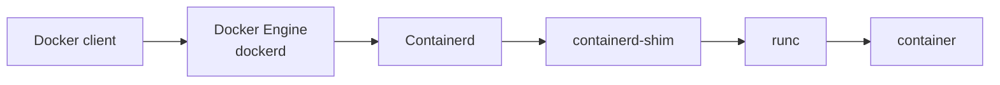

# Docker 容器化应用快速入门

::: tip 本篇定位：掌握容器原理、镜像构建、存储网络、Compose 多服务编排、仓库管理、资源限制、运维。
:::

## Docker 概述

`Docker` 是**容器化平台**，基于 Linux 内核的 `Namespace（隔离）`、`Cgroups（资源限制）`、`UnionFS（联合文件系统）`实现。<br>
简单一句话：**把应用 + 依赖 + 配置打包成一个轻量、可移植的容器，一处打包，到处运行。**

><small>区分与虚拟机的区别：</small>
>- <small>**虚拟机**：完整操作系统内核，体积大，启动分钟级。</small>
>- <small>**Docker 容器**：共享宿主机内核，只打包应用和库，MB 级别，秒级启动。</small>

### 核心概念

- 镜像（Image）：只读模板，是创建容器的模板。比如 `nginx:alpine`，包含 nginx 程序、依赖。镜像不能运行。<br>
- 容器（Container）：运行中的镜像实例。比如 `nginx:alpine` 运行的容器。<br>
- 仓库（Registry）：存储镜像的中心仓库。比如 Docker Hub、Harbor。<br>
- 网络（Network）：容器之间的通信。比如 bridge、host、none、container。<br>
- 端口映射（Port Mapping）：将容器端口映射到宿主机端口。比如 `80:80`，将容器端口 80 映射到宿主机端口 80。<br>
- 卷（Volume）：持久化存储容器数据的目录。比如 `/app`。<br>
- 绑定挂载（Bind Mount）：将宿主机目录挂载到容器目录。比如 `/app:/app`。<br>
- 环境变量：在容器运行时设置的环境变量。比如 `PORT=80`。<br>    

### 核心优势

- ✅ **环境一致**：开发、测试、生产环境完全相同，解决 “在我电脑能跑，线上不行”
- ✅ **轻量高效**：共享宿主机内核，占用资源远低于虚拟机，秒启动
- ✅ **快速部署**：镜像分发，一键拉起服务
- ✅ **隔离性**：容器之间进程、网络、文件系统互相隔离
- ✅ **版本管理**：镜像支持版本标签，方便回滚

### 使用场景

1. 开发环境标准化（团队统一环境）
2. 微服务打包部署（K8s 底层就是容器）
3. 持续集成 / CI/CD（Jenkins + Docker）
4. 测试环境快速创建销毁
5. 单机多应用隔离（数据库、中间件、网站分开容器）

### 简单工作流

1. 编写 Dockerfile → `docker build` 构建镜像
2. 本地保存镜像，或 push 到镜像仓库
3. 在目标机器拉取镜像 `docker pull`
4. `docker run` 创建并启动容器，对外提供服务

### 命令速记

```bash
# 拉取镜像
docker pull nginx:1.25-alpine
# 查看本地镜像
docker images
# 查看镜像历史
docker history nginx:1.25-alpine
# 后台运行容器，端口映射 80:80 -d 后台运行
# --name 容器名称
# -p 宫主机端口:容器端口
# -v 宫主机目录:容器目录
docker run -d --name mynginx -p 80:80 -v /app:/app nginx:1.25-alpine
# 进入容器
docker exec -it mynginx /bin/bash
# 查看容器状态
docker inspect mynginx
# 查看容器环境变量
docker inspect -f '{{.Config.Env}}' mynginx
# 查看容器挂载的卷
docker inspect -f '{{.Mounts}}' mynginx
# 查看容器网络
docker inspect -f '{{.NetworkSettings}}' mynginx
# 查看容器端口映射
docker inspect -f '{{.NetworkSettings.Ports}}' mynginx
# 查看容器命令
docker inspect -f '{{.Config.Cmd}}' mynginx
# 查看运行容器
docker ps -a
# 查看容器日志
docker logs mynginx
# 启动容器
docker start mynginx
# 停止容器
docker stop mynginx
# 重启容器
docker restart mynginx
# 删除容器
docker rm mynginx
# 删除镜像
docker rmi nginx:alpine:1.25
```

## 安装

### Docker 版本管理

核心区分：**Docker Engine（容器引擎，Linux 生产环境用）** vs **Docker Desktop（Windows/mac 开发桌面工具，内置 Engine+GUI+K8s）**
底层开源项目叫 **Moby**，Docker Engine 基于 Moby 编译打包。

#### 版本号命名历史变迁

1. **早期版本（2017-03 之前）：1.x 序列**
`0.x ~ 1.13.1`，语义化版本，如 `1.12.6`、`1.13.1`。

> 
> 1.13.1 是最后一个 1.x 版本。

2. **2017.03 ~ 2020：YY.MM 时间化版本（CE/EE 时代）**
从 `17.03` 开始，格式：**年。月**，后缀是补丁号，例 `19.03.15`（2019 年 3 月发布，第 15 次补丁）

- CE：Community Edition 社区免费版
  - Stable：季度稳定版，维护周期 4 个月
  - Edge：月度尝鲜版，维护很短，生产不推荐
- EE：Enterprise Edition 企业付费版，同版本号，维护 1 年，带官方支持、安全加固、认证镜像等

> 
> 注意：**2020 年后 EE 产品线停产，不再单独发布 EE**，现在企业付费是 Docker Desktop 订阅。

3. **2021 之后：恢复纯主版本号（20.10 → 21,22,23,24,25,26,27,28,29）**
格式：`主.次.补丁`，例如 `20.10.24`、`25.0.5`、`29.0.0`。

### Docker 安装和删除

- 官方文档 : <small>https://docs.docker.com/engine/install/<br></small>
- 阿里云文档: <small>https://developer.aliyun.com/mirror/docker-ce?spm=a2c6h.13651102.0.0.29a91b11NTKyP9</small>    

#### Debian/Ubuntu RHEL 系包安装
::: code-group

```bash [Debian/Ubuntu]
sudo apt-get update
sudo apt-get -y install apt-transport-https ca-certificates curl software-properties-common
# step 2: 安装GPG证书
curl -fsSL https://mirrors.aliyun.com/docker-ce/linux/ubuntu/gpg | sudo apt-key 
add -
# Step 3: 写入软件源信息
sudo add-apt-repository "deb [arch=amd64] https://mirrors.aliyun.com/docker-ce/linux/ubuntu $(lsb_release -cs) stable"
# Step 4: 更新并安装Docker-CE
sudo apt-get -y update
sudo apt-get -y install docker-ce

# Step 5: 删除 Docker
apt purge docker-ce docker-ce-cli containerd.io runc
rm -rf /var/lib/docker

```

```bash [RHEL 系]
# step 1: 安装必要的一些系统工具
sudo yum install -y yum-utils
# Step 2: 添加软件源信息
yum-config-manager --add-repo https://mirrors.aliyun.com/dockerce/linux/centos/docker-ce.repo
# Step 3: 安装Docker
sudo yum install docker-ce docker-ce-cli containerd.io docker-buildx-plugin 
docker-compose-plugin
# Step 4: 开启Docker服务
sudo service docker start

# 注意：
# 官方软件源默认启用了最新的软件，您可以通过编辑软件源的方式获取各个版本的软件包。例如官方并没有
# 将测试版本的软件源置为可用，您可以通过以下方式开启。同理可以开启各种测试版本等。
# vim /etc/yum.repos.d/docker-ce.repo
#   将[docker-ce-test]下方的enabled=0修改为enabled=1
#
# 安装指定版本的Docker-CE:
# Step 1: 查找Docker-CE的版本:
# yum list docker-ce.x86_64 --showduplicates | sort -r
#   Loading mirror speeds from cached hostfile
#   Loaded plugins: branch, fastestmirror, langpacks
#   docker-ce.x86_64           17.03.1.ce-1.el7.centos           docker-ce-stable
#   docker-ce.x86_64           17.03.1.ce-1.el7.centos           @docker-ce-stable
#   docker-ce.x86_64           17.03.0.ce-1.el7.centos           docker-ce-stable
#   Available Packages
# Step2: 安装指定版本的Docker-CE: (VERSION例如上面的17.03.0.ce.1-1.el7.centos)
# sudo yum -y install docker-ce-[VERSION]
```

:::

#### Linux 二进制离线安装

本方法适用于无法上网或无法通过包安装方式安装的主机上安装docker

**安装文档：**

- <small>https://docs.docker.com/engine/install/binaries/<br></small>
- <small>https://docs.docker.com/install/linux/docker-ce/binaries/<br></small>

**二进制安装下载路径：**

- <small>https://download.docker.com/linux/<br></small>
- <small>https://download.docker.com/linux/static/stable/<br></small>
- <small>https://mirrors.aliyun.com/docker-ce/linux/static/stable/x86_64/<br></small>


::: code-group

```bash [Debian/Ubuntu]
# step 1: 下载二进制包  注意：版本请自行确定
wget https://download.docker.com/linux/static/stable/amd64/docker-ce-20.10.24-0~ubuntu-20.04.1.tar.gz
# step 2: 解压二进制包
tar -zxvf docker-ce-20.10.24-0~ubuntu-20.04.1.tar.gz
# step 3: 安装二进制包
cp docker/* /usr/local/bin/
# step 4: 启动 Docker 服务
dockerd &>/dev/null
# step 5: 验证安装
docker version
# step 6: 运行测试容器
docker run hello-world
# step 7: 查看进程树
pstree -p
```

:::

**创建 Docker service 文件**

```bash
cat > /lib/systemd/system/docker.service <<-EOF
[Unit]
Description=Docker Application Container Engine
Documentation=https://docs.docker.com
After=network-online.target firewalld.service
Wants=network-online.target
[Service]
Type=notify
# the default is not to use systemd for cgroups because the delegate issues still
ExecStart=/usr/local/bin/dockerd -H unix://var/run/docker.sock
ExecReload=/bin/kill -s HUP \$MAINPID
LimitNOFILE=infinity
LimitNPROC=infinity
LimitCORE=infinity
TimeoutStartSec=0
Delegate=yes
KillMode=process
Restart=on-failure
StartLimitBurst=3
StartLimitInterval=60s
[Install]
WantedBy=multi-user.target
EOF
# 重新加载 systemd 配置
systemctl daemon-reload
# 启用 Docker 服务
systemctl enable --now docker

```

**自动补全[可选]**
::: code-group

```bash [Debian/Ubuntu]
# For Bash Completion
curl -L https://raw.githubusercontent.com/docker/cli/master/contrib/completion/bash/docker -o /etc/bash_completion.d/docker.sh
# 检查是否成功
wc -l /etc/bash_completion.d/docker.sh
# For Zsh users
curl -L https://raw.githubusercontent.com/docker/cli/master/contrib/completion/zsh/_docker -o /usr/local/share/zsh/site-functions/_docker 
# 安装 bash-completion 包
apt install -y bash-completion
```

:::

### 官方通用安装Docker脚本

从Docker官方下载通用安装脚本
<front color=red> 注意： 此脚本当前不支持 Rocky Linux</front>

```bash
# 如果是 Rocky Linux，修改os-release文件如下，即可支持安装Docker
sudo vim /etc/os-release    
# 将ID=rocky 修改为 ID=centos
# step 1: 下载脚本
curl -fsSL https://get.docker.com -o get-docker.sh
# step 2: 执行脚本
sudo sh get-docker.sh
```

### Docker 组成和配置



环境配置文件：

- `/etc/sysconfig/docker-network`
- `/etc/sysconfig/docker-storage`
- `/etc/sysconfig/docker`

Unit File: `/lib/systemd/system/docker.service`

docker-ce 配置文件: `/etc/docker/daemon.json`

::: code-group

```json [国内镜像加速]
{
     "registry-mirrors": [  
        "https://docker.m.daocloud.io",
        "https://docker.1panel.live",
        "https://docker.1ms.run",
        "https://docker.xuanyuan.me"
   ]
}
```

:::

Docker Registry配置文件: `/etc/docker/registry.json`

**ubuntu 查看Docker相关文件**
::: code-group

```bash [服务端相关文件]
dpkg -L docker-ce
/.
/etc
/etc/default
/etc/default/docker
/etc/init
/etc/init/docker.conf
/etc/init.d
/etc/init.d/docker
/lib
/lib/systemd
/lib/systemd/system
/lib/systemd/system/docker.service
/lib/systemd/system/docker.socket
/usr
/usr/bin
/usr/bin/docker-init
/usr/bin/docker-proxy
/usr/bin/dockerd
/usr/share
/usr/share/doc
/usr/share/doc/docker-ce
/usr/share/doc/docker-ce/README.md
/usr/share/doc/docker-ce/changelog.Debian.gz
/var
/var/lib
/var/lib/docker-engine
/var/lib/docker-engine/distribution_based_engine.json
```
```bash [客户端相关文件]
dpkg -L docker-ce-cli
/.
/usr
/usr/bin
/usr/bin/docker
/usr/libexec
/usr/libexec/docker
/usr/libexec/docker/cli-plugins
/usr/libexec/docker/cli-plugins/docker-app
/usr/libexec/docker/cli-plugins/docker-buildx
/usr/share
/usr/share/bash-completion
/usr/share/bash-completion/completions
/usr/share/bash-completion/completions/docker
/usr/share/doc
/usr/share/doc/docker-ce-cli
/usr/share/doc/docker-ce-cli/changelog.Debian.gz
/usr/share/fish
/usr/share/fish/vendor_completions.d
/usr/share/fish/vendor_completions.d/docker.fish
/usr/share/man
/usr/share/man/man1
/usr/share/man/man1/docker-wait.1.gz
/usr/share/man/man1/docker.1.gz
/usr/share/man/man5
/usr/share/man/man5/Dockerfile.5.gz
/usr/share/man/man5/docker-config-json.5.gz
/usr/share/man/man8
/usr/share/man/man8/dockerd.8.gz
/usr/share/zsh
/usr/share/zsh/vendor-completions
/usr/share/zsh/vendor-completions/_docker
```

:::

### Docker 命令帮助 [🐳](/reference/docker-commands)

**docker 命令格式**

```bash
docker [OPTIONS] COMMAND
# COMMAND 分为
Management Commands  # 指定管理的资源对象类型,较新的命令用法,将命令按资源类型进行分类,方便使用
Commands             # 对不同资源操作的命令不分类,使用容易产生混乱
```
docker 命令有很多子命令，可以用下面方法查看帮助

```bash
#docker 命令帮助
man docker 
docker
docker  --help
#docker 子命令帮助
man docker-COMMAND
docker COMMAND --help```
```

官方文档:

- <small>https://docs.docker.com/reference/</small>
- <small>https://docs.docker.com/engine/reference/commandline/cli/</small>

### Docker 相关信息和优化配置

**查看Docker版本信息**

```bash
docker version      # 显示Docker Client 版本信息与 Docker Engine 版本信息
docker -version     # 显示Docker Client 版本信息
```

**查看 docker 详解信息**

```bash
docker info      # 显示Docker Engine 信息,包括版本、系统信息、容器数量、镜像数量、存储驱动、网络驱动、日志驱动等

Client:
 Debug Mode: false                  #client 端是否开启 debug
Server:
 Containers: 2                      #当前主机运行的容器总数
 Running: 0                         #有几个容器是正在运行的
 Paused: 0                          #有几个容器是暂停的
 Stopped: 2                         #有几个容器是停止的
 Images: 4                          #当前服务器的镜像数
 Server Version: 19.03.5            #服务端版本
 Storage Driver: overlay2           #正在使用的存储引擎
 Backing Filesystem: extfs          #后端文件系统，即服务器的磁盘文件系统
 Supports d_type: true              #是否支持 d_type
 Native Overlay Diff: true          #是否支持差异数据存储
 Logging Driver: json-file          #日志类型,每个容器的标准输出以日志存放在
                                    #/var/lib/docker/containers/<CONTAINER ID>/<CONTAINER ID>-json.log 
 Cgroup Driver: cgroupfs            #Cgroups 类型    
 Plugins:                           #插件
 Volume: local                      #卷
 Network: bridge host ipvlan macvlan null overlay       # overlay 跨主机通信
 Log: awslogs fluentd gcplogs gelf journald json-file local logentries splunk 
syslog                              #日志类型
 Swarm: inactive                    #是否支持 swarm
 Runtimes: runc                     #已安装的容器运行时
 Default Runtime: runc              #默认使用的容器运行时
 Init Binary: docker-init           #初始化容器的守护进程，即 pid 为 1 的进程
 containerd version: b34a5c8af56e510852c35414db4c1f4fa6172339     #版本
 runc version: 3e425f80a8c931f88e6d94a8c831b9d5aa481657           #runc版本
 init version: fec3683                                            #init 版本
 Security Options:                                                #安全选项
 apparmor                           #安全模块，https://docs.docker.com/engine/security/apparmor/
 seccomp                            #安全计算模块，即制容器操作，https://docs.docker.com/engine/security/seccomp/
   Profile: default                     #默认的配置文件
 Kernel Version: 4.15.0-29-generic      #宿主机内核版本
 Operating System: Ubuntu 18.04.1 LTS   #宿主机操作系统
 OSType: linux                          #宿主机操作系统类型
 Architecture: x86_64                   #宿主机架构
 CPUs: 1                                #宿主机 CPU 数量
 Total Memory: 962MiB                   #宿主机总内存
 Name: ubuntu1804.magedu.com            #宿主机 hostname
 ID: IZHJ:WPIN:BRMC:XQUI:VVVR:UVGK:NZBM:YQXT:JDWB:33RS:45V7:SQWJ    #宿主机 ID
 Docker Root Dir: /var/lib/docker           #宿主机关于docker数据的保存目录,建议使用独立SSD的磁盘,保证性能和空间
 Debug Mode: false                          #server 端是否开启 debug
 Registry: https://index.docker.io/v1/      #仓库路径
 Labels:
 Experimental: false                        #是否测试版
 Insecure Registries:
  127.0.0.0/8 :                             #非安全的镜像仓库
 Registry Mirrors:
 https://si7y70hh.mirror.aliyuncs.com/       #镜像仓库
 Live Restore Enabled: false                 #是否开启活动重启 (重启docker-daemon 不关闭容器 )
WARNING: No swap limit support               #系统警告信息 (没有开启 swap 资源限制 )
```

解决方法请参考 ➡ [解决SWAP报警提示](/cases/t-docker-swap.md)

### 查看 docker0 网卡

在docker安装启动之后，默认会生成一个名称为docker0的网卡并且默认IP地址为172.17.0.1的网卡。

```bash
ip a | grep docker0

4: docker0: <BROADCAST,MULTICAST,UP,LOWER_UP> mtu 1500 qdisc noqueue state UP 
group default 
   link/ether 0X:00:d3:26:ed:4e brd ff:ff:ff:ff:ff:ff
   inet 172.17.0.1/16 brd 172.17.255.255 scope global docker0
       valid_lft forever preferred_lft forever
   inet6 fe80::42:d3ff:fe26:ed4e/64 scope link 
       valid_lft forever preferred_lft forever
route -n

Kernel IP routing table

Destination     Gateway         Genmask         Flags Metric Ref   Use Iface
0.0.0.0         10.0.0.2        0.0.0.0         UG    100    0        0 eth0
10.0.0.0        0.0.0.0         255.255.255.0   U     100    0        0 eth0
172.17.0.0      0.0.0.0         255.255.0.0     U     0      0        0 docker0
```

### Docker 存储引擎

官方文档关于存储引擎的相关文档：<br>
[Docker 存储引擎](https://docs.docker.com/storage/storagedriver/) <br>
[选择存储引擎](https://docs.docker.com/engine/storage/drivers/select-storage-driver/)

修改存储引擎参考文档：<br>
[修改存储引擎](https://docs.docker.com/storage/storagedriver/overlayfs-driver/)<br>

Docker官方推荐首选存储引擎为overlay2

devicemapper存在使用空间方面存在限制，虽然可以通过配置解决，当前官方依然推荐使用overlay2

**基于Overlay文件系统实现联合文件系统挂载**

```bash
# 查看是否支持overlay2存储引擎的挂载点
# 如果支持overlay2存储引擎，会显示overlay2的挂载点
# 如果不支持overlay2存储引擎，会显示devicemapper的挂载点
grep -i overlay /boot/config-6.8.0-31-generic

CONFIG_EFI_CUSTOM_SSDT_OVERLAYS=y
CONFIG_OVERLAY_FS=m
# CONFIG_OVERLAY_FS_REDIRECT_DIR is not set
CONFIG_OVERLAY_FS_REDIRECT_ALWAYS_FOLLOW=y
# CONFIG_OVERLAY_FS_INDEX is not set
CONFIG_OVERLAY_FS_XINO_AUTO=y
# CONFIG_OVERLAY_FS_METACOPY is not set
# CONFIG_OVERLAY_FS_DEBUG is not set

# 加载overlay内核模块
modinfo -d overlay      # Overlay filesystem
modinfo -n overlay      # /lib/modules/6.8.0-31-generic/kernel/fs/overlayfs/overlay.ko.zst
lsmod | grep overlay    # overlay               212992  2

# 如果没有，可以执行下面加载模块
modprobe overlayfs
mkdir -p /data/overlay/{lower1,lower2,merged,upper,work} 
echo lower1 file f1 > /data/overlay/lower1/f1
echo lower1 file f2 > /data/overlay/lower1/f2
echo lower2 file f1 > /data/overlay/lower2/f1
echo lower2 file f3 > /data/overlay/lower2/f3
tree /data/overlay/
/data/overlay/
├── lower1
│   ├── f1
│   └── f2
├── lower2
│   ├── f1
│   └── f3
├── merged
├── upper
└── work
6 directories, 4 files
cd /data/overlay/
[root@ubuntu2404 overlay]#tree
.
├── lower1
│   ├── f1
│   └── f2
├── lower2
│   ├── f1
│   └── f3
├── merged
├── upper
└── work
6 directories, 4 files

#挂载
[root@ubuntu2404 overlay]#mount -t overlay overlay -o 
lowerdir=./lower2:./lower1,upperdir=./upper,workdir=./work ./merged
#验证
[root@ubuntu2404 overlay]#tree ./merged/
./merged/
├── f1
├── f2
└── f3
1 directory, 3 files

[root@ubuntu2404 overlay]#cat ./merged/f1 
lower2 file f1
[root@ubuntu2404 overlay]#cat ./merged/f2
lower1 file f2
[root@ubuntu2404 overlay]#cat ./merged/f3
lower2 file f3
[root@ubuntu2404 overlay]#echo merged file f4 > merged/f4
[root@ubuntu2404 overlay]#ls upper/
f4
[root@ubuntu2404 overlay]#cat upper/f4
merged file f4
[root@ubuntu2404 overlay]#cat merged/f1 
lower2 file f1
[root@ubuntu2404 overlay]#echo merged file f1 > merged/f1
[root@ubuntu2404 overlay]#ls upper/
f1 f4
[root@ubuntu2404 overlay]#cat upper/f1
merged file f1
```

### Docker 配置和优化

官方文档关于配置和优化的相关文档：<br>
[配置和优化](https://docs.docker.com/reference/cli/dockerd/#daemon-configuration-file)  

注意：这种方式只对新建的容器有效的，之前的容器不生效

**支持官方仓库和私有仓库镜像下载**

```bash
cat /etc/docker/daemon.json
{
    "registry-mirrors": [  
        "https://docker.m.daocloud.io",
        "https://docker.1panel.live",
        "https://docker.1ms.run",
        "https://docker.xuanyuan.me"
   ],
    "insecure-registries": ["example.com"]
}
#只支持docker官方镜像下载，不支持私有仓库镜像下载
```

**Docker 优化**

```bash
vim /etc/docker/daemon.json
{
"registry-mirrors": [   
    "https://registry.docker-cn.com",
    "http://hub-mirror.c.163.com",
    "https://docker.mirrors.ustc.edu.cn",
    "https://si7y70hh.mirror.aliyuncs.com/"
 ],
#开启远程:https://docs.docker.com/config/daemon/remote-access/ 
#方法1:docker.service文件中ExecStart=/usr/bin/dockerd -H tcp://0.0.0.0:2375 -H fd:// 
#方法2: 注意:需要删除/lib/systemd/system/docker.service文件中的-H fd:// 两种冲突
"hosts": ["unix:///var/run/docker.sock", "tcp://0.0.0.0:2375"],
"insecure-registries": ["harbor.magedu.com"],
"exec-opts": ["native.cgroupdriver=systemd"],
  "data-root": "/data/docker",                  #方法1:指定docker数据目录,方法2：
ExecStart=/usr/bin/dockerd --data-root=/data/docker
#"graph": "/data/docker",#旧版写法，指定docker数据目录,新版24.0.0不支持
"max-concurrent-downloads": 10, 
"max-concurrent-uploads": 5,    
"log-opts": {
   "max-size": "300m",   #指定容器日志文件的最大值
   "max-file": "2"       #指定容器日志文件的个数，循环写入日志文件，即一个日志满，会写入第二
个文件
 },
"live-restore": true,   #docker.service重启，不影响容器的运行
  "proxies": {           #代理 https://docs.docker.com/network/proxy/
   "default": {
     "httpProxy": "http://proxy.example.com:3128",
     "httpsProxy": "https://proxy.example.com:3129",
     "noProxy": "*.test.example.com,.example.org,127.0.0.0/8"
   }
   "tcp://docker-daemon1.example.com": {
     "noProxy": "*.internal.example.net"
   }
 }
}
systemctl daemon-reload && systemctl restart docker.service

```

**Docker 实现代理功能**

```bash
#无法直接下载指定镜像
docker pull registry.k8s.io/ingress-nginx/controller:v1.7.1
Error response from daemon: Head "https://us-west2-docker.pkg.dev/v2/k8s-artifacts-prod/images/ingress-nginx/controller/manifests/v1.7.1": dial tcp 142.251.170.82:443: connect: connection refused
#先安装科学上网软件，开启局域网连接略
mkdir -p /etc/systemd/system/docker.service.d
cat >> /etc/systemd/system/docker.service.d/http-proxy.conf 
<<EOF
[Service]
Environment="HTTP_PROXY=http://${PROXY_SERVER_IP}:${PROXY_PORT}/"
Environment="HTTPS_PROXY=http://${PROXY_SERVER_IP}:${PROXY_PORT}/"
Environment="NO_PROXY=127.0.0.0/8,172.17.0.0/16,10.0.0.0/24,10.244.0.0/16,192.16
8.0.0/16,magedu.com,cluster.local"
EOF
systemctl daemon-reload && systemctl restart docker.service
#重新拉取成功
docker pull registry.k8s.io/ingress-nginx/controller:v1.7.1 
```

**Containerd 实现代理功能**

```bash
mkdir -p /etc/systemd/system/containerd.service.d
cat >> /etc/systemd/system/containerd.service.d/http-proxy.conf <<EOF
[Service]
Environment="HTTP_PROXY=http://${PROXY_SERVER_IP}:${PROXY_PORT}/"
Environment="HTTPS_PROXY=http://${PROXY_SERVER_IP}:${PROXY_PORT}/"
Environment="NO_PROXY=127.0.0.0/8,172.17.0.0/16,10.0.0.0/24,10.244.0.0/16,192.16
8.0.0/16,magedu.com,cluster.local"
EOF
systemctl daemon-reload && systemctl restart 
containerd.service
```
**开启远程连接**

```bash
#在docker服务端主机开启远程网络连接功能
vim /lib/systemd/system/docker.service 
[Service]
.....
ExecStart=/usr/local/bin/dockerd -H unix://var/run/docker.sock -H 
tcp://0.0.0.0:2375
.......
systemctl daemon-reload
systemctl restart docker.service
#确认端口打开
ss -ntlp|grep dockerd
LISTEN 0      4096               *:2375           *:*   users:(("dockerd",pid=1937,fd=3))
docker info
.......
  127.0.0.0/8
 Live Restore Enabled: false
 Product License: Community Engine
#显示下面提示
WARNING: API is accessible on http://0.0.0.0:2375 without encryption.
         Access to the remote API is equivalent to root access on the host. 
Refer
         to the 'Docker daemon attack surface' section in the documentation for
         more information: https://docs.docker.com/go/attack-surface/

#在另一台docker客户端主机远程连接服务器
docker -H <docker服务器IP>:2375 version
Client: Docker Engine - Community
 Version:           24.0.6  #本机docker客户端的版本
......
Server: Docker Engine - Community
 Engine:
 Version:          24.0.7  #此处可以看到远程docker服务器的版本,和客户端版本不同
```

**通过ssh 协议远程连接**

```bash
ssh-keygen
ssh-copy-id 10.0.0.100
docker -H ssh://root@10.0.0.100 version
Client: Docker Engine - Community
 Version:           26.1.3
 API version:       1.45
 Go version:       go1.21.10
 Git commit:       b72abbb
 Built:             Thu May 16 08:33:29 2024
 OS/Arch:           linux/amd64
 Context:           default
Server: Docker Engine - Community
 Engine:
 Version:          26.1.4
 API version:      1.45 (minimum version 1.24)
 Go version:       go1.21.11
 Git commit:       de5c9cf
 Built:           Wed Jun  5 11:28:57 2024
 OS/Arch:         linux/amd64
 Experimental:     false
 containerd:
 Version:          1.6.33
 GitCommit:       d2d58213f83a351ca8f528a95fbd145f5654e957
 runc:
 Version:          1.1.12
 GitCommit:       v1.1.12-0-g51d5e94
 docker-init:
 Version:          0.19.0
 GitCommit:       de40ad0

ssh 10.0.0.100 docker images
REPOSITORY                       TAG           IMAGE ID       CREATED         
SIZE
harbor.magedu.com/library/ubuntu    22.04         67c845845b7d   5 months ago   77.9MB
172.24.0.253/library/rockylinux   8.9-minimal   f63d8d2889fd   11 months ago   93.3MB
```

## Docker 镜像（Image）管理

### Docker 镜像介绍

Docker 镜像是容器的**静态只读模板**，打包了应用程序运行所需的全部内容：业务代码、运行时环境、依赖库、配置文件、环境变量、启动命令等。镜像启动后就成为一个容器，二者的关系可以类比为「程序安装包」与「运行中的程序」。

**核心特性**

1. **只读性**：镜像本身不可修改，只能通过重新构建生成新镜像；容器运行时的所有修改都发生在顶部的可写层，不会改动镜像本身。
2. **分层存储**：基于联合文件系统（UnionFS）实现多层叠加，是镜像最核心的设计。
3. **可复用共享**：不同镜像可以共用相同的底层镜像，极大节省磁盘和传输成本。
4. **可移植性**：一次构建，可在任意安装了 Docker 的环境中运行，环境完全一致。
5. **版本化管理**：通过标签（Tag）区分不同版本 / 变体，支持版本回滚。

**核心原理：分层文件系统**

**联合文件系统（UnionFS）**

UnionFS 是一种轻量级文件系统，它可以将多个独立的目录（层）挂载到同一个目录下，对外呈现为一个完整的文件系统。

Docker 镜像就是由一层层这样的只读文件系统叠加而成：

- 最底层是基础镜像（如 `ubuntu`、`alpine`）
- 往上每一层对应一次文件系统变更（安装软件、复制文件等）
- 上层优先级高于下层，同名文件会被上层覆盖

**镜像层与容器层**

- **镜像层**：全部只读，每一层对应 Dockerfile 中一条会修改文件系统的指令（`RUN`/`COPY`/`ADD`）；`ENV`/`CMD`/`EXPOSE` 等指令仅修改元数据，不新增文件层。
- **容器层**：容器启动时，会在镜像最顶层添加**唯一一层可写层**；容器内所有文件修改、新增、删除都只作用于这一层，删除容器时可写层一并销毁，镜像本身不受影响

**分层设计的优势**

- **节省磁盘**：100 个基于 Ubuntu 的应用镜像，只需存储 1 份 Ubuntu 基础层。
- **加速构建**：未修改的层直接复用缓存，无需重复执行。
- **加速传输**：拉取 / 推送镜像时，只传输本地不存在的层。

示例：

```bash
docker pull nginx 
Using default tag: latest
latest: Pulling from library/nginx
8ec398bc0356: Pull complete 
a53c868fbde7: Pull complete 
79daf9dd140d: Pull complete
Digest: sha256:70821e443be75ea38bdf52a974fd2271babd5875b2b1964f05025981c75a6717
Status: Downloaded newer image for nginx:latest
docker.io/library/nginx:latest

#查看镜像分层历史
docker history nginx
IMAGE           CREATED        CREATED BY                                    SIZE     COMMENT
0901fa9da894    9 days ago    /bin/sh -c #(nop) CMD ["nginx" "-g" "daemon…   0B                  
<missing>       9 days ago    /bin/sh -c #(nop) STOPSIGNAL SIGTERM           0B                  
<missing>       9 days ago    /bin/sh -c #(nop) EXPOSE 80                    0B                  
<missing>       9 days ago    /bin/sh -c #(nop) ENTRYPOINT ["/docker-entr…   0B                  
<missing>       9 days ago    /bin/sh -c #(nop) COPY file:0fd5fca330dcd6a7…  1.04kB             
<missing>       9 days ago    /bin/sh -c #(nop) COPY file:1d0a4127e78a26c1…  1.96kB             
<missing>       9 days ago    /bin/sh -c #(nop) COPY file:e7e183879c35719c…  1.2kB              
<missing>       9 days ago    /bin/sh -c set -x     && addgroup --system -…  63.3MB             
......
```

**镜像的命名与标识**

```bash
[仓库地址/]仓库名[:标签]
```

- **仓库地址**：私有仓库时填写，如 `registry.example.com/`；官方 Docker Hub 可省略。
- **仓库名**：镜像的名称，官方镜像直接为名称（如 `nginx`），第三方镜像为 `用户名/仓库名`（如 `bitnami/nginx`）。
- **标签（Tag）**：版本 / 变体标识，不写默认使用 `latest`。

> ⚠️ 注意：`latest` 只是默认标签，不代表「最新稳定版」，生产环境必须指定明确版本号。

示例：

- `nginx:latest`：官方最新稳定版
- `bitnami/nginx:8.9-minimal`：第三方最新稳定版
- `harbor.magedu.com/library/ubuntu:22.04`：私有仓库 22.04 版本

**唯一标识：镜像 ID 与摘要**

- **镜像 ID**：本地生成的短哈希，仅在当前宿主机唯一，用于快速操作。
- **镜像摘要（Digest）**：基于镜像内容计算的全局唯一哈希，内容不变则摘要不变；生产环境中用于精确锁定镜像版本，避免标签被覆盖导致的不一致。

**常见镜像分类与变体**

按来源划分

- **官方镜像**：Docker 官方认证维护，安全、更新及时，如 `ubuntu`、`mysql`、`python`、`redis`。
- **第三方镜像**：社区、厂商或个人发布，如 `bitnami` 系列、`elastic/logstash`。
- **自建镜像**：企业 / 个人通过 Dockerfile 定制构建，用于业务应用。

主流标签变体对比

以官方镜像为例，同一软件通常提供多个变体，适配不同场景：

| 变体标签              | 核心特点                                                     | 适用场景                     |
| --------------------- | ------------------------------------------------------------ | ---------------------------- |
| `alpine`              | 基于 Alpine Linux，体积极小（几 MB~ 几十 MB），使用 musl libc | 生产部署、追求轻量化         |
| `slim`                | 精简版，移除非必要工具，体积小于标准版                       | 平衡功能与体积               |
| `bullseye`/`bookworm` | 基于对应版本 Debian，完整 glibc 环境                         | 兼容性要求高的业务           |
| `latest`              | 默认标签，内容随官方更新而变化                               | 本地测试，**不推荐生产使用** |

镜像仓库 Registry

统一保存镜像而且是多个不同镜像版本的地方，叫做镜像仓库
Docker hub: docker官方的公共仓库，已经保存了大量的常用镜像，可以方便大家直接使用
阿里云，网易等第三方镜像的公共仓库
Image registry: docker 官方提供的私有仓库部署工具，无web管理界面，目前使用较少
Harbor: vmware 提供的自带web界面自带认证功能的镜像私有仓库，目前有很多公司使用

镜像的地址格式

```bash
nginx = docker.io/library/nginx:latest
nginx:latest
nginx:1.20.0
docker.io/library/nginx:1.20.0
docker.io/library/alpine
registry.cn-hangzhou.aliyuncs.com/wangxiaochun/busybox:v1.0
harbor.magedu.com/project/centos:7.2.1511
172.20.0.100/project/centos: latest
```

### 镜像搜索

**官方网站进行镜像的搜索:**

```bash
http://hub.docker.com
http://dockerhub.com
https://hub-stage.docker.com/ 
```

**第三方仓库**

```bash
https://quay.io/              # 红帽公司维护
https://registry.k8s.io       # kubernetes 仓库
http://cr.console.aliyun.com  # 阿里云仓库
```

执行docker search命令进行搜索，例如：

```bash
Usage: docker search [OPTIONS] TERM
Options:
  -f, --filter filter   Filter output based on conditions provided
      --format string   Pretty-print search using a Go template
      --limit int       Max number of search results (default 25)
      --no-trunc        Don't truncate output
说明:  
OFFICIAL: 官方
AUTOMATED: 使用第三方docker服务来帮助编译镜像，可以在互联网上面直接拉取到镜像，减少了繁琐的编译过程
```

示例：

```bash
docker search centos
NAME                               DESCRIPTION      STARS               OFFICIAL           AUTOMATED
centos                             The official build of CentOS.        5786               [OK]            
ansible/centos7-ansible           Ansible on Centos7                    126                [OK]
jdeathe/centos-ssh                 OpenSSH / Supervisor / EPEL/IUS/SCL  114                [OK]
consol/centos-xfce-vnc             Centos container with "headless"...  108                [OK]
centos/mysql-57-centos7           MySQL 5.7 SQL database server         67                     
imagine10255/centos6-lnmp-php56   centos6-lnmp-php56                    57                 [OK]
tutum/centos                       Simple CentOS docker image with SSH  44  
......                               
```
选择性的查找镜像

```bash
#搜索点赞100个以上的镜像
#旧语法
docker search -s 100 centos
#新语法
docker search --filter=stars=100 centos
```
Alpine 镜像

Alpine 操作系统是一个面向安全的轻型 Linux 发行版。它不同于通常 Linux 发行版，Alpine 采用了musl libc 和 busybox 以减小系统的体积和运行时资源消耗，但功能上比 busybox 又完善的多，因此得到开源社区越来越多的青睐。在保持瘦身的同时，Alpine 还提供了自己的包管理工具 apk，可以通过 https://pkgs.alpinelinux.org/packages 网站上查询包信息，也可以直接通过 apk 命令直接查询和安装各种软件。

- Alpine 官网: https://www.alpinelinux.org/
- Alpine 官方仓库: https://github.com/alpinelinux
- Alpine 官方镜像: https://hub.docker.com/_/alpine/
- Alpine 官方镜像仓库: https://github.com/gliderlabs/docker-alpine
- Alpine 阿里云的镜像仓库: https://mirrors.aliyun.com/alpine/

alpine 管理软件

```bash
/ # cat /etc/apk/repositories
https://dl-cdn.alpinelinux.org/alpine/v3.15/main
https://dl-cdn.alpinelinux.org/alpine/v3.15/community

#修改源替换成国内源
sed -i 's/dl-cdn.alpinelinux.org/mirrors.aliyun.com/' /etc/apk/repositories
sed -i 's/dl-cdn.alpinelinux.org/mirrors.tuna.tsinghua.edu.cn/' /etc/apk/repositories 
sed -i 's/dl-cdn.alpinelinux.org/mirrors.ustc.edu.cn/' /etc/apk/repositories

#更新源
apk update  #相当于 apt update

#安装软件
apk add vim #相当于 apt install vim

#删除软件
apk del openssh openntp vim #相当于 apt remove openssh 
#安装常见软件
apk update && apk --no-cache add bash curl telnet  wget net-tools pstree zip unzip 

#安装常用编译工具
apk update && apk --no-cache add gcc make curl zip unzip net-tools pstree wget libgcc libc-dev libcurl libc-utils pcre-dev zlib-dev libnfs pcre pcre2 libevent libevent-dev iproute2

#修改时区
apk update && apk --no-cache add tzdata && ln -s /usr/share/zoneinfo/Asia/Shanghai /etc/localtime && echo "Asia/Shanghai" > /etc/timezone

apk add nginx
apk info nginx
apk manifest nginx
ls -l /bin
```

Debian(ubuntu)系统建议安装的基础包

在很多软件官方提供的镜像都使用的是Debian(ubuntu)的系统,比如:nginx,tomcat,mysql,httpd 等,但镜像内缺少很多常用的调试工具.当需要进入容器内进行调试管理时,可以安装以下常用工具包

```bash
# apt update             # 安装软件前需要先更新索引
# apt install procps  #提供top,ps,free等命令
# apt install psmisc  #提供pstree,killall等命令
# apt install iputils-ping  #提供ping命令
# apt install net-tools  #提供netstat网络工具等
```

### 镜像下载

从 docker 仓库将镜像下载到本地，命令格式如下:

```bash
ddocker pull [OPTIONS] NAME[:TAG|@DIGEST]
Options:
  -a, --all-tags               Download all tagged images in the repository
      --disable-content-trust   Skip image verification (default true)
      --platform string         Set platform if server is multi-platform capable
  -q, --quiet                   Suppress verbose output
NAME: 是镜像名,格式:仓库服务器:端口/项目名称/镜像名称，仓库服务器:端口/项目名称/可以省略，默认docker.io/library/
TAG: 即版本号,如果不指定:TAG,则下载最新版镜像,即latest
```

```bash
# 下载最新版镜像
docker pull nginx

# 下载镜像指定版本
docker pull nginx:1.19-alpine
```

hello world 镜像

```bash
docker pull hello-world
Using default tag: latest               #默认下载最新版本
latest: Pulling from library/hello-world
1b930d010525: Pull complete             #分层下载
Digest: sha256:9572f7cdcee8591948c2963463447a53466950b3fc15a247fcad1917ca215a2f 
#摘要
Status: Downloaded newer image for hello-world:latest
docker.io/library/hello-world:latest    #下载的完整地址

```

默认镜像下载保存的路径:

```bash
#29.X版本以后路径
/var/lib/docker/containerd/daemon
#旧版路径
/var/lib/docker/overlay2/镜像ID
```

> 注意: 镜像下载完成后，会自动解压缩，比官网显示的可能会大很多，如: centos8.1.1911下载时只有70MB，下载完后显示237MB

示例：从docker官网下载镜像

```bash
docker pull hello-world
docker pull alpine
docker pull busybox
docker pull nginx    
docker pull centos
docker pull centos:centos7.7.1908
docker pull docker.io/library/mysql:5.7.30
docker pull mysql:5.6.47
```

下载镜像 alpine,busybox等镜像,查看下载的存放目录

```bash
ls /var/lib/docker/overlay2/l
du -sh /var/lib/docker/overlay2
8.0K /var/lib/docker/overlay2

ls /var/lib/docker/overlay2/l
docker pull hello-world
docker pull alpine:3.11.3
3.11.3: Pulling from library/alpine
c9b1b535fdd9: Pull complete 
Digest: sha256:ab00606a42621fb68f2ed6ad3c88be54397f981a7b70a79db3d1172b11c4367d
Status: Downloaded newer image for alpine:3.11.3
docker.io/library/alpine:3.11.3

docker pull busybox
Using default tag: latest
latest: Pulling from library/busybox
bdbbaa22dec6: Pull complete 
Digest: sha256:6915be4043561d64e0ab0f8f098dc2ac48e077fe23f488ac24b665166898115a
Status: Downloaded newer image for busybox:latest
docker.io/library/busybox:latest

docker pull centos:centos8.1.1911
centos8.1.1911: Pulling from library/centos
1234567890abcdef: Pull complete 
Digest: sha256:1234567890abcdef1234567890abcdef1234567890abcdef1234567890abcdef1234567890abcdef
Status: Downloaded newer image for centos:centos8.1.1911
docker.io/library/centos:centos8.1.1911
centos8.1.1911: Pulling from library/centos
8a29a15cefae: Pull complete 
Digest: sha256:fe8d824220415eed5477b63addf40fb06c3b049404242b31982106ac204f6700
Status: Downloaded newer image for centos:centos8.1.1911
docker.io/library/centos:centos8.1.1911

du -sh /var/lib/docker/overlay2/*
5.9M /var/lib/docker/overlay2/1802616f4c8e0a0b52c839431b6faa8ac21f4bd831548dcbd46943d3f60061fa
16K  /var/lib/docker/overlay2/5773b92e1351da5e589d0573d9f22d1ec3be1e0e98edbfcddba4b830f12c7be2
1.3M /var/lib/docker/overlay2/de31641b8d2207de7f08eabb5240474a1aaccfef08b6034dcee02b9623f8d9dc
252M /var/lib/docker/overlay2/f41df336075611f9e358e5eaf2ebd5089920a90ba68760cdec8da03edff362f7
20K  /var/lib/docker/overlay2/l

docker images 
REPOSITORY         TAG                 IMAGE ID           CREATED            SIZE
alpine             3.11.3             e7d92cdc71fe        7 days ago         5.59MB
centos             centos8.1.1911     470671670cac        7 days ago         237MB
busybox            latest             6d5fcfe5ff17        4 weeks ago        1.22MB
hello-world        latest             fce289e99eb9        12 months ago      1.84kB
```


### 镜像加速和配置优化

### 查看本地镜像

### 镜像导出

### 镜像导入

### 镜像删除

### 清理`dangling`状态镜像

### 镜像打标签

### 拉取不可描述的镜像


> ✏️ pull/images/tag/rmi、save/load、Harbor 私有仓库。

（在此填写内容）

## 镜像构建

> ✏️ Dockerfile 指令、构建、多阶段构建、分层缓存、最佳实践。

（在此填写内容）

## 容器的数据管理

> ✏️ run 参数、生命周期、exec、logs、资源限制 cgroup。

（在此填写内容）

## 存储

> ✏️ volume、bind mount、数据共享。

（在此填写内容）

## 网络管理

> ✏️ bridge/host/none/container、端口映射、自定义网络、容器互联。

（在此填写内容）

## DockerCompose 容器单机编排

> ✏️ docker-compose.yml、多服务编排、实战项目。

（在此填写内容）

## Docker 仓库管理


## Docker 的资源限制

> ✏️ 监控、清理、日志驱动、常见问题。

（在此填写内容）

## 相关速查

- [Docker 命令速查](/reference/docker-commands)
