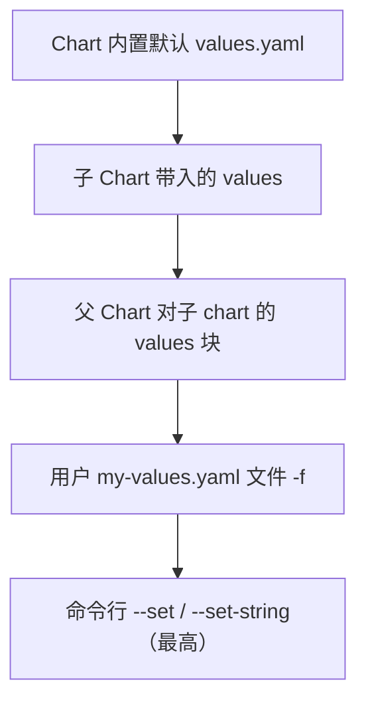

# Helm 包管理与 Kustomize

::: tip 本篇定位
在 Kubernetes 里用 YAML 手搓 Deployment/Service/Ingress 会越来越乱：环境多了要复制粘贴改镜像 tag、改副本数，升级回滚全靠记。这篇讲清楚"包管理"到底解决什么问题，以及两大主流方案 **Helm**（模板化包管理）和 **Kustomize**（无模板 overlay 定制）怎么选、怎么用。
本篇版本：Helm v4.3.0（当前稳定版，2026-09 发布；上一代 Helm 3 已于 2026-09-09 EOL，不再推荐新集群使用）、Kustomize v5.8.1（`kubectl kustomize` 内建版本随 K8s 1.37.0 发布）。所有版本以官网当前稳定版为准。
:::

## 一、背景与基础

### 1.1 小白类比：为什么需要"包管理"

直接 `kubectl apply -f` 一套 YAML 就像"手动一个个文件地装软件"：自己下依赖、自己记配置、升级时手动改一堆文件、卸载时还得想起来建过哪些资源。

Helm 之于 Kubernetes，就像 **apt/yum 之于 Linux、App Store 之于手机**：

- **Chart（图表）** = 一个 App 的安装包，把应用的所有 YAML 模板 + 默认配置打包在一起。
- **Repository（仓库）** = App Store，里面有别人打包好的 Chart（Nginx、Redis、Prometheus……）。
- **Release（发布实例）** = 你从这个包装出来、跑在集群里的那一份具体应用。同一个 Chart 能装出多个 Release（`web-prod`、`web-staging`）。

> 类比：Chart 是"微信 APK"，Repository 是"应用商店"，Release 是"你手机上真正装好并登录过账号的那个微信"。同一个 APK 装在工作机和家里机上就是两个 Release，配置不一样。

### 1.2 Helm vs Kustomize：两条路线

| 对比 | Helm | Kustomize |
|---|---|---|
| 核心思想 | **模板化**：YAML 变"填空模板"，values.yaml 填变量 | **无模板**：写好 base 原始 YAML，用 overlay 打补丁覆盖 |
| 变量来源 | values.yaml + 命令行 `--set` | kustomization.yaml 里 patches / 替换字段 |
| 复用方式 | Chart 依赖（dependencies）拉子 Chart | base + overlays 目录继承 |
| 能力 | 强（条件、循环、命名、钩子、版本化发布） | 克制（只做字段覆盖/生成，不写逻辑） |
| 适合 | 对外分发、多租户、参数化中间件 | 同一套基线在多环境做小差异 |
| 典型用户 | 中间件团队、SaaS 交付 | 应用团队、GitOps（Flux/Argo CD） |

一句话：**Helm 是"做安装包"，Kustomize 是"改现成配置"**。现实中常组合——Helm 包中间件，Kustomize 在 overlay 里对渲染结果打补丁。

## 二、安装与 Chart 结构

### 2.1 安装 Helm

```bash
# 官方脚本（Linux，版本以脚本当前安装为准，可用 helm version 核对）
curl https://raw.githubusercontent.com/helm/helm/main/scripts/get-helm-3 | bash

# 或固定版本手动安装（推荐生产，写死版本号）
wget https://get.helm.sh/helm-v4.3.0-linux-amd64.tar.gz
tar zxf helm-v4.3.0-linux-amd64.tar.gz
sudo mv linux-amd64/helm /usr/local/bin/
helm version    # 应输出 Version:"v4.3.0"
```

::: tip Helm 4 要点
Helm 4（2025-11 发布的新一代主版本）与上一代 Chart 格式基本兼容，且 OCI 仓库作为一等公民、`helm registry` 命令更顺。本文命令与模板均以 v4.3.0 为准；公共 Chart 仓库照常可用，无需特殊迁移。
:::

### 2.2 一个 Chart 的目录结构

```bash
helm create mychart        # 脚手架生成一个标准 Chart
```

```
mychart/
├── Chart.yaml        # 元信息：名字、版本、描述、类型
├── values.yaml       # 默认配置值（最常改）
├── charts/           # 依赖的子 Chart
└── templates/        # 模板目录（Go template）：deployment/service/ingress/configmap
                      #   _helpers.tpl=可复用片段；NOTES.txt=安装后提示
```

`Chart.yaml` 示例：

```yaml
apiVersion: v2          # v2 是 Helm 4 的固定写法
name: webapp
description: 示例 Web 应用 Chart
type: application       # application=应用 chart；library=公共模板库
version: 0.1.0          # Chart 本身版本
appVersion: "1.2.0"     # 被部署应用的版本，模板里可引用
```

## 三、模板渲染：核心对象、函数与覆盖优先级

### 3.1 内置对象与常用函数

`templates/deployment.yaml` 里写 Go template，`{{ .xxx }}` 是变量插值：

| 对象 | 含义 | 例子 |
|---|---|---|
| `.Release` | 本次发布实例 | `.Release.Name`、`.Release.Namespace`、`.Release.Revision` |
| `.Values` | values.yaml + 命令行注入值 | `.Values.image.tag` |
| `.Chart` | Chart.yaml 内容 | `.Chart.AppVersion` |
| `.Files` / `.Capabilities` | Chart 额外文件 / 集群能力 | `.Files.Get("nginx.conf")` |

常用函数用管道 `|` 串联：`default "x"`（空值给默认）、`quote`/`squote`（加引号）、`lower`/`upper`、`toYaml`（转 YAML 片段，常配 `nindent` 缩进）、`b64enc`/`b64dec`（做 Secret）、`include "xxx" .`（调命名模板）、`if`/`with`/`range`（条件与循环）。

```yaml
apiVersion: apps/v1
kind: Deployment
metadata:
  name: {{ .Release.Name }}-webapp
spec:
  replicas: {{ .Values.replicaCount | default 1 }}
  template:
    spec:
      containers:
        - name: webapp
          image: "{{ .Values.image.repository }}:{{ .Values.image.tag | default .Chart.AppVersion }}"
          {{- with .Values.env }}
          env:
            {{ toYaml . | nindent 12 }}
          {{- end }}
```

### 3.2 values 覆盖优先级（从低到高）



```bash
helm template myweb ./mychart --set image.tag=v1.2.0 -f values-prod.yaml  # 本地渲染，不装
helm lint ./mychart                                                         # 校验模板/结构
```

## 四、Release 生命周期与仓库

### 4.1 常用命令

```bash
helm repo add bitnami https://charts.bitnami.com/bitnami   # 加仓库
helm repo update                                           # 拉取仓库索引
helm search repo nginx                                     # 搜 Chart

helm install myweb ./mychart -n dev --create-namespace --set replicaCount=3
helm list -A                        # 看所有 Release
helm history myweb -n dev           # 看版本历史（每次 upgrade/rollback 产生新 Revision）
helm upgrade myweb ./mychart --set image.tag=v1.3.0 -n dev
helm rollback myweb 1 -n dev        # 回滚到第 1 版
helm uninstall myweb -n dev         # 卸载（加 --keep-history 保留历史）
```

### 4.2 Repository：自建与 OCI/Harbor

```bash
helm package ./mychart                                  # 打包成 mychart-0.1.0.tgz
helm registry login harbor.example.com -u admin         # 登录私有仓库
helm push mychart-0.1.0.tgz oci://harbor.example.com/chartrepo
helm install myweb oci://harbor.example.com/chartrepo/mychart --version 0.1.0
```

> 趋势：Helm 仓库正从"老式 HTTP index.yaml"转向 **OCI 制品仓库**（Harbor/OCI Registry），镜像和 Chart 共用一套仓库、权限与扫描。详见 [Harbor 与 Nexus](./devops-artifacts)。

### 4.3 依赖与 hooks

`Chart.yaml` 声明依赖：

```yaml
dependencies:
  - name: redis
    version: "~18.0.0"
    repository: "@bitnami"     # @ 指代已 add 的仓库名
    condition: redis.enabled    # values 里控制是否启用
```

```bash
helm dependency update ./mychart   # 把依赖下载到 charts/
```

**Hooks** 是在 Release 生命周期特定时机自动执行的资源（annotations 标记）：`pre-install`/`post-install`、`pre-upgrade`/`post-upgrade`、`pre-delete`/`post-delete`、`post-rollback`。典型用途：`pre-install` 跑 Job 做数据库迁移。

## 五、实战：从零做一个可安装的 Chart

最小但完整的 Chart：含 ConfigMap、Deployment、Service、Ingress。`templates/configmap.yaml`：

```yaml
apiVersion: v1
kind: ConfigMap
metadata:
  name: {{ .Release.Name }}-config
data:
  app.conf: |
    listen=8080
    log_level={{ .Values.logLevel | default "info" }}
```

`templates/deployment.yaml`：

```yaml
apiVersion: apps/v1
kind: Deployment
metadata:
  name: {{ .Release.Name }}-web
spec:
  replicas: {{ .Values.replicaCount }}
  selector:
    matchLabels:
      app: {{ .Release.Name }}-web
  template:
    metadata:
      labels:
        app: {{ .Release.Name }}-web
    spec:
      containers:
        - name: web
          image: "{{ .Values.image.repository }}:{{ .Values.image.tag }}"
          ports: [{ containerPort: 8080 }]
          envFrom: [{ configMapRef: { name: {{ .Release.Name }}-config }}]
          resources:
            {{- toYaml .Values.resources | nindent 12 }}
```

`templates/service.yaml`：

```yaml
apiVersion: v1
kind: Service
metadata:
  name: {{ .Release.Name }}-web
spec:
  type: {{ .Values.service.type }}
  selector:
    app: {{ .Release.Name }}-web
  ports:
    - port: {{ .Values.service.port }}
      targetPort: 8080
```

`templates/ingress.yaml`（用 `if` 做开关）：

```yaml
{{- if .Values.ingress.enabled }}
apiVersion: networking.k8s.io/v1
kind: Ingress
metadata:
  name: {{ .Release.Name }}-web
spec:
  rules:
    - host: {{ .Values.ingress.host }}
      http:
        paths:
          - path: /
            pathType: Prefix
            backend:
              service:
                name: {{ .Release.Name }}-web
                port: { number: {{ .Values.service.port }} }
{{- end }}
```

`values.yaml`：

```yaml
replicaCount: 2
logLevel: info
image: { repository: nginx, tag: "1.27.0" }
service: { type: ClusterIP, port: 80 }
ingress: { enabled: true, host: web.example.com }
resources:
  requests: { cpu: 100m, memory: 128Mi }
  limits: { cpu: 500m, memory: 256Mi }
```

```bash
helm lint ./mychart && helm template demo ./mychart   # 先校验+本地渲染
helm install demo ./mychart -n demo --create-namespace
kubectl get all,ingress -n demo
```

## 六、Kustomize 速通

### 6.1 kustomization.yaml 与 base/overlay 布局

```
base/  ├── deployment.yaml ├── service.yaml └── kustomization.yaml
overlays/
  ├── dev/   ├── kustomization.yaml └── replica-patch.yaml
  └── prod/  ├── kustomization.yaml └── prod-patch.yaml
```

`base/kustomization.yaml`：

```yaml
resources: [deployment.yaml, service.yaml]
commonLabels: { app: webapp }
```

`overlays/prod/kustomization.yaml`：

```yaml
resources:
  - ../../base                 # 继承 base
patches:
  - path: prod-patch.yaml      # 对 base 打补丁
replicas:
  - { name: webapp, count: 10 }   # 直接把副本数改成 10
```

`overlays/prod/prod-patch.yaml`（策略性补丁，只写要改的字段）：

```yaml
- op: replace
  path: /spec/template/spec/containers/0/image
  value: nginx:1.27.0
```

### 6.2 常用命令与关键字

```bash
kubectl kustomize overlays/prod      # 渲染出最终 YAML（不应用）
kubectl apply -k overlays/prod       # 直接 apply 渲染结果
```

| 关键字 | 作用 |
|---|---|
| `resources` | 引入基础资源/其他 kustomization |
| `patches` | 对已有资源做字段覆盖 |
| `replicas` / `images` | 批量改副本数 / 只改镜像 tag |
| `commonLabels` | 给所有资源统一打标签 |
| `secretGenerator` / `configMapGenerator` | 生成 Secret/ConfigMap |

## 七、常见问题排错

| 现象 | 原因 | 解决 |
|---|---|---|
| `helm install` 报 `context deadline exceeded` | 连不上 apiserver 或仓库 | 先 `kubectl get ns` 确认集群可达；`helm repo update` 重试 |
| 渲染出来变量是空 `<no value>` | Values 路径写错/缩进不对 | `helm template` 本地渲染，对照 values 层级；用 `{{ .Values.x \| toYaml }}` 打印调试 |
| `--set` 不生效 | 被 `-f` 同字段覆盖或转义问题 | `--set` 优先级最高；含点号的值用 `--set-string 'a\=b'` |
| 升级后资源没变化 | 镜像 tag 没变，K8s 不重建 Pod | 改 tag，或 `kubectl rollout restart` |
| `helm rollback` 后还是旧镜像 | 回滚的是 Release 记录，PV/PVC 数据不会回滚 | 数据库类先备份；回滚前 `helm history` 确认 Revision |
| Kustomize `apply -k` 报字段冲突 | patch 路径写错/target 不匹配 | 先 `kubectl kustomize overlays/prod` 看渲染结果定位 |
| CRD 装不上/顺序错乱 | CRD 和自定义资源同时 apply | 分两步：先 `kubectl apply -f crds/`，再装 chart |

::: warning 生产红线
- Chart 版本与镜像 tag 都写死（`version: 0.1.0`、`image.tag: "1.27.0"`），values 里**禁止用 `latest`**，升级先在 staging 验证。
- `helm uninstall` 会删资源（含 PV 绑定），生产卸载前先 `helm history`、先备份；重要 Release 加 `--keep-history`。
- 私有仓库加鉴权（`helm registry login`），含密码的 values 别提交 Git——用 Sealed Secret / External Secrets，见 [密钥与证书管理](./devops-secrets)。
- 不要在模板里硬编码集群特定配置，一切走 values，保证同一 Chart 能装到任何环境。
:::

## 相关速查

- K8s 基础：[架构与集群](./container-k8s-01-architecture-cluster)、[Pod 与服务发现](./container-k8s-02-pod-service-discovery)、[存储与 Ingress](./container-k8s-03-storage-ingress)
- 进阶：[Operator/CRD 模式与 Gateway API](./container-operator)、[服务网格](./container-servicemesh)
- 命令速查：[kubectl 命令速查](/reference/kubectl-commands)、[云原生命令速查](/reference/cloudnative-commands)、[Linux 命令速查](/reference/linux-commands)

### 官方文档

- Helm 官网与文档：https://helm.sh/ 、https://helm.sh/docs/
- Helm Chart 模板指南：https://helm.sh/docs/chart_template_guide/
- Helm 版本发布（选 tag）：https://github.com/helm/helm/releases
- Helm 3 EOL 公告：https://helm.sh/blog/helm-v3-end-of-life/
- Kustomize 官网：https://kubectl.docs.kubernetes.io/references/kustomize/
- Kustomize 版本发布（选 tag）：https://github.com/kubernetes-sigs/kustomize/releases
- Artifact Hub（公共 Chart 仓库）：https://artifacthub.io/
