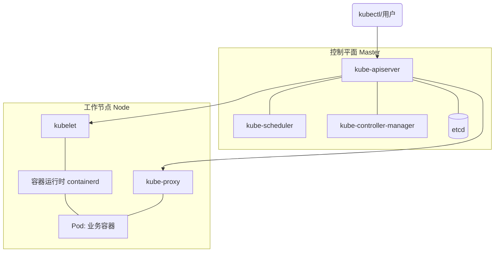
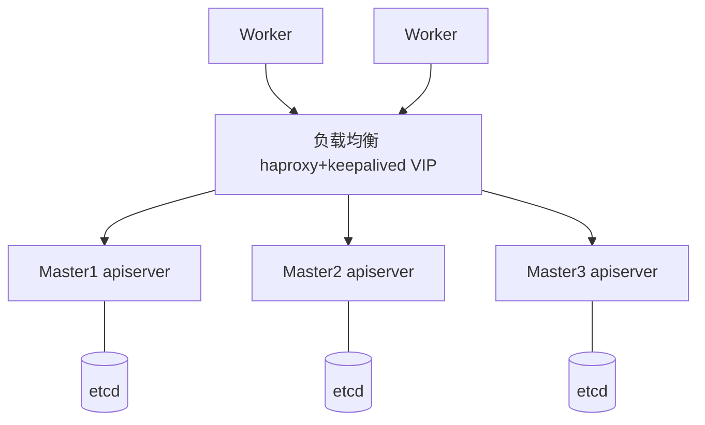

# K8s 01：架构与集群部署

::: tip 本篇定位
理解 Kubernetes 架构与核心概念，能用 kubeadm 搭建高可用集群。
:::

> 下面已列好本文该有的章节，每节开头说明了要写什么，照着填即可。填完可删除这些灰色提示。

## 一、K8s 概述

### 1.1 为什么需要容器编排

单机 Docker 能解决"打包、环境一致"的问题，但当容器数量从几个变成几十上百个、分布在多台机器上时，手动管理会遇到一系列痛点：

- 容器挂了谁来重启？机器宕机了上面的服务怎么自动迁移？
- 一次发布要更新 50 个容器，怎么滚动更新、出问题怎么一键回滚？
- 流量进来怎么分发到多个后端？后端 IP 一直在变，调用方怎么找到它们？
- 高峰期怎么自动扩容、低峰怎么缩容？

**容器编排（Container Orchestration）** 就是来自动化解决这些问题的。Kubernetes（希腊语"舵手"，简称 K8s，K 和 s 之间有 8 个字母）是当前容器编排领域的事实标准。

### 1.2 K8s 的起源

Kubernetes 源于 Google 内部运行了十几年的集群管理系统 **Borg/Omega**，2014 年 Google 将其开源，2015 年捐赠给新成立的 **CNCF（云原生计算基金会）**。它用 Go 语言编写，一次声明"我期望的状态"，K8s 持续驱动实际状态向期望状态收敛（声明式 + 调谐循环 Reconciliation Loop）。

### 1.3 K8s 提供的核心能力

| 能力 | 说明 |
|---|---|
| 自动部署与回滚 | 滚动更新、灰度，异常自动回滚 |
| 服务发现与负载均衡 | 内置 DNS（CoreDNS），Service 提供稳定入口和负载分发 |
| 自愈 | 重新启动失败容器、替换/重新调度宕机节点上的 Pod |
| 水平扩缩容 | 命令/UI 或基于 CPU 等指标自动扩缩（HPA） |
| 存储编排 | 自动挂载本地存储、云盘、NFS、Ceph 等 |
| 配置与密钥管理 | ConfigMap / Secret，无需重新构建镜像即可更新配置 |
| 自动装箱 | 根据资源请求和约束自动调度容器，提高资源利用率 |

## 二、集群架构

Kubernetes 是一个分布式集群，节点分为**控制平面（Control Plane / Master）**和**工作节点（Worker Node）**。



### 2.1 控制平面组件

| 组件 | 职责 |
|---|---|
| **kube-apiserver** | 集群唯一入口，提供 REST API，负责认证、授权、校验；**所有组件都通过它交互**；本身无状态，集群数据存 etcd |
| **kube-scheduler** | 监听未调度的 Pod，经过"过滤（Filter）+ 打分（Rank）"两阶段为 Pod 选择最合适的节点 |
| **kube-controller-manager** | 运行众多控制器（节点控制器、副本控制器、端点控制器、服务账号控制器等），把实际状态调谐到期望状态 |
| **etcd** | 高可用 key-value 数据库，保存集群所有状态数据；建议奇数节点（3/5），生产需定期备份 |
| cloud-controller-manager | 与云厂商交互的控制器（节点、路由、负载均衡、存储），自建集群可无 |

::: tip 理解 watch 机制
apiserver 的 **watch** 是核心机制：scheduler、controller-manager、kubelet、kube-proxy 都通过 watch 长连接监听资源变更，一旦有变化立即收到推送并处理，而不是反复轮询。
:::

### 2.2 工作节点组件

| 组件 | 职责 |
|---|---|
| **kubelet** | 节点上的代理，接收 Pod 定义，通过容器运行时启动/监控容器，上报节点和 Pod 状态、执行健康检查 |
| **kube-proxy** | 维护节点网络规则，把对 Service 的访问转发到后端 Pod；支持 iptables / IPVS 模式（IPVS 适合大规模） |
| **容器运行时** | 真正运行容器的软件，K8s 通过 **CRI（容器运行时接口）** 调用；当前默认/推荐 **containerd**，也可用 CRI-O |

### 2.3 三个标准接口

- **CRI**（Container Runtime Interface）：kubelet ↔ 容器运行时
- **CNI**（Container Network Interface）：网络插件为 Pod 提供网络
- **CSI**（Container Storage Interface）：存储插件提供存储

## 三、核心概念

| 概念 | 说明 |
|---|---|
| **Pod** | 最小部署单元，一个或多个共享网络/存储的容器集合；内容器共享 IP 和存储卷 |
| **Node** | 工作机器（物理机/虚拟机），运行 Pod |
| **Namespace** | 资源的逻辑隔离分区（如 default、kube-system） |
| **Label / Selector** | 标签键值对 + 标签选择器，用于筛选和关联资源（Service 靠它找 Pod） |
| **工作负载** | Deployment（无状态）、StatefulSet（有状态）、DaemonSet（每节点一个）、Job/CronJob（批处理） |
| **Service** | 为一组 Pod 提供稳定 IP/DNS 和负载均衡的入口 |
| **ConfigMap / Secret** | 配置 / 敏感信息 |
| **PV / PVC** | 持久化存储卷 / 存储申领 |
| **Ingress** | 七层路由，把外部 HTTP/HTTPS 流量按域名/路径转发到 Service |

> Pod 是临时的、IP 会变，所以不直接访问 Pod，而是通过 Service / Ingress 访问。

## 四、部署方案

### 4.1 常见部署方式对比

| 方式 | 特点 | 适用 |
|---|---|---|
| **kubeadm** | 官方工具，简单快速，证书/组件自动配置，已可用于生产 | 自建集群首选、学习 |
| **二进制部署** | 手动部署每个组件、手动签发证书，过程繁琐、可控性最强 | 生产、深入理解底层 |
| **托管集群** | 云厂商托管 Master（EKS、ACK、GKE），免维护控制平面 | 云上生产 |
| minikube / kind | 单机/容器化快速起集群 | 本地学习、测试 |
| Sealos / Kubekey / Kubesphere | kubeadm 的二次封装，图形化/一条命令 | 快速交付、多集群 |

### 4.2 高可用拓扑

生产高可用需要**多个 Master + 一个负载均衡（LB）**，etcd 有两种放置方式：

- **Stacked etcd（堆叠）**：etcd 与控制平面组件同机，部署简单，kubeadm 常用；
- **External etcd（外部）**：etcd 独立成集群，故障域分离，架构更复杂。



## 五、环境准备

### 5.1 主机规划示例

| IP | 主机名 | 角色 |
|---|---|---|
| 10.0.0.100 | kubeapi（VIP） | apiserver 统一入口 |
| 10.0.0.101~103 | master1~3 | 控制平面 + etcd |
| 10.0.0.104~106 | node1~3 | 工作节点 |

网段规划：Pod 网段 `10.244.0.0/16`，Service 网段 `10.96.0.0/12`。

::: warning 最低资源
Master 至少 **2 核 2G**，否则初始化报错：`[ERROR Mem]: the system RAM is less than the minimum 1700 MB`。
:::

### 5.2 系统初始化（所有节点）

```bash
# 主机名与 hosts 解析
hostnamectl set-hostname master1
cat >> /etc/hosts <<'EOF'
10.0.0.101 master1
10.0.0.102 master2
10.0.0.103 master3
10.0.0.104 node1
10.0.0.105 node2
10.0.0.106 node3
EOF

# 时间同步
apt install -y chrony && systemctl enable --now chrony     # Ubuntu
timedatectl set-timezone Asia/Shanghai

# 关闭 swap（K8s 要求可预测的资源控制）
swapoff -a
sed -ri 's/.*swap.*/#&/' /etc/fstab

# 关闭 SELinux（RHEL 系）
setenforce 0
sed -ri 's/^(SELINUX=).*/\1disabled/' /etc/selinux/config

# 关闭防火墙（或精确放行所需端口）
systemctl disable --now firewalld      # RHEL 系；Ubuntu: ufw disable
```

### 5.3 内核参数与模块

```bash
cat <<EOF | tee /etc/modules-load.d/k8s.conf
overlay
br_netfilter
EOF
modprobe overlay && modprobe br_netfilter

cat <<EOF | tee /etc/sysctl.d/k8s.conf
net.bridge.bridge-nf-call-iptables  = 1
net.bridge.bridge-nf-call-ip6tables = 1
net.ipv4.ip_forward                 = 1
EOF
sysctl --system
```

### 5.4 安装容器运行时 containerd

```bash
apt install -y containerd
# 生成默认配置
mkdir -p /etc/containerd
containerd config default | tee /etc/containerd/config.toml
```

两处关键修改（见 5.5）：

```bash
# 1) 把 pause 沙箱镜像改成国内可拉取地址
sed -ri 's#registry.k8s.io/pause:.*#registry.aliyuncs.com/google_containers/pause:3.9#' /etc/containerd/config.toml
# 2) 使用 systemd cgroup 驱动（与 kubelet 保持一致）
sed -ri 's/SystemdCgroup = false/SystemdCgroup = true/' /etc/containerd/config.toml

systemctl restart containerd && systemctl enable containerd
```

### 5.5 安装 kubeadm / kubelet / kubectl

```bash
# 配置阿里云 Kubernetes 源（Ubuntu/Debian）
apt install -y apt-transport-https ca-certificates curl gpg
K8S_VERSION=v1.30
curl -fsSL https://mirrors.aliyun.com/kubernetes-new/core/stable/$K8S_VERSION/deb/Release.key \
  | gpg --dearmor -o /etc/apt/keyrings/kubernetes-apt-keyring.gpg
echo "deb [signed-by=/etc/apt/keyrings/kubernetes-apt-keyring.gpg] https://mirrors.aliyun.com/kubernetes-new/core/stable/$K8S_VERSION/deb/ /" \
  | tee /etc/apt/sources.list.d/kubernetes.list
apt update
apt install -y kubelet kubeadm kubectl
apt-mark hold kubelet kubeadm kubectl        # 锁定版本，防止误升级
systemctl enable kubelet
```

> 此时 kubelet 会反复重启并报错是**正常现象**，因为还没有 kubeconfig（等 kubeadm init 后生成）。

## 六、kubeadm 部署集群

### 6.1 预拉取镜像（master）

```bash
# 查看需要哪些镜像（默认从 registry.k8s.io，国内改走阿里云）
kubeadm config images list \
  --image-repository registry.aliyuncs.com/google_containers \
  --kubernetes-version v1.30.0
# 提前拉取
kubeadm config images pull \
  --image-repository registry.aliyuncs.com/google_containers \
  --kubernetes-version v1.30.0 \
  --cri-socket=unix:///run/containerd/containerd.sock
```

### 6.2 初始化第一个 Master

```bash
kubeadm init \
  --apiserver-advertise-address=10.0.0.101 \
  --control-plane-endpoint "10.0.0.100:6443" \
  --kubernetes-version v1.30.0 \
  --pod-network-cidr=10.244.0.0/16 \
  --service-cidr=10.96.0.0/12 \
  --image-repository registry.aliyuncs.com/google_containers \
  --cri-socket=unix:///run/containerd/containerd.sock \
  --upload-certs
```

> 单 Master（无 LB）时去掉 `--control-plane-endpoint`。输出末尾会给出两条命令：worker 的 `kubeadm join` 和（多 Master 时）控制平面的 join，注意保存。

初始化成功后配置 kubectl：

```bash
mkdir -p $HOME/.kube
cp -i /etc/kubernetes/admin.conf $HOME/.kube/config
chown $(id -u):(id -g) $HOME/.kube/config
kubectl get nodes        # 此时是 NotReady，因为还没装网络插件
```

### 6.3 安装网络插件（CNI）

以 Calico 为例（也可用 Flannel）：

```bash
# 下载 Calico manifest（可从文档或镜像站获取）
curl -LO https://raw.githubusercontent.com/projectcalico/calico/v3.27.0/manifests/calico.yaml
# 若使用自定义 podCIDR，确认 calico 配置中的 CIDR 与 --pod-network-cidr 一致
kubectl apply -f calico.yaml
# 等待 Calico Pod Running
kubectl get pods -n kube-system -l k8s-app=calico-node
```

> Flannel 更轻量：`kubectl apply -f https://raw.githubusercontent.com/flannel-io/flannel/master/Documentation/kube-flannel.yml`，并确保 init 时 podCIDR 为 `10.244.0.0/16`。

### 6.4 Worker 节点加入

在每个 node 上执行 init 输出的 join 命令：

```bash
kubeadm join 10.0.0.100:6443 \
  --token xxxxx \
  --discovery-token-ca-cert-hash sha256:xxxxx \
  --cri-socket=unix:///run/containerd/containerd.sock
```

Token 默认 24 小时过期，master 上可重新生成：

```bash
kubeadm token create --print-join-command
```

## 七、高可用（多 Master）

### 7.1 部署负载均衡

在两台 LB 主机（ha1/ha2）上用 **haproxy（四层转发）+ keepalived（VIP 漂移）**，也可用 nginx stream。haproxy 关键配置：

```text
frontend k8s-api
  bind 10.0.0.100:6443
  mode tcp
  default_backend k8s-masters
backend k8s-masters
  mode tcp
  server master1 10.0.0.101:6443 check inter 3s fall 3 rise 3
  server master2 10.0.0.102:6443 check inter 3s fall 3 rise 3
  server master3 10.0.0.103:6443 check inter 3s fall 3 rise 3
```

keepalived 通过 VRRP 在 ha1/ha2 间维护 VIP `10.0.0.100`，主节点 priority 100、备节点 80。

### 7.2 加入其余 Master

第一个 master init 带 `--upload-certs` 后，在 master2/3 执行控制平面 join（带 `--control-plane --certificate-key`）：

```bash
kubeadm join 10.0.0.100:6443 \
  --token xxxx --discovery-token-ca-cert-hash sha256:xxxx \
  --control-plane --certificate-key xxxx \
  --cri-socket=unix:///run/containerd/containerd.sock
```

若证书 key（约 2 小时）过期，可在 master1 重新生成：`kubeadm init phase upload-certs --upload-certs`。

## 八、验证

```bash
kubectl get nodes                       # 全部 Ready
kubectl get cs                          # scheduler/controller-manager/etcd Healthy
kubectl cluster-info                    # 控制平面与 CoreDNS 地址
kubectl get pods -A                     # 系统组件均 Running
```

创建测试应用验证网络与发布：

```bash
kubectl create deployment nginx --image=nginx:1.27 --replicas=3
kubectl expose deployment nginx --port=80 --type=NodePort
kubectl get svc,pod -o wide
```

### 常见问题

| 现象 | 排查方向 |
|---|---|
| 节点一直 NotReady | `kubectl describe node`，多为 CNI 未装/未就绪 |
| kubelet 起不来，cgroup driver 不一致 | containerd 设 SystemdCgroup=true，与 kubelet 一致 |
| scheduler/controller-manager Unhealthy | 多为旧版组件健康检查端口问题，检查静态 Pod manifest |
| 拉镜像超时/ImagePullBackOff | 配 image-repository、确认节点 containerd 可访问镜像源 |
| init 失败重来 | `kubeadm reset -f`，清理 `/etc/cni/net.d`、`~/.kube` 后重做 |

## 面试自测

1. K8s 控制平面有哪些组件？各自职责是什么？
2. 为什么说 apiserver 是集群唯一入口？watch 机制解决什么问题？
3. kube-proxy 的 iptables 和 IPVS 模式有什么区别？
4. Pod 和容器是什么关系？为什么不直接管理容器？
5. K8s 高可用怎么做？stacked 和 external etcd 有何区别？
6. kubeadm 部署一个集群的完整步骤是什么？
7. CRI/CNI/CSI 分别是什么？
8. kubelet 的作用是什么？它和 kube-proxy 有什么不同？
9. 为什么 K8s 要求关闭 swap？
10. 一个 Pod 从创建到被调度、启动经过哪些组件？

## 相关速查

- [kubectl 命令速查](/reference/kubectl-commands)
- Kubernetes 官方文档：https://kubernetes.io/zh-cn/docs/home/
- kubeadm 安装：https://kubernetes.io/zh-cn/docs/setup/production-environment/tools/kubeadm/
- 集群组件：https://kubernetes.io/zh-cn/docs/concepts/overview/components/
- Calico：https://docs.tigera.io/calico/latest/about/
- containerd：https://github.com/containerd/containerd/blob/main/docs/getting-started.md
