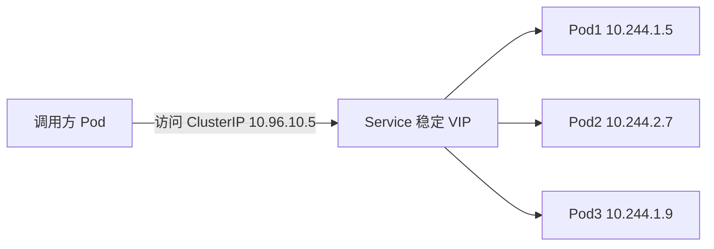
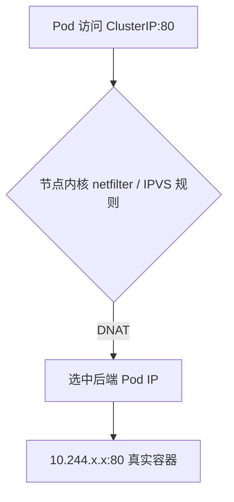

# K8s 02：Pod 管理与服务发现

::: tip 本篇定位
理解 Pod 这个最小调度单元的结构与生命周期，掌握 Deployment 等工作负载控制器，最终搞懂 Service 与 CoreDNS 是如何让 Pod 之间互相找到的。全程沿用 01 篇规划的集群：K8s **v1.30**，Pod 网段 `10.244.0.0/16`，Service 网段 `10.96.0.0/12`。
:::

## 一、Pod 详解

### 1.1 小白类比：Pod 就是"一合租屋"

直接用 Docker 跑容器时，我们一个容器跑一个进程。但 K8s 不直接管容器，而是管 **Pod**。为什么多包一层？

你可以把 Pod 想象成**一间合租屋**：

- 屋子里住着一个或几个**室友（容器）**；
- 全屋共用一个**门牌号（IP 地址）**，室友之间用 `localhost` 互相串门；
- 屋里有**共用的储物柜（Volume）**，所有室友都能往里放东西；
- 屋子是一个整体，被当作"最小出租/调度单位"整体分配给某台机器。

K8s 不直接调度单个容器，是因为现实中常有这种场景：主业务容器需要一个"跟班"容器配合干活（比如把日志持续转发走）。把它们放进同一个 Pod，共享网络和存储，就天然配好了对。

### 1.2 Pod 的结构

一个 Pod 里的多个容器：

- **共享同一个网络命名空间**：同一 IP、同一端口空间，容器间用 `localhost:端口` 通信；
- **共享存储卷（Volume）**：可以挂同一个 Volume 到不同容器的不同路径；
- 但**文件系统默认隔离**：不挂 Volume 的话，各容器有各自根文件系统。

最常见的是**单容器 Pod**（一个屋子住一个人），多容器 Pod 用于 **sidecar（边车）** 模式。

### 1.3 多容器 Pod 与 sidecar

sidecar 就是"跟班室友"：主容器专心干业务，sidecar 帮忙做辅助工作。典型例子：主容器只把日志写到共享目录，sidecar 容器（如 fluent-bit/filebeat）挂载同一目录，负责把日志采集发走。

```yaml
# pod-sidecar-demo.yaml
apiVersion: v1
kind: Pod
metadata:
  name: web-with-logger
  labels:
    app: web
spec:
  containers:
    - name: web                        # 主容器：用 nginx 输出页面
      image: nginx:1.27
      ports:
        - containerPort: 80
      volumeMounts:
        - name: logvol
          mountPath: /var/log/nginx      # nginx 日志写到这里
    - name: logshipper                 # sidecar：把日志 tail 出来
      image: busybox:1.36
      args: [/bin/sh, -c, 'tail -f /var/log/nginx/access.log']
      volumeMounts:
        - name: logvol
          mountPath: /var/log/nginx      # 同一个卷，看到同一份文件
  volumes:
    - name: logvol
      emptyDir: {}                     # 两个容器共享的临时卷
```

```bash
kubectl apply -f pod-sidecar-demo.yaml
kubectl get pod web-with-logger
# NAME              READY   STATUS    RESTTS   AGE
# web-with-logger   2/2     Running   0        30s     ← 2/2 表示两个容器都 Ready
```

::: warning 不要滥用多容器
只有"两个进程必须共享网络或存储、且生命周期必须绑在一起"时才放一个 Pod。普通的"调用另一个微服务"应该是两个独立 Pod + Service 通信，而不是塞进一个 Pod。
:::

### 1.4 Pod 生命周期与阶段（Phase）

Pod 从生到死会经历下面几个阶段，这是排障时 `kubectl get pod` 最右一列 `STATUS` 显示的值：

| Phase | 含义 | 你该关注什么 |
|---|---|---|
| **Pending** | 已被 apiserver 接受，但还没全部容器跑起来：可能在等调度、拉镜像、挂卷 | 为什么没调度上？describe 看 events |
| **Running** | Pod 已绑定到节点，所有容器已创建，至少一个在运行 | 正常运行中 |
| **Succeeded** | 所有容器都成功退出且不再重启（退出码 0） | Job 类任务正常结束 |
| **Failed** | 所有容器都退出了，至少一个失败（非 0 退出） | 看 logs / describe 找崩溃原因 |
| **Unknown** |  apiserver 拿不到该 Pod 状态（通常是节点失联） | 检查节点 kubelet |

注意：**Phase 是粗粒度概括**。一个 Running 的 Pod 里容器也可能已经崩了很多次（看 `RESTARTS` 列），所以还要结合容器状态 `Waiting / Running / Terminated` 和探针看。

### 1.5 重启策略 restartPolicy

Pod 挂了要不要自动拉起来？由 `restartPolicy` 控制，**它作用于 Pod 内所有容器**：

| 策略 | 行为 | 典型使用者 |
|---|---|---|
| **Always**（默认） | 容器退出就重启，不管成功失败 | 长期运行的服务（Deployment 等默认） |
| **OnFailure** | 只有非 0 退出才重启；成功退出（0）不重启 | 批处理 Job |
| **Never** | 永不自动重启，退出就退出 | 一次性调试任务 |

```yaml
spec:
  restartPolicy: OnFailure     # 放在 Pod 级，不在容器级
```

### 1.6 探针（Probe）：kubelet 的健康检查

光"进程活着"不等于"服务可用"——可能死锁了、可能依赖的后端挂了。K8s 让 kubelet 定期探测容器，就是**探针**。三种探针：

| 探针 | 作用 | 失败后动作 | 小白类比 |
|---|---|---|---|
| **livenessProbe**（存活） | 容器是否还在正常工作 | 失败就按 restartPolicy **重启容器** | 测脉搏，没心跳就抢救（重启） |
| **readinessProbe**（就绪） | 容器是否已准备好接流量 | 失败就把 Pod 从 Service 端点**摘掉**，不打流量 | 问"你上班了吗"，没到岗就别派活 |
| **startupProbe**（启动） | 慢启动应用是否起来了 | 启动成功前**暂停**另两个探针，避免慢启动被误杀 | 给刚开工的新人一段宽限期 |

每种探针都支持三种探测方式：`httpGet`（HTTP 状态码 ≥200 <400 算成功）、`tcpSocket`（能连上端口就算成功）、`exec`（容器内跑命令，退出码 0 算成功）。

```yaml
# pod-probe-demo.yaml
apiVersion: v1
kind: Pod
metadata:
  name: nginx-probe
  labels:
    app: nginx
spec:
  containers:
    - name: nginx
      image: nginx:1.27
      ports:
        - containerPort: 80
      # 启动探针：给慢启动应用宽限，成功前不做存活/就绪检查
      startupProbe:
        httpGet:
          path: /
          port: 80
        failureThreshold: 30          # 最多允许失败 30 次
        periodSeconds: 10             # 每 10 秒探一次 → 最长等 300 秒
      # 存活探针：连续失败 3 次就重启
      livenessProbe:
        httpGet:
          path: /healthz
          port: 80
        initialDelaySeconds: 5        # 启动后等 5 秒再开始探
        periodSeconds: 10
        failureThreshold: 3
      # 就绪探针：失败就摘流量，直到恢复
      readinessProbe:
        httpGet:
          path: /
          port: 80
        periodSeconds: 5
        failureThreshold: 3
```

```bash
kubectl apply -f pod-probe-demo.yaml
kubectl describe pod nginx-probe | grep -A5 Events
# Events 里能看到 Liveness/Readiness probe 成功与否
```

::: warning 探针配错会反复重启
`initialDelaySeconds` 太短、或 liveness 的检查路径要依赖还没起来的后端，会导致容器"探活失败→被重启→还没起来又探活失败"，陷入 **CrashLoopBackOff**。慢启动应用务必配 `startupProbe` 兜底宽限期。
:::

## 二、资源管理

### 2.1 小白类比：requests 和 limits 是"饭量约定"

一个节点 16G 内存，上面跑 10 个 Pod，每个 Pod 都说自己"只吃一点点"，结果高峰期每个都吃到 3G，节点直接 OOM。K8s 需要 Pod 提前申报：

- **requests（申请量）**：我"保底"要这么多资源。调度器按 requests 挑节点——节点剩余可用资源 ≥ Pod 的 requests 才肯放上去。相当于"我至少要一个工位"。
- **limits（上限）**：我最多只能吃这么多。超过 CPU limit 会被**限流（throttle）**，超过内存 limit 会被**OOM 杀掉（OOMKilled）**。相当于"我吃饭有上限，吃超了就被请出去"。

### 2.2 完整示例

```yaml
# pod-resource-demo.yaml
apiVersion: v1
kind: Pod
metadata:
  name: demo-resource
spec:
  containers:
    - name: app
      image: nginx:1.27
      resources:
        requests:               # 调度依据
          cpu: "100m"           # 0.1 核 = 100 毫核(millicore)
          memory: "128Mi"
        limits:                 # 硬上限
          cpu: "500m"           # 最多用 0.5 核
          memory: "256Mi"
```

单位说明：

- CPU：`1` = 1 个逻辑核；也可用毫核 `m`，`1000m = 1`。
- 内存：`Mi`（MiB，1024²）、`Gi`（GiB）；注意 `M`/`G` 是 1000 进制，K8s 内存一般用 `Mi/Gi`。

```bash
kubectl top pod demo-resource          # 需先装 metrics-server，看实际用量
# NAME            CPU(cores)   MEMORY(bytes)
# demo-resource   2m           12Mi
```

### 2.3 QoS 三类：K8s 怎么决定先杀谁

节点资源不够要**驱逐（evict）**Pod 时，K8s 按 Pod 的 requests/limits 自动分三个**服务质量等级（QoS Class）**，等级越低越先被杀：

| QoS 等级 | 判定条件 | 被驱逐优先级 |
|---|---|---|
**Guaranteed（最佳）** | 每个容器都**同时**设了 requests 和 limits，且 CPU/内存的 requests == limits | 最后被杀（最稳） |
| **Burstable（大多数）** | 设了部分 requests/limits，但没到 Guaranteed 标准 | 中间 |
| **BestEffort（最易被杀）** | **完全没设** requests 和 limits | 最先被杀 |

::: warning 生产红线
核心服务一定要设 requests，并尽量设成 Guaranteed（requests == limits）。不设任何限制的 BestEffort Pod 在节点压力时会被第一批牺牲掉。
:::

## 三、Deployment

### 3.1 小白类比：Deployment 是"副本包工头"

你不会一个一个 `kubectl run` 去手管 10 个 nginx 容器——机器挂了谁帮你补？更新版本怎么平滑？这就是 **Deployment** 干的事：你声明"我要 nginx 1.27 跑 3 个副本"，Deployment 负责始终维持这个数量，挂了补、要更新就滚动替换。

它内部是层层嵌套的控制器关系：

```
Deployment  →  ReplicaSet  →  Pod
( desired 3 副本)  (保证副本数)  (真正跑容器)
```

- **Deployment**：管理 ReplicaSet，负责滚动更新、回滚；
- **ReplicaSet**：保证某一版本的 Pod 副本数始终正确；
- 更新时 Deployment 会**新建一个 ReplicaSet**，逐步把旧 RS 副本数降到 0、新 RS 升到目标值。

### 3.2 完整 nginx Deployment YAML

```yaml
# deployment-nginx.yaml
apiVersion: apps/v1
kind: Deployment
metadata:
  name: nginx
  labels:
    app: nginx
spec:
  replicas: 3                          # 期望 3 个副本
  selector:                            # 必须与 template 里的标签匹配
    matchLabels:
      app: nginx
  strategy:                            # 滚动更新策略
    type: RollingUpdate
    rollingUpdate:
      maxSurge: 25%                    # 更新时最多比期望数多起几个
      maxUnavailable: 25%              # 更新时最多允许几个不可用
  template:                            # Pod 模板
    metadata:
      labels:
        app: nginx
    spec:
      containers:
        - name: nginx
          image: nginx:1.27
          ports:
            - containerPort: 80
          resources:
            requests:
              cpu: "100m"
              memory: "128Mi"
            limits:
              cpu: "500m"
              memory: "256Mi"
          readinessProbe:               # 就绪才接流量
            httpGet:
              path: /
              port: 80
            periodSeconds: 5
```

### 3.3 常用 kubectl 命令

```bash
kubectl apply -f deployment-nginx.yaml

# 看 Deployment / ReplicaSet / Pod 关系
kubectl get deploy,rs,pod -l app=nginx -o wide
# NAME                    READY   UP-TO-DATE   AVAILABLE   AGE
# deployment.apps/nginx   3/3     3            3           2m
#
# NAME                               DESIRED   CURRENT   READY   AGE
# replicaset.apps/nginx-xxxx         3         3         3       2m

# 扩缩容：从 3 个扩到 5 个
kubectl scale deployment nginx --replicas=5

# 改镜像触发滚动更新（比如升到 1.28）
kubectl set image deployment/nginx nginx=nginx:1.28

# 查看滚动更新进度
kubectl rollout status deployment/nginx
# Waiting for deployment "nginx" rollout to finish: 2 out of 3 new replicas...

# 查看历史版本（revision）
kubectl rollout history deployment/nginx

# 回滚：回到上一版
kubectl rollout undo deployment/nginx
# 回滚到指定版本
kubectl rollout undo deployment/nginx --to-revision=1

# 暂停/继续发布（分批发布时用）
kubectl rollout pause deployment/nginx
kubectl rollout resume deployment/nginx
```

### 3.4 maxSurge 与 maxUnavailable 怎么理解

以 3 副本、`maxSurge=25%`、`maxUnavailable=25%` 为例（向上取整后 surge≈1、unavailable≈1）：

- 更新时最多同时存在 `3 + 1 = 4` 个 Pod（多起 1 个新的）；
- 同一时刻最多允许 1 个 Pod 不可用；
- 于是过程是"起一个新的 → 等它就绪 → 停一个旧的 → 循环"，全程业务不中断。

::: tip 想一次性全量替换
把 `strategy.type` 设为 `Recreate`：先把旧 Pod 全部删光再起新的。**会有业务中断**，只适合不能双版本并存的有状态应用。
:::

## 四、其他控制器

Deployment 管"无状态、副本可任意替换"的服务。还有四种常用控制器，各管一类场景：

| 控制器 | 一句话场景 | 副本特点 |
|---|---|---|
| **DaemonSet** | 每个（符合条件的）节点上**固定跑一个** Pod | 节点加一个就自动多一个 |
| **StatefulSet** | **有状态**应用（数据库、集群），需要稳定网络名/稳定存储 | 每个 Pod 有固定序号、独立 PVC |
| **Job** | 跑**一次性任务**，成功结束就退出 | 跑成功即完成，可重试 |
| **CronJob** | **定时任务**，像 crontab 一样周期触发 Job | 按时间表跑 |

### 4.1 DaemonSet 示例

典型用途：日志采集（fluent-bit）、节点监控（node-exporter）、CNI 网络插件——每台机器都要有一个。

```yaml
# daemonset-node-exporter.yaml
apiVersion: apps/v1
kind: DaemonSet
metadata:
  name: node-exporter
  namespace: kube-system
spec:
  selector:
    matchLabels:
      app: node-exporter
  template:
    metadata:
      labels:
        app: node-exporter
    spec:
      containers:
        - name: node-exporter
          image: prom/node-exporter:v1.8.1
          ports:
            - containerPort: 9100
              hostPort: 9100            # 直接用节点端口
```

```bash
kubectl get ds -n kube-system
# NAME            DESIRED   CURRENT   READY   ...   ← DESIRED 通常等于节点数
```

### 4.2 Job 示例

跑一个"算完就退"的任务，失败自动重试：

```yaml
# job-demo.yaml
apiVersion: batch/v1
kind: Job
metadata:
  name: hello
spec:
  completions: 3                 # 期望成功完成 3 次
  parallelism: 2                 # 并行 2 个
  backoffLimit: 4                # 失败最多重试 4 次
  template:
    spec:
      restartPolicy: OnFailure   # Job 必须用 OnFailure 或 Never
      containers:
        - name: hello
          image: busybox:1.36
          command: ["sh", "-c", "echo hello from $(hostname); sleep 5"]
```

### 4.3 CronJob 示例

每天凌晨 2 点跑一次备份任务：

```yaml
# cronjob-backup.yaml
apiVersion: batch/v1
kind: CronJob
metadata:
  name: backup-db
spec:
  schedule: "0 2 * * *"          # 标准 crontab 格式：每天 02:00
  jobTemplate:
    spec:
      template:
        spec:
          restartPolicy: OnFailure
          containers:
            - name: backup
              image: busybox:1.36
              command: ["sh", "-c", "echo backup at $(date)"]
```

```bash
kubectl get cronjob
kubectl get job
kubectl create job --from=cronjob/backup-db manual-backup   # 手动触发一次
```

> StatefulSet 内容较多，放在 04 篇专门讲。

## 五、Label 与调度

### 5.1 Label 与 Selector：K8s 的"标签贴"

Label 是贴在资源上的**键值对小标签**（如 `app=nginx`、`env=prod`、`disk=ssd`）。它本身不做任何事，靠 **Selector（选择器）** 来筛选：Service 靠它挑后端 Pod、Deployment 靠它管自己的 Pod、调度靠它决定 Pod 上哪台机器。

```bash
# 给节点打标签
kubectl label node node1 disktype=ssd
kubectl label node node2 disktype=hdd

# 查看带标签的资源
kubectl get nodes -L disktype
# NAME     STATUS   ROLES    ...   DISKTYPE
# node1    Ready    worker   ...   ssd
# node2    Ready    worker   ...   hdd

# 按选择器筛选 Pod
kubectl get pods -l app=nginx
kubectl get pods -l 'app in (nginx, redis)'
```

### 5.2 nodeSelector：最简单的定向调度

想把"要 SSD 的应用"只调度到带 `disktype=ssd` 标签的节点：

```yaml
spec:
  nodeSelector:
    disktype: ssd          # Pod 只会被调到带这个标签的节点上
  containers:
    - name: app
      image: nginx:1.27
```

### 5.3 nodeAffinity：更灵活的调度偏好

`nodeSelector` 只能"必须等于某标签"。**节点亲和性（nodeAffinity）** 支持 `In / NotIn / Exists / Gt / Lt`，还分"硬性要求"和"软性偏好"：

```yaml
spec:
  affinity:
    nodeAffinity:
      requiredDuringSchedulingIgnoredDuringExecution:   # 硬要求：必须满足
        nodeSelectorTerms:
          - matchExpressions:
              - key: disktype
                operator: In
                values: ["ssd", "nvme"]
      preferredDuringSchedulingIgnoredDuringExecution:  # 软偏好：尽量满足
        - weight: 100
          preference:
            matchExpressions:
              - key: zone
                operator: In
                values: ["az-a"]
```

`required` = 不满足就不调度（硬约束）；`preferred` = 尽量往这边排，排不上也接受。Pod 之间的亲和/反亲和（podAffinity/podAntiAffinity）在 04 篇调度进阶里展开。

## 六、Service 详解

### 6.1 小白类比：Service 是"前台接待台"

Pod 是临时工——随时会被重建、IP 随时变、还会有好几个副本。调用方如果直接记某个 Pod 的 IP，Pod 一挂就瞎了。**Service** 就是在这群 Pod 前面放一个**固定的前台接待台**：

- 它有一个**稳定的虚拟 IP（ClusterIP）**和稳定的名字，永远不变；
- 它通过 Label Selector 自动圈定"当前活着的后端 Pod"；
- 谁找我都行，我来负责把请求**负载均衡**转发给后面的某个 Pod。



### 6.2 四种 Service 类型

| 类型 | 作用范围 | 小白类比 | 典型用途 |
|---|---|---|---|
| **ClusterIP**（默认） | 集群内部虚拟 IP，**集群内才能访问** | 公司内部内线电话 | 微服务之间互调 |
| **NodePort** | 在每个节点上开一个固定端口（30000-32767），外部 `节点IP:NodePort` 可访问 | 前台门口装个公用电话，谁都能拨 | 测试/临时对外暴露 |
| **LoadBalancer** | 云上自动给一个外部负载均衡 IP | 直接配了个对外总机 | 云上生产对外服务 |
| **ExternalName** | 把 Service 做成一个 DNS CNAME，指向集群外域名 | 内线转接到外部合作方 | 把外部数据库包装成集群内服务名 |

### 6.3 完整示例

```yaml
# service-nginx.yaml
apiVersion: v1
kind: Service
metadata:
  name: nginx
spec:
  type: ClusterIP               # 默认；对外就改 NodePort / LoadBalancer
  selector:
    app: nginx                  # 圈定后端 Pod
  ports:
    - port: 80                  # Service 自己的端口（ClusterIP:80）
      targetPort: 80            # 转发到后端 Pod 的端口
      nodePort: 30080           # type=NodePort 时指定；不写则随机分
```

```bash
kubectl expose deployment nginx --port=80 --type=ClusterIP   # 命令行方式
kubectl get svc
# NAME         TYPE        CLUSTER-IP      EXTERNAL-IP   PORT(S)   AGE
# kubernetes   ClusterIP   10.96.0.1       <none>        443/TCP   1h
# nginx        ClusterIP   10.96.10.5      <none>        80/TCP    2m
```

**ExternalName 示例**（把集群外的 `db.example.com` 包装成集群内名字）：

```yaml
apiVersion: v1
kind: Service
metadata:
  name: mysql-external
spec:
  type: ExternalName
  externalName: db.example.com     # 实际是一条 CNAME
```

### 6.4 kube-proxy 转发原理

Service 的 ClusterIP 是个**虚拟 IP**——没有真正监听它的网卡。真正干活的是每个节点上的 **kube-proxy**。它 watch Service/Endpoint 变化，在节点上写一组**流量转发规则**，把发往 ClusterIP 的包 DNAT 改写到某个后端 Pod IP。

两种主流模式：

| 模式 | 原理 | 对比 |
|---|---|---|
| **iptables** | 在内核 netfilter 里写规则，按随机概率选后端 | 默认；规则是线性匹配，Service 上千后规则数暴涨、性能下降 |
| **IPVS** | 基于内核 LVS，用哈希表查后端 | 大规模集群推荐，转发性能高、支持多种负载均衡算法（rr/lc/sh） |



切到 IPVS 模式（kubeadm 集群）：编辑 `ConfigMap/kube-proxy`，把 `mode: ""` 改成 `mode: "ipvs"`，再重启 kube-proxy Pod：

```bash
kubectl get configmap kube-proxy -n kube-system -o yaml | \
  sed -i 's/mode: ""/mode: "ipvs"/' | kubectl apply -f -
kubectl rollout restart ds kube-proxy -n kube-system
```

## 七、服务发现

Service 给了稳定入口，那**调用方怎么知道这个 Service 的地址？** 两种方式。

### 7.1 环境变量（只对已存在的 Service 有效）

Pod 启动时，kubelet 会把当时**已经存在**的所有 Service 的 IP/端口以环境变量写进容器。问题明显：**顺序敏感**——先起的 Pod 看不到后建的 Service，所以生产基本不用它做发现。

```bash
kubectl exec -it nginx-xxxx -- env | grep -i NGINX
# NGINX_SERVICE_HOST=10.96.10.5
# NGINX_SERVICE_PORT=80
```

### 7.2 CoreDNS：推荐的服务发现方式

集群里跑着 **CoreDNS**（Deployment，在 `kube-system` 命名空间），它 watch 所有 Service，给每个 Service 自动生成一条 DNS 记录。容器的 `/etc/resolv.conf` 已被 kubelet 指向 CoreDNS，于是**直接用 Service 名字就能访问**。

完整域名（FQDN）格式：

```
<service名>.<namespace>.svc.cluster.local
```

实际调用时可以简写：

| 场景 | 写法 | 说明 |
|---|---|---|
| 同命名空间 | `nginx` 或 `nginx.default.svc.cluster.local` | 直接写 Service 名即可 |
| 跨命名空间 | `nginx.prod.svc.cluster.local` | 必须带上对方 namespace |

```bash
# 进入一个 Pod 里测 DNS 解析
kubectl exec -it nginx-xxxx -- nslookup nginx
# Server:   10.96.0.10          ← CoreDNS 的 ClusterIP
# Address 1: 10.96.0.10 kube-dns.kube-system.svc.cluster.local
# Name:     nginx.default.svc.cluster.local
# Address 1: 10.96.10.5         ← 解析到 Service 的 ClusterIP
```

::: tip ClusterIP 才是稳定的
DNS 名字解析出来的是 **Service 的 ClusterIP**（不是某个 Pod IP），所以无论后端 Pod 怎么重建，名字解析结果始终指向稳定入口。这就是"服务发现"的本质：**名字不变、后端随便换**。
:::

### 7.3 排错：Service 访问不通

```bash
# 1. Service 有没有后端端点（Endpoints）？最常见就是空的——标签没对上
kubectl get endpoints nginx
# NAME    ENDPOINTS           AGE
# nginx   10.244.1.5:80,...   2m     ← 空的话说明 selector 没选中任何 Pod

# 2. Service selector 选的标签和 Pod 标签一致吗？
kubectl get svc nginx -o wide
kubectl get pods --show-labels

# 3. 从 Pod 里实测
kubectl exec -it nginx-xxxx -- curl -s http://nginx
```

## 面试自测

1. Pod 和容器是什么关系？什么时候才该在一个 Pod 里放多个容器？
2. Pending、Running、Succeeded、Failed 分别代表什么？
3. livenessProbe 和 readinessProbe 有什么区别？startupProbe 解决什么问题？
4. requests 和 limits 有什么区别？Guaranteed / Burstable / BestEffort 怎么划分？
5. Deployment、ReplicaSet、Pod 三者是什么关系？滚动更新时发生了什么？
6. maxSurge 和 maxUnavailable 各控制什么？设成 100% 会怎样？
7. DaemonSet、Job、CronJob 分别用在什么场景？
8. ClusterIP、NodePort、LoadBalancer、ExternalName 有什么区别？
9. kube-proxy 的 iptables 和 IPVS 模式原理与区别？
10. CoreDNS 里 `nginx.prod.svc.cluster.local` 各段分别是什么含义？

## 相关速查

- [kubectl 命令速查](/reference/kubectl-commands)
- Kubernetes 官方文档：https://kubernetes.io/zh-cn/docs/home/
- Pod 概念：https://kubernetes.io/zh-cn/docs/concepts/workloads/pods/
- 探针配置：https://kubernetes.io/zh-cn/docs/tasks/configure-pod-container/configure-liveness-readiness-startup-probes/
- Deployment：https://kubernetes.io/zh-cn/docs/concepts/workloads/controllers/deployment/
- Service：https://kubernetes.io/zh-cn/docs/concepts/services-networking/service/
- 服务发现（CoreDNS）：https://kubernetes.io/zh-cn/docs/tasks/administer-cluster/dns-custom-nameservers/
