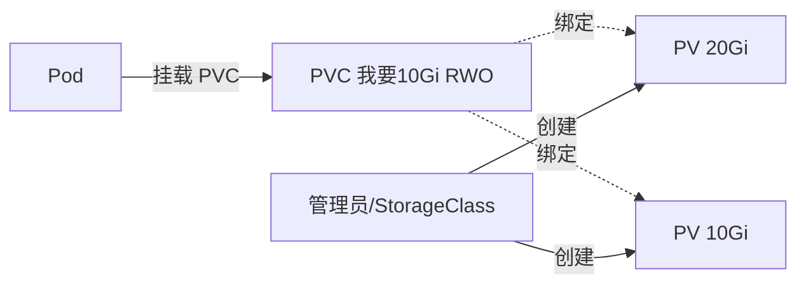
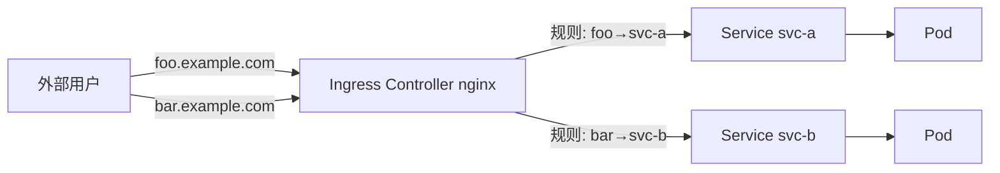

# K8s 03：存储与 Ingress

::: tip 本篇定位
掌握两类存储：临时卷（emptyDir/hostPath）与持久化卷（PV/PVC/StorageClass），以及配置管理（ConfigMap/Secret）；最后搞懂 Ingress 七层路由如何把外部 HTTP 流量按域名/路径引进集群。沿用 01 篇集群：K8s **v1.30**，Service 网段 `10.96.0.0/12`。
:::

## 一、配置管理：ConfigMap 与 Secret

### 1.1 小白类比：配置不该写死在镜像里

你把应用的数据库地址、日志级别打包进镜像，改一次配置就得重新构建镜像、重新发版——这很蠢。现实里，**程序和配置是分开的**：程序是"APP"，配置是"便签纸"，换环境只换便签，不动 APP。

K8s 用两个对象管"便签"：

- **ConfigMap（ConfigMap, CM）**：放**不敏感**的配置（配置文件、环境变量、URL）；
- **Secret**：放**敏感**信息（密码、Token、证书），数据 base64 编码（注意：只是编码不是加密，生产应配合加密 etcd、Vault 等）。

### 1.2 创建 ConfigMap

```bash
# 方式一：从字量键值创建
kubectl create configmap app-config \
  --from-literal=APP_ENV=prod \
  --from-literal=LOG_LEVEL=info

# 方式二：从整个文件创建（文件名成为 key，文件内容成为 value）
kubectl create configmap nginx-conf --from-file=./nginx.conf

# 方式三：从目录创建
kubectl create configmap app-config-dir --from-file=./config/

# 查看
kubectl get cm app-config -o yaml
```

### 1.3 创建 Secret

```bash
# 通用 Opaque 类型（自定义键值），字符串自动 base64
kubectl create secret generic db-secret \
  --from-literal=username=appuser \
  --from-literal=password='S3cr3tPwd!'

# Docker 镜像仓库拉取凭证
kubectl create secret docker-registry regcred \
  --docker-server=registry.example.com \
  --docker-username=bot \
  --docker-password=xxx

# TLS 证书（Ingress 用得到）
kubectl create secret tls my-tls --cert=./tls.crt --key=./tls.key

kubectl get secret db-secret -o yaml     # data 里是 base64，decode 才是明文
echo 'UzNjcjN0UHdkIQ==' | base64 -d      # 手动解 base64 验证
```

### 1.4 三种使用方式

**方式一：注入为环境变量**

```yaml
# cm-env-demo.yaml
apiVersion: v1
kind: Pod
metadata:
  name: env-demo
spec:
  containers:
    - name: app
      image: nginx:1.27
      env:
        - name: APP_ENV                    # 环境变量名
          valueFrom:
            configMapKeyRef:               # 从 ConfigMap 取
              name: app-config
              key: APP_ENV
        - name: DB_PASSWORD                # 从 Secret 取
          valueFrom:
            secretKeyRef:
              name: db-secret
              key: password
      envFrom:                             # 一次性把整个 ConfigMap 所有键都导入为环境变量
        - configMapRef:
            name: app-config
```

**方式二：挂载为文件（卷）**——最常用，适合放完整配置文件

```yaml
spec:
  containers:
    - name: app
      image: nginx:1.27
      volumeMounts:
        - name: config-vol
          mountPath: /etc/nginx/conf.d     # 整个 CM 挂成目录，每个 key 是一个文件
  volumes:
    - name: config-vol
      configMap:
        name: nginx-conf
```

挂载后容器里 `/etc/nginx/conf.d/` 下会出现以 key 命名的文件，内容就是配置。

### 1.5 ConfigMap 与 Secret 的区别

| 对比 | ConfigMap | Secret |
|---|---|---|
| 用途 | 非敏感配置 | 密码、Token、证书 |
| 存储 | 明文 etcd | base64 编码（etcd 仍可解码，不等于加密） |
| 体积 | 较大（单对象 ≤1MiB） | 较小，设计上放小块数据 |
| 挂载 | 相同卷机制 | 相同卷机制 |

::: warning 生产红线
Secret 的 base64 **不是加密**！任何能读 etcd 或该 Secret 的人都能 decode。生产必须开启 etcd 静态加密（EncryptionConfiguration），敏感数据优先用 Vault / KMS。另外，**修改已挂载的 ConfigMap 后，容器内文件会自动更新（约 1-2 分钟），但通过 env 注入的环境变量不会热更新**，需要重建 Pod。
:::

## 二、临时存储：emptyDir 与 hostPath

### 2.1 小白类比：屋子的桌面 vs 房东的桌子

- **emptyDir**：Pod 里所有容器共享的一张"临时桌面"。Pod 一被删除，桌面清空，数据**不持久**。主要用途就是 02 篇 sidecar 那种"两个容器临时交换文件"。
- **hostPath**：直接挂**宿主机上的某个目录**进容器。数据在节点磁盘上，Pod 重建后只要还调度回同一节点，数据还在——但一旦被调度到别的节点就没了。

### 2.2 emptyDir 示例

```yaml
spec:
  containers:
    - name: app
      image: nginx:1.27
      volumeMounts:
        - name: cache
          mountPath: /cache
  volumes:
    - name: cache
      emptyDir:
        medium: ""                 # 留空用节点磁盘；设 "Memory" 则用 tmpfs（内存盘）
        sizeLimit: 512Mi           # 空间上限
```

### 2.3 hostPath 示例

典型用途：监控类 Pod 要读宿主机数据，比如采集 `/var/log`、容器运行时目录。

```yaml
spec:
  containers:
    - name: collector
      image: nginx:1.27
      volumeMounts:
        - name: host-log
          mountPath: /host/var/log
          readOnly: true
  volumes:
    - name: host-log
      hostPath:
        path: /var/log             # 宿主机上的真实目录
        type: DirectoryOrCreate
```

::: warning hostPath 有风险
hostPath 直接暴露节点文件系统，跨节点迁移后数据丢失，且有安全风险（容器逃逸面变大）。**业务持久数据一律用 PV/PVC，不要用 hostPath。** hostPath 基本只给 DaemonSet 类节点代理用。
:::

> ConfigMap 也可以作为 Volume 挂载（见 1.4），K8s 还有 `projected` 卷能把多个 CM/Secret/ downwardAPI 聚合到同一目录，原理类似，都是"把配置当文件挂进去"。

## 三、PV / PVC：持久化存储

### 3.1 小白类比：租房三方关系

Pod 是"租客"，它根本不关心磁盘在哪、是 NFS 还是云盘。K8s 用三个对象把"存储的提供方和使用方"解耦：

- **PV（PersistentVolume，持久卷）**：管理员/系统**准备好的一块存储**，相当于"已经装修好的房源"；
- **PVC（PersistentVolumeClaim，存储申领）**：用户**提出的租房需求**（"我要 10Gi、能多人合租"）；
- K8s 自动把 PVC 和合适的 PV **绑定（Bind）**，Pod 挂这个 PVC 就能用。



### 3.2 PV、PVC 关键字段

**访问模式（accessModes）**：

| 模式 | 含义 |
|---|---|
| **RWO**（ReadWriteOnce） | 单节点可读写 |
| **ROX**（ReadOnlyMany） | 多节点只读 |
| **RWX**（ReadWriteMany） | 多节点可读写（NFS 这类共享存储才支持） |

**回收策略（persistentVolumeReclaimPolicy）**：PVC 删了之后 PV 怎么办？

| 策略 | 行为 |
|---|---|
| **Retain** | 保留数据，需管理员手动清理（最安全） |
| **Delete** | 连底层存储一起删（云盘、动态供给默认） |
| **Recycle** | 清空后可再用（已废弃） |

### 3.3 静态供给完整示例（NFS）

先手动准备一块 NFS PV，再写 PVC 申领。

```yaml
# pv-nfs.yaml
apiVersion: v1
kind: PersistentVolume
metadata:
  name: pv-nfs-1g
spec:
  capacity:
    storage: 1Gi
  accessModes:
    - ReadWriteMany              # NFS 支持多节点读写
  persistentVolumeReclaimPolicy: Retain
  nfs:                           # 后端是 NFS 服务器
    server: 10.0.0.110           # NFS 服务器地址
    path: /export/data1
```

```yaml
# pvc-nfs.yaml
apiVersion: v1
kind: PersistentVolumeClaim
metadata:
  name: pvc-nfs-1g
spec:
  accessModes:
    - ReadWriteMany
  resources:
    requests:
      storage: 1Gi               # 要 1Gi
```

Pod 挂载：

```yaml
# pod-pvc-demo.yaml
apiVersion: v1
kind: Pod
metadata:
  name: web-with-pvc
spec:
  containers:
    - name: web
      image: nginx:1.27
      volumeMounts:
        - name: data
          mountPath: /usr/share/nginx/html
  volumes:
    - name: data
      persistentVolumeClaim:
        claimName: pvc-nfs-1g     # 引用上面的 PVC
```

```bash
kubectl apply -f pv-nfs.yaml -f pvc-nfs.yaml -f pod-pvc-demo.yaml
kubectl get pv,pvc
# NAME                      CAPACITY   ACCESS MODES   STATUS   CLAIM
# pv/pv-nfs-1g              1Gi        RWX            Bound    default/pvc-nfs-1g
#
# NAME                         STATUS   VOLUME      CAPACITY   ...
# pvc/pvc-nfs-1g               Bound    pv-nfs-1g   1Gi
```

## 四、动态供给：StorageClass

### 4.1 小白类比：不想管理员手动备房源了

静态 PV 要管理员提前一块一块准备，很笨。**StorageClass（SC）** 就是"自动租房中介"：用户只提 PVC，中介（provisioner）**按需自动创建 PV、自动绑定**，这叫**动态供给（Dynamic Provisioning）**。

### 4.2 NFS provisioner 示例

自建集群常用 [nfs-subdir-external-provisioner](https://github.com/kubernetes-sigs/nfs-subdir-external-provisioner) 做动态供给（在 NFS 服务器上为每个 PVC 自动建子目录）。

先创建 provisioner 所需的 RBAC 与 Deployment（略，按官方 README 安装），核心是一个 StorageClass：

```yaml
# storageclass-nfs.yaml
apiVersion: storage.k8s.io/v1
kind: StorageClass
metadata:
  name: nfs-client
provisioner: k8s-sigs.io/nfs-subdir-external-provisioner   # 与 provisioner Deployment 里一致
parameters:
  archiveOnDelete: "false"        # PVC 删除时是否归档保留数据
reclaimPolicy: Delete             # 动态卷默认 Delete
volumeBindingMode: Immediate
```

PVC 里通过 `storageClassName` 指名用哪个 SC，剩下全自动：

```yaml
# pvc-dynamic.yaml
apiVersion: v1
kind: PersistentVolumeClaim
metadata:
  name: pvc-dynamic
spec:
  storageClassName: nfs-client     # 关键：交给 StorageClass 自动建 PV
  accessModes:
    - ReadWriteMany
  resources:
    requests:
      storage: 5Gi
```

```bash
kubectl apply -f storageclass-nfs.yaml -f pvc-dynamic.yaml
kubectl get sc,pvc
# NAME                        PROVISIONER                                    RECLAIM POLICY
# storageclass.storage.k8s.io/nfs-client   k8s-sigs.io/nfs-subdir-external-...   Delete
#
# NAME              STATUS   VOLUME       CAPACITY   ...
# pvc/pvc-dynamic   Bound    pvc-xxxx     5Gi        ← PV 自动被创建并绑定
```

::: tip 设默认 StorageClass
生产应把常用的 SC 标记为 default（`kubectl patch storageclass nfs-client -p '{"metadata": {"annotations":{"storageclass.kubernetes.io/is-default-class":"true"}}}'`），这样 PVC 不写 `storageClassName` 时也能自动供给。云盘等其他后端只是换 provisioner 和 parameters，流程完全一样。
:::

## 五、Ingress 原理

### 5.1 小白类比：Service 只能"内线"，Ingress 是"公司前台+按部门分机"

ClusterIP 只能集群内访问，NodePort 要开 30000+ 端口、每个服务一个端口，很乱。**Ingress** 是七层（HTTP/HTTPS）入口：它像公司前台，根据你"找哪个域名、哪个网址路径"，把你转交给对应的内部 Service。

但 Ingress 本身只是一份**规则说明书**（"foo.example.com 转给 svc-a，bar.example.com 转给 svc-b"）。真正干活的是 **Ingress Controller**（如 ingress-nginx），它 watch 这些规则，在节点上跑一个 Nginx/负载均衡器来真正转发流量。



- **Ingress**：路由规则资源（YAML）；
- **Ingress Controller**：真正执行转发的软件（必须单独部署）；
- **IngressClass**：一类 Controller 的名字标识，多套 Controller 时用它区分。

## 六、Ingress 资源：部署 ingress-nginx

### 6.1 安装 ingress-nginx Controller

官方推荐用官方 manifest 部署（v1.10 系列，以官网当前版本为准）：

```bash
# 官方 deployment（含 namespace、ServiceAccount、Deployment、Service 等）
kubectl apply -f \
  https://raw.githubusercontent.com/kubernetes/ingress-nginx/controller-v1.10.1/deploy/static/provider/cloud/deploy.yaml

# 等待 Controller Running
kubectl get pods -n ingress-nginx
# NAME                                        READY   STATUS
# ingress-nginx-controller-xxxx-yyyy         1/1     Running
```

::: details 自建集群用 NodePort 暴露
上面 cloud 版默认 LoadBalancer。自建无云 LB 时，把 Controller 的 Service 改成 `NodePort`，或宿主网络模式；学习环境直接 `kubectl edit svc -n ingress-nginx ingress-nginx-controller` 把 type 改为 NodePort，再用 `节点IP:30xxx` 访问。
:::

### 6.2 一个最基础的 Ingress

```yaml
# ingress-basic.yaml
apiVersion: networking.k8s.io/v1
kind: Ingress
metadata:
  name: web-ingress
  annotations:
    nginx.ingress.kubernetes.io/rewrite-target: /   # 重写路径，常用注解
spec:
  ingressClassName: nginx          # 指向 ingress-nginx Controller
  rules:
    - host: foo.example.com       # 哪个域名
      http:
        paths:
          - path: /               # 该域名下所有路径
            pathType: Prefix
            backend:
              service:
                name: nginx       # 转发到这个 Service
                port:
                  number: 80
```

```bash
kubectl apply -f ingress-basic.yaml
kubectl get ingress
# NAME          CLASS   HOSTS             ADDRESS     PORTS
# web-ingress   nginx   foo.example.com                80
```

> 本地测试时没有真实 DNS，可在 `/etc/hosts` 里写 `节点IP foo.example.com`，再 `curl http://foo.example.com` 验证。

## 七、实战：多站点路由与 HTTPS

### 7.1 多域名 + 多路径规则

一个 Ingress 里写多条规则，按域名和路径分流：

```yaml
# ingress-multi.yaml
apiVersion: networking.k8s.io/v1
kind: Ingress
metadata:
  name: multi-rules
  annotations:
    nginx.ingress.kubernetes.io/ssl-redirect: "true"   # 强制 HTTPS
spec:
  ingressClassName: nginx
  tls:                                   # TLS 配置
    - hosts:
        - shop.example.com
        - admin.example.com
      secretName: tls-secret             # 引用事先创建好的 TLS Secret
  rules:
    - host: shop.example.com
      http:
        paths:
          - path: /api                  # /api 转给后端 api 服务
            pathType: Prefix
            backend:
              service:
                name: api
                port:
                  number: 8080
          - path: /                     # 其余转给前端 web 服务
            pathType: Prefix
            backend:
              service:
                name: web
                port:
                  number: 80
    - host: admin.example.com
      http:
        paths:
          - path: /
            pathType: Prefix
            backend:
              service:
                name: admin
                port:
                  number: 80
```

先准备 TLS Secret（用自签证书测试）：

```bash
openssl req -x509 -nodes -days 365 -newkey rsa:2048 \
  -keyout tls.key -out tls.crt -subj "/CN=shop.example.com"
kubectl create secret tls tls-secret --cert=tls.crt --key=tls.key
kubectl apply -f ingress-multi.yaml
```

### 7.2 默认后端（Default Backend）

如果请求的域名/路径**没匹配到任何规则**，ingress-nginx 会把它转给 **默认后端**（通常是一个返回 404 的服务）。可以在 Ingress 里用 `defaultBackend` 自定义：

```yaml
spec:
  ingressClassName: nginx
  defaultBackend:                 # 没匹配上的流量都来这
    service:
      name: default-404
      port:
        number: 80
  rules:
    - host: shop.example.com
      http:
        paths:
          - path: /
            pathType: Prefix
            backend:
              service:
                name: web
                port:
                  number: 80
```

### 7.3 常用注解（Annotations）

ingress-nginx 靠 `metadata.annotations` 做精细化配置：

| 注解 | 作用 |
|---|---|
| `nginx.ingress.kubernetes.io/rewrite-target: /` | 路径重写 |
| `nginx.ingress.kubernetes.io/ssl-redirect: "true"` | HTTP 强制跳 HTTPS |
| `nginx.ingress.kubernetes.io/proxy-body-size: "50m"` | 允许上传 body 大小 |
| `nginx.ingress.kubernetes.io/rate-limit-connections: "10"` | 限流 |
| `nginx.ingress.kubernetes.io/auth-type: basic` | 开启基础认证 |

::: warning pathType 要写对
`pathType` 支持 `ImplementationSpecific`、`Prefix`、`Exact`。写错类型会导致路由匹配不符合预期（比如 `/app` 误匹配 `/apple`）。前缀路由用 `Prefix`，精确匹配用 `Exact`。
:::

## 面试自测

1. ConfigMap 和 Secret 有什么区别？Secret 加密了吗？
2. ConfigMap 挂载为文件后改了内容，Pod 里会自动更新吗？env 注入的呢？
3. PV、PVC、StorageClass 三者关系？什么是动态供给？
4. accessModes 的 RWO / ROX / RWX 区别？NFS 支持哪种？
5. PV 的回收策略 Retain 和 Delete 有什么区别？
6. Ingress 和 Service（NodePort/LoadBalancer）有什么区别？
7. Ingress 资源和 Ingress Controller 是什么关系？只写 Ingress YAML 为什么不通？
8. Ingress 怎么做 HTTPS？TLS 证书放在哪？
9. 什么是 Ingress 默认后端？
10. emptyDir 和 hostPath 有什么区别？业务持久数据该用哪个？

## 相关速查

- [kubectl 命令速查](/reference/kubectl-commands)
- Kubernetes 官方文档：https://kubernetes.io/zh-cn/docs/home/
- ConfigMap：https://kubernetes.io/zh-cn/docs/concepts/configuration/configmap/
- Secret：https://kubernetes.io/zh-cn/docs/concepts/configuration/secret/
- PV/PVC：https://kubernetes.io/zh-cn/docs/concepts/storage/persistent-volumes/
- StorageClass：https://kubernetes.io/zh-cn/docs/concepts/storage/storage-classes/
- Ingress：https://kubernetes.io/zh-cn/docs/concepts/services-networking/ingress/
- ingress-nginx 控制器：https://github.com/kubernetes/ingress-nginx
- nfs-subdir-external-provisioner：https://github.com/kubernetes-sigs/nfs-subdir-external-provisioner
