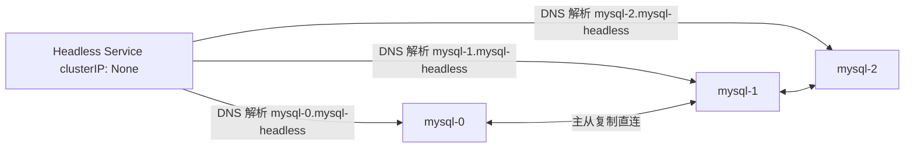

# K8s 04：有状态服务与安全

::: tip 本篇定位
掌握 StatefulSet 如何跑数据库这类有状态应用、Headless Service，搞懂 RBAC 授权与安全上下文，最后学会污点容忍、Pod 亲和与 HPA 自动扩缩容。沿用 01 篇集群：K8s **v1.30**。
:::

## 一、StatefulSet

### 1.1 小白类比：Deployment 是"临时工"，StatefulSet 是"固定工位的正式员工"

Deployment 管的 Pod 像临时工：大家一模一样，谁来都行，名字随机（`nginx-xxxx-yyyy`），谁挂了换个新的无所谓。但**数据库集群**不一样——每个节点有自己的身份和数据盘：MySQL 主从里，"主库"和"从库"不能随便互换；Redis 集群每个分片管不同的数据槽。这种"每个副本都有稳定身份、专属存储"的场景，就要用 **StatefulSet（有状态副本集）**。

StatefulSet 的 Pod 名字是**固定有序**的：`mysql-0`、`mysql-1`、`mysql-2`，删除重建后**名字不变、重新绑回原来的 PVC**，就像正式员工永远坐自己固定的工位、用自己专属的柜子。

### 1.2 StatefulSet 的三大特性

| 特性 | 说明 |
|---|---|
| **稳定的网络标识** | Pod DNS 名固定：`<pod名>.<headless-service>.<ns>.svc.cluster.local` |
| **有序部署/扩缩/更新** | 按 0→1→2 顺序建，逆序 2→1→0 删；默认逐个更新 |
| **稳定持久存储** | 通过 `volumeClaimTemplates` 为每个 Pod 自动建独立 PVC，重建后数据不丢 |

### 1.3 为什么需要 Headless Service

普通 Service 有个 ClusterIP，背后是一堆 Pod 的负载均衡入口。但有状态集群里，**节点之间要互相直连**（主库要能精确连到某个特定从库，而不是被负载均衡随机转到另一个）。**Headless Service**（`clusterIP: None`）不分配虚拟 IP，而是直接把 DNS 解析到每个 Pod 的真实 IP，于是 `mysql-0.mysql-headless` 永远解析到 `mysql-0` 这个 Pod。



## 二、有状态实战：以 MySQL 为例

下面是一个 StatefulSet 跑 3 个 MySQL 副本的骨架（生产 MySQL 集群还需半同步复制、Orchestrator 等，这里演示核心结构）。

### 2.1 Headless Service

```yaml
# mysql-headless-svc.yaml
apiVersion: v1
kind: Service
metadata:
  name: mysql-headless
  labels:
    app: mysql
spec:
  selector:
    app: mysql
  clusterIP: None               # 关键：Headless Service，不分配 ClusterIP
  ports:
    - port: 3306
      name: mysql
```

### 2.2 StatefulSet 完整 YAML

```yaml
# mysql-statefulset.yaml
apiVersion: apps/v1
kind: StatefulSet
metadata:
  name: mysql
spec:
  serviceName: mysql-headless          # 必须指定对应的 Headless Service
  replicas: 3
  selector:
    matchLabels:
      app: mysql
  updateStrategy:
    type: RollingUpdate               # 逐个逆序更新
  podManagementPolicy: OrderedReady    # 有序启动（也可改 Parallel 并行）
  template:
    metadata:
      labels:
        app: mysql
    spec:
      containers:
        - name: mysql
          image: mysql:8.4
          ports:
            - containerPort: 3306
              name: mysql
          env:
            - name: MYSQL_ROOT_PASSWORD
              valueFrom:
                secretKeyRef:
                  name: mysql-secret
                  key: root-password
          volumeMounts:
            - name: data
              mountPath: /var/lib/mysql   # 每个 Pod 挂自己那块独立盘
  volumeClaimTemplates:               # 关键：自动为每个 Pod 生成 PVC
    - metadata:
        name: data
      spec:
        accessModes: ["ReadWriteOnce"]
        storageClassName: nfs-client   # 用 03 篇建的 StorageClass
        resources:
          requests:
            storage: 10Gi
```

```bash
# 先建 Secret（StatefulSet 依赖它）
kubectl create secret generic mysql-secret \
  --from-literal=root-password='Root@123'

kubectl apply -f mysql-headless-svc.yaml -f mysql-statefulset.yaml

# 观察 Pod 是一个一个有序起来的
kubectl get pods -l app=mysql -w
# NAME      READY   STATUS
# mysql-0   1/1     Running     ← 先等 mysql-0 Ready 才起 mysql-1
# mysql-1   1/1     Running
# mysql-2   1/1     Running

# 每个 Pod 都自动拿到了独立 PVC
kubectl get pvc
# NAME           STATUS   VOLUME       CAPACITY
# data-mysql-0   Bound    pvc-xxxx1    10Gi
# data-mysql-1   Bound    pvc-xxxx2    10Gi
# data-mysql-2   Bound    pvc-xxxx3    10Gi
```

### 2.3 扩缩容与更新

```bash
# 扩容到 5 个：会自动起 mysql-3、mysql-4，并各建一块 PVC
kubectl scale statefulset mysql --replicas=5

# 缩容：逆序删，先删 mysql-4、mysql-3；默认缩容不会自动删 PVC（数据保留）
kubectl scale statefulset mysql --replicas=3

# 改镜像滚动更新
kubectl set image statefulset mysql mysql=mysql:8.4.3
kubectl rollout status statefulset mysql
```

::: warning StatefulSet 缩容≠删数据
缩容删掉了 Pod，但对应的 PVC **默认保留**。如果确认不要数据，要手动删 PVC 才会回收存储。反过来，扩容到旧副本数时会**复用旧 PVC**，这正是"稳定存储"的体现。
:::

## 三、安全上下文（SecurityContext）

### 3.1 小白类比：给容器"限制自由度"

默认容器里的进程常常是 **root** 在跑，万一被攻破，攻击者就拿到了容器内 root 权限。安全上下文就是给容器设"行为约束"：用普通用户跑、根目录只读、不准用特权能力，就算被攻破也干不了什么坏事。

可在 **Pod 级**（对所有容器生效）或**容器级**（只对该容器生效）设置，容器级覆盖 Pod 级。

### 3.2 完整示例

```yaml
# security-context-demo.yaml
apiVersion: v1
kind: Pod
metadata:
  name: sec-demo
spec:
  securityContext:                 # Pod 级：对所有容器生效
    runAsNonRoot: true             # 禁止以 root 运行
    runAsUser: 10001               # 用 UID 10001 跑
    fsGroup: 2000                  # 挂载卷的属组
  containers:
    - name: app
      image: nginx:1.27
      securityContext:              # 容器级，覆盖/补充 Pod 级
        allowPrivilegeEscalation: false   # 禁止提权
        readOnlyRootFilesystem: true      # 根文件系统只读（防写马）
        capabilities:
          drop: ["ALL"]                 # 去掉所有 Linux capabilitities
          add: ["NET_BIND_SERVICE"]     # 只保留需要的（绑 80 端口）
```

### 3.3 常用字段速查

| 字段 | 作用 |
|---|---|
| `runAsNonRoot: true` | 强制非 root 运行，否则启动失败 |
| `runAsUser: 10001` | 指定运行 UID |
| `readOnlyRootFilesystem: true` | 根文件系统只读，需写的目录单独挂 emptyDir |
| `allowPrivilegeEscalation: false` | 禁止子进程获得比父进程更高权限 |
| `capabilities.drop/add` | 精细控制 Linux capability |
| `privileged: true` | 特权模式（几乎等于宿主 root，**生产严禁**） |

## 四、Pod 安全准入（PSA）

旧版用 **PodSecurityPolicy（PSP）**，已在 v1.25 移除。现在用 **Pod Security Standards（PSS）+ Pod Security Admission（PSA）**：按命名空间打标签，准入时强制执行三档策略：

| 档位 | 严格程度 | 说明 |
|---|---|---|
| **privileged** | 最宽松 | 不限制，等于不做安全约束 |
| **baseline** | 中等 | 禁止已知提权路径，兼容性好 |
| **restricted** | 最严格 | 按生产最安全标准（必须非 root、只读根、禁特权等） |

给命名空间打标签强制执行 restricted：

```bash
kubectl label ns prod \
  pod-security.kubernetes.io/enforce=restricted \
  pod-security.kubernetes.io/audit=restricted \
  pod-security.kubernetes.io/warn=restricted
```

不满足 restricted 的 Pod 在该命名空间会被**拒绝创建**。

## 五、RBAC 权限控制

### 5.1 小白类比：公司门禁系统

K8s 默认谁都能调 apiserver 就完蛋。RBAC（基于角色的访问控制）就是**门禁权限系统**：

- **ServiceAccount（SA，服务账号）**：Pod 的"工牌"——Pod 里的程序调 apiserver 时出示的身份；
- **Role / ClusterRole（角色）**：定义"能进哪些房间、能干什么"（如"能读 Pod"）；
- **RoleBinding / ClusterRoleBinding（绑定）**：把工牌和角色挂在一起——"给这个工牌配上这个权限"。

区别：**Role/RoleBinding 只作用于某个命名空间**；**ClusterRole/ClusterRoleBinding 作用于整个集群**（如节点、PV 这种集群级资源）。

### 5.2 完整示例：给某 SA 只读 default 命名空间的权限

**第一步：创建 ServiceAccount**

```yaml
# sa-demo.yaml
apiVersion: v1
kind: ServiceAccount
metadata:
  name: reader-sa
  namespace: default
```

**第二步：Role——定义能看 Pod、Deployment、Service**

```yaml
# role-reader.yaml
apiVersion: rbac.authorization.k8s.io/v1
kind: Role
metadata:
  namespace: default
  name: pod-reader
rules:
  - apiGroups: [""]                # 核心组（v1）
    resources: ["pods", "pods/log", "services"]
    verbs: ["get", "list", "watch"]   # 只能读，不能改
  - apiGroups: ["apps"]
    resources: ["deployments"]
    verbs: ["get", "list", "watch"]
```

**第三步：RoleBinding——把 Role 绑给 SA**

```yaml
# rolebinding-reader.yaml
apiVersion: rbac.authorization.k8s.io/v1
kind: RoleBinding
metadata:
  name: read-pods
  namespace: default
subjects:                          # 给谁授权
  - kind: ServiceAccount
    name: reader-sa
    namespace: default
roleRef:                           # 引用哪个 Role
  kind: Role
  name: pod-reader
  apiGroup: rbac.authorization.k8s.io
```

**集群级权限用 ClusterRole/ClusterRoleBinding**（比如让某 SA 能看所有命名空间的 Pod、以及 PV 这类集群资源）：

```yaml
# clusterrolebinding-demo.yaml
apiVersion: rbac.authorization.k8s.io/v1
kind: ClusterRoleBinding
metadata:
  name: view-pv
subjects:
  - kind: ServiceAccount
    name: reader-sa
    namespace: default
roleRef:
  kind: ClusterRole
  name: view                    # 用内置 ClusterRole "view"，只读全集群
  apiGroup: rbac.authorization.k8s.io
```

```bash
kubectl apply -f sa-demo.yaml -f role-reader.yaml -f rolebinding-reader.yaml -f clusterrolebinding-demo.yaml

# 验证权限：以该 SA 视角试一下
kubectl auth can-i list pods --as=system:serviceaccount:default:reader-sa
# yes
kubectl auth can-i delete pods --as=system:serviceaccount:default:reader-sa
# no
```

::: warning 不要滥用 cluster-admin
`cluster-admin` 是集群超级管理员权限。日常应用的 SA 一律按"最小权限"原则只给必要的读/写权限，绝不给 Pod 的 SA 绑 cluster-admin。
:::

## 六、调度进阶

### 6.1 小白类比：污点和容忍

02 篇讲的 nodeAffinity 是"Pod 想上哪台机器"（Pod 主动挑）。有时反过来，**节点想拒载某些 Pod**——比如有块 GPU 的专用节点，不想让普通 Pod 占资源。这就是**污点（Taint）**：节点主动打上"谢绝来访"的标记；只有**容忍（Toleration）**这个污点的 Pod 才能被调度上去。

### 6.2 污点与容忍

```bash
# 给 node1 打污点：key=special，value=gpu， effect=NoSchedule
# effect 三种：NoSchedule(不调度) / PreferNoSchedule(尽量不) / NoExecute(已在上面的也赶下来)
kubectl taint nodes node1 special=gpu:NoSchedule
```

Pod 要在 node1 上跑就必须声明容忍：

```yaml
spec:
  tolerations:
    - key: "special"
      operator: "Equal"
      value: "gpu"
      effect: "NoSchedule"
  containers:
    - name: gpu-app
      image: nginx:1.27
```

```bash
# 解除污点（在 key 后面加减号）
kubectl taint nodes node1 special=gpu:NoSchedule-
```

> 实际上 Master 节点默认就打了 `node-role.kubernetes.io/control-plane:NoSchedule` 污点，所以业务 Pod 默认不会被调度到 Master 上——这就是原理。

### 6.3 Pod 亲和与反亲和

**nodeAffinity** 是按"节点标签"挑机器；**podAffinity / podAntiAffinity** 是按"已有 Pod 的标签"来决定新 Pod 放哪：

- **podAffinity（亲和）**：我想和某类 Pod 待在一起（比如缓存和应用放一起，降低延迟）；
- **podAntiAffinity（反亲和）**：我要和某类 Pod **错开**（比如把 3 个副本打散到不同节点，一个节点挂了不影响全部）。

反亲和示例——把 nginx 的 3 副本尽量分散到不同节点：

```yaml
spec:
  affinity:
    podAntiAffinity:
      requiredDuringSchedulingIgnoredDuringExecution:
        - labelSelector:
            matchLabels:
              app: nginx
          topologyKey: kubernetes.io/hostname   # 同一主机名(节点)上不放两个
  containers:
    - name: nginx
      image: nginx:1.27
```

### 6.4 节点维护：cordon 与 drain

要把某节点下线维护，先"标记不可调度"再"腾空上面的 Pod"：

```bash
kubectl cordon node1          # 标记 SchedulingDisabled，不再往这调度新 Pod
kubectl drain node1 --ignore-daemonsets --delete-emptydir-data   # 把上面普通 Pod 驱逐到别的节点
# 维护完恢复
kubectl uncordon node1        # 重新可调度
```

## 七、HPA 自动扩缩容

### 7.1 小白类比：按客流量自动增减服务员

白天高峰要多派几个服务员，半夜没客人就少留几个。**HPA（Horizontal Pod Autoscaler，水平自动扩缩容）** 就是按指标（CPU/内存/自定义指标）自动调整 Deployment/StatefulSet 的副本数。

### 7.2 前提：metrics-server

HPA 靠**资源指标**做决策，而这些指标由 **metrics-server** 提供（它聚合各节点 kubelet 的 CPU/内存数据）。先确认它已部署：

```bash
kubectl top nodes            # 能出 CPU/内存就说明 metrics-server 正常
kubectl get pods -n kube-system | grep metrics-server
```

没装就装（v1.30 集群用 metrics-server v0.7.x，以官网为准）：

```bash
kubectl apply -f https://github.com/kubernetes-sigs/metrics-server/releases/latest/download/components.yaml
# 自建集群若证书不安全，需加启动参数 --kubelet-insecure-tls
```

### 7.3 HPA 完整示例

```bash
# 命令行方式：CPU 平均用量超过 50% 时自动扩，范围 2~10 个副本
kubectl autoscale deployment nginx \
  --cpu-percent=50 \
  --min=2 \
  --max=10
```

等价 YAML 方式（可同时管 CPU 和内存）：

```yaml
# hpa-nginx.yaml
apiVersion: autoscaling/v2
kind: HorizontalPodAutoscaler
metadata:
  name: nginx
spec:
  scaleTargetRef:
    apiVersion: apps/v1
    kind: Deployment
    name: nginx
  minReplicas: 2
  maxReplicas: 10
  metrics:
    - type: Resource
      resource:
        name: cpu
        target:
          type: Utilization
          averageUtilization: 50      # 所有 Pod 平均 CPU 用量达 requests 的 50% 就扩容
```

```bash
kubectl apply -f hpa-nginx.yaml
kubectl get hpa
# NAME    REFERENCE          TARGETS   MINPODS   MAXPODS   REPLICAS
# nginx   Deployment/nginx   10%/50%   2         10        2
```

::: warning HPA 必须设 requests
HPA 按"用量 / requests 的百分比"计算利用率。如果 Pod 没设 CPU requests，HPA 算不出百分比、根本不工作。这是最常见的 HPA 不扩容原因。
:::

## 面试自测

1. StatefulSet 和 Deployment 最核心的区别？StatefulSet 的 Pod 名字有什么特点？
2. 什么是 Headless Service？有状态应用为什么需要它？
3. volumeClaimTemplates 起什么作用？StatefulSet 缩容后 PVC 会被删吗？
4. SecurityContext 里 runAsNonRoot、readOnlyRootFilesystem 各解决什么安全问题？
5. PSP 为什么被弃用？现在的 Pod 安全标准有哪三档？
6. ServiceAccount、Role、RoleBinding 各是什么？Role 和 ClusterRole 区别？
7. 怎么用一条命令验证某 SA 有没有权限删 Pod？
8. 污点 Taint 和节点亲和 nodeAffinity 有什么方向上的不同？
9. podAntiAffinity 常用来解决什么问题？举个场景。
10. HPA 自动扩缩容的前提是什么？为什么不设 requests 会导致 HPA 失效？

## 相关速查

- [kubectl 命令速查](/reference/kubectl-commands)
- Kubernetes 官方文档：https://kubernetes.io/zh-cn/docs/home/
- StatefulSet：https://kubernetes.io/zh-cn/docs/concepts/workloads/controllers/statefulset/
- Headless Service：https://kubernetes.io/zh-cn/docs/concepts/services-networking/service/#headless-services
- RBAC：https://kubernetes.io/zh-cn/docs/reference/access-authn-authz/rbac/
- 安全上下文：https://kubernetes.io/zh-cn/docs/tasks/configure-pod-container/security-context/
- Pod 安全标准：https://kubernetes.io/zh-cn/docs/concepts/security/pod-security-standards/
- 污点与容忍：https://kubernetes.io/zh-cn/docs/concepts/scheduling-eviction/taint-and-toleration/
- HPA：https://kubernetes.io/zh-cn/docs/tasks/run-application/horizontal-pod-autoscale/
- metrics-server：https://github.com/kubernetes-sigs/metrics-server
