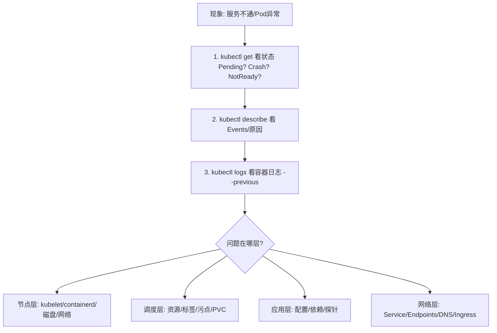

# K8s 05：运维 SOP 与 FAQ

::: tip 本篇定位
这是一篇**上机运维手册**：以可直接复制的 SOP 命令和排查表格为主，沉淀集群日常巡检、发布回滚、证书更新、etcd 备份恢复的标准流程，以及最常见故障的定位命令与解法。示例沿用 kubeadm 部署的 **v1.30** 集群，Master 在 `10.0.0.101~103`。
:::

## 一、运维 SOP

### 1.1 集群日常巡检 SOP

每次巡检按"节点 → 控制平面组件 → 系统 Pod → 证书 → etcd"顺序过一遍，全部正常才算健康。

**① 节点状态**

```bash
kubectl get nodes -o wide
# NAME     STATUS   ROLES           AGE   VERSION
# master1  Ready    control-plane   30d   v1.30.0     ← STATUS 必须全 Ready
# node1    Ready    worker          30d   v1.30.0
```

看：是否有 `NotReady`、`SchedulingDisabled`，版本是否一致。

```bash
kubectl describe node node1 | grep -A5 Conditions
# Conditions:
#   MemoryPressure  False   ← False 表示正常（无内存压力）
#   DiskPressure    False
#   PIDPressure     False
#   Ready           True
```

**② 控制平面组件健康**

```bash
kubectl get cs
# NAME                         STATUS      MESSAGE
# scheduler                    Healthy     ok        ← 三项都应 Healthy
# controller-manager           Healthy     ok
# etcd-0                       Healthy     {"health":"true"}

kubectl get pods -n kube-system -o wide
# 所有 kube-system Pod 应为 Running/Completed，RESTARTS 不应频繁增长
```

**③ 资源水位**

```bash
kubectl top nodes
# NAME     CPU(cores)   CPU%   MEMORY(bytes)   MEMORY%
# master1  320m         8%     1400Mi          35%      ← CPU%/MEMORY% 过高要关注
kubectl top pods -A --sort-by=cpu       # 找最耗 CPU 的 Pod
kubectl top pods -A --sort-by=memory    # 找最耗内存的 Pod
```

**④ 证书有效期检查**（kubeadm 集群证书默认 1 年）

```bash
kubeadm certs check-expiration
# CERTIFICATE                EXPIRATION                     ...
# apiserver                  Sep 30, 2027 09:00 UTC         valid   ← 剩余时间 > 1 个月才算健康
# apiserver-etcd-client      ...
```

**⑤ etcd 健康与成员**

```bash
# 成员列表（应看到全部 master，且都是 started）
kubectl -n kube-system exec -it etcd-master1 -- \
  etcdctl --endpoints=https://127.0.0.1:2379 \
  --cacert=/etc/kubernetes/pki/etcd/ca.crt \
  --cert=/etc/kubernetes/pki/etcd/server.crt \
  --key=/etc/kubernetes/pki/etcd/server.key \
  member list -w table

# 集群健康
etcdctl ... endpoint health
# https://127.0.0.1:2379 is healthy: successfully committed proposal
```

### 1.2 应用发布与回滚 SOP

发布前确认 `kubectl rollout status` 上一版本已完成，再按下面步骤：

```bash
# 1) 确认当前版本与副本数
kubectl rollout history deployment/nginx

# 2) 发布新版本（改镜像）
kubectl set image deployment/nginx nginx=nginx:1.28 --record

# 3) 实时观察滚动更新进度
kubectl rollout status deployment/nginx
# Waiting for deployment "nginx" rollout to finish: 2 out of 3 new replicas...
# deployment "nginx" successfully rolled out

# 4) 验证新版本 Pod 全 Ready、业务正常
kubectl get pods -l app=nginx
kubectl describe svc nginx | grep Endpoints    # 后端端点正确

# 5) 若发现问题，立即回滚
kubectl rollout undo deployment/nginx                    # 回到上一版
kubectl rollout undo deployment/nginx --to-revision=2   # 回到指定版本
```

| 阶段 | 检查点 | 不通过的动作 |
|---|---|---|
| 发布前 | 旧版本 `rollout status` 成功、有最近一次 revision | 先等稳定再发 |
| 发布中 | 新 Pod 逐个 Ready、RESTARTS 不增长 | `kubectl rollout pause` 暂停观察 |
| 发布后 | 业务探针/冒烟测试通过 | 立即 `rollout undo` 回滚 |

### 1.3 证书更新 SOP（kubeadm certs renew）

kubeadm 集群的 apiserver 等证书默认 **1 年过期**，过期后 apiserver 与组件之间认证失败、集群瘫痪。**提前巡检发现剩余不足 1 个月就续期**。

```bash
# 1) 在每个 master 上先检查到期时间（见 1.1 ④）
kubeadm certs check-expiration

# 2) 续期全部证书（滚动升级后也可重跑，幂等）
kubeadm certs renew all

# 3) 重启控制平面静态 Pod 让新证书生效
#    静态 Pod 在 /etc/kubernetes/manifests/，挪走再挪回会触发 kubelet 重建
cd /etc/kubernetes/manifests/
mkdir -p /tmp/manifests-bak
mv kube-apiserver.yaml kube-controller-manager.yaml kube-scheduler.yaml etcd.yaml /tmp/manifests-bak/
sleep 30                       # 等容器停掉
mv /tmp/manifests-bak/*.yaml . # 挪回来，kubelet 自动用新证书重建

# 4) 验证
kubectl get nodes              # 集群恢复正常
kubeadm certs check-expiration # 过期时间顺延一年
```

::: warning 证书续期注意
- `kubeadm certs renew all` 不会动 `ca.crt/ca.key`（CA 十年有效），只续叶子证书。
- 多 master 要在**每台 master** 上都执行一遍。
- 续期会短暂影响控制平面，业务 Pod 不受影响；建议在维护窗口操作。
:::

### 1.4 etcd 备份恢复 SOP

etcd 存了集群**全部状态数据**，丢了集群就重建不出来，**必须定期备份**。

**① 备份（snapshot）**

```bash
# 在任意 master 上执行，把快照存到 /backup/etcd-snapshot.db
ETCDCTL_API=3 etcdctl snapshot save /backup/etcd-snapshot.db \
  --endpoints=https://127.0.0.1:2379 \
  --cacert=/etc/kubernetes/pki/etcd/ca.crt \
  --cert=/etc/kubernetes/pki/etcd/server.crt \
  --key=/etc/kubernetes/pki/etcd/server.key

# 验证快照完整性
ETCDCTL_API=3 etcdctl snapshot status /backup/etcd-snapshot.db -w table
```

建议写进 cron，每天一份、保留最近 7 份。

**② 恢复（restore）**——灾难时用快照重建 etcd：

```bash
# 1) 先停掉 apiserver 等控制平面静态 Pod（挪走 manifests），但保留 etcd 数据目录前先备份

# 2) 用快照恢复到新数据目录
ETCDCTL_API=3 etcdctl snapshot restore /backup/etcd-snapshot.db \
  --data-dir=/var/lib/etcd-restore \
  --initial-cluster=master1=https://10.0.0.101:2380 \
  --initial-advertise-peer-urls=https://10.0.0.101:2380 \
  --name=master1

# 3) 改 etcd 静态 Pod manifest 的 --data-dir 指向新目录 /var/lib/etcd-restore，
#    挪回 manifests 让 etcd 起来，再依次启动其他控制平面组件
```

::: danger 恢复是高危操作
etcd restore 会把集群**整体回滚到备份时刻**，之后所有写入都会丢失。restore 前务必再备一份当前（损坏的）数据目录，操作前充分演练。生产建议用云盘快照或专门的 etcd 备份方案。
:::

## 二、常见 FAQ（故障速查）

### 2.1 Pod 一直 Pending

Pod 一直卡在 `Pending`，意思是**还没被调度到任何节点**。

```bash
kubectl describe pod <pod-name> | grep -A20 Events
# 典型事件：
# 0/3 nodes are available: 3 Insufficient cpu.     ← 资源不够
# 0/3 nodes are available: 3 node(s) didn't match nodeSelector.  ← 标签不匹配
# pod has unbound immediate PersistentVolumeClaims  ← PVC 没绑上
```

| 原因 | 解法 |
|---|---|
| 节点资源不足（Insufficient cpu/memory） | 扩节点或调小 requests |
| nodeSelector / 亲和没匹配节点 | `kubectl label node` 补标签，或放宽调度规则 |
| PVC 一直 Pending | 检查 StorageClass、PV 是否存在、NFS 是否可达 |
| 污点挡着 | 节点有 NoSchedule 污点，加 toleration 或去污点 |

### 2.2 ImagePullBackOff / ErrImagePull

```bash
kubectl describe pod <pod-name> | grep -A10 Events
# Failed to pull image "nginx:1.99": rpc error: ... not found      ← 镜像名/tag 错
# Failed to pull image: ... dial tcp i/o timeout                   ← 网络/镜像源不通
```

| 原因 | 解法 |
|---|---|
| 镜像名或 tag 写错 | 核对 `image:`，tag 别用 `latest` |
| 私有仓库没配拉取凭证 | `kubectl create secret docker-registry` 并在 Pod 配 `imagePullSecrets` |
| 国内拉不到 registry.k8s.io/Docker Hub | 配镜像加速、换国内镜像源（如 registry.aliyuncs.com） |
| 节点到镜像仓库网络不通 | 查节点 DNS、出网、防火墙 |

### 2.3 CrashLoopBackOff（容器反复崩溃重启）

```bash
kubectl logs <pod-name> --previous     # 看上一次崩溃的日志（关键！）
kubectl describe pod <pod-name> | grep -A10 Last State
# Last State:  Terminated  Reason: Error / OOMKilled / Error 255
```

| 现象 / Reason | 原因与解法 |
|---|---|
| `OOMKilled` | 内存超了 limit → 调大 limit 或修内存泄漏 |
| 应用启动报错退出 | 看 `logs --previous`，多半是配置/依赖连不上 |
| liveness 探针太激进 | 探针配错导致被反复杀（见 02 篇），加 startupProbe |
| 命令/entrypoint 写错 | 镜像启动命令有误，本地 `docker run` 先验证 |

### 2.4 Node NotReady

```bash
kubectl describe node node1 | grep -A10 Conditions
# Kubelet stopped posting node status      ← kubelet 挂了
```

登上该节点排查：

```bash
systemctl status kubelet          # kubelet 起没起
journalctl -u kubelet -f --no-pager | tail -50   # kubelet 报错
systemctl status containerd       # 容器运行时起没起
crictl ps                         # 用 crictl 看运行时里的容器
# 常见：证书过期、容器运行时没起、磁盘满、CNI 插件异常
```

### 2.5 磁盘压力导致驱逐（DiskPressure / Eviction）

节点磁盘满，kubelet 会主动驱逐 Pod，Pod 事件出现 `Evicted`。

```bash
kubectl describe node node1 | grep -i disk
# DiskPressure  True
df -h /var/lib/containerd /var/lib/kubelet     # 在节点上看哪个盘满了
crictl images                                  # 堆积的无用镜像
crictl rmi --prune                             # 清理未使用镜像
```

常见根因：容器日志暴涨、镜像堆积、emptyDir/PVC 写满。处理后节点自动恢复。

### 2.6 Service 访问不通

```bash
kubectl get endpoints <svc>          # 最常踩坑：ENDPOINTS 为空 → selector 标签没对上
kubectl get svc <svc> -o yaml | grep -A5 selector
kubectl get pods --show-labels       # 对比 Pod 实际标签
# Pod 端用 DNS 直连测试
kubectl exec -it <pod> -- nslookup <svc>
kubectl exec -it <pod> -- curl -v http://<svc>
```

## 三、排障思路：分层定位

遇到问题别瞎试，**从下往上分层查**：



三个万能命令记住：

```bash
kubectl describe pod <pod>     # 看 Events、状态、为什么
kubectl logs <pod> --previous  # 看上一次崩溃日志
kubectl get events --sort-by=.metadata.creationTimestamp   # 全局最近事件
```

## 四、kubectl 高频命令速查表

### 4.1 查看类

| 命令 | 作用 |
|---|---|
| `kubectl get pods -A -o wide` | 看所有命名空间 Pod 及所在节点/IP |
| `kubectl get svc,deploy,ds,sts,job -A` | 概览各类工作负载 |
| `kubectl describe <资源> <名>` | 看详情与 Events |
| `kubectl logs <pod> [-c 容器] [--previous]` | 看日志，多容器要 `-c`，崩溃看 `--previous` |
| `kubectl top pods / nodes` | 看资源用量（需 metrics-server） |
| `kubectl get events --sort-by=.lastTimestamp` | 看最近事件 |

### 4.2 操作类

| 命令 | 作用 |
|---|---|
| `kubectl apply -f xxx.yaml` | 声明式创建/更新 |
| `kubectl delete -f xxx.yaml` / `kubectl delete pod <名>` | 删除资源 |
| `kubectl scale deploy nginx --replicas=5` | 扩缩容 |
| `kubectl set image deploy/nginx nginx=nginx:1.28` | 改镜像发版 |
| `kubectl rollout status/history/undo/pause/resume` | 发布进度/历史/回滚 |
| `kubectl cordon / uncordon / drain <node>` | 节点维护 |

### 4.3 进入与调试类

| 命令 | 作用 |
|---|---|
| `kubectl exec -it <pod> -- sh` | 进入容器 |
| `kubectl exec -it <pod> -- nslookup <svc>` | 容器内测 DNS |
| `kubectl port-forward svc/<svc> 8080:80` | 把集群内服务转发到本机端口调试 |
| `kubectl explain pods.spec.containers` | 查资源字段定义（查 YAML 字段神器） |
| `kubectl api-resources` | 列出所有资源类型 |
| `kubectl auth can-i <动作> --as=系统账号` | 验证 RBAC 权限 |

> 更完整的命令清单见站内速查表。

## 面试自测

1. 集群巡检你会按什么顺序查哪些东西？
2. kubeadm 集群证书默认有效期多久？怎么续期？
3. etcd 快照怎么做？恢复时要注意什么？
4. Pod 一直 Pending 怎么一步步定位？
5. CrashLoopBackOff 你第一步看什么命令？
6. ImagePullBackOff 有哪几类原因？
7. Node NotReady 登上去先查哪几个服务？
8. Service 的 Endpoints 是空的，说明什么？
9. drain 一个节点前为什么要先 cordon？
10. describe、logs --previous、get events 分别解决什么问题？

## 相关速查

- [kubectl 命令速查](/reference/kubectl-commands)
- Kubernetes 官方文档：https://kubernetes.io/zh-cn/docs/home/
- kubeadm 证书管理：https://kubernetes.io/zh-cn/docs/tasks/administer-cluster/kubeadm/kubeadm-certs/
- etcd 运维：https://etcd.io/docs/latest/op-guide/
- 排障指南：https://kubernetes.io/zh-cn/docs/tasks/debug/debug-application/
- 节点压力驱逐：https://kubernetes.io/zh-cn/docs/concepts/scheduling-eviction/node-pressure-eviction/
