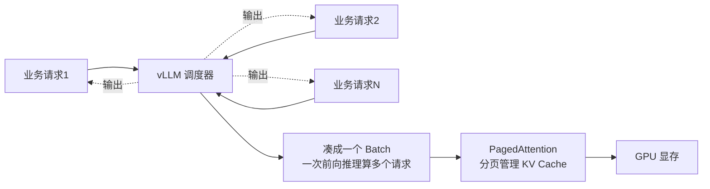

# 大模型部署

::: tip 本篇定位
在自有服务器（有 GPU 最好）上把开源大模型跑起来，并对外提供一个和 OpenAI 一样的 API 接口。
本篇版本：Ollama（官方脚本滚动安装）、vLLM v0.29.0（Docker 镜像 vllm/vllm-openai:v0.29.0）、Open WebUI v0.11.1、代表模型 Qwen3 系列（8B/14B/32B）。所有版本以官网当前稳定版为准。
:::

## 一、背景与基础

### 1.1 小白类比："部署一个大模型"到底在干嘛

ChatGPT 用着很爽，但你想把数据留在自己机房、不想把内网文档发到公网 API，于是要"自己跑一个大模型"。

这件事拆开就是三步：

1. **下载模型权重文件**：模型本质上就是一大串数字（几十亿个参数），存成一个几 GB 到上百 GB 的文件。
2. **把权重装进显存/内存**：让显卡或 CPU 能读着这些数字干活。
3. **起一个推理服务进程**：对外暴露一个 HTTP 接口，别人发一句话进来，它返回生成的回答。

> 类比：权重文件像一本厚厚的菜谱书；显卡是厨师；推理框架（Ollama/vLLM）是后厨管理系统，负责把菜谱摆上案板、安排厨师同时给多桌客人做菜。

### 1.2 模型格式：safetensors 与 GGUF

下载下来的模型，常见有两种"打包格式"：

| 格式 | 谁在用 | 特点 |
|---|---|---|
| **safetensors** | vLLM、Transformers、GPU 推理 | 一个模型切成多个 `.safetensors` 分片文件，配合 `config.json`，GPU 加载快、安全（禁用恶意 pickle） |
| **GGUF** | Ollama、llama.cpp、CPU/边缘 | 单文件（一个 `.gguf`），专为 CPU/低显存量化设计，Ollama 拉下来的就是这种 |

在 Hugging Face 上同一个模型往往同时提供两种格式：GPU 服务器选 `safetensors` 版（或直接用模型 ID 让 vLLM 下载）；CPU/小内存机器选 Ollama 拉取的 GGUF 量化版。

### 1.3 参数量与显存/内存需求的关系

"7B"里的 B = Billion（十亿），7B 就是 70 亿个参数。**参数越多越聪明，但越吃显存。**

粗算公式（记忆用）：

- **FP16 全精度**：每参数约占 2 字节 → 模型大小 ≈ 参数量 × 2 GB。例如 7B ≈ 14 GB，14B ≈ 28 GB，72B ≈ 144 GB。
- **INT8 量化**：每参数约 1 字节 → 7B ≈ 7~8 GB。
- **INT4 量化**：每参数约 0.5 字节 → 7B ≈ 4~5 GB，14B ≈ 9~10 GB。

::: tip 别忘 KV Cache
上面只是"权重本身"。真正跑起来还要留显存给**KV Cache**（缓存上下文，支持多并发）和临时计算。经验值：**实际要在权重基础上再加 20%~40%**。所以选卡时别把显存算得刚好。
:::

常见配置参考（粗略，含上下文余量）：

| 模型规模 | 定性 | 最低硬件参考 |
|---|---|---|
| Qwen3-8B | 入门、个人开发者主力 | INT4 量化约 6~8 GB 显存（如单张 16G 消费卡/CPU 32G 内存） |
| Qwen3-14B | 兼顾质量与成本 | INT4 约 10~12 GB，建议 16~24 GB 显存 |
| Qwen3-32B | 生产可用的稠密大模型 | INT4 约 20 GB，建议 2×24G 或 1×48G 显存 |
| Qwen3-235B（MoE） | 旗舰开源 | 需多卡 A100/H100，单机多卡张量并行 |

> Qwen3 还有 MoE（混合专家）版本如 30B-A3B、235B-A22B：总参数很大但每次只激活一小部分，推理时显存和算力介于稠密模型之间。本文不展开。

## 二、推理框架

### 2.1 两条路：Ollama（省事）vs vLLM（高并发）

| 对比 | Ollama | vLLM |
|---|---|---|
| 定位 | 本地开发、个人/小团队、CPU 也能跑 | 生产级高并发在线推理服务 |
| 上手难度 | 一行脚本装完，`ollama run` 就聊天 | 要 Docker、要 GPU、配参数 |
| 并发能力 | 一般，适合几个人用 | 强，PagedAttention 支持几十上百并发 |
| 模型格式 | GGUF | safetensors（HuggingFace 直下） |
| API | 自带 REST，也兼容 OpenAI | 原生 OpenAI 兼容 API |
| 适合场景 | 笔记本、内网小工具、原型验证 | 对外提供 API、给业务系统调用 |

### 2.2 GPU 直通与纯 CPU 两种场景

- **有 NVIDIA GPU（推荐生产）**：服务器插 N 卡，装好 NVIDIA 驱动 + Container Toolkit，Docker 里用 `--gpus all` 直通给容器。这是 vLLM 的主战场。
- **纯 CPU（无 GPU）**：也能跑，但慢很多，适合验证、离线小模型。Ollama 对 CPU 很友好，`qwen3:8b` 量化版在 32G 内存的机器上能跑（生成速度每秒几个 token，体验一般）。vLLM 也有 CPU 后端，但生产 CPU 不推荐高并发。
- **GPU 直通注意**：容器必须装了 nvidia-container-toolkit 才能 `--gpus all`，否则容器里看不到显卡：

```bash
nvidia-smi                       # 宿主机上能看到显卡
docker run --rm --gpus all nvidia/cuda:12.4.0-base-ubuntu22.04 nvidia-smi
# 容器里也能看到显卡 = 直通配置成功
```

## 三、模型量化

### 3.1 为什么要量化

FP16 下 7B 模型就要 14GB 显存，一张 24G 卡塞不下 14B 以上的模型。**量化就是把每个参数的数字从"高精度"压成"低精度"**，像把高清图压成 JPEG——体积小很多，肉眼看差别不大。

| 精度 | 每参数字节 | 7B 模型体积 | 质量损失 | 说明 |
|---|---|---|---|---|
| FP16/BF16 | 2 | ~14 GB | 无（基准） | 全精度，效果最好 |
| INT8 | 1 | ~7~8 GB | 很小 | 体积减半，质量几乎无感 |
| INT4 | 0.5 | ~4~5 GB | 可接受 | 体积再减半，消费显卡能跑大模型的关键 |

### 3.2 常见量化方法通俗区分

INT8/INT4 是"压到几位"，下面三个是"怎么压"的具体方案，面试和选型会遇到：

- **GPTQ**：一种训练后权重量化算法，把权重量化到 INT4，主要跑在 GPU 上，需要预先量化好的模型文件。
- **AWQ（Activation-aware Weight Quantization）**：和 GPTQ 思路类似，但认为"不是所有参数都同样重要"，保留一小部分关键参数高精度，实测常比 GPTQ 掉点更少，目前很流行。
- **GGUF + Q4_K_M / Q8_0**：Ollama/llama.cpp 生态的量化等级命名。`Q4_K_M` 就是 4bit 量化、K-quant 方案、中等大小（M=medium），是 Ollama 里最常用的"性价比档"。

> 类比：GPTQ/AWQ 像是出版前直接把书扫成低清晰度 PDF；GGUF 像是专门为手机阅读优化过的排版。文件小了，但重点内容（关键参数）尽量保留清晰。

Ollama 里选 tag 时就能看到这些档位：`ollama pull qwen3:8b` 默认拉的是 Q4_K_M 这一档；想要更小可以 `qwen3:8b-q4_0`，想要更准可以 `qwen3:14b`。

## 四、实战部署

### 4.1 方式一：Ollama 部署（最快上手）

#### 4.1.1 安装

```bash
# 官方一键脚本（Linux，自动识别 systemd、CPU/GPU）
curl -fsSL https://ollama.com/install.sh | sh

# 验证
ollama --version
# ollama version is 0.13.x     ← 以脚本当前安装的版本为准
systemctl status ollama      # 装完自动起后台服务，默认监听 127.0.0.1:11434
```

::: details Ubuntu/Debian 与 RHEL 系安装差异
官方脚本 `install.sh` 在两大系上都能用，自动装成 systemd 服务。
- Ubuntu 也可用 Snap：`sudo snap install ollama`（更新更频繁）。
- RHEL/Rocky 若 curl 被墙，可手动下载压缩包解压：`curl -fsSL https://ollama.com/download/ollama-linux-amd64.tar.zst | sudo tar x -C /usr`。
:::

#### 4.1.2 拉模型并运行

```bash
# 拉取 Qwen3 8B（GGUF Q4_K_M 档，约 5GB，自动下载）
ollama pull qwen3:8b

# 直接进入对话
ollama run qwen3:8b
# >>> 你好，介绍一下你自己    ← 输入问题开始聊，/bye 退出
```

常用命令：

```bash
ollama list                  # 看本地已有哪些模型
ollama ps                    # 看当前正在内存里跑着的模型
ollama rm qwen3:8b           # 删模型
```

#### 4.1.3 Modelfile：定制自己的模型

想给模型加固定系统提示词、设默认参数，用 Modelfile：

```dockerfile
# Modelfile（注意：这是 Ollama 的 Modelfile 语法，不是 Dockerfile）
FROM qwen3:8b                # 基于已有模型改
PARAMETER temperature 0.3    # 低温度 = 更稳定
PARAMETER num_ctx 8192       # 上下文长度
SYSTEM """你是一个运维助手，回答要简洁，多用命令行示例。"""
```

用它建一个新模型：

```bash
ollama create ops-assistant -f Modelfile
ollama run ops-assistant
```

#### 4.1.4 API 调用

Ollama 自带 REST 服务（默认 11434 端口）：

```bash
# 原生 /api/chat 接口
curl http://localhost:11434/api/chat -d '{
  "model": "qwen3:8b",
  "messages": [{"role": "user", "content": "用一句话解释什么是负载均衡"}],
  "stream": false
}'
```

Ollama 也提供 **OpenAI 兼容接口**（路径 `/v1/chat/completions`），这样 OpenAI SDK 改个 base_url 就能直接用：

```bash
curl http://localhost:11434/v1/chat/completions -d '{
  "model": "qwen3:8b",
  "messages": [{"role": "user", "content": "hello"}]
}'
```

### 4.2 方式二：vLLM 部署（生产高并发）

vLLM 用官方 Docker 镜像起一个 **OpenAI 兼容 API 服务**。下面是完整可复制命令（镜像固定到 v0.29.0）：

```bash
docker run -d \
  --name vllm-qwen3 \
  --runtime nvidia \
  --gpus all \
  -p 8000:8000 \
  --ipc=host \
  -v ~/.cache/huggingface:/root/.cache/huggingface \
  -e HF_TOKEN=hf_xxx_你的huggingface_token \
  vllm/vllm-openai:v0.29.0 \
  --model Qwen/Qwen3-32B \
  --served-model-name qwen3-32b \
  --max-model-len 8192 \
  --gpu-memory-utilization 0.90
```

参数说明：

| 参数 | 含义 |
|---|---|
| `--gpus all` | 把所有 GPU 直通给容器（需 nvidia-container-toolkit） |
| `--ipc=host` | 共享内存，张量并行/PyTorch 必须 |
| `-v ~/.cache/huggingface` | 把模型缓存挂到宿主机，容器重建不重复下载 |
| `--model` | HuggingFace 模型 ID（Qwen3-32B，safetensors 格式） |
| `--served-model-name` | 对外 API 里显示的模型名，自定义好记 |
| `--max-model-len` | 最大上下文长度，占显存，别乱设大 |
| `--gpu-memory-utilization 0.90` | 用掉 90% 显存，留一点给系统 |

启动后（首次要下载几十 GB 权重，耐心等）验证：

```bash
# 看启动日志，出现 "Uvicorn running on http://0.0.0.0:8000" 才算就绪
docker logs -f vllm-qwen3

# 调 OpenAI 兼容接口
curl http://localhost:8000/v1/chat/completions -d '{
  "model": "qwen3-32b",
  "messages": [{"role":"user","content":"用一句话解释 K8s 的 Deployment"}],
  "max_tokens": 128
}'
```

返回结构和 OpenAI 几乎一模一样（`choices[0].message.content`），所以业务代码把 `base_url` 指向 `http://服务器IP:8000/v1`、`api_key` 随便填，就能无缝从 OpenAI 切到自建模型。

::: details vLLM 并发推理为什么快（通俗）
vLLM 的杀手锏叫 **PagedAttention**。朴素做法是给每个请求都预先划一大块连续显存存它的对话缓存（KV Cache），就像"每桌客人都先占一个大包间"——大量包间空着也不让别人用，显存碎片严重，并发上不去。

PagedAttention 把 KV Cache 切成**固定大小的小块（页）**，像操作系统管理内存分页一样：哪桌客人用到哪块就分配哪块，空闲块随时回收给下一桌。于是一块显卡能同时服务几十上百个并发请求，显存利用率大幅提升，吞吐比朴素推理高几倍到十几倍。
:::



### 4.3 Open WebUI 前端对接

裸 API 调试不方便，装一个开源网页聊天界面 Open WebUI，把它接到上面的 Ollama 或 vLLM：

```bash
docker run -d \
  --name open-webui \
  -p 3000:8080 \
  -v open-webui:/app/backend/data \
  # 接 Ollama（同机时用 host.docker.internal 或 host 网络）
  -e OLLAMA_BASE_URL=http://host.docker.internal:11434 \
  # 或接 vLLM 的 OpenAI 兼容接口：
  # -e OPENAI_API_BASE_URL=http://vllm-host:8000/v1
  --add-host=host.docker.internal:host-gateway \
  ghcr.io/open-webui/open-webui:v0.11.1
```

浏览器访问 `http://服务器IP:3000`，**第一个注册的账号自动成为管理员**。进去后模型下拉里就能看到 Ollama/vLLM 里的模型，可以像 ChatGPT 一样对话、建知识库、多用户共享。

## 五、运维

### 5.1 显存与并发监控

```bash
nvidia-smi                          # 实时看显存占用、GPU 利用率
watch -n 1 nvidia-smi               # 每秒刷新

# vLLM 容器里看更细的统计
docker exec -it vllm-qwen3 curl http://localhost:8000/metrics | grep vllm
# 关注 vllm:num_requests_running（正在跑的并发）、vllm:gpu_cache_usage_perc（KV Cache 使用率）
```

经验：`vllm:gpu_cache_usage_perc` 长期接近 100% 就说明该加卡或降并发了，新请求会被排队。

### 5.2 选型对比小结

| 你的情况 | 选谁 |
|---|---|
| 自己笔记本/小服务器，偶尔用用 | Ollama |
| 内网小工具、CPU 机器 | Ollama（GGUF Q4） |
| 给业务系统提供高并发 API、有 GPU | vLLM |
| 想要网页界面 | Open WebUI 接 Ollama/vLLM |
| 多用户、要权限和知识库 | Open WebUI + vLLM 后端 |

### 5.3 常见问题排错

| 现象 | 原因 | 解决 |
|---|---|---|
| 模型下载极慢/卡住 | HuggingFace 在国内访问慢 | 设镜像：`export HF_ENDPOINT=https://hf-mirror.com`；Ollama 可配 `OLLAMA_NATIVE=1` 或换网络；vLLM 容器加 `-e HF_ENDPOINT=https://hf-mirror.com` |
| vLLM 启动报 `CUDA out of memory` | 显存不够装权重+KV Cache | 换更小模型/INT4/AWQ 量化版；调小 `--max-model-len`；调低 `--gpu-memory-utilization` 排除其他进程占用 |
| `No available memory for the cache blocks` | 上下文开太大，KV Cache 分不到 | 减小 `--max-model-len`，或限制 `--max-num-seqs`（并发数） |
| 并发上去后请求超时/排队 | GPU 算力或 KV Cache 到顶 | 降并发、加卡、张量并行 `--tensor-parallel-size 2`、换 AWQ 量化模型 |
| Ollama 跑起来很慢（CPU） | 没用到 GPU / 模型太大 | 确认 `nvidia-smi` 可见；换 Q4 量化档或更小模型 |
| 容器里 `Unknown runtime nvidia` | 没装 nvidia-container-toolkit | 宿主机装 NVIDIA Container Toolkit 并重启 docker |
| Open WebUI 下拉看不到模型 | 后端地址配错 | 检查 `OLLAMA_BASE_URL` / `OPENAI_API_BASE_URL` 网络可达，`curl` 后端 `/v1/models` 验证 |

::: warning 生产红线
- 不要在公网裸奔 vLLM/Ollama 的 8000/11434 端口——它们默认无鉴权。前面一定要加网关（Nginx + 认证）或放在内网。
- 镜像 tag 固定具体版本（如 `v0.29.0`、`v0.11.1`），不要用 `latest`，升级前先在测试环境验证模型兼容性。
- 大模型很吃显存，`--gpu-memory-utilization` 别拉满到 1.0，留 10% 余量避免 OOM 崩溃。
:::

## 相关速查

- [Linux 命令速查](/reference/linux-commands)
- 容器基础：[Docker 命令速查](/reference/docker-commands)
- K8s 上部署：[kubectl 命令速查](/reference/kubectl-commands)

### 官方文档

- Ollama 官网与文档：https://ollama.com/ 、https://docs.ollama.com/
- Ollama 模型库（选 tag）：https://ollama.com/library
- vLLM 官方文档：https://docs.vllm.ai/
- vLLM Docker 部署：https://docs.vllm.ai/en/stable/deployment/docker/
- vLLM 版本发布（选镜像 tag）：https://github.com/vllm-project/vllm/releases
- Qwen 模型（HuggingFace）：https://huggingface.co/Qwen（需科学上网）；国内平替：https://hf-mirror.com/Qwen
- Open WebUI 文档：https://docs.openwebui.com/
- Open WebUI 镜像 tag：https://github.com/open-webui/open-webui/releases
