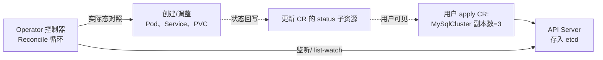
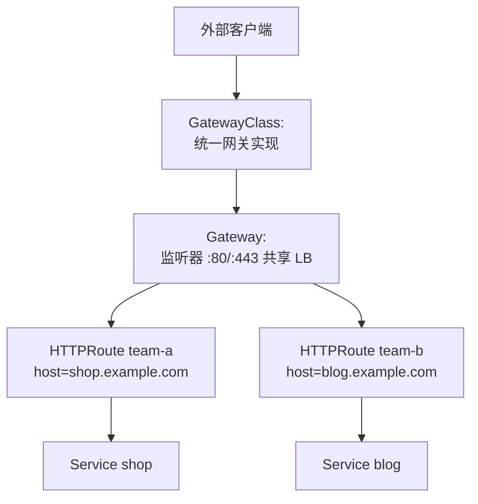

# Operator/CRD 模式与 Gateway API

::: tip 本篇定位
Kubernetes 自带的 Deployment/Service/ConfigMap 只能管"无状态、标准化"的应用。当你想让 K8s 像管理原生资源一样管理自己的中间件（比如 `kubectl apply 一个 MySql 资源` 就自动建好主从、备份、故障切换），就需要 **Operator 模式**。这篇讲清楚 CRD、控制循环、Kubebuilder/Operator SDK 怎么写 Operator，以及新一代入口规范 **Gateway API**（Ingress 的继任者）怎么用。
本篇版本：Kubernetes 1.37.0、Kubebuilder v4.15.0、Operator SDK v1.40.0、Gateway API v1.6.1（Standard Channel）。注意：社区维护的 Ingress-NGINX 已于 2026-03-24 退役，新集群应优先 Gateway API。所有版本以官网当前稳定版为准。
:::

## 一、背景与基础

### 1.1 小白类比：声明式 API 与"空调恒温器"

普通命令式操作像"手动开空调"：你觉得热了，手动按一下降温；过一会又热了，再按一下——人得一直盯着。

Kubernetes 的 **声明式 + 控制循环（Reconcile Loop）** 像"空调恒温器"：

- 你只需要告诉它**期望态**："我要 26 度"（写进 YAML 里 `spec`）。
- 恒温器自己不断测量**实际态**：现在室温 28 度。
- 发现两者不一致，它就自动开冷气，一直追到"实际态 == 期望态"为止。
- 达到 26 度后它就停着，哪天温度又飘走了，它再自动补回来。

Operator 就是把这个"恒温器"扩展到**你的业务资源**上：你定义一种新资源（比如 `kind: MySqlCluster`），再写一个控制器程序，它不停地"测量实际态 → 对比期望态 → 动手补齐"。

### 1.2 CRD 与 Operator 的关系

| 概念 | 通俗解释 |
|---|---|
| **CRD（CustomResourceDefinition）** | "给 K8s 注册一种新资源类型"。比如注册后，集群就认识 `kubectl get mysqlclusters` 了 |
| **CR（CustomResource）** | 用户按 CRD 定义提交的一个具体实例，如"我要一个 3 节点的 MySQL 集群" |
| **Controller（控制器）** | 真正干活的循环程序：监听 CR 变化，去创建/调整 Pod、Service、PV 等底层资源 |
| **Operator** | "CRD + 专用 Controller"的整套打包叫法，把领域知识（怎么部署、怎么备份、怎么故障切换）写进控制器 |



## 二、写一个 Operator：Kubebuilder / Operator SDK

### 2.1 两者关系与选型

| 对比 | Kubebuilder | Operator SDK |
|---|---|---|
| 定位 | K8s 官方 Go Operator 脚手架（上游） | Red Hat 主导，**封装并内建 Kubebuilder**，额外加 OLM/Ansible/Helm 插件 |
| 产物 | 纯 Go Operator 项目 | 同样是 Go 项目（go 插件底层就是 Kubebuilder），或 Ansible/Helm Operator |
| 适合 | 通用 Go Operator 开发 | 要发布到 OperatorHub/OpenShift 生态、或不想写 Go 用 Ansible 的团队 |

> 新手建议：直接学 **Kubebuilder**（概念最干净），需要上 OLM 发布时再用 Operator SDK 套壳。

### 2.2 脚手架生成项目

前置：Go 1.22+、kubectl、一个可连通的测试集群（如 [kind](https://kind.sigs.k8s.io)）。

```bash
# 安装 Kubebuilder CLI（固定版本 v4.15.0）
export KUBEBUILDER_VERSION=4.15.0
curl -Lo kubebuilder https://go.kubebuilder.io/dl/${KUBEBUILDER_VERSION}/$(go env GOOS)/$(go env GOARCH)
chmod +x kubebuilder && sudo mv kubebuilder /usr/local/bin/
kubebuilder version

# 初始化一个新项目
mkdir -p ~/projects/app-operator && cd ~/projects/app-operator
kubebuilder init --domain example.com --repo example.com/app-operator

# 新建一个 API：kind=AppService，group=apps，version=v1
kubebuilder create api --group apps --version v1 --kind AppService
```

生成的关键目录：

```
app-operator/
├── main.go                     # 入口，启动 manager
├── api/v1/
│   ├── appservice_types.go     # ① 定义 CRD 字段（Spec/Status）
│   └── zz_generated.deepcopy.go
├── internal/controller/
│   └── appservice_reconciler.go # ② 核心 Reconcile 调谐逻辑
├── config/
│   ├── crd/                    # 生成的 CRD 清单
│   ├── manager/                # 控制器本身的 Deployment
│   └── default/
└── Makefile
```

### 2.3 关键代码：类型定义与 Reconcile

`api/v1/appservice_types.go`（定义 CR 的期望态字段）：

```go
package v1

import (
    metav1 "k8s.io/apimachinery/pkg/apis/meta/v1"
)

// AppServiceSpec 期望态
type AppServiceSpec struct {
    // 希望跑几个副本
    Replicas int32  `json:"replicas,omitempty"`
    // 用哪个镜像
    Image    string `json:"image,omitempty"`
}

// AppServiceStatus 实际态（回写给用户看）
type AppServiceStatus struct {
    // 当前 Ready 的副本数
    ReadyReplicas int32 `json:"readyReplicas,omitempty"`
}

// +kubebuilder:object:root=true
// +kubebuilder:subresource:status
type AppService struct {
    metav1.TypeMeta   `json:",inline"`
    metav1.ObjectMeta `json:"metadata,omitempty"`
    Spec   AppServiceSpec   `json:"spec,omitempty"`
    Status AppServiceStatus `json:"status,omitempty"`
}

// +kubebuilder:object:root=true
type AppServiceList struct {
    metav1.TypeMeta `json:",inline"`
    metav1.ListMeta `json:"metadata,omitempty"`
    Items []AppService `json:"items"`
}

func init() { SchemeBuilder.Register(&AppService{}, &AppServiceList{}) }
```

`internal/controller/appservice_reconciler.go`（核心： reconcile 函数）：

```go
func (r *AppServiceReconciler) Reconcile(ctx context.Context, req ctrl.Request) (ctrl.Result, error) {
    log := log.FromContext(ctx)

    // 1. 取出期望态（CR 对象）
    var app appsv1.AppService
    if err := r.Get(ctx, req.NamespacedName, &app); err != nil {
        return ctrl.Result{}, client.IgnoreNotFound(err)
    }

    // 2. 期望拥有的 Deployment（按 spec 造一个）
    dep := &appsv1.Deployment{}
    // ... 用 r.Get 查实际 Deployment；不存在就 r.Create；
    //    副本数/镜像不一致就 r.Update（这里省略细节）
    _ = dep

    // 3. 把实际态写回 CR 的 status
    app.Status.ReadyReplicas = 3 // 来自查到的 Deployment.Status
    if err := r.Status().Update(ctx, &app); err != nil {
        return ctrl.Result{}, err
    }
    log.Info("reconciled", "replicas", app.Spec.Replicas)
    return ctrl.Result{RequeueAfter: 30 * time.Second}, nil
}

// 把 AppService 及其下属 Deployment 串起来，任意一个变动都触发 Reconcile
func (r *AppServiceReconciler) SetupWithManager(mgr ctrl.Manager) error {
    return ctrl.NewControllerManagedBy(mgr).
        For(&appsv1.AppService{}).
        Owns(&appsv1.Deployment{}).
        Complete(r)
}
```

::: details Reconcile 循环的几个关键点
- **Reconcile 必须幂等**：同一个事件被重复触发一百次，结果都一样。不要写"再建一次"这种会重复创建的逻辑。
- **不要假设状态永远正确**：每次都重新 `Get` 一遍当前对象，而不是靠内存里缓存。
- **`Owns`**：声明"我拥有这个 Deployment"，Pod/Deployment 一变就会触发对应 CR 的 Reconcile。
- **失败要返回 error 或 Requeue**：让控制器过会再试，而不是放弃。
:::

### 2.4 生成 CRD、装到集群、跑起来

```bash
make manifests            # 从 types.go 注释标记生成 CRD YAML
make install              # 把 CRD 注册进集群
make run                  # 本地跑控制器（连 kubeconfig 当前集群）

# 另开终端，建一个 CR
kubectl apply -f config/samples/apps_v1_appservice.yaml
kubectl get appservices   # 看到 kind=AppService 被认识了
kubectl describe appservice sample-appservice
```

Webhook（准入校验/默认值）用 `kubebuilder create webhook --group apps --version v1 --kind AppService --conversion` 生成，在 CR 写入 etcd 前做校验（比如 `replicas` 必须 > 0）。

### 2.5 OperatorHub 与 OLM

把 Operator 分发给别人时，光有镜像不够，还要解决"怎么装、怎么升级、怎么卸载、依赖谁"。**OLM（Operator Lifecycle Manager）** 就是干这个的：

- 用 **CSV（ClusterServiceVersion）** 描述一个 Operator 的元数据、安装清单、权限、版本。
- **OperatorHub** 是公共 Operator 市场（如 PostgreSQL Operator、Redis Operator、Prometheus Operator）。
- 用户在 OpenShift/配了 OLM 的集群里点一下，OLM 自动装好 Operator 并维持其生命周期。

```bash
# Operator SDK 生成 OLM 打包 manifests（在项目根目录）
operator-sdk generate bundle --version=0.1.0
operator-sdk bundle validate ./bundle
```

## 三、Gateway API：Ingress 的继任者

### 3.1 为什么 Ingress 不够用

Ingress 是 K8s 很早（v1.1）就有的七层入口规范，但它有硬伤：

- 只能表达"域名 + 路径 → Service"这一种最简单的转发，**TCP/UDP、gRPC、流量镜像、流量权重、跨命名空间引用**全都表达不了。
- 每个 Ingress Controller（Nginx、Traefik、HAProxy）都在 Ingress 之上加自己的 annotation，配置五花八门、不可移植。
- 角色分工模糊：平台团队和应用团队共用一个 Ingress 资源，没法分权。

**Gateway API** 是 SIG Network 推出的下一代标准，把入口拆成三个角色清晰的资源：

| 资源 | 谁管 | 作用 |
|---|---|---|
| **GatewayClass** | 平台/集群管理员 | 定义"用哪种实现"（如 envoy-gateway、Cilium、Istio） |
| **Gateway** | 平台团队 | 一个具体的负载均衡实例（监听哪个端口、哪些监听器） |
| **HTTPRoute / TCPRoute / UDPRoute** | 应用团队 | 路由规则：把哪些 host/path 转发到哪些 Service |



### 3.2 安装与完整示例

```bash
# 安装 Gateway API Standard Channel（固定版本 v1.6.1）
kubectl apply --server-side -f \
  https://github.com/kubernetes-sigs/gateway-api/releases/download/v1.6.1/standard-install.yaml

# 装一个具体实现，这里以 Envoy Gateway 为例（Cilium/Istio 也都兼容 Gateway API）
# 详见 https://gateway-api.sigs.k8s.io/implementations/
```

`Gateway` 资源（平台团队建一个共享网关）：

```yaml
apiVersion: gateway.networking.k8s.io/v1
kind: Gateway
metadata:
  name: shared-gw
spec:
  gatewayClassName: envoy
  listeners:
    - name: http
      protocol: HTTP
      port: 80
      allowedRoutes:
        namespaces:
          from: All      # 允许所有命名空间的 HTTPRoute 挂上来
```

`HTTPRoute`（应用团队在自己命名空间建路由）：

```yaml
apiVersion: gateway.networking.k8s.io/v1
kind: HTTPRoute
metadata:
  name: shop-route
  namespace: shop
spec:
  parentRefs:
    - name: shared-gw        # 挂到上面那个 Gateway 上
  hostnames:
    - shop.example.com
  rules:
    - matches:
        - path:
            type: PathPrefix
            value: /api
      backendRefs:
        - name: shop-api
          port: 8080
          weight: 90          # 流量权重，做金丝雀很顺手
        - name: shop-api-canary
          port: 8080
          weight: 10
```

### 3.3 Gateway API vs Ingress 对照

| 能力 | Ingress | Gateway API |
|---|---|---|
| 路由模型 | 只有 host/path | HTTPRoute/TCPRoute/UDPRATE/GRPCRoute，权重、镜像、头匹配 |
| 角色分权 | 单一资源，混在一起 | Gateway（平台）与 Route（应用）分离 |
| 跨命名空间 | 几乎不行 | ReferenceGrant 显式授权 |
| 可移植性 | annotation 各家私有 | 标准 CRD，换实现不重写 |
| 现状（2026-09） | Ingress-NGINX 已退役，仅保留老集群维护 | v1.6.1 Standard Channel，TCP/UDPRoute 已 GA，主流实现均兼容 |

> 与数据面的关系：Cilium（见 [eBPF 文章](./linux-ebpf)）、Istio（见 [服务网格](./container-servicemesh)）都能作为 Gateway API 的实现，把路由规则落到自己的高性能数据面。

## 四、常见问题排错

| 现象 | 原因 | 解决 |
|---|---|---|
| `kubectl get appservice` 不认识这种资源 | CRD 没装好 | `make install` 或 `kubectl get crd` 确认 `appservices.apps.example.com` 存在 |
| Reconcile 一直被反复触发、不收敛 | 状态更新失败或逻辑不幂等 | 看控制器日志；确保 `Status().Update` 成功；检查是否每次都重复 Create |
| CR 建了但底层 Deployment 没起来 | Reconcile 报错/权限不足 | 看 controller 日志；确认 `config/rbac` 里 ClusterRole 权限够 |
| Webhook 一直不就绪、API Server 报错 | Webhook service/CA 配置错 | `kubectl get validatingwebhookconfigurations`，确认 service 指向起来的 pod |
| Gateway 建了但 `Address` 一直空 | 没有可用的 GatewayClass 实现/控制器没装 | `kubectl get gatewayclass`，确认对应实现（envoy/cilium）已部署 |
| HTTPRoute 不生效，`Accepted=False` | parentRef 指向的 Gateway 不允许本命名空间挂路由 | 检查 Gateway 的 `allowedRoutes`；跨命名空间要建 ReferenceGrant |
| 升级 Operator 后 CRD 字段冲突 | CRD schema 改了但旧 CR 不兼容 | 加 conversion webhook；CRD 改动遵循"只加不删"原则 |

::: warning 生产红线
- Operator 自己也会出错，**控制器要高可用（多副本 + leader election）**，但要保证只有一个 Reconcile 在跑，避免并发冲突。
- 生产 Operator 的 RBAC 按最小权限给，别图省事给 `cluster-admin`；CRD 变更要向后兼容，删除字段前先观察一个版本。
- Gateway/Ingress 对外监听前确认 TLS 证书与安全策略，不要把管理面端口暴露公网；换 Ingress-NGINX 前先在测试集群用 Gateway API 跑通。
- 自建 Operator 镜像 tag 写死、走私有镜像仓库；不要在没有 OLM 的集群里手动 `kubectl apply` 一套裸 Operator 资源上线。
:::

## 相关速查

- K8s 基础：[架构与集群](./container-k8s-01-architecture-cluster)、[Pod 与服务发现](./container-k8s-02-pod-service-discovery)、[存储与 Ingress](./container-k8s-03-storage-ingress)、[StatefulSet 与安全](./container-k8s-04-statefulset-security)、[SOP 命令清单](./container-k8s-05-appendix-sop-commands)
- 配套：[Helm 包管理与 Kustomize](./container-helm)、[服务网格](./container-servicemesh)、[eBPF 原理与应用](./linux-ebpf)
- 命令速查：[kubectl 命令速查](/reference/kubectl-commands)、[云原生命令速查](/reference/cloudnative-commands)

### 官方文档

- Kubernetes 官方 CRD 文档：https://kubernetes.io/docs/tasks/extend-kubernetes/custom-resources/custom-resource-definitions/
- Kubebuilder 文档：https://book.kubebuilder.io/
- Kubebuilder 版本发布（选 tag）：https://github.com/kubernetes-sigs/kubebuilder/releases
- Operator SDK 文档：https://sdk.operatorframework.io/
- Operator SDK 版本发布：https://github.com/operator-framework/operator-sdk/releases
- OperatorHub：https://operatorhub.io/
- Gateway API 官方文档：https://gateway-api.sigs.k8s.io/
- Gateway API 版本发布（选安装清单）：https://github.com/kubernetes-sigs/gateway-api/releases
- Gateway API v1.6 发布说明：https://kubernetes.io/blog/2026/06/30/gateway-api-v1-6/
