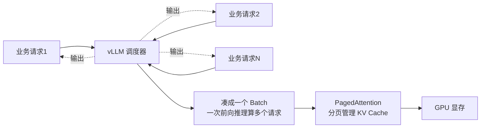
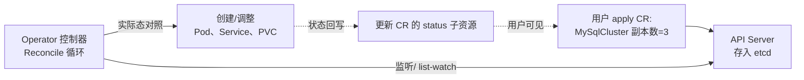
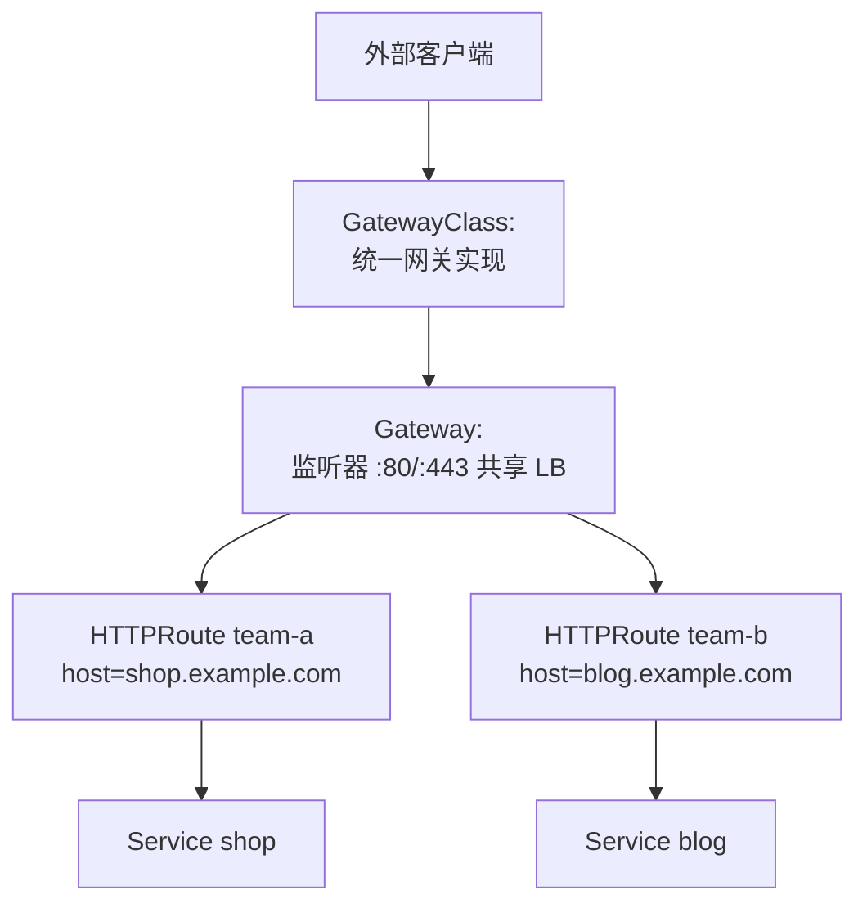

# 容器与编排

> 本页聚合 **容器化、容器编排、服务网格和大模型部署**。这是当前运维最核心、最"值钱"的方向。

## 文章索引

### Docker

::: idx

| 文章 | 解决什么问题 | 状态 |
|---|---|---|
| [Docker 实战手册](/services/container/docker/01-理论) | 原理、镜像构建/Harbor、存储、网络、Compose 深入 | ✅ 已完成 |

:::

### Kubernetes（K8s 系列）

::: idx

| 文章 | 解决什么问题 | 状态 |
|---|---|---|
| [K8s 01：架构与集群部署](/services/container/kubernetes/01-理论) | 架构、高可用集群安装 | ✅ 已完成 |
| [K8s 02：Pod 管理与服务发现](/services/container/kubernetes/01-理论) | Pod/工作负载、Service | ✅ 已完成 |
| [K8s 03：存储与 Ingress](/services/container/kubernetes/01-理论) | PV/PVC、ConfigMap/Secret、Ingress | ✅ 已完成 |
| [K8s 04：有状态服务与安全](/services/container/kubernetes/01-理论) | StatefulSet、RBAC、调度、HPA | ✅ 已完成 |
| [K8s 05：附录 SOP/FAQ/命令](/services/container/kubernetes/01-理论) | 运维 SOP、常见问题、命令速查 | ✅ 已完成 |

:::

### 服务网格与可观测

::: idx

| 文章 | 解决什么问题 | 状态 |
|---|---|---|
| [服务网格](#合并资料) | Istio 流量管理、SkyWalking 链路追踪、可观测性 | ✅ 已完成 |

:::

### 大模型部署

::: idx

| 文章 | 解决什么问题 | 状态 |
|---|---|---|
| [大模型部署](#合并资料) | 模型格式、vLLM/Ollama、量化、API 服务 | ✅ 已完成 |

:::

### 云原生进阶

::: idx

| 文章 | 解决什么问题 | 状态 |
|---|---|---|
| [Helm 与 Kustomize](/services/container/helm) | Chart/Repository/Release、模板与依赖、Kustomize 覆盖 | ✅ 已完成 |
| [Operator 与 Gateway API](#合并资料) | CRD/Controller 模式、Operator SDK/Kubebuilder、Gateway API | ✅ 已完成 |

:::

## 命令速查

- [Docker 命令速查](/reference/docker-commands)
- [kubectl 命令速查](/reference/kubectl-commands)

<!-- merged-qa-faq:start -->
## 常见问题 FAQ

> 容器与 Kubernetes 问题的高频问题已并入本页。默认只显示问题，点开查看完整答案。

### 一、构建与部署：镜像、网络与架构

<details>
<summary>Q1：Docker 网络模式？</summary>

**答：**

结论：Docker 有五种网络模式，常用的是 **bridge、host、none、container**，再加上自定义 bridge。

第一，**bridge（默认）**。每个容器在 docker0 网桥（一般是 172.17.0.0/16）上拿到一个独立 IP，容器之间通过 NAT 出去访问外网。外部要访问容器，必须 `-p 8080:80` 做端口映射，本质是 iptables DNAT。单机容器之间互通没问题，但跨主机就麻烦，而且默认 bridge 不支持容器名 DNS 解析。

第二，**host**。容器直接共享宿主机网络命名空间，没有独立网卡，容器里监听 80 就是宿主机的 80。网络性能最好（没有 NAT 开销），但端口会打架，谁先占谁用。性能敏感、端口不冲突的任务型容器用。

第三，**none**。容器有自己的 net namespace，但不配置任何网卡，只有 lo 回环。完全隔离，适合安全计算、临时任务。

第四，**container**。新容器不创建自己的网络，而是复用另一个已有容器的网络命名空间。两个容器共享同一个 IP 和端口空间，sidecar 模式（比如 Istio 代理）就这么玩。

第五，**自定义 bridge 网络**。生产推荐：`docker network create mynet`，容器加入 `mynet` 后，**可以直接用容器名互相 DNS 解析**（默认 bridge 不行），还能做更细的隔离。微服务单机部署基本都这么搞。

跨主机容器通信要靠 Overlay 网络（Swarm 自带、或 Calico/Flannel），单机 bridge 解决不了。

</details>

<details>
<summary>Q2：Docker 底层原理？</summary>

**答：**

结论：Docker 容器不是虚拟机，本质是**宿主机上一个被 namespace 隔离、被 cgroup 限制、用 rootfs 装了独立文件系统的普通进程**。三个核心技术：

第一，**Linux Namespace 做隔离**。容器看起来像一台独立机器，是因为它有自己一套 namespace：`PID`（独立进程树，容器里 1 号进程是你的应用）、`NET`（独立网卡/路由表）、`IPC`、`MNT`（独立挂载点）、`UTS`（独立 hostname）、`USER`（用户映射）。隔离了这些，进程就以为自己独占一个系统。

第二，**Cgroup 做资源限制**。namespace 只隔离"看不见"，不限制"用多少"。cgroup 负责限制这个组进程能用多少 CPU、内存、磁盘 IO、进程数。`docker run --cpus=1.5 -m 512m` 就是在配 cgroup。容器内存超了，OOM Killer 就出来杀进程。

第三，**rootfs + Overlay2 做文件系统**。镜像一层层叠起来，底层是只读的（`docker image inspect` 能看到多层 layer），容器启动时在最上面挂一层可写层（upperdir）。用的是 OverlayFS：lowerdir 是各层只读镜像，upperdir 是容器可写层，mergeddir 是联合视图。你改一个文件，Copy-on-Write 把它从底层复制到 upperdir 再改，不影响镜像层。这就是为什么镜像能多层复用、容器启动快。

所以镜像本质是一堆只读 layer + 一个 json 配置，容器就是"镜像 layer 联合挂载 + namespace 起进程 + cgroup 限资源"。

</details>

<details>
<summary>Q3：镜像如何优化体积？</summary>

**答：**

结论：镜像优化三板斧——**选小基础镜像、多阶段构建、减少层数并清理缓存**。

第一，**基础镜像选小的**。能跑 Alpine 就别跑 CentOS/Debian，`alpine` 才 5MB 左右；跑 Go/Rust 这种静态编译语言直接用 `scratch`（空镜像）或 `distroless`，十几 MB 搞定。别用 `latest` 标签，固定版本号。

第二，**多阶段构建**。这是最有效的手段。Dockerfile 写两个阶段：第一阶段用 `golang:1.22` 这种大镜像编译出二进制；第二阶段 `FROM alpine`，把第一阶段编译产物 `COPY --from=0 /build/app /app` 进去。最终镜像里只有二进制和运行时依赖，编译工具链全部留在第一阶段，不带进最终镜像。Java 项目也这么玩，Maven 编译阶段和 JRE 运行阶段分开。

第三，**合并 RUN 并清理缓存**。每写一个 `RUN` 就多一层，所以 `apt-get install`、`yum install`、`pip install` 这种，要把安装、清理缓存、删临时文件写在同一个 RUN 里，用 `&&` 连起来：

```dockerfile
RUN apt-get update && \
    apt-get install -y --no-install-recommends curl && \
    rm -rf /var/lib/apt/lists/*
```

不删 `/var/lib/apt/lists/*`，apt 的索引就留在镜像层里，白占几百 MB。

第四，**写 `.dockerignore`**，把 `.git`、`node_modules`、本地配置文件、`*.log` 排除掉，别让它们进构建上下文。

第五，**用 `.dockerignore` 排敏感文件**，构建上下文传得也快。

优化完用 `docker history <镜像>` 看每一层多大，找胖的那层；`docker images` 对比优化前后体积。

</details>

<details>
<summary>Q4：K8s 架构和组件？</summary>

**答：**

结论：K8s 分控制面（Master）和工作节点（Node）两层，核心思想是**声明式 API + 调谐循环（reconcile）**。

控制面组件：

- **kube-apiserver**：所有组件的唯一入口，RESTful 接 CRUD，所有操作都经过它，认证鉴权、限流都在这一层。etcd 只被 apiserver 访问。
- **etcd**：分布式 KV 存储，存整个集群的所有状态（Pods、Service、ConfigMap、Secret），Raft 强一致。etcd 挂了集群就懵了，生产要单独备份。
- **kube-scheduler**：watch 新创建的、还没分配节点的 Pod，根据资源请求、亲和性、污点容忍选个合适的节点绑上去（bind）。它只做"选哪台"，不负责启动容器。
- **kube-controller-manager**：一堆控制器的大管家，Node 控制器、Deployment 控制器、ReplicaSet 控制器、Endpoint 控制器都在里面。每个控制器干一件事：不断对比"我现在看到的状态"和"用户声明的期望状态"，不一样就动手调。

工作节点组件：

- **kubelet**：每个节点上的 agent，watch 分配到本节点的 Pod，调容器运行时把容器拉起来、保持住，定期上报 Pod 状态和节点健康。
- **kube-proxy**：每个节点上跑，负责 Service 的网络转发（iptables/ipvs 规则），ClusterIP 怎么转到 Pod 全靠它。
- **容器运行时**：containerd 或 CRI-O，真正跑容器的东西。

整个工作机制一句话：你 `kubectl apply` 一个 Deployment，apiserver 写进 etcd，Deployment 控制器看到后创建 ReplicaSet，ReplicaSet 控制器看到后创建 Pod，scheduler 把 Pod 绑到某节点，那节点 kubelet 调运行时起容器。这就是"声明式"——你只说"我要 3 个副本"，至于怎么凑够 3 个是控制器自己的事。

</details>

### 二、部署与发布：Pod、Service 与更新

<details>
<summary>Q5：Pod 生命周期和状态？</summary>

**答：**

结论：Pod 是 K8s 最小调度单位，不是容器，是"一组共享网络/存储的容器集合"。Pod 相位（Phase）有五种：`Pending`（已创建但容器还没起来，可能在调度/拉镜像）、`Running`（已绑定节点，至少一个容器在跑）、`Succeeded`（所有容器正常退出、不再重启）、`Failed`（所有容器都退出、至少一个失败）、`Unknown`（节点失联，kubelet 没上报）。

Pod 里有三种容器：**基础容器（pause 容器）** 负责 hold 住网络和 namespace；**init 容器**（可以多个）按顺序一个个跑完才起主容器，常用来等 DB 就绪、初始化配置；**业务容器**跑主进程。

探针三个，决定 Pod 死活：

- **livenessProbe（存活探针）**：失败就重启容器。程序死锁、僵死时用。
- **readinessProbe（就绪探针）**：失败就把 Pod 从 Service Endpoints 摘下来，不接流量，但不重启容器。程序还在启动、依赖没就绪时用。
- **startupProbe（启动探针）**：慢启动应用专用，启动期间其他探针暂停，避免老应用启动 60 秒被 liveness 误杀。

重启策略 `restartPolicy`：`Always`（默认）、`OnFailure`、`Never`。

优雅终止：Pod 被删时，先把它从 Endpoints 摘掉（不再有新流量），发 `SIGTERM` 给主进程，等 `terminationGracePeriodSeconds`（默认 30 秒），还不退就 `SIGKILL`。所以应用一定要处理 SIGTERM，把在处理的请求做完再退，不然会出现用户看到的连接被掐断。

</details>

<details>
<summary>Q6：Service 类型？</summary>

**答：**

结论：Service 是一组 Pod 的稳定访问入口，解决"Pod IP 会变"的问题。四种类型：

第一，**ClusterIP（默认）**。分配一个集群内部虚拟 IP，只有集群内容器能访问。Pod 之间互调用这个，最常用。

第二，**NodePort**。在每个节点上开一个端口（30000~32767），外部访问 `<任一节点IP>:NodePort` 就能到 Service。测试环境、临时服务用，生产一般不直接暴露，端口不好记、不好做 SSL。

第三，**LoadBalancer**。云上给你开一个公网负载均衡器（阿里云 SLB、AWS ELB），自动把流量导到后端 Pod。云厂商收费，适合对外暴露的核心业务。

第四，**ExternalName**。把 Service 映射成一个外部域名（CNAME），`app.example.com -> external.example.com`，集群内用内部域名访问外部服务，做服务抽象用。

还有个 **Headless Service**（`clusterIP: None`），不分配虚拟 IP，DNS 直接返回所有 Pod 的 IP，适合 StatefulSet 这种需要稳定网络身份的场景。

底层怎么实现？kube-proxy 在每个节点上写 iptables（或 ipvs）规则：访问 ClusterIP 的包被 DNAT 到某个后端 Pod IP。ipvs 模式性能更好、规则多时不卡。

七层路由靠 **Ingress**（Nginx Ingress、Traefik），按域名和路径把外部 HTTP 流量分到不同 Service。Service 四层出了集群才能用 NodePort/LB，七层域名路由交给 Ingress。

</details>

<details>
<summary>Q7：滚动更新与回滚？</summary>

**答：**

结论：Deployment 默认就是滚动更新，通过 `maxSurge` 和 `maxUnavailable` 两个参数控制节奏，不中断业务。

两个关键参数：`maxSurge` 滚动期间最多比期望副本数多几个（默认 25%）；`maxUnavailable` 滚动期间最多允许几个不可用（默认 25%）。比如期望 4 个副本，maxSurge=25%、maxUnavailable=25%，意思是更新时最多同时存在 5 个 Pod、最少保证 3 个可用。过程就是：起一个新 Pod，等它 Ready，再杀一个旧 Pod，再起一个新的，直到全部换新。

命令：

```bash
kubectl set image deployment/myapp myapp=registry/myapp:v1.2.0
kubectl rollout status deployment/myapp     # 看滚动进度
kubectl rollout history deployment/myapp    # 看历史版本
kubectl rollout undo deployment/myapp       # 回滚到上一版
kubectl rollout undo deployment/myapp --to-revision=3   # 回滚到指定版本
kubectl rollout pause deployment/myapp      # 暂停，灰度一半
kubectl rollout resume deployment/myapp     # 继续
```

注意：滚动更新是否真不中断，取决于 readinessProbe 配没配。新 Pod 没就绪就先不接流量，旧 Pod 不删；如果没配就绪探针，K8s 以为新 Pod 一启动就 ready，可能瞬间把旧 Pod 全杀了、新 Pod 还没起来，业务就抖一下。所以** readinessProbe 是滚动更新不中断的前提**。

回滚本质是把 Deployment 的 Pod 模板切回旧版本，再触发一次滚动更新，很快。镜像标签别用 `latest`，每次发布用明确的版本号或 commit SHA，不然回滚时都不知道回的是哪个。

</details>

### 三、运行与排障

<details>
<summary>Q8：容器异常如何排查？</summary>

**答：**

结论：容器挂了按"**状态 → 日志 → 进程 → 配置 → 资源**"五步查。

第一步，看状态。`docker ps -a`，重点看 STATUS 列：`Exited (137) 10 minutes ago` 是被 OOM 杀的（137=128+9 SIGKILL）；`Exited (1)` 是应用自己报错退出；`Restarting` 一直在重启说明启动就崩。

第二步，看日志。`docker logs <容器>` 看标准输出；`docker logs --tail 200 -f <容器>` 实时跟踪。`--since 10m` 看最近 10 分钟。应用日志如果写在容器内文件里，要挂 volume 出来，不然容器删了日志就没了。

第三步，进容器看。`docker exec -it <容器> sh`（Alpine 没 bash）。如果容器根本起不来、exec 不进去，用 `docker run --entrypoint=sh <镜像>` 起一个临时容器挂同样的卷和网络进去查。

第四步，看配置。`docker inspect <容器>`，重点看 `State`（退出码、OOMKilled、Error）、`Mounts`（卷挂对没）、`NetworkSettings`（IP、端口映射）、`HostConfig`（资源限制、重启策略）。

第五步，查资源。`docker stats` 实时看每个容器 CPU/内存/网络；`docker update` 动态调限制。OOM 了就看 `dmesg | tail`，调大 `-m` 或者优化应用内存。

常见坑：镜像里没装 `sh`/`curl`/`ss` 这些工具（distroless 镜像常见），exec 进去啥都干不了，这时候要靠 sidecar 临时调试容器，或者把镜像换成带 shell 的 debug 版。容器一直 CrashLoopBackOff，八成是配置文件/环境变量/挂载不对，先看日志里第一行报错，别瞎猜。

</details>

<details>
<summary>Q9：Pod 异常如何排查？</summary>

**答：**

结论：Pod 异常按"**状态 → describe 事件 → 日志 → 资源 → 网络/配置/存储**"五步查，命令是 `kubectl get/describe/logs`。

第一步，看状态。`kubectl get pods -n ns`，看 STATUS 和 RESTARTS。`Pending` 一般是调度不上；`CrashLoopBackOff` 启动就崩反复重启；`ImagePullBackOff` 镜像拉不下来；`Error` 刚退出。

第二步，`kubectl describe pod <pod> -n ns`，重点看 **Events** 部分。90% 的问题这里直接告诉你：节点资源不够（0/3 nodes available）、镜像拉取失败看 pull secret、探针失败、卷挂载失败、调度被污点拒绝。

第三步，看日志。`kubectl logs <pod> -n ns`；如果容器刚崩、日志没了，加 `--previous` 看上次崩溃的日志：`kubectl logs <pod> --previous`。多容器 Pod 要 `-c <容器名>` 指定。

第四步，进容器验证。`kubectl exec -it <pod> -- sh`，进去 `curl` 自己的端口、看进程、看环境变量。

第五步，分类深挖：

- **调度类**（Pending）：`kubectl describe node` 看资源够不够，有没有 taint 没容忍。
- **镜像类**（ImagePullBackOff）：镜像名/tag 写错、私有仓库 secret 没配、网络拉不动。
- **探针类**（CrashLoopBackOff + Liveness failed）：readiness/liveness 配太严，应用启动慢被反复杀，调大 initialDelaySeconds 或加 startupProbe。
- **资源类**（OOMKilled）：`kubectl describe pod` 看 Last State Reason，限制内存太小，调 `resources.limits`。
- **网络类**：`kubectl get svc endpoints` 看 endpoints 有没有 IP，Service 选对没选对 Pod；跨 namespace DNS 不通就 `nslookup` 查 CoreDNS。
- **配置/存储类**：ConfigMap/Secret 改了没？Volume 挂载失败？describe 里 Events 会写。

</details>

<!-- merged-qa-faq:end -->

<!-- merged-guide-material:start -->
## 合并资料

> 原先单独成页的同主题内容已收进本页；默认折叠，点开看原页全文。

<details>
<summary><strong>大模型部署 — 在自有服务器（有 GPU 最好）上把开源大模型跑起来，并对外提供一个和 OpenAI 一样的 API 接口。</strong></summary>

::: tip 本篇定位
在自有服务器（有 GPU 最好）上把开源大模型跑起来，并对外提供一个和 OpenAI 一样的 API 接口。
本篇版本：Ollama（官方脚本滚动安装）、vLLM v0.29.0（Docker 镜像 vllm/vllm-openai:v0.29.0）、Open WebUI v0.11.1、代表模型 Qwen3 系列（8B/14B/32B）。所有版本以官网当前稳定版为准。
:::

#### 一、背景与基础

##### 1.1 小白类比："部署一个大模型"到底在干嘛

ChatGPT 用着很爽，但你想把数据留在自己机房、不想把内网文档发到公网 API，于是要"自己跑一个大模型"。

这件事拆开就是三步：

1. **下载模型权重文件**：模型本质上就是一大串数字（几十亿个参数），存成一个几 GB 到上百 GB 的文件。
2. **把权重装进显存/内存**：让显卡或 CPU 能读着这些数字干活。
3. **起一个推理服务进程**：对外暴露一个 HTTP 接口，别人发一句话进来，它返回生成的回答。

> 类比：权重文件像一本厚厚的菜谱书；显卡是厨师；推理框架（Ollama/vLLM）是后厨管理系统，负责把菜谱摆上案板、安排厨师同时给多桌客人做菜。

##### 1.2 模型格式：safetensors 与 GGUF

下载下来的模型，常见有两种"打包格式"：

| 格式 | 谁在用 | 特点 |
|---|---|---|
| **safetensors** | vLLM、Transformers、GPU 推理 | 一个模型切成多个 `.safetensors` 分片文件，配合 `config.json`，GPU 加载快、安全（禁用恶意 pickle） |
| **GGUF** | Ollama、llama.cpp、CPU/边缘 | 单文件（一个 `.gguf`），专为 CPU/低显存量化设计，Ollama 拉下来的就是这种 |

在 Hugging Face 上同一个模型往往同时提供两种格式：GPU 服务器选 `safetensors` 版（或直接用模型 ID 让 vLLM 下载）；CPU/小内存机器选 Ollama 拉取的 GGUF 量化版。

##### 1.3 参数量与显存/内存需求的关系

"7B"里的 B = Billion（十亿），7B 就是 70 亿个参数。**参数越多越聪明，但越吃显存。**

粗算公式（记忆用）：

- **FP16 全精度**：每参数约占 2 字节 → 模型大小 ≈ 参数量 × 2 GB。例如 7B ≈ 14 GB，14B ≈ 28 GB，72B ≈ 144 GB。
- **INT8 量化**：每参数约 1 字节 → 7B ≈ 7~8 GB。
- **INT4 量化**：每参数约 0.5 字节 → 7B ≈ 4~5 GB，14B ≈ 9~10 GB。

::: tip 别忘 KV Cache
上面只是"权重本身"。真正跑起来还要留显存给**KV Cache**（缓存上下文，支持多并发）和临时计算。经验值：**实际要在权重基础上再加 20%~40%**。所以选卡时别把显存算得刚好。
:::

常见配置参考（粗略，含上下文余量）：

| 模型规模 | 定性 | 最低硬件参考 |
|---|---|---|
| Qwen3-8B | 入门、个人开发者主力 | INT4 量化约 6~8 GB 显存（如单张 16G 消费卡/CPU 32G 内存） |
| Qwen3-14B | 兼顾质量与成本 | INT4 约 10~12 GB，建议 16~24 GB 显存 |
| Qwen3-32B | 生产可用的稠密大模型 | INT4 约 20 GB，建议 2×24G 或 1×48G 显存 |
| Qwen3-235B（MoE） | 旗舰开源 | 需多卡 A100/H100，单机多卡张量并行 |

> Qwen3 还有 MoE（混合专家）版本如 30B-A3B、235B-A22B：总参数很大但每次只激活一小部分，推理时显存和算力介于稠密模型之间。本文不展开。

#### 二、推理框架

##### 2.1 两条路：Ollama（省事）vs vLLM（高并发）

| 对比 | Ollama | vLLM |
|---|---|---|
| 定位 | 本地开发、个人/小团队、CPU 也能跑 | 生产级高并发在线推理服务 |
| 上手难度 | 一行脚本装完，`ollama run` 就聊天 | 要 Docker、要 GPU、配参数 |
| 并发能力 | 一般，适合几个人用 | 强，PagedAttention 支持几十上百并发 |
| 模型格式 | GGUF | safetensors（HuggingFace 直下） |
| API | 自带 REST，也兼容 OpenAI | 原生 OpenAI 兼容 API |
| 适合场景 | 笔记本、内网小工具、原型验证 | 对外提供 API、给业务系统调用 |

##### 2.2 GPU 直通与纯 CPU 两种场景

- **有 NVIDIA GPU（推荐生产）**：服务器插 N 卡，装好 NVIDIA 驱动 + Container Toolkit，Docker 里用 `--gpus all` 直通给容器。这是 vLLM 的主战场。
- **纯 CPU（无 GPU）**：也能跑，但慢很多，适合验证、离线小模型。Ollama 对 CPU 很友好，`qwen3:8b` 量化版在 32G 内存的机器上能跑（生成速度每秒几个 token，体验一般）。vLLM 也有 CPU 后端，但生产 CPU 不推荐高并发。
- **GPU 直通注意**：容器必须装了 nvidia-container-toolkit 才能 `--gpus all`，否则容器里看不到显卡：

```bash
nvidia-smi                       # 宿主机上能看到显卡
docker run --rm --gpus all nvidia/cuda:12.4.0-base-ubuntu22.04 nvidia-smi
# 容器里也能看到显卡 = 直通配置成功
```

#### 三、模型量化

##### 3.1 为什么要量化

FP16 下 7B 模型就要 14GB 显存，一张 24G 卡塞不下 14B 以上的模型。**量化就是把每个参数的数字从"高精度"压成"低精度"**，像把高清图压成 JPEG——体积小很多，肉眼看差别不大。

| 精度 | 每参数字节 | 7B 模型体积 | 质量损失 | 说明 |
|---|---|---|---|---|
| FP16/BF16 | 2 | ~14 GB | 无（基准） | 全精度，效果最好 |
| INT8 | 1 | ~7~8 GB | 很小 | 体积减半，质量几乎无感 |
| INT4 | 0.5 | ~4~5 GB | 可接受 | 体积再减半，消费显卡能跑大模型的关键 |

##### 3.2 常见量化方法通俗区分

INT8/INT4 是"压到几位"，下面三个是"怎么压"的具体方案，选型和实践中会遇到：

- **GPTQ**：一种训练后权重量化算法，把权重量化到 INT4，主要跑在 GPU 上，需要预先量化好的模型文件。
- **AWQ（Activation-aware Weight Quantization）**：和 GPTQ 思路类似，但认为"不是所有参数都同样重要"，保留一小部分关键参数高精度，实测常比 GPTQ 掉点更少，目前很流行。
- **GGUF + Q4_K_M / Q8_0**：Ollama/llama.cpp 生态的量化等级命名。`Q4_K_M` 就是 4bit 量化、K-quant 方案、中等大小（M=medium），是 Ollama 里最常用的"性价比档"。

> 类比：GPTQ/AWQ 像是出版前直接把书扫成低清晰度 PDF；GGUF 像是专门为手机阅读优化过的排版。文件小了，但重点内容（关键参数）尽量保留清晰。

Ollama 里选 tag 时就能看到这些档位：`ollama pull qwen3:8b` 默认拉的是 Q4_K_M 这一档；想要更小可以 `qwen3:8b-q4_0`，想要更准可以 `qwen3:14b`。

#### 四、实战部署

##### 4.1 方式一：Ollama 部署（最快上手）

#### 4.1.1 安装

```bash
# 官方一键脚本（Linux，自动识别 systemd、CPU/GPU）
curl -fsSL https://ollama.com/install.sh | sh

# 验证
ollama --version
# ollama version is 0.13.x     ← 以脚本当前安装的版本为准
systemctl status ollama      # 装完自动起后台服务，默认监听 127.0.0.1:11434
```

::: details Ubuntu/Debian 与 RHEL 系安装差异
官方脚本 `install.sh` 在两大系上都能用，自动装成 systemd 服务。
- Ubuntu 也可用 Snap：`sudo snap install ollama`（更新更频繁）。
- RHEL/Rocky 若 curl 被墙，可手动下载压缩包解压：`curl -fsSL https://ollama.com/download/ollama-linux-amd64.tar.zst | sudo tar x -C /usr`。
:::

#### 4.1.2 拉模型并运行

```bash
# 拉取 Qwen3 8B（GGUF Q4_K_M 档，约 5GB，自动下载）
ollama pull qwen3:8b

# 直接进入对话
ollama run qwen3:8b
# >>> 你好，介绍一下你自己    ← 输入问题开始聊，/bye 退出
```

常用命令：

```bash
ollama list                  # 看本地已有哪些模型
ollama ps                    # 看当前正在内存里跑着的模型
ollama rm qwen3:8b           # 删模型
```

#### 4.1.3 Modelfile：定制自己的模型

想给模型加固定系统提示词、设默认参数，用 Modelfile：

```dockerfile
# Modelfile（注意：这是 Ollama 的 Modelfile 语法，不是 Dockerfile）
FROM qwen3:8b                # 基于已有模型改
PARAMETER temperature 0.3    # 低温度 = 更稳定
PARAMETER num_ctx 8192       # 上下文长度
SYSTEM """你是一个运维助手，回答要简洁，多用命令行示例。"""
```

用它建一个新模型：

```bash
ollama create ops-assistant -f Modelfile
ollama run ops-assistant
```

#### 4.1.4 API 调用

Ollama 自带 REST 服务（默认 11434 端口）：

```bash
# 原生 /api/chat 接口
curl http://localhost:11434/api/chat -d '{
  "model": "qwen3:8b",
  "messages": [{"role": "user", "content": "用一句话解释什么是负载均衡"}],
  "stream": false
}'
```

Ollama 也提供 **OpenAI 兼容接口**（路径 `/v1/chat/completions`），这样 OpenAI SDK 改个 base_url 就能直接用：

```bash
curl http://localhost:11434/v1/chat/completions -d '{
  "model": "qwen3:8b",
  "messages": [{"role": "user", "content": "hello"}]
}'
```

##### 4.2 方式二：vLLM 部署（生产高并发）

vLLM 用官方 Docker 镜像起一个 **OpenAI 兼容 API 服务**。下面是完整可复制命令（镜像固定到 v0.29.0）：

```bash
docker run -d \
  --name vllm-qwen3 \
  --runtime nvidia \
  --gpus all \
  -p 8000:8000 \
  --ipc=host \
  -v ~/.cache/huggingface:/root/.cache/huggingface \
  -e HF_TOKEN=hf_xxx_你的huggingface_token \
  vllm/vllm-openai:v0.29.0 \
  --model Qwen/Qwen3-32B \
  --served-model-name qwen3-32b \
  --max-model-len 8192 \
  --gpu-memory-utilization 0.90
```

参数说明：

| 参数 | 含义 |
|---|---|
| `--gpus all` | 把所有 GPU 直通给容器（需 nvidia-container-toolkit） |
| `--ipc=host` | 共享内存，张量并行/PyTorch 必须 |
| `-v ~/.cache/huggingface` | 把模型缓存挂到宿主机，容器重建不重复下载 |
| `--model` | HuggingFace 模型 ID（Qwen3-32B，safetensors 格式） |
| `--served-model-name` | 对外 API 里显示的模型名，自定义好记 |
| `--max-model-len` | 最大上下文长度，占显存，别乱设大 |
| `--gpu-memory-utilization 0.90` | 用掉 90% 显存，留一点给系统 |

启动后（首次要下载几十 GB 权重，耐心等）验证：

```bash
# 看启动日志，出现 "Uvicorn running on http://0.0.0.0:8000" 才算就绪
docker logs -f vllm-qwen3

# 调 OpenAI 兼容接口
curl http://localhost:8000/v1/chat/completions -d '{
  "model": "qwen3-32b",
  "messages": [{"role":"user","content":"用一句话解释 K8s 的 Deployment"}],
  "max_tokens": 128
}'
```

返回结构和 OpenAI 几乎一模一样（`choices[0].message.content`），所以业务代码把 `base_url` 指向 `http://服务器IP:8000/v1`、`api_key` 随便填，就能无缝从 OpenAI 切到自建模型。

::: details vLLM 并发推理为什么快（通俗）
vLLM 的杀手锏叫 **PagedAttention**。朴素做法是给每个请求都预先划一大块连续显存存它的对话缓存（KV Cache），就像"每桌客人都先占一个大包间"——大量包间空着也不让别人用，显存碎片严重，并发上不去。

PagedAttention 把 KV Cache 切成**固定大小的小块（页）**，像操作系统管理内存分页一样：哪桌客人用到哪块就分配哪块，空闲块随时回收给下一桌。于是一块显卡能同时服务几十上百个并发请求，显存利用率大幅提升，吞吐比朴素推理高几倍到十几倍。
:::



##### 4.3 Open WebUI 前端对接

裸 API 调试不方便，装一个开源网页聊天界面 Open WebUI，把它接到上面的 Ollama 或 vLLM：

```bash
docker run -d \
  --name open-webui \
  -p 3000:8080 \
  -v open-webui:/app/backend/data \
  # 接 Ollama（同机时用 host.docker.internal 或 host 网络）
  -e OLLAMA_BASE_URL=http://host.docker.internal:11434 \
  # 或接 vLLM 的 OpenAI 兼容接口：
  # -e OPENAI_API_BASE_URL=http://vllm-host:8000/v1
  --add-host=host.docker.internal:host-gateway \
  ghcr.io/open-webui/open-webui:v0.11.1
```

浏览器访问 `http://服务器IP:3000`，**第一个注册的账号自动成为管理员**。进去后模型下拉里就能看到 Ollama/vLLM 里的模型，可以像 ChatGPT 一样对话、建知识库、多用户共享。

#### 五、运维

##### 5.1 显存与并发监控

```bash
nvidia-smi                          # 实时看显存占用、GPU 利用率
watch -n 1 nvidia-smi               # 每秒刷新

# vLLM 容器里看更细的统计
docker exec -it vllm-qwen3 curl http://localhost:8000/metrics | grep vllm
# 关注 vllm:num_requests_running（正在跑的并发）、vllm:gpu_cache_usage_perc（KV Cache 使用率）
```

经验：`vllm:gpu_cache_usage_perc` 长期接近 100% 就说明该加卡或降并发了，新请求会被排队。

##### 5.2 选型对比小结

| 你的情况 | 选谁 |
|---|---|
| 自己笔记本/小服务器，偶尔用用 | Ollama |
| 内网小工具、CPU 机器 | Ollama（GGUF Q4） |
| 给业务系统提供高并发 API、有 GPU | vLLM |
| 想要网页界面 | Open WebUI 接 Ollama/vLLM |
| 多用户、要权限和知识库 | Open WebUI + vLLM 后端 |

##### 5.3 常见问题排错

| 现象 | 原因 | 解决 |
|---|---|---|
| 模型下载极慢/卡住 | HuggingFace 在国内访问慢 | 设镜像：`export HF_ENDPOINT=https://hf-mirror.com`；Ollama 可配 `OLLAMA_NATIVE=1` 或换网络；vLLM 容器加 `-e HF_ENDPOINT=https://hf-mirror.com` |
| vLLM 启动报 `CUDA out of memory` | 显存不够装权重+KV Cache | 换更小模型/INT4/AWQ 量化版；调小 `--max-model-len`；调低 `--gpu-memory-utilization` 排除其他进程占用 |
| `No available memory for the cache blocks` | 上下文开太大，KV Cache 分不到 | 减小 `--max-model-len`，或限制 `--max-num-seqs`（并发数） |
| 并发上去后请求超时/排队 | GPU 算力或 KV Cache 到顶 | 降并发、加卡、张量并行 `--tensor-parallel-size 2`、换 AWQ 量化模型 |
| Ollama 跑起来很慢（CPU） | 没用到 GPU / 模型太大 | 确认 `nvidia-smi` 可见；换 Q4 量化档或更小模型 |
| 容器里 `Unknown runtime nvidia` | 没装 nvidia-container-toolkit | 宿主机装 NVIDIA Container Toolkit 并重启 docker |
| Open WebUI 下拉看不到模型 | 后端地址配错 | 检查 `OLLAMA_BASE_URL` / `OPENAI_API_BASE_URL` 网络可达，`curl` 后端 `/v1/models` 验证 |

::: warning 生产红线
- 不要在公网裸奔 vLLM/Ollama 的 8000/11434 端口——它们默认无鉴权。前面一定要加网关（Nginx + 认证）或放在内网。
- 镜像 tag 固定具体版本（如 `v0.29.0`、`v0.11.1`），不要用 `latest`，升级前先在测试环境验证模型兼容性。
- 大模型很吃显存，`--gpu-memory-utilization` 别拉满到 1.0，留 10% 余量避免 OOM 崩溃。
:::

#### 相关速查

- [Linux 命令速查](/reference/linux-commands)
- 容器基础：[Docker 命令速查](/reference/docker-commands)
- K8s 上部署：[kubectl 命令速查](/reference/kubectl-commands)

##### 官方文档

- Ollama 官网与文档：https://ollama.com/ 、https://docs.ollama.com/
- Ollama 模型库（选 tag）：https://ollama.com/library
- vLLM 官方文档：https://docs.vllm.ai/
- vLLM Docker 部署：https://docs.vllm.ai/en/stable/deployment/docker/
- vLLM 版本发布（选镜像 tag）：https://github.com/vllm-project/vllm/releases
- Qwen 模型（HuggingFace）：https://huggingface.co/Qwen（需科学上网）；国内平替：https://hf-mirror.com/Qwen
- Open WebUI 文档：https://docs.openwebui.com/
- Open WebUI 镜像 tag：https://github.com/open-webui/open-webui/releases

</details>

<details>
<summary><strong>Operator/CRD 模式与 Gateway API — Kubernetes 自带的 Deployment/Service/ConfigMap 只能管&#x27;无状态、标准化&#x27;的应用。当你想让 K8s 像管理原生资源一样管理自己的中间件（比如 kubectl apply 一个 MySql 资源 就自动建好主从、备份、故障切换），就需要 Operator 模式。这…</strong></summary>

::: tip 本篇定位
Kubernetes 自带的 Deployment/Service/ConfigMap 只能管"无状态、标准化"的应用。当你想让 K8s 像管理原生资源一样管理自己的中间件（比如 `kubectl apply 一个 MySql 资源` 就自动建好主从、备份、故障切换），就需要 **Operator 模式**。这篇讲清楚 CRD、控制循环、Kubebuilder/Operator SDK 怎么写 Operator，以及新一代入口规范 **Gateway API**（Ingress 的继任者）怎么用。
本篇版本：Kubernetes 1.37.0、Kubebuilder v4.15.0、Operator SDK v1.40.0、Gateway API v1.6.1（Standard Channel）。注意：社区维护的 Ingress-NGINX 已于 2026-03-24 退役，新集群应优先 Gateway API。所有版本以官网当前稳定版为准。
:::

#### 一、背景与基础

##### 1.1 小白类比：声明式 API 与"空调恒温器"

普通命令式操作像"手动开空调"：你觉得热了，手动按一下降温；过一会又热了，再按一下——人得一直盯着。

Kubernetes 的 **声明式 + 控制循环（Reconcile Loop）** 像"空调恒温器"：

- 你只需要告诉它**期望态**："我要 26 度"（写进 YAML 里 `spec`）。
- 恒温器自己不断测量**实际态**：现在室温 28 度。
- 发现两者不一致，它就自动开冷气，一直追到"实际态 == 期望态"为止。
- 达到 26 度后它就停着，哪天温度又飘走了，它再自动补回来。

Operator 就是把这个"恒温器"扩展到**你的业务资源**上：你定义一种新资源（比如 `kind: MySqlCluster`），再写一个控制器程序，它不停地"测量实际态 → 对比期望态 → 动手补齐"。

##### 1.2 CRD 与 Operator 的关系

| 概念 | 通俗解释 |
|---|---|
| **CRD（CustomResourceDefinition）** | "给 K8s 注册一种新资源类型"。比如注册后，集群就认识 `kubectl get mysqlclusters` 了 |
| **CR（CustomResource）** | 用户按 CRD 定义提交的一个具体实例，如"我要一个 3 节点的 MySQL 集群" |
| **Controller（控制器）** | 真正干活的循环程序：监听 CR 变化，去创建/调整 Pod、Service、PV 等底层资源 |
| **Operator** | "CRD + 专用 Controller"的整套打包叫法，把领域知识（怎么部署、怎么备份、怎么故障切换）写进控制器 |



#### 二、写一个 Operator：Kubebuilder / Operator SDK

##### 2.1 两者关系与选型

| 对比 | Kubebuilder | Operator SDK |
|---|---|---|
| 定位 | K8s 官方 Go Operator 脚手架（上游） | Red Hat 主导，**封装并内建 Kubebuilder**，额外加 OLM/Ansible/Helm 插件 |
| 产物 | 纯 Go Operator 项目 | 同样是 Go 项目（go 插件底层就是 Kubebuilder），或 Ansible/Helm Operator |
| 适合 | 通用 Go Operator 开发 | 要发布到 OperatorHub/OpenShift 生态、或不想写 Go 用 Ansible 的团队 |

> 新手建议：直接学 **Kubebuilder**（概念最干净），需要上 OLM 发布时再用 Operator SDK 套壳。

##### 2.2 脚手架生成项目

前置：Go 1.22+、kubectl、一个可连通的测试集群（如 [kind](https://kind.sigs.k8s.io)）。

```bash
# 安装 Kubebuilder CLI（固定版本 v4.15.0）
export KUBEBUILDER_VERSION=4.15.0
curl -Lo kubebuilder https://go.kubebuilder.io/dl/${KUBEBUILDER_VERSION}/$(go env GOOS)/$(go env GOARCH)
chmod +x kubebuilder && sudo mv kubebuilder /usr/local/bin/
kubebuilder version

# 初始化一个新项目
mkdir -p ~/projects/app-operator && cd ~/projects/app-operator
kubebuilder init --domain example.com --repo example.com/app-operator

# 新建一个 API：kind=AppService，group=apps，version=v1
kubebuilder create api --group apps --version v1 --kind AppService
```

生成的关键目录：

```
app-operator/
├── main.go                     # 入口，启动 manager
├── api/v1/
│   ├── appservice_types.go     # ① 定义 CRD 字段（Spec/Status）
│   └── zz_generated.deepcopy.go
├── internal/controller/
│   └── appservice_reconciler.go # ② 核心 Reconcile 调谐逻辑
├── config/
│   ├── crd/                    # 生成的 CRD 清单
│   ├── manager/                # 控制器本身的 Deployment
│   └── default/
└── Makefile
```

##### 2.3 关键代码：类型定义与 Reconcile

`api/v1/appservice_types.go`（定义 CR 的期望态字段）：

```go
package v1

import (
    metav1 "k8s.io/apimachinery/pkg/apis/meta/v1"
)

// AppServiceSpec 期望态
type AppServiceSpec struct {
    // 希望跑几个副本
    Replicas int32  `json:"replicas,omitempty"`
    // 用哪个镜像
    Image    string `json:"image,omitempty"`
}

// AppServiceStatus 实际态（回写给用户看）
type AppServiceStatus struct {
    // 当前 Ready 的副本数
    ReadyReplicas int32 `json:"readyReplicas,omitempty"`
}

// +kubebuilder:object:root=true
// +kubebuilder:subresource:status
type AppService struct {
    metav1.TypeMeta   `json:",inline"`
    metav1.ObjectMeta `json:"metadata,omitempty"`
    Spec   AppServiceSpec   `json:"spec,omitempty"`
    Status AppServiceStatus `json:"status,omitempty"`
}

// +kubebuilder:object:root=true
type AppServiceList struct {
    metav1.TypeMeta `json:",inline"`
    metav1.ListMeta `json:"metadata,omitempty"`
    Items []AppService `json:"items"`
}

func init() { SchemeBuilder.Register(&AppService{}, &AppServiceList{}) }
```

`internal/controller/appservice_reconciler.go`（核心： reconcile 函数）：

```go
func (r *AppServiceReconciler) Reconcile(ctx context.Context, req ctrl.Request) (ctrl.Result, error) {
    log := log.FromContext(ctx)

    // 1. 取出期望态（CR 对象）
    var app appsv1.AppService
    if err := r.Get(ctx, req.NamespacedName, &app); err != nil {
        return ctrl.Result{}, client.IgnoreNotFound(err)
    }

    // 2. 期望拥有的 Deployment（按 spec 造一个）
    dep := &appsv1.Deployment{}
    // ... 用 r.Get 查实际 Deployment；不存在就 r.Create；
    //    副本数/镜像不一致就 r.Update（这里省略细节）
    _ = dep

    // 3. 把实际态写回 CR 的 status
    app.Status.ReadyReplicas = 3 // 来自查到的 Deployment.Status
    if err := r.Status().Update(ctx, &app); err != nil {
        return ctrl.Result{}, err
    }
    log.Info("reconciled", "replicas", app.Spec.Replicas)
    return ctrl.Result{RequeueAfter: 30 * time.Second}, nil
}

// 把 AppService 及其下属 Deployment 串起来，任意一个变动都触发 Reconcile
func (r *AppServiceReconciler) SetupWithManager(mgr ctrl.Manager) error {
    return ctrl.NewControllerManagedBy(mgr).
        For(&appsv1.AppService{}).
        Owns(&appsv1.Deployment{}).
        Complete(r)
}
```

::: details Reconcile 循环的几个关键点
- **Reconcile 必须幂等**：同一个事件被重复触发一百次，结果都一样。不要写"再建一次"这种会重复创建的逻辑。
- **不要假设状态永远正确**：每次都重新 `Get` 一遍当前对象，而不是靠内存里缓存。
- **`Owns`**：声明"我拥有这个 Deployment"，Pod/Deployment 一变就会触发对应 CR 的 Reconcile。
- **失败要返回 error 或 Requeue**：让控制器过会再试，而不是放弃。
:::

##### 2.4 生成 CRD、装到集群、跑起来

```bash
make manifests            # 从 types.go 注释标记生成 CRD YAML
make install              # 把 CRD 注册进集群
make run                  # 本地跑控制器（连 kubeconfig 当前集群）

# 另开终端，建一个 CR
kubectl apply -f config/samples/apps_v1_appservice.yaml
kubectl get appservices   # 看到 kind=AppService 被认识了
kubectl describe appservice sample-appservice
```

Webhook（准入校验/默认值）用 `kubebuilder create webhook --group apps --version v1 --kind AppService --conversion` 生成，在 CR 写入 etcd 前做校验（比如 `replicas` 必须 > 0）。

##### 2.5 OperatorHub 与 OLM

把 Operator 分发给别人时，光有镜像不够，还要解决"怎么装、怎么升级、怎么卸载、依赖谁"。**OLM（Operator Lifecycle Manager）** 就是干这个的：

- 用 **CSV（ClusterServiceVersion）** 描述一个 Operator 的元数据、安装清单、权限、版本。
- **OperatorHub** 是公共 Operator 市场（如 PostgreSQL Operator、Redis Operator、Prometheus Operator）。
- 用户在 OpenShift/配了 OLM 的集群里点一下，OLM 自动装好 Operator 并维持其生命周期。

```bash
# Operator SDK 生成 OLM 打包 manifests（在项目根目录）
operator-sdk generate bundle --version=0.1.0
operator-sdk bundle validate ./bundle
```

#### 三、Gateway API：Ingress 的继任者

##### 3.1 为什么 Ingress 不够用

Ingress 是 K8s 很早（v1.1）就有的七层入口规范，但它有硬伤：

- 只能表达"域名 + 路径 → Service"这一种最简单的转发，**TCP/UDP、gRPC、流量镜像、流量权重、跨命名空间引用**全都表达不了。
- 每个 Ingress Controller（Nginx、Traefik、HAProxy）都在 Ingress 之上加自己的 annotation，配置五花八门、不可移植。
- 角色分工模糊：平台团队和应用团队共用一个 Ingress 资源，没法分权。

**Gateway API** 是 SIG Network 推出的下一代标准，把入口拆成三个角色清晰的资源：

| 资源 | 谁管 | 作用 |
|---|---|---|
| **GatewayClass** | 平台/集群管理员 | 定义"用哪种实现"（如 envoy-gateway、Cilium、Istio） |
| **Gateway** | 平台团队 | 一个具体的负载均衡实例（监听哪个端口、哪些监听器） |
| **HTTPRoute / TCPRoute / UDPRoute** | 应用团队 | 路由规则：把哪些 host/path 转发到哪些 Service |



##### 3.2 安装与完整示例

```bash
# 安装 Gateway API Standard Channel（固定版本 v1.6.1）
kubectl apply --server-side -f \
  https://github.com/kubernetes-sigs/gateway-api/releases/download/v1.6.1/standard-install.yaml

# 装一个具体实现，这里以 Envoy Gateway 为例（Cilium/Istio 也都兼容 Gateway API）
# 详见 https://gateway-api.sigs.k8s.io/implementations/
```

`Gateway` 资源（平台团队建一个共享网关）：

```yaml
apiVersion: gateway.networking.k8s.io/v1
kind: Gateway
metadata:
  name: shared-gw
spec:
  gatewayClassName: envoy
  listeners:
    - name: http
      protocol: HTTP
      port: 80
      allowedRoutes:
        namespaces:
          from: All      # 允许所有命名空间的 HTTPRoute 挂上来
```

`HTTPRoute`（应用团队在自己命名空间建路由）：

```yaml
apiVersion: gateway.networking.k8s.io/v1
kind: HTTPRoute
metadata:
  name: shop-route
  namespace: shop
spec:
  parentRefs:
    - name: shared-gw        # 挂到上面那个 Gateway 上
  hostnames:
    - shop.example.com
  rules:
    - matches:
        - path:
            type: PathPrefix
            value: /api
      backendRefs:
        - name: shop-api
          port: 8080
          weight: 90          # 流量权重，做金丝雀很顺手
        - name: shop-api-canary
          port: 8080
          weight: 10
```

##### 3.3 Gateway API vs Ingress 对照

| 能力 | Ingress | Gateway API |
|---|---|---|
| 路由模型 | 只有 host/path | HTTPRoute/TCPRoute/UDPRATE/GRPCRoute，权重、镜像、头匹配 |
| 角色分权 | 单一资源，混在一起 | Gateway（平台）与 Route（应用）分离 |
| 跨命名空间 | 几乎不行 | ReferenceGrant 显式授权 |
| 可移植性 | annotation 各家私有 | 标准 CRD，换实现不重写 |
| 现状（2026-09） | Ingress-NGINX 已退役，仅保留老集群维护 | v1.6.1 Standard Channel，TCP/UDPRoute 已 GA，主流实现均兼容 |

> 与数据面的关系：Cilium（见 [eBPF 文章](/guide/linux#合并资料)）、Istio（见 [服务网格](#合并资料)）都能作为 Gateway API 的实现，把路由规则落到自己的高性能数据面。

#### 四、常见问题排错

| 现象 | 原因 | 解决 |
|---|---|---|
| `kubectl get appservice` 不认识这种资源 | CRD 没装好 | `make install` 或 `kubectl get crd` 确认 `appservices.apps.example.com` 存在 |
| Reconcile 一直被反复触发、不收敛 | 状态更新失败或逻辑不幂等 | 看控制器日志；确保 `Status().Update` 成功；检查是否每次都重复 Create |
| CR 建了但底层 Deployment 没起来 | Reconcile 报错/权限不足 | 看 controller 日志；确认 `config/rbac` 里 ClusterRole 权限够 |
| Webhook 一直不就绪、API Server 报错 | Webhook service/CA 配置错 | `kubectl get validatingwebhookconfigurations`，确认 service 指向起来的 pod |
| Gateway 建了但 `Address` 一直空 | 没有可用的 GatewayClass 实现/控制器没装 | `kubectl get gatewayclass`，确认对应实现（envoy/cilium）已部署 |
| HTTPRoute 不生效，`Accepted=False` | parentRef 指向的 Gateway 不允许本命名空间挂路由 | 检查 Gateway 的 `allowedRoutes`；跨命名空间要建 ReferenceGrant |
| 升级 Operator 后 CRD 字段冲突 | CRD schema 改了但旧 CR 不兼容 | 加 conversion webhook；CRD 改动遵循"只加不删"原则 |

::: warning 生产红线
- Operator 自己也会出错，**控制器要高可用（多副本 + leader election）**，但要保证只有一个 Reconcile 在跑，避免并发冲突。
- 生产 Operator 的 RBAC 按最小权限给，别图省事给 `cluster-admin`；CRD 变更要向后兼容，删除字段前先观察一个版本。
- Gateway/Ingress 对外监听前确认 TLS 证书与安全策略，不要把管理面端口暴露公网；换 Ingress-NGINX 前先在测试集群用 Gateway API 跑通。
- 自建 Operator 镜像 tag 写死、走私有镜像仓库；不要在没有 OLM 的集群里手动 `kubectl apply` 一套裸 Operator 资源上线。
:::

#### 相关速查

- K8s 基础：[架构与集群](/services/container/kubernetes/01-理论)、[Pod 与服务发现](/services/container/kubernetes/01-理论)、[存储与 Ingress](/services/container/kubernetes/01-理论)、[StatefulSet 与安全](/services/container/kubernetes/01-理论)、[SOP 命令清单](/services/container/kubernetes/01-理论)
- 配套：[Helm 包管理与 Kustomize](/services/container/helm)、[服务网格](#合并资料)、[eBPF 原理与应用](/guide/linux#合并资料)
- 命令速查：[kubectl 命令速查](/reference/kubectl-commands)、[云原生命令速查](/reference/cloudnative-commands)

##### 官方文档

- Kubernetes 官方 CRD 文档：https://kubernetes.io/docs/tasks/extend-kubernetes/custom-resources/custom-resource-definitions/
- Kubebuilder 文档：https://book.kubebuilder.io/
- Kubebuilder 版本发布（选 tag）：https://github.com/kubernetes-sigs/kubebuilder/releases
- Operator SDK 文档：https://sdk.operatorframework.io/
- Operator SDK 版本发布：https://github.com/operator-framework/operator-sdk/releases
- OperatorHub：https://operatorhub.io/
- Gateway API 官方文档：https://gateway-api.sigs.k8s.io/
- Gateway API 版本发布（选安装清单）：https://github.com/kubernetes-sigs/gateway-api/releases
- Gateway API v1.6 发布说明：https://kubernetes.io/blog/2026/06/30/gateway-api-v1-6/

</details>

<details>
<summary><strong>服务网格与链路追踪实战 — 理解服务网格（Service Mesh）如何用 Sidecar 把服务治理能力从业务代码中剥离，掌握 Istio 的部署与流量管理，并用 SkyWalking 实现分布式链路追踪。本篇版本：Istio 1.31.x、SkyWalking 10.4.0。</strong></summary>

::: tip 本篇定位
理解服务网格（Service Mesh）如何用 Sidecar 把服务治理能力从业务代码中剥离，掌握 Istio 的部署与流量管理，并用 SkyWalking 实现分布式链路追踪。本篇版本：Istio 1.31.x、SkyWalking 10.4.0。
:::

#### 一、从微服务到服务网格

##### 1.1 微服务与服务治理

微服务把单体应用按业务拆分成一组小服务，各自独立开发、部署、扩展。但拆分后，服务间远程通信带来一系列**服务治理**问题：服务发现、负载均衡、调用失败后的熔断降级、限流、灰度发布、认证授权、调用链追踪等。

早期这些能力由应用框架解决，如 Java 的 Spring Cloud（Eureka/Nacos 注册、Ribbon 负载、Hystrix/Sentinel 熔断、Gateway 网关）。缺点是：能力与业务代码耦合，每种语言都要实现一套，升级治理组件要改代码、重新发布。

##### 1.2 Kubernetes 解决了一部分

Kubernetes 已经提供了服务发现（CoreDNS）、配置（ConfigMap/Secret）、负载均衡、弹性伸缩、RBAC 等能力。但仍有一些处于"应用与基础设施边缘"的问题（精细的流量路由、熔断、双向认证、请求级指标）难以在基础设施层完全处理。

##### 1.3 Sidecar 与服务网格

服务网格引入**边车代理（Sidecar Proxy）**：在每个服务 Pod 中自动注入一个通信代理（如 Envoy），以对应用透明的方式接管该服务所有进出流量。

- 应用之间的实际通信经过代理，称为**数据平面（Data Plane）**；
- 代理还接收控制器下发的配置和策略，称为**控制平面（Control Plane）**；
- 代理据此实现负载均衡、熔断、认证、度量、流量路由，**业务代码无需任何改动**，且与开发语言无关。


代表技术：Istio（控制平面）+ Envoy（数据平面）是主流组合，另有 Linkerd、Consul Connect 等。

#### 二、Istio 部署

##### 2.1 Istio 架构

Istio 分为两部分：

- **数据平面**：注入到每个 Pod 的 Envoy 代理，负责实际转发、安全、收集指标；
- **控制平面**：组件 `istiod`（整合了配置分发、证书签发、服务发现），把用户定义的路由、安全规则转换成 Envoy 能理解的配置并统一下发。


##### 2.2 版本与前提

Istio 1.31 支持 Kubernetes 1.32～1.36。安装前确认 K8s 版本在支持范围内、节点和 CoreDNS 正常。

##### 2.3 安装 istioctl 并部署

下载并安装 istioctl（以 1.31.1 为例，国内可走加速代理）：

```bash
curl -L https://istio.io/downloadIstio | ISTIO_VERSION=1.31.1 sh
cd istio-1.31.1
cp bin/istioctl /usr/local/bin/
istioctl version
```

安装到集群（default 配置档）：

```bash
istioctl install --set profile=demo -y
kubectl get pods -n istio-system
```

##### 2.4 开启 Sidecar 自动注入

给命名空间打上标签后，该命名空间里新建的 Pod 会被自动注入 Envoy：

```bash
kubectl label namespace default istio-injection=enabled
kubectl get namespace --show-labels
```

对已运行的工作负载需要重启一次以触发注入：

```bash
kubectl rollout restart deployment <你的部署名>
kubectl get pods
```

注入成功后，每个业务 Pod 会显示 `2/2 READY`（业务容器 + istio-proxy 容器）。

#### 三、流量管理

Istio 用两个核心 CRD 描述流量：

- **VirtualService（虚拟服务）**：定义请求如何路由，可按路径、Header 匹配，可设置权重做灰度，还能配置重试、超时、故障注入；
- **DestinationRule（目标规则）**：定义目标服务的版本子集（subset），以及连接池、异常检测（熔断）等策略。

##### 3.1 入口网关 Gateway

```yaml
apiVersion: networking.istio.io/v1
kind: Gateway
metadata:
  name: my-gateway
spec:
  selector:
    istio: ingressgateway
  servers:
  - port:
      number: 80
      name: http
      protocol: HTTP
    hosts: ["*"]
```

##### 3.2 灰度发布（按权重）

VirtualService 把 90% 流量给 v1、10% 给 v2，逐步调大比例完成灰度：

```yaml
apiVersion: networking.istio.io/v1
kind: VirtualService
metadata:
  name: myapp
spec:
  hosts:
  - myapp
  gateways:
  - my-gateway
  http:
  - route:
    - destination:
        host: myapp
        subset: v1
      weight: 90
    - destination:
        host: myapp
        subset: v2
      weight: 10
```

##### 3.3 版本子集与熔断

```yaml
apiVersion: networking.istio.io/v1
kind: DestinationRule
metadata:
  name: myapp
spec:
  host: myapp
  subsets:
  - name: v1
    labels:
      version: v1
  - name: v2
    labels:
      version: v2
  trafficPolicy:
    connectionPool:
      tcp:
        maxConnections: 100
      http:
        http2MaxRequests: 1000
    outlierDetection:
      consecutive5xxErrors: 3
      interval: 30s
      baseEjectionTime: 30s
```

`outlierDetection` 即熔断：当某实例连续出现 5xx 达到阈值，就把它临时摘除一段时间，避免请求继续打到异常实例。

#### 四、安全与可观测

##### 4.1 双向 TLS（mTLS）

Istio 可为网格内服务通信自动加密并做身份认证。全局开启严格模式：

```yaml
apiVersion: security.istio.io/v1
kind: PeerAuthentication
metadata:
  name: default
  namespace: istio-system
spec:
  mtls:
    mode: STRICT
```

STRICT 要求服务间一律走 mTLS；迁移期可用 PERMISSIVE（明文、密文都允许）过渡。证书由 istiod 自动签发和轮换，业务无感。

##### 4.2 可观测组件

demo 配置档默认集成了 Prometheus、Grafana、Kiali：

```bash
istioctl dashboard kiali       # 服务拓扑、流量图
istioctl dashboard prometheus  # 指标
istioctl dashboard grafana     # 仪表盘
```

- **Kiali**：可视化服务拓扑、流量走向、校验配置是否正确；
- **Prometheus + Grafana**：采集 Envoy 暴露的请求量、延迟、错误率等指标（RED 指标）。

#### 五、分布式链路追踪原理

##### 5.1 为什么需要链路追踪

微服务中一个用户请求往往要经过多个服务，一旦变慢或失败，很难判断问题出在哪个环节。链路追踪用于还原请求的完整传播路径、各段耗时和依赖关系。

##### 5.2 核心概念

- **Trace（链路）**：一次请求从入口到结束的完整调用链；
- **Span（跨度）**：链路中的一次操作（如一次服务调用、一次数据库查询），记录开始/结束时间和耗时；
- **TraceId**：在请求入口生成的全局唯一标识（类似快递单号），随调用通过 HTTP 请求头向下游传播；
- 各服务把自己的 Span（带 TraceId、SpanId、父 SpanId）上报，后端按 TraceId 把所有 Span 组装成完整链路。

##### 5.3 APM 与主流系统

APM（应用性能管理）深入应用内部监控服务、接口的性能，与监控基础设施的传统监控（如 Zabbix）不同。主流链路追踪/APM：SkyWalking、Jaeger、Zipkin、CAT，以及厂商中立的 **OpenTelemetry**（已成为可观测数据采集的事实标准）。

#### 六、SkyWalking 部署与接入

##### 6.1 架构

SkyWalking 由四部分组成：探针 Agent（Java 字节码增强，无侵入采集）、OAP 分析平台（接收并分析数据）、存储、Web UI。


##### 6.2 部署 OAP 与 UI

下载并解压（以 10.4.0 为例，可用国内镜像）：

```bash
cd /usr/local
wget https://archive.apache.org/dist/skywalking/java-agent/10.4.0/apache-skywalking-apm-10.4.0.tar.gz
tar xf apache-skywalking-apm-10.4.0.tar.gz
ln -s apache-skywalking-apm-bin skywalking
```

启动（会同时拉起 OAP 和 Webapp）：

```bash
/usr/local/skywalking/bin/startup.sh
ss -tnlp | grep -E '8080|11800|12800'
```

端口说明：UI `8080`、OAP gRPC（接收 Agent）`11800`、OAP HTTP（UI 查询）`12800`。默认存储为 H2，仅供测试；生产在 `config/application.yml` 把存储改为 BanyanDB 或 Elasticsearch。

##### 6.3 挂载 Agent

Java Agent 是一个 jar，通过 JVM 参数 `-javaagent` 加载，无需修改业务代码：

```bash
java -javaagent:/usr/local/skywalking/agent/skywalking-agent.jar \
  -Dskywalking.agent.service_name=my-service \
  -Dskywalking.collector.backend_service=OAP地址:11800 \
  -jar your-app.jar
```

也可在 `agent/config/agent.config` 里改服务名和后端地址；Tomcat 则把 `-javaagent` 加到 `CATALINA_OPTS`。容器化时把 agent 目录挂载进镜像并加上 JVM 参数即可。

##### 6.4 查看结果

访问 `http://OAP地址:8080`，可看到：服务拓扑图、服务/端点指标、单次请求的 Trace 调用链和各 Span 耗时，并可配置告警。

::: tip 版本说明
SkyWalking 11.0.0 已于 2026-08 发布，官方 UI 换成全新的 Horizon UI、并新增 admin server。学习和求稳可先用 10.4.0，等 11.x 文档和实践成熟后再升级。
:::

#### 七、落地考量

- 服务网格会在每个 Pod 增加一个 Sidecar，带来额外 CPU、内存开销和运维复杂度，服务规模小、技术栈单一时未必划算，应按需引入；
- 链路追踪上报和存储有成本，通常配置**采样率**，不必 100% 采集；
- 建议先用可观测（追踪、指标）尝到价值，再逐步启用流量和安全策略。

#### 本章自测

1. 什么是服务网格？它解决了 Spring Cloud 类方案的什么痛点？
2. 解释 Sidecar 模式，数据平面和控制平面分别负责什么。
3. 为什么说服务网格对业务代码无侵入、且与语言无关？
4. Istio 的数据平面和控制平面分别用什么组件？istiod 整合了哪些能力？
5. Sidecar 自动注入是怎么实现的？注入成功后 Pod 有什么变化？
6. VirtualService 和 DestinationRule 各负责什么？
7. 如何用 Istio 实现灰度发布？
8. Istio 的熔断对应哪个配置？工作原理是什么？
9. mTLS 是什么？STRICT 和 PERMISSIVE 模式有什么区别？
10. Kiali、Prometheus 在网格里分别提供什么？
11. 什么是 Trace、Span、TraceId？TraceId 如何在服务间传播？
12. 链路追踪后端如何把分散的上报还原成一条完整链路？
13. APM 和 Zabbix 这类基础设施监控有什么区别？
14. OpenTelemetry 是什么？为什么说它是事实标准？
15. SkyWalking 由哪几部分组成？Agent 为什么能做到无侵入？
16. SkyWalking 的 8080、11800、12800 端口分别做什么？
17. SkyWalking 默认存储是什么？生产应该用什么？
18. Java 应用如何接入 SkyWalking Agent？
19. 服务网格和链路追踪会带来哪些性能/资源开销？如何控制？
20. 什么情况下不建议引入服务网格？

#### 相关速查

- 命令速查：[kubectl 命令速查](/reference/kubectl-commands)、[Docker 命令速查](/reference/docker-commands)、[网络命令速查](/reference/network-commands)
- 官方资源：
  - Istio 官网：https://istio.io/latest/zh/
  - Istio 文档：https://istio.io/latest/zh/docs/
  - 版本支持：https://istio.io/latest/docs/releases/supported-releases/
  - 流量管理：https://istio.io/latest/zh/docs/concepts/traffic-management/
  - 安装 istioctl：https://istio.io/latest/zh/docs/setup/getting-started/
  - SkyWalking 官网：https://skywalking.apache.org/
  - SkyWalking 文档：https://skywalking.apache.org/docs/
  - SkyWalking 下载：https://skywalking.apache.org/downloads/
  - Java Agent 文档：https://skywalking.apache.org/docs/skywalking-java/latest/en/setup/service-agent/java-agent/
  - OpenTelemetry：https://opentelemetry.io/
  - Envoy 官网：https://www.envoyproxy.io/
  - Kiali：https://kiali.io/

</details>

<!-- merged-guide-material:end -->
