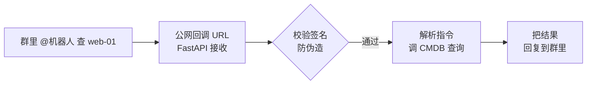

# 运维 CLI 与钉钉/企微机器人

::: tip 本篇定位
两件事：①用 **Click/Typer** 写一个带多子命令的运维 CLI（配置、日志、打包成单文件分发），并对比 **Go Cobra**；②写一个**钉钉/企业微信机器人**（加签校验、发文本/卡片、Webhook 自动化告警）。
本篇版本：Click 8.4.2、Typer 0.27.2、Go Cobra v1.10.2、requests 2.32、pyinstaller 6.x（2026-09 官网稳定版）。
:::

## 一、为什么要做 CLI

### 1.1 小白类比：把"菜单"装进命令行

Web 平台好用，但半夜告警、SSH 上服务器排查时，你不可能开浏览器点来点去。**CLI 就是把平台能力做成一个命令**：`opscli host list`、`opscli deploy web v1.4.2`，在终端里一条搞定。它是平台能力的"命令行皮肤"。

### 1.2 Click vs Typer vs Go Cobra

| 对比 | Click 8.4.2 | Typer 0.27.2 | Go Cobra v1.10.2 |
|---|---|---|---|
| 语言 | Python | Python | Go |
| 定义方式 | 装饰器 `@click.option` | Python 类型注解 | 结构体 + Run 函数 |
| 自动帮助 | 有 | 有（更好） | 有（kubectl 同款） |
| 分发 | pip / pyinstaller 打包 | 同左 | 编译成单二进制，无依赖 |
| 适合 | 传统脚本转 CLI | 新写 Python CLI | 要发单文件、高并发的工具 |

**结论**：Python 写小工具用 Typer（类型注解自动生成帮助）；要给全团队发一个"拷过去就能跑"的单文件、不想装 Python 环境，用 Go Cobra。

## 二、Typer 多子命令 CLI（完整可跑）

```python
# opscli.py —— 一个多子命令运维 CLI
# pip install "typer==0.27.2"
import typer
from rich import print  # 可选美化，没有就用普通 print

app = typer.Typer(help="运维平台命令行工具", no_args_is_help=True)
host_app = typer.Typer(help="主机相关")
app.add_typer(host_app, name="host")


@app.command("config")
def config(env: str = typer.Option("prod", help="环境 prod/staging")):
    """查看当前 CLI 配置。"""
    print(f"[green]当前环境:[/green] {env}")
    print("API 地址: http://cmdb.internal:8000")


@host_app.command("list")
def host_list(
    env: str = typer.Option("prod", help="过滤环境"),
    keyword: str = typer.Option("", help="按主机名/IP 模糊搜"),
):
    """列出主机（这里演示，真实调 CMDB 的 /api/hosts）。"""
    print(f"查询环境={env} 关键字={keyword or '(无)'}")
    # import requests
    # r = requests.get("http://cmdb.internal:8000/api/hosts",
    #                  params={"env_id": 1, "keyword": keyword})
    # for h in r.json():
    #     print(h["hostname"], h["ip"])


@host_app.command("ssh")
def host_ssh(host: str = typer.Argument(..., help="要登录的主机名/IP")):
    """快速 ssh 登录某台主机。"""
    print(f"[yellow]即将登录 {host}[/yellow]")
    # 真实实现：os.execvp("ssh", ["ops@" + host])


if __name__ == "__main__":
    app()
```

运行效果：

```bash
python opscli.py --help                 # 自动列出所有子命令
python opscli.py config --env staging   # 查看配置
python opscli.py host list --keyword web
python opscli.py host ssh web-01
```

::: tip Typer 爽点
参数类型直接写在函数签名里（`env: str = typer.Option(...)`），它自动生成 `--help`、自动做类型转换、缺参数自动报错。比老 Click 少写很多装饰器。
:::

### 2.1 打包成单文件可执行

```bash
pip install "typer==0.27.2" "pyinstaller>=6.0"
# 打包成单个二进制（不带控制台窗口用 --windowed，CLI 不要加）
pyinstaller -F --name opscli opscli.py
# 产物在 dist/opscli，拷给同事就能跑，不用装 Python
./dist/opscli host list
```

## 三、Go Cobra 简述与对比

K8s 的 `kubectl`、GitHub 的 `gh` 都是 Cobra 写的。Go 的优势是编译出**单文件二进制**，目标机零依赖：

```go
// opscli.go —— Go Cobra 最小示例（go get github.com/spf13/cobra@v1.10.2）
package main

import (
	"fmt"
	"github.com/spf13/cobra"
)

func main() {
	root := &cobra.Command{Use: "opscli", Short: "运维平台 CLI"}
	hostList := &cobra.Command{
		Use:   "list",
		Short: "列出主机",
		Run: func(cmd *cobra.Command, args []string) {
			env, _ := cmd.Flags().GetString("env")
			fmt.Printf("查询环境=%s\n", env)
		},
	}
	hostList.Flags().String("env", "prod", "环境")
	root.AddCommand(hostList)
	root.Execute()
}
```

```bash
go mod init opscli && go get github.com/spf13/cobra@v1.10.2
go build -o opscli .
./opscli list --env staging
```

## 四、钉钉/企业微信机器人

### 4.1 两种用法

| 用法 | 场景 | 实现 |
|---|---|---|
| **Outgoing（主动发）** | 告警推到群、工单催办通知 | Webhook + 加签 |
| **Incoming（被动收）** | 在群里 @机器人 查主机、提工单 | 公网回调 URL，验签后响应 |

### 4.2 钉钉机器人：加签 + 发消息（完整可跑）

钉钉安全设置选"加签"，发送时要用时间戳 + secret 做 HMAC-SHA256：

```python
# dingtalk_bot.py —— 钉钉自定义机器人，pip install requests
import time
import hmac
import hashlib
import base64
import urllib.parse
import requests

WEBHOOK = "https://oapi.dingtalk.com/robot/send?access_token=你的token"
SECRET = "SEC你的加签密钥"   # 从机器人安全设置里拿，走环境变量！


def _sign() -> dict:
    timestamp = str(round(time.time() * 1000))
    string_to_sign = f"{timestamp}\n{SECRET}"
    hmac_code = hmac.new(SECRET.encode(), string_to_sign.encode(),
                         digestmod=hashlib.sha256).digest()
    sign = urllib.parse.quote_plus(base64.b64encode(hmac_code))
    return {"timestamp": timestamp, "sign": sign}


def send_text(content: str, at_mobiles: list | None = None):
    url = WEBHOOK + "&" + "&".join(f"{k}={v}" for k, v in _sign().items())
    payload = {
        "msgtype": "text",
        "text": {"content": content},
        "at": {"atMobiles": at_mobiles or [], "isAtAll": False},
    }
    r = requests.post(url, json=payload, timeout=5)
    return r.json()


if __name__ == "__main__":
    # 告警示例：CPU 超限时推到群里
    print(send_text("【告警】web-01 CPU 使用率 92%，请值班同学处理",
                    at_mobiles=["13800000000"]))
```

发 Markdown 卡片只需换 `msgtype`：

```python
def send_markdown(title: str, text: str):
    url = WEBHOOK + "&" + "&".join(f"{k}={v}" for k, v in _sign().items())
    payload = {"msgtype": "markdown",
               "markdown": {"title": title, "text": text}}
    return requests.post(url, json=payload, timeout=5).json()
```

### 4.3 企业微信机器人

企wecom 机器人更简单——不用加签，直接在 Webhook URL 后带 `key`：

```python
# wecom_bot.py —— 企业微信群机器人
import requests

KEY = "你的企wecom机器人key"
WEBHOOK = f"https://qyapi.weixin.qq.com/cgi-bin/webhook/send?key={KEY}"


def send_text(content: str):
    payload = {"msgtype": "text", "text": {"content": content}}
    return requests.post(WEBHOOK, json=payload, timeout=5).json()
```

### 4.4 被动响应：在群里 @机器人



```python
# bot_callback.py —— FastAPI 接收机器人事件并响应
from fastapi import FastAPI, Request
import hashlib

app = FastAPI()
TOKEN = "你的校验token"  # 走环境变量

@app.post("/bot/event")
async def event(req: Request):
    body = await req.json()
    # 钉钉/企微都有自己的验签字段，这里示意
    msg = body.get("text", {}).get("content", "")
    if "查" in msg and "web" in msg:
        # 真实：调 CMDB /api/hosts?keyword=web
        return {"msgtype": "text",
                "text": {"content": "web-01 10.0.0.11 负责人: 张三"}}
    return {"msgtype": "text", "text": {"content": "没听懂，支持: 查<关键字>"}}
```

::: warning 生产红线
- **Webhook token / 加签 secret 一律走环境变量**，绝不写死在代码里提交 Git（见 [密钥管理](./devops-secrets)）。
- 被动回调必须做**签名校验**，否则任何人都能伪造请求打你的接口。
- 机器人是入口：解析用户指令时不要直接拼 shell 执行（命令注入），白名单匹配指令。
- CLI 分发版本写死：`typer==0.27.2`、cobra `v1.10.2`，不要 `latest`。
:::

## 五、常见问题排错

| 现象 | 原因 | 解决 |
|---|---|---|
| 钉钉返回 `sign not match` | 时间戳差太多/secret 错 | 服务器时间校时（NTP）；确认 secret 没多余空格 |
| 钉钉 `keywords 不匹配` | 安全设置加了关键词过滤 | 消息内容必须包含设置的关键词，或改用加签 |
| CLI `No module named rich` | 装了可选美化但目标机没有 | 别强依赖 rich，用普通 print，或打包时带上 |
| pyinstaller 产物杀软报毒 | 单文件打包常见误报 | 加 `--key` 或换 Nuitka；在内网分发说明白 |
| 企wecom 发消息 `invalid webhook url` | key 拼错/机器人被移出群 | 确认 key 正确、机器人还在群里 |
| Go 编译 `cannot find package` | 没 go get | 先 `go get github.com/spf13/cobra@v1.10.2` |

## 相关速查

- 平台能力来源：[自研 CMDB](./devdev-platform-cmdb)
- 告警/SLA 催办：[工单系统与监控大屏](./devdev-ticket-dashboard)
- 让 AI 帮你写 CLI：[运维 AI Prompt 速查](/reference/ai-prompts)
- Git 提交规范：[Git 命令速查](/reference/git-commands)

### 官方文档

- Typer 文档：https://typer.tiangolo.com/
- Click 文档：https://click.palletsprojects.com/
- Go Cobra 文档：https://cobra.dev/
- 钉钉自定义机器人：https://open.dingtalk.com/document/robots/custom-robot-access
- 企业微信群机器人：https://developer.work.weixin.qq.com/document/path/91770
- pyinstaller：https://pyinstaller.org/
