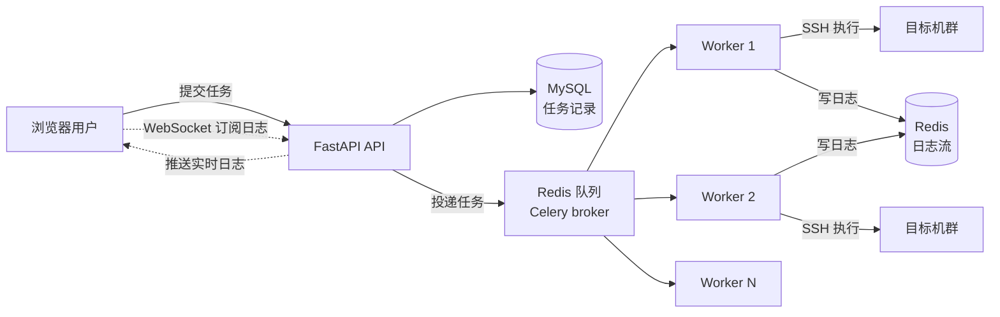
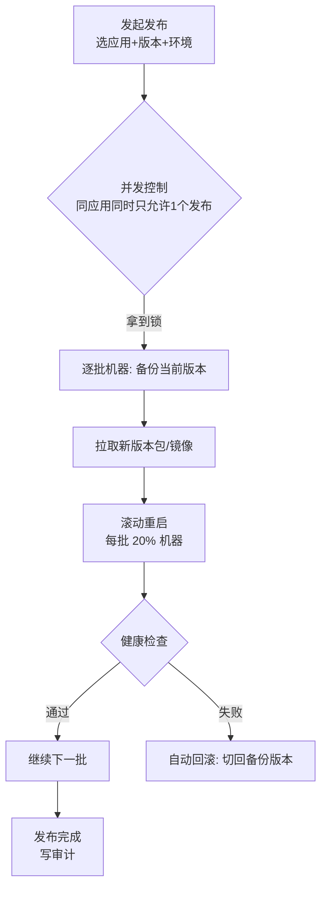

# 作业执行与发布平台

::: tip 本篇定位
造一个**面向运维的批量执行 + 发布平台**：在网页上选一批机器、填一条命令（或一次发布），后台通过队列异步执行，执行日志实时推到浏览器，带幂等、并发控制、审计和回滚。
本篇版本：FastAPI 0.141.1、Celery 5.6.3、Redis 7.4、SQLAlchemy 2.0.54、Pydantic 2.13.5、paramiko 5.0.0（2026-09 官网稳定版）。
:::

## 一、它解决什么痛点

### 1.1 小白类比：运维版"外卖骑手调度"

在终端里 `for h in 机器列表; do ssh $h 命令`，问题是：**命令一跑就是几分钟，你的 SSH 窗口卡住、断线就前功尽弃；100 台机器一起跑，密码打错一台就全停；更重要的是——谁在什么时候对哪批机器干了什么，完全没记录。**

作业平台像一个外卖调度系统：你（用户）下单（提交任务）→ 调度中心（Celery 队列）派给骑手（Worker）→ 骑手边跑边直播进度（WebSocket 回显）→ 全程录像（审计日志）。



## 二、整体架构与职责拆分

| 组件 | 技术 | 职责 |
|---|---|---|
| API 层 | FastAPI 0.141.1 | 接收任务、查询状态、WebSocket 推送日志 |
| 队列/broker | Redis 7.4 | 任务排队、结果后端、日志流缓存 |
| 执行 Worker | Celery 5.6.3 | 真正连 SSH 跑命令、逐行采集输出 |
| 存储 | MySQL | 任务元数据、操作人、审计 |
| 前端 | Vue | 选机器、填命令、实时日志窗口、发布/回滚按钮 |

**为什么不能在 API 里直接跑命令？** HTTP 请求是同步的，一条命令跑 5 分钟，Worker 进程会被占死，并发一上来就雪崩。必须"API 立即返回任务 ID，后台异步跑，日志单独推"。

## 三、任务数据模型与 API 设计

### 3.1 任务表结构

| 字段 | 类型 | 说明 |
|---|---|---|
| id | int PK | 任务 ID |
| task_uuid | str | Celery 任务 ID，幂等键 |
| operator | str | 操作人（必须记） |
| command | str | 要执行的命令 |
| hosts | json | 目标主机列表 |
| status | str | pending / running / success / failed |
| created_at | datetime | 提交时间 |

### 3.2 API 路由设计

| 方法 | 路径 | 说明 |
|---|---|---|
| POST | `/api/jobs` | 提交任务，返回 `{task_uuid}` |
| GET | `/api/jobs/{uuid}` | 查任务状态与结果 |
| GET | `/ws/jobs/{uuid}` | WebSocket 实时订阅日志 |
| POST | `/api/releases` | 发起一次发布（带回滚动作） |

## 四、关键代码骨架

### 4.1 Celery 配置与任务（worker.py）

```python
# worker.py —— Celery 应用与执行任务，python -m celery -A worker worker -l info
from celery import Celery
import paramiko

BROKER = "redis://127.0.0.1:6379/0"
app_celery = Celery("opsjobs", broker=BROKER, backend=BROKER)

# 每个 worker 最多同时处理 4 个任务，防止一台机器打满 SSH
app_celery.conf.update(worker_concurrency=4, task_acks_late=True)


def _run_on_host(host: str, command: str, key_path: str) -> dict:
    """在单台机器执行命令，返回 stdout/stderr/退出码。"""
    client = paramiko.SSHClient()
    client.set_missing_host_key_policy(paramiko.AutoAddPolicy())
    client.connect(hostname=host, username="ops", key_filename=key_path, timeout=5)
    _in, out, err = client.exec_command(command, timeout=300)
    code = out.channel.recv_exit_status()
    client.close()
    return {"host": host, "code": code,
            "stdout": out.read().decode().strip(),
            "stderr": err.read().decode().strip()}


@app_celery.task(bind=True, name="opsjobs.batch_exec")
def batch_exec(self, command: str, hosts: list, key_path: str):
    """批量在多台机器执行，逐台写 Redis 日志流。"""
    results = []
    for i, host in enumerate(hosts):
        # 进度写到 Redis list，供 WebSocket 推送
        self.redis_client.lpush(f"log:{self.request.id}", f"[{i+1}/{len(hosts)}] {host} 开始")
        try:
            r = _run_on_host(host, command, key_path)
        except Exception as e:  # 单台失败不影响其他机器
            r = {"host": host, "code": -1, "stderr": str(e)}
        results.append(r)
        self.redis_client.lpush(f"log:{self.request.id}",
                                f"{host} 退出码={r['code']}")
    return {"results": results, "ok": all(r["code"] == 0 for r in results)}
```

::: tip Redis 日志流
这里把每台机器的输出 `lpush` 到 `log:{task_uuid}`，前端 WebSocket 连上后由 API 层持续 `lrange` 读取并推送，实现"边跑边看"。
:::

### 4.2 FastAPI 提交任务与 WebSocket（main.py）

```python
# main.py —— FastAPI 入口
import redis
from fastapi import FastAPI, WebSocket, WebSocketDisconnect, Depends
from pydantic import BaseModel

from worker import batch_exec

app = FastAPI(title="作业执行平台")
rd = redis.Redis(host="127.0.0.1", port=6379, db=0)


class JobIn(BaseModel):
    command: str
    hosts: list[str]
    operator: str
    key_path: str = "/home/ops/.ssh/id_ed25519"


@app.post("/api/jobs")
def submit(job: JobIn):
    # 幂等：同一操作人 + 同一命令 + 同一批主机，5 分钟内不重复提交
    dedup_key = f"dedup:{job.operator}:{hash(job.command)}-{hash(tuple(job.hosts))}"
    if rd.exists(dedup_key):
        return {"task_uuid": rd.get(dedup_key).decode(), "dedup": True}
    async_result = batch_exec.delay(job.command, job.hosts, job.key_path)
    rd.setex(dedup_key, 300, async_result.id)
    return {"task_uuid": async_result.id, "dedup": False}


@app.get("/api/jobs/{task_uuid}")
def job_status(task_uuid: str):
    res = batch_exec.AsyncResult(task_uuid)
    return {"state": res.state, "result": res.result if res.ready() else None}


@app.websocket("/ws/jobs/{task_uuid}")
async def ws_log(websocket: WebSocket, task_uuid: str):
    await websocket.accept()
    last = 0
    try:
        while True:
            # 从上次偏移继续读新日志
            total = rd.llen(f"log:{task_uuid}")
            if total > last:
                lines = rd.lrange(f"log:{task_uuid}", last, total - 1)
                for line in reversed(lines):  # lpush 是头插，倒序才是时间序
                    await websocket.send_text(line.decode())
                last = total
            if batch_exec.AsyncResult(task_uuid).ready():
                await websocket.send_text("__DONE__")
                break
    except WebSocketDisconnect:
        pass
```

### 4.3 发布与回滚



发布比批量执行多两件事：**每批之间留健康检查窗口、失败自动回滚**。回滚命令要和发布命令成对保存（见下表），记录在任务表里，点一下"回滚"就把上一版重新跑一遍。

| 动作 | 命令示例 | 幂等键 |
|---|---|---|
| 发布 | `deploy.sh app=web ver=v1.4.2` | `rel:{app}:{env}:{ver}` |
| 回滚 | `deploy.sh app=web ver=v1.4.1 rollback=1` | `rel:{app}:{env}:{ver}:rb` |

## 五、幂等、并发与审计

### 5.1 三条硬规则

| 规则 | 为什么 | 实现 |
|---|---|---|
| **幂等** | 用户手抖点两次"重启"，不该重启两遍 | 提交前用 Redis `setex` 做 5 分钟去重键 |
| **并发控制** | 同应用同时两个发布，互相覆盖 | 对 `rel:{app}:{env}` 加分布式锁（`SET NX EX`），拿不到就拒绝 |
| **审计** | 出事要查"谁干的" | 任务表强制 `operator` 字段，所有写操作落 MySQL |

### 5.2 分布式锁片段

```python
# 对某个资源加锁，防止并发操作（发布/扩容这类）
def acquire_lock(resource: str, ttl: int = 600) -> bool:
    return rd.set(f"lock:{resource}", "1", nx=True, ex=ttl)

def release_lock(resource: str):
    rd.delete(f"lock:{resource}")
```

::: warning 生产红线
- **执行账号最小权限**：SSH 账号 `ops` 只能跑约定的 `deploy.sh`/`restart.sh`，禁止 root、禁止交互式 shell；密钥走 [密钥管理](./devops-secrets)。
- 命令执行平台是**高危入口**：必须登录鉴权 + 操作人审计 + IP 白名单，绝不能裸奔到公网。
- `task_acks_late=True`：Worker 中途崩溃，任务会重新投递，所以执行命令要**幂等**（重跑一遍不破坏状态）。
- 并发要限流：`worker_concurrency=4` + 每批机器数限制，防止一次 SSH 几百台把跳板机打爆。
- 依赖写死：`celery==5.6.3`、`redis>=5.0`、`paramiko==5.0.0`，不用 `latest`。
:::

## 六、常见问题排错

| 现象 | 原因 | 解决 |
|---|---|---|
| 提交任务后 Worker 没动静 | broker 地址不通/没启动 worker | 先 `redis-cli ping`；确认 `celery -A worker worker` 已起 |
| WebSocket 一直没日志 | Redis key 方向读反 | `lpush` 头插，读时要倒序，且按 `last` 偏移递增 |
| 单台失败整批卡住 | 没做单台 try/except | 每台机器独立捕获异常，失败记结果继续下一台 |
| 任务重跑导致重复操作 | 没做幂等 | 提交前去重键 + 命令本身幂等 |
| 发布到一半 Worker OOM | 并发/输出过大 | 降 `worker_concurrency`，大输出写文件而不是全塞内存 |
| SSH 连接超时 | 目标机防火墙/密钥权限 | 手动 `ssh -i key ops@host` 验证；私钥权限 600 |

## 相关速查

- CI/CD 流水线（与本平台互补）：[CI/CD 进阶与渐进式交付](./devops-cicd-advanced)
- 数据底座：[自研 CMDB](./devdev-platform-cmdb)
- 密钥：[密钥与证书管理](./devops-secrets)
- K8s 滚动发布：[云原生命令速查](/reference/cloudnative-commands)

### 官方文档

- FastAPI WebSocket：https://fastapi.tiangolo.com/tutorial/websockets/
- Celery 文档：https://docs.celeryq.dev/
- Redis 文档：https://redis.io/docs/
- paramiko 文档：https://www.paramiko.org/
- SQLAlchemy：https://docs.sqlalchemy.org/
