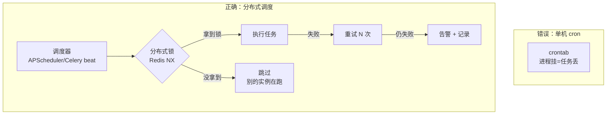
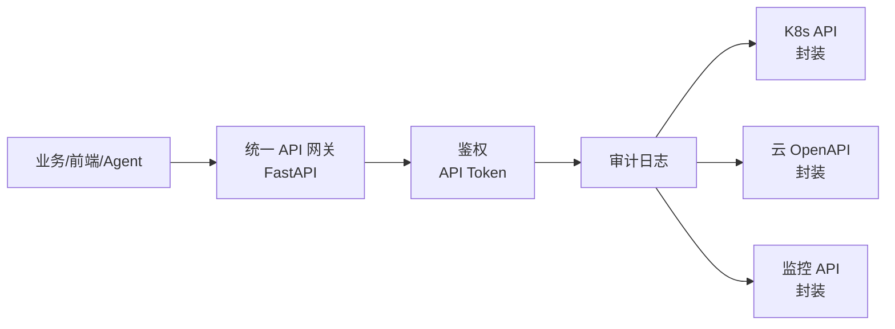
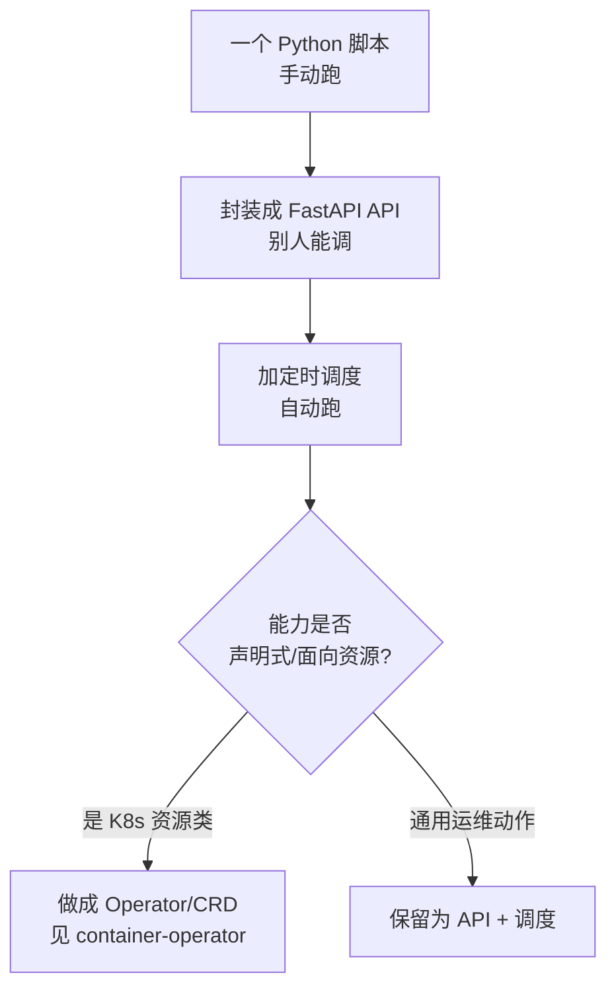

# 任务调度与 API 产品化

::: tip 本篇定位
讲两件事的收尾：①**定时任务怎么可靠地跑**（APScheduler/Celery beat、持久化、分布式锁、失败重试、可观测）；②**把运维能力封装成统一 API**（对接 K8s/云/监控、鉴权、权限审计、灰度配额），并在合适的时候 Operator 化。
本篇版本：APScheduler 3.11.3、Celery 5.6.3、Redis 7.4、FastAPI 0.141.1、SQLAlchemy 2.0.54（2026-09 官网稳定版）。
:::

## 一、为什么定时任务也会出事

### 1.1 小白类比：闹钟为什么会连环响/不响

定时任务就是给服务器上闹钟：每天凌晨 2 点对账、每 5 分钟巡检。但单机闹钟有三个经典坑——**进程挂了闹钟不响（单点）、起了两个进程闹钟响两遍（重复执行）、任务失败没人知道（静默失败）**。运维平台的调度层，就是要把这三个坑填上。



## 二、调度方案选型

| 方案 | 适合 | 持久化 | 分布式 |
|---|---|---|---|
| Linux crontab | 单机简单任务 | 无 | 无，会重复跑 |
| APScheduler 3.11.3 | Python 内嵌、轻量定时 | SQLAlchemyJobStore 落库 | 需自己加锁 |
| Celery beat | 已有 Celery 任务体系 | 用 Redis/RDB 存 schedule | beat 单实例，Worker 多实例消费 |
| K8s CronJob | 云原生、要隔离 | K8s 托管 | 自带并发策略 |

**经验法则**：已经用 Celery 跑作业（见 [作业执行平台](./devdev-job-release)），定时就用 **Celery beat**；独立的轻量定时脚本用 **APScheduler**；要跑成容器、和 K8s 生态打通就上 **K8s CronJob**（见 [Operator/CRD](./container-operator)）。

## 三、APScheduler 持久化 + 分布式锁骨架

```python
# scheduler.py —— 可靠的定时调度入口
# pip install "apscheduler==3.11.3" "redis>=5.0"
import time
import redis
from apscheduler.schedulers.background import BackgroundScheduler
from apscheduler.jobstores.sqlalchemy import SQLAlchemyJobStore

rd = redis.Redis(host="127.0.0.1", port=6379, db=0)
# 任务定义持久化到 MySQL，重启不丢
jobstore = SQLAlchemyJobStore(url="mysql+pymysql://ops:密码@127.0.0.1:3306/scheduler?charset=utf8mb4")
sched = BackgroundScheduler(jobstores={"default": jobstore})


def with_lock(lock_key: str, ttl: int = 300):
    """装饰器：分布式锁，保证同一时刻只有一个实例执行。"""
    def deco(fn):
        def wrapper(*args, **kwargs):
            if not rd.set(f"lock:{lock_key}", "1", nx=True, ex=ttl):
                print(f"[{lock_key}] 已有实例在跑，跳过")
                return
            try:
                return fn(*args, **kwargs)
            finally:
                rd.delete(f"lock:{lock_key}")
        return wrapper
    return deco


@with_lock("cmdb-reconcile", ttl=600)
def cmdb_reconcile():
    """每天 CMDB 对账，见 CMDB 篇第六节。"""
    print("开始对账...")
    time.sleep(1)


@with_lock("monitor-snapshot", ttl=120)
def monitor_snapshot():
    """每 5 分钟抓一次监控快照落库。"""
    print("抓监控快照...")


# misfire_grace_time: 进程重启后错过的任务，宽限 60 秒内补跑
# coalesce=True: 积压多次只跑一次，避免补跑风暴
sched.add_job(cmdb_reconcile, "cron", hour=2, minute=0,
              id="cmdb_reconcile", misfire_grace_time=60, coalesce=True)
sched.add_job(monitor_snapshot, "interval", minutes=5,
              id="monitor_snapshot", misfire_grace_time=60, coalesce=True)

if __name__ == "__main__":
    sched.start()
    print("调度器已启动，已注册:", [j.id for j in sched.get_jobs()])
    try:
        while True:
            time.sleep(3600)
    except (KeyboardInterrupt, SystemExit):
        sched.shutdown()
```

### 3.1 失败重试与可观测

| 需求 | 做法 |
|---|---|
| 任务失败重试 | 函数内部 `try/except` + 指数退避重试 3 次 |
| 失败告警 | 重试仍失败 → 调 [机器人](./devdev-cli-bot) 推群 |
| 执行记录 | 每次执行写 `job_run` 表（开始/结束/耗时/状态） |
| 监控 | 暴露 `/metrics`：任务次数、失败率、耗时（接 Prometheus） |

::: warning 为什么要 coalesce + 分布式锁
进程重启后，APScheduler 发现"本该凌晨 2 点跑的对账没跑"，**默认会立刻补跑一次**；如果你积压了 10 次，它能补跑 10 次把数据库打挂。`coalesce=True` 让它只补跑一次；`with_lock` 保证多副本部署时不会两个进程同时跑同一个对账。
:::

## 四、统一 API 封装与鉴权

把 K8s、云厂商、监控系统的能力，**不要让前端/调用方各自去调**，而是在你的平台里收一层统一网关：



### 4.1 统一鉴权依赖

```python
# auth.py —— FastAPI 依赖：校验 Token + 记录审计
from fastapi import Depends, Header, HTTPException
import redis

rd = redis.Redis(host="127.0.0.1", port=6379, db=0)
# 真实：token -> 角色 存在 MySQL/Redis
VALID_TOKENS = {"tok-ops-readonly": "read", "tok-ops-admin": "admin"}


def auth(x_api_token: str = Header(None)):
    if not x_api_token or x_api_token not in VALID_TOKENS:
        raise HTTPException(401, "无效 Token")
    role = VALID_TOKENS[x_api_token]
    return {"token": x_api_token, "role": role}


def require_admin(user: dict = Depends(auth)):
    if user["role"] != "admin":
        raise HTTPException(403, "需要 admin 权限")
    return user
```

### 4.2 权限模型（RBAC）

| 角色 | 能读 | 能写/执行 |
|---|---|---|
| read | CMDB、监控、工单查询 | 无 |
| ops | 读 + 提交作业 | 不能删资产、不能改权限 |
| admin | 全部 | 发布、删除、配置调度 |

所有写操作走 `require_admin`，并在网关层写一条审计日志：`谁、什么时候、调了哪个接口、带了什么参数、结果`。

## 五、服务化与 Operator 化



**判断标准**：如果你的能力是"管理一类有期望状态的资源"（比如"我声明 3 个从库，你帮我保持 3 个"），就适合做成 K8s Operator（见 [Operator/CRD 模式](./container-operator)）；如果是"一次性动作/定时巡检"，保持成 API + 调度即可，别过度 Operator 化。

## 六、产品化要素

一个内部工具要变成"产品"被团队真正用起来，光能跑不够：

| 要素 | 说明 |
|---|---|
| 文档 | FastAPI 自带 `/docs`；补一份 README 写清能干什么、不能干什么 |
| 多环境 | dev/staging/prod 三套配置隔离，一个环境的发布不影响另一个 |
| 灰度 | 新接口先小流量内测，再全量；新任务先在 staging 跑一周 |
| 配额 | 限制单用户并发任务数、每天调用次数，防止被误刷 |
| 可观测 | 接口成功率、耗时、任务失败率上大屏（见 [监控大屏](./devdev-ticket-dashboard)） |

::: warning 生产红线
- 调度器必须**多副本 + 分布式锁**，绝不能只靠单进程；锁 key 要带任务 ID，避免不同任务互相阻塞。
- 所有写接口强制鉴权 + 审计；Token 走环境变量/[密钥管理](./devops-secrets)，不进 Git。
- `misfire_grace_time` + `coalesce` 一定要配，防止重启补跑风暴。
- 任务失败必须有告警出口（机器人），不能静默失败。
- 依赖写死：`apscheduler==3.11.3`、`celery==5.6.3`，不用 `latest`。
:::

## 七、常见问题排错

| 现象 | 原因 | 解决 |
|---|---|---|
| 定时任务一天跑了两遍 | 起了两个 scheduler 进程，没加锁 | 加 `with_lock`；或只跑一个 beat 实例 |
| 重启后任务堆一起狂跑 | 没配 coalesce | `coalesce=True`，宽限内只补一次 |
| 任务到点没跑 | 进程挂了/时间时区错 | 确认进程存活；容器里时区设为 Asia/Shanghai |
| 接口被刷爆 | 没配额/没鉴权 | 加 Token + 并发限制 + Redis 计数配额 |
| 任务失败没人知道 | 没接告警出口 | 失败 → 机器人推群 |
| 想做成 Operator 又犹豫 | 过度设计 | 先 API + 调度，确认是"声明式资源"再 Operator 化 |

## 相关速查

- 作业执行（Celery 任务来源）：[作业执行与发布平台](./devdev-job-release)
- 对账任务数据底座：[自研 CMDB](./devdev-platform-cmdb)
- 告警出口：[运维 CLI 与机器人](./devdev-cli-bot)
- Operator 化深入：[Operator/CRD 模式](./container-operator)
- 密钥：[密钥与证书管理](./devops-secrets)

### 官方文档

- APScheduler 文档：https://apscheduler.readthedocs.io/
- Celery Beat：https://docs.celeryq.dev/en/stable/userguide/periodic-tasks.html
- FastAPI 依赖与安全：https://fastapi.tiangolo.com/tutorial/dependencies/
- Redis 文档：https://redis.io/docs/
- SQLAlchemy：https://docs.sqlalchemy.org/
