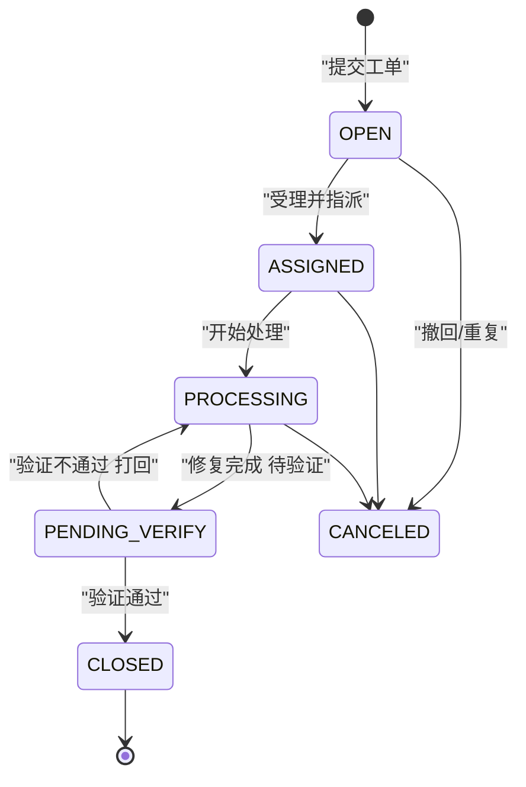
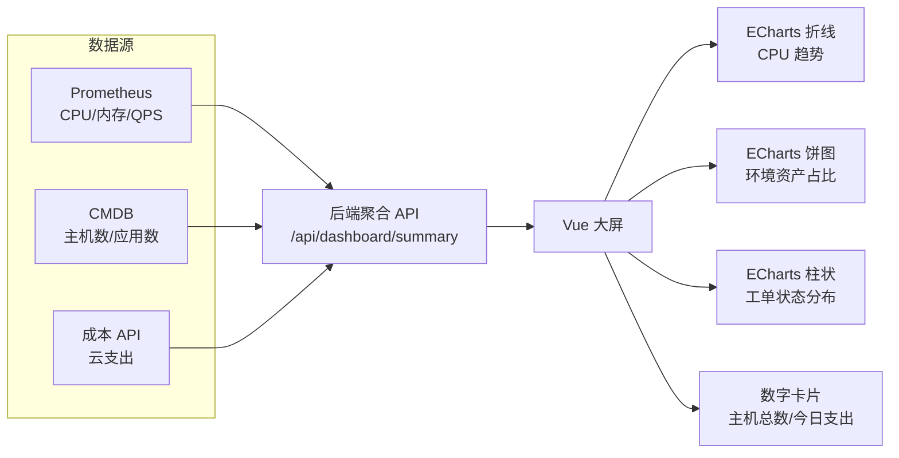

# 工单系统与监控大屏

::: tip 本篇定位
两块一起做：①一个轻量**运维工单系统**（状态机流转 + SLA + 通知）；②一块**监控大屏**（把 Prometheus、CMDB、成本 API 的数据聚合成 Vue + ECharts 图表，自动刷新）。
本篇版本：FastAPI 0.141.1、SQLAlchemy 2.0.54、Pydantic 2.13.5、Vue 3.5.43、Apache ECharts 6.1.0、Prometheus 3.x（2026-09 官网稳定版）。
:::

## 一、工单系统

### 1.1 小白类比：报修单的"传送带"

工单就是把"某个同事说系统慢"这件事变成一张有编号、有状态、有负责人、有时限的单子：新建 → 受理 → 处理中 → 待验证 → 关闭，全程可追踪、超时自动催。没有它，问题散落在聊天记录里，谁也不知道处理到哪了。

### 1.2 工单状态机



### 1.3 状态与字段设计

| 字段 | 说明 |
|---|---|
| id / no | 工单号（如 INC-20260930-001） |
| title / description | 标题、描述 |
| status | open / assigned / processing / pending_verify / closed / canceled |
| reporter / assignee | 报告人 / 处理人 |
| priority | P1~P4，决定 SLA 时限 |
| sla_deadline | 截止时间（创建时按优先级算出） |

### 1.4 SLA 时限表

| 优先级 | 含义 | 响应时限 | 解决时限 |
|---|---|---|---|
| P1 | 核心业务不可用 | 15 分钟 | 2 小时 |
| P2 | 重要功能受损 | 30 分钟 | 8 小时 |
| P3 | 一般问题 | 2 小时 | 3 个工作日 |
| P4 | 咨询/优化 | 1 天 | 5 个工作日 |

超时处理：一个定时任务（见 [任务调度与 API 产品化](./devdev-scheduler-api)）每分钟扫 `sla_deadline < now() 且 status 未 closed` 的单子，自动给 assignee 发钉钉/企微催办（机器人见 [运维 CLI 与机器人](./devdev-cli-bot)）。

## 二、后端工单 API 骨架

```python
# tickets.py —— FastAPI 工单路由
from datetime import datetime, timedelta
from fastapi import APIRouter, Depends, HTTPException
from pydantic import BaseModel
from sqlalchemy.orm import Session
import models  # 复用 CMDB 篇的 engine/get_db

router = APIRouter(prefix="/api/tickets", tags=["tickets"])

SLA = {"P1": (timedelta(minutes=15), timedelta(hours=2)),
       "P2": (timedelta(minutes=30), timedelta(hours=8)),
       "P3": (timedelta(hours=2), timedelta(days=3)),
       "P4": (timedelta(days=1), timedelta(days=5))}


class TicketIn(BaseModel):
    title: str
    description: str = ""
    priority: str = "P3"
    reporter: str


@router.post("")
def create_ticket(body: TicketIn, db: Session = Depends(models.get_db)):
    if body.priority not in SLA:
        raise HTTPException(400, "priority 必须是 P1~P4")
    resp, solve = SLA[body.priority]
    t = models.Ticket(**body.model_dump(),
                     status="open",
                     sla_deadline=datetime.now() + solve)
    db.add(t)
    db.commit()
    db.refresh(t)
    return {"id": t.id, "no": t.no, "status": t.status,
            "sla_deadline": t.sla_deadline}


# 合法状态流转表：from_state -> 允许的 to_state
ALLOWED = {
    "open": {"assigned", "canceled"},
    "assigned": {"processing", "canceled"},
    "processing": {"pending_verify", "canceled"},
    "pending_verify": {"processing", "closed"},
}


@router.post("/{tid}/transition")
def transit(tid: int, to_state: str, db: Session = Depends(models.get_db)):
    t = db.get(models.Ticket, tid)
    if not t:
        raise HTTPException(404, "工单不存在")
    if to_state not in ALLOWED.get(t.status, set()):
        raise HTTPException(400, f"不允许从 {t.status} 流转到 {to_state}")
    t.status = to_state
    db.commit()
    return {"id": t.id, "status": t.status}
```

::: tip 状态机为什么要用白名单表
`ALLOWED` 把"哪些状态能去哪"显式列出来，而不是谁都能随便改 status。这样前端按钮、后端校验、审计三处用同一张表，不会出现"关闭的单子被改成 open"这种脏数据。
:::

## 三、监控大屏：数据聚合

### 3.1 数据从哪来



大屏不是直接连数据库，而是后端起一个 `/api/dashboard/summary` 接口，**把多个源的数据拼成一个 JSON** 再给前端，前端只管画图。这样换数据源不用动前端。

### 3.2 后端聚合 API 骨架

```python
# dashboard.py —— 大屏数据聚合
import requests
from fastapi import APIRouter

router = APIRouter(prefix="/api/dashboard", tags=["dashboard"])
PROM = "http://127.0.0.1:9090"


def prom_query(query: str):
    r = requests.get(f"{PROM}/api/v1/query", params={"query": query}, timeout=5)
    data = r.json()["data"]["result"]
    return [{"name": m["metric"].get("instance", "?"),
             "value": float(m["value"][1])} for m in data]


@router.get("/summary")
def summary():
    return {
        "cpu_top": prom_query("topk(5, avg by(instance)(rate(node_cpu_seconds_total[5m])))"),
        "host_count": 128,            # 真实从 CMDB 统计
        "app_count": 42,
        "ticket_open": 7,
        "cost_today_cny": 3520.5,
        "ts": __import__("datetime").datetime.now().isoformat(),
    }
```

::: warning 不要让前端直连 Prometheus
大屏页面要是直接调 Prometheus，权限和数据源就散了。后端聚合层还能加缓存（Redis 存 30 秒），避免大屏每 5 秒刷新一次就把 Prometheus 打一遍。
:::

## 四、Vue + ECharts 大屏关键代码

```vue
<!-- Dashboard.vue  Vue 3.5.43 + ECharts 6.1.0 -->
<template>
  <div class="screen">
    <div class="cards">
      <div class="card">主机总数 <b>{{ data.host_count }}</b></div>
      <div class="card">今日支出 ¥{{ data.cost_today_cny }}</div>
      <div class="card">未闭环工单 <b>{{ data.ticket_open }}</b></div>
    </div>
    <div ref="cpuChart" style="width:600px;height:360px"></div>
  </div>
</template>

<script setup>
import { ref, onMounted, onUnmounted } from "vue";
import * as echarts from "echarts";

const data = ref({});
let chart, timer;

async function load() {
  const resp = await fetch("/api/dashboard/summary");
  data.value = await resp.json();
  chart.setOption({
    title: { text: "CPU Top5" },
    tooltip: {},
    xAxis: { type: "category", data: data.value.cpu_top.map(i => i.name) },
    yAxis: { type: "value" },
    series: [{ type: "bar", data: data.value.cpu_top.map(i => i.value) }],
  });
}

onMounted(() => {
  chart = echarts.init(document.querySelector(".screen > div:last-child"));
  load();
  timer = setInterval(load, 5000);   // 5 秒自动刷新
});
onUnmounted(() => clearInterval(timer));
</script>
```

### 4.1 大屏图表设计建议

| 图表类型 | 展示什么 | 刷新频率 |
|---|---|---|
| 数字卡片 | 主机总数、今日支出、未闭环工单 | 30 秒 |
| 折线图 | CPU/QPS 24h 趋势 | 30 秒~1 分钟 |
| 饼图 | 各环境资产占比（prod/staging/dev） | 5 分钟 |
| 柱状图 | 工单状态分布 / P1~P4 数量 | 30 秒 |

::: tip 大屏不是操作台
大屏只做**展示**，不要把编辑、审批按钮塞上去。它挂在值班室墙上，远距离一眼看清健康度；操作还是回到后台管理页。
:::

## 五、常见问题排错

| 现象 | 原因 | 解决 |
|---|---|---|
| 大屏图表空白 | ECharts 容器宽高为 0 | 给 `div` 设固定宽高，或 `resize` 监听窗口 |
| 数据不刷新 | `setInterval` 没起/组件卸载没清 | `onUnmounted` 里 `clearInterval` |
| Prometheus 查询报 400 | PromQL 写错/时间格式 | 先在 Prometheus 页面手动试好再写进代码 |
| 工单能乱改状态 | 没做白名单流转 | 用 `ALLOWED` 表，拒绝非法跳转 |
| SLA 不催办 | 定时任务没配 | 见 [任务调度](./devdev-scheduler-api) 配每分钟巡检 |
| 大屏打开慢 | 每次都查多个源没缓存 | 后端 Redis 缓存 summary 30 秒 |

::: warning 生产红线
- 大屏接口不要暴露内网 Prometheus/CMDB 的查询权限——只通过聚合 API 取预先算好的指标。
- 自动刷新频率别太激进（建议 ≥5 秒），否则几十个浏览器同时刷新会压垮后端。
- 工单号、SLA 时间一律服务端生成，不要信前端传的 `created_at`。
- 依赖写死：`echarts@6.1.0`、`vue@3.5.43`、`fastapi==0.141.1`，不用 `latest`。
:::

## 相关速查

- 数据底座：[自研 CMDB](./devdev-platform-cmdb)
- SLA/SLO 原理：[SRE 稳定性](./monitor-slo)
- 值班通知机器人：[运维 CLI 与钉钉/企微机器人](./devdev-cli-bot)
- 监控数据：[Prometheus](./monitor-prometheus)

### 官方文档

- FastAPI 文档：https://fastapi.tiangolo.com/
- Vue 文档：https://cn.vuejs.org/
- Apache ECharts 文档：https://echarts.apache.org/zh/
- Prometheus HTTP API：https://prometheus.io/docs/prometheus/latest/querying/api/
- SQLAlchemy：https://docs.sqlalchemy.org/
