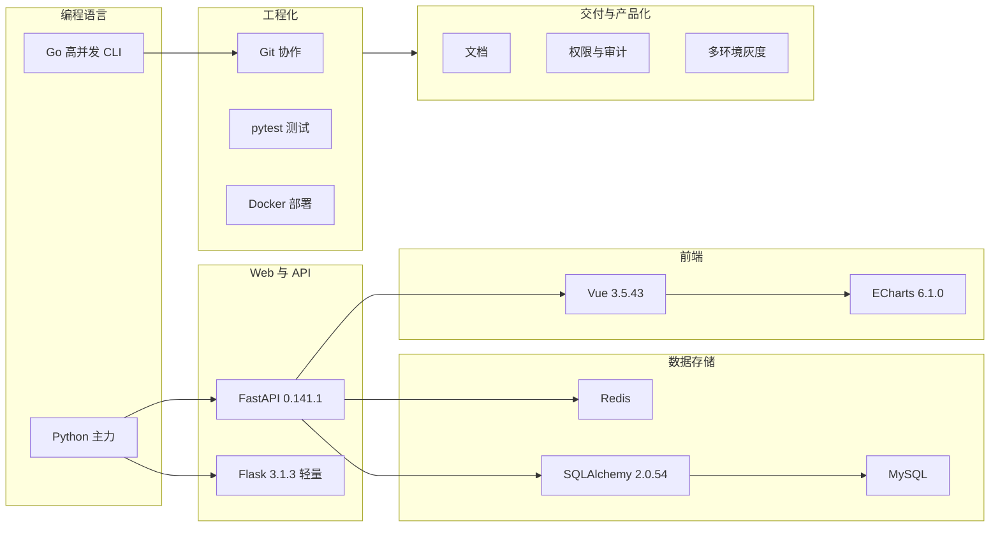
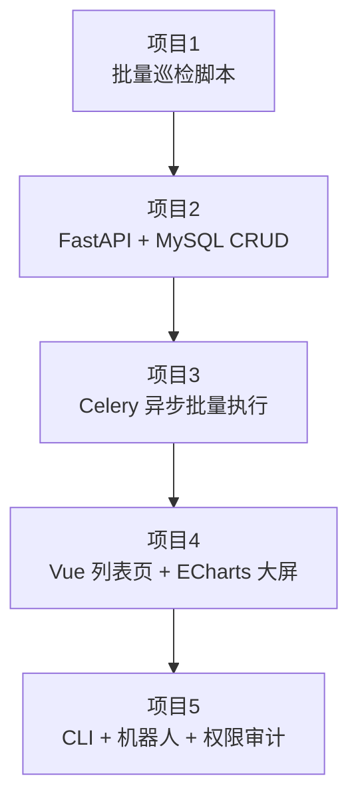
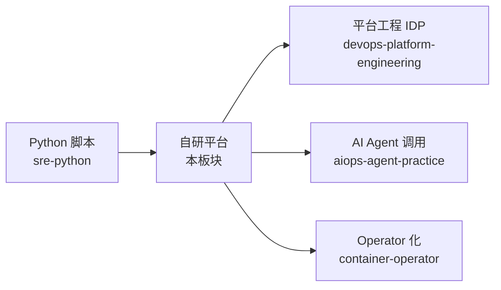

# 运维为什么写代码与能力地图

::: tip 本篇定位
回答两个问题：**运维到底要不要自己写代码、写到什么程度？** 以及 **从只会敲 shell 脚本到能自研一套运维平台，技术栈该怎么补、按什么顺序学？**
本篇版本：FastAPI 0.141.1、Flask 3.1.3、SQLAlchemy 2.0.54、Pydantic 2.13.5、Celery 5.6.3、Click 8.4.2、Typer 0.27.2、Go Cobra v1.10.2、Vue 3.5.43、ECharts 6.1.0、paramiko 5.0.0、APScheduler 3.11.3（均为 2026-09 官网当前稳定版）。
:::

## 一、为什么运维要写代码

### 1.1 小白类比：从"修水管的"到"造阀门的"

传统运维像大楼里的水电工：哪层漏水了、哪个闸跳了，拎着工具上门。问题是——**每次漏水都得你亲自跑一趟，楼盖到 100 层、机房扩到上千台，你就跑断腿也修不完。**

写代码的本质，是把你脑子里那套"遇到 X 就按 Y 步骤处理"的经验，变成一台**自动运转的阀门/流水线**：漏水了它自己关闸、自己报警、自己记日志。你从"干活的人"变成"设计和维护这套自动装置的人"。

### 1.2 写代码的三重价值

| 价值 | 大白话 | 典型产出 |
|---|---|---|
| **替代重复劳动** | 每周手动做 20 台机器的巡检，写个脚本 5 分钟跑完 | 巡检脚本、批量改配置、自动发邮件 |
| **把经验产品化** | 你脑子里的"发布 7 步"不再只存在于你的脑内，团队谁都能用 | CMDB、发布平台、工单系统、CLI |
| **突破职业天花板** | 只会执行，替代你的是外包；能造工具，替代你的是 AI | 平台工程师、SRE、架构师 |

> 一句话：**shell 脚本解决"一次只做一遍的事"，写 Web/API 解决"全团队天天都要用的事"。** 后者才是运维从执行层跨到产品层的门槛。

### 1.3 运维写代码 ≠ 转岗当开发

要划清一条线：运维写代码的目标是**把自己的运维工作变高效、把团队的运维流程变标准**，不是去和后端工程师拼业务系统的复杂度。所以你不需要学微服务全家桶，但下面这几块必须会：

- 一门主力脚本语言（Python，本知识库已有 [Python 运维自动化](./sre-python)）。
- 一个能起 HTTP 服务的 Web 框架（FastAPI 首选）。
- 数据库（MySQL 存结构化数据 + Redis 做缓存/队列）。
- 一点前端（Vue + ECharts，做出能给老板看的页面）。
- 工程化基本功（Git、测试、Docker 打包部署）。

## 二、能力地图

### 2.1 一张图看清要补哪些栈



### 2.2 分层技术栈选型表

| 层 | 首选 | 备选 | 为什么这么选 |
|---|---|---|---|
| 主力语言 | Python 3.12+ | Go | 运维生态（paramiko、requests、celery）全在 Python |
| Web 框架 | FastAPI 0.141.1 | Flask 3.1.3 | FastAPI 自带 Pydantic 校验 + 自动 Swagger 文档，写 API 极快；Flask 适合超小工具 |
| ORM | SQLAlchemy 2.0.54 | 裸 SQL | 防 SQL 注入、表结构即代码；2.0 语法是当前主流 |
| 数据校验 | Pydantic 2.13.5 | — | FastAPI 内置，请求/响应模型自动生成 |
| 异步任务 | Celery 5.6.3 + Redis | APScheduler 3.11.3 | 长任务（批量 SSH、发布）不能堵住 HTTP 请求 |
| CLI | Typer 0.27.2 | Click 8.4.2 / Cobra v1.10.2 | Typer 基于类型注解；Click 生态更广；Go 写单文件分发方便 |
| 远程执行 | paramiko 5.0.0 | Ansible | 脚本里嵌 SSH 调机；大规模编排用 [Ansible](./automation-ansible) |
| 前端 | Vue 3.5.43 | 原生 HTML | 后台管理生态成熟，上手快 |
| 图表 | ECharts 6.1.0 | — | 运维大屏事实标准 |

### 2.3 FastAPI vs Flask：运维平台怎么选

| 对比 | FastAPI 0.141.1 | Flask 3.1.3 |
|---|---|---|
| 性能 | 异步 ASGI，高并发强 | 同步 WSGI，够用 |
| 参数校验 | Pydantic 自动校验 | 手写或装插件 |
| 接口文档 | 自动生成 `/docs` Swagger | 要装 flask-restx |
| 学习曲线 | 需要懂类型注解 | 极简，几行起服务 |
| 适合 | 自研平台、对外 API | 内部小工具、脚本套壳 |

**结论：新平台一律 FastAPI；一两天写出来的小脚本工具可以 Flask。**

## 三、项目驱动的学习路径

别抱着文档从头啃，按下面 5 个项目递进，每个项目都能直接变成简历/团队里的真实工具。



| 阶段 | 做什么 | 学到的硬技能 | 对应本板块文章 |
|---|---|---|---|
| ① 脚本 | 用 paramiko 巡检 10 台机器 | SSH、并发、日志 | [Python 运维自动化](./sre-python) |
| ② CRUD | 用 FastAPI + MySQL 写一个主机登记接口 | 路由、ORM、Pydantic、Swagger | [自研 CMDB](./devdev-platform-cmdb) |
| ③ 异步 | 给 CMDB 加"一键批量重启"，后台跑 | Celery、Redis、WebSocket 回显 | [作业执行平台](./devdev-job-release) |
| ④ 前端 | 做一个主机列表页 + 监控大屏 | Vue、ECharts、接口联调 | [工单与大屏](./devdev-ticket-dashboard) |
| ⑤ 产品化 | 打包成 CLI、接钉钉机器人、加权限 | Click/Typer、加签、审计 | [CLI 机器人](./devdev-cli-bot)、[调度 API](./devdev-scheduler-api) |

### 3.1 最小可运行 FastAPI 骨架（先跑起来找手感）

```python
# main.py —— 第一个 FastAPI 服务，pip install "fastapi[standard]==0.141.1"
from fastapi import FastAPI
from pydantic import BaseModel

app = FastAPI(title="我的第一个运维 API")


class HostIn(BaseModel):
    hostname: str
    ip: str


@app.get("/api/health")
def health():
    return {"status": "ok"}


@app.post("/api/hosts")
def create_host(host: HostIn):
    # 真实项目里这里写 SQLAlchemy 落库，见 CMDB 篇
    return {"msg": f"已登记 {host.hostname} ({host.ip})"}
```

启动并打开自动文档：

```bash
pip install "fastapi[standard]==0.141.1" "uvicorn>=0.30"
uvicorn main:app --reload --port 8000
# 浏览器打开 http://127.0.0.1:8000/docs  就是自动生成的 Swagger 页面
curl http://127.0.0.1:8000/api/health
```

::: tip 为什么先写这个
FastAPI 最大的爽点是写完函数就有 `/docs` 交互式文档。运维最怕"写了个工具没人会用"，自动文档直接解决推广问题。
:::

## 四、与 SRE、平台工程、前序板块的关系

| 板块 | 它解决什么 | 和本板块的分工 |
|---|---|---|
| [SRE 编程 Python](./sre-python) | 单机脚本、subprocess、paramiko 基础 | 本板块的语言基础篇，脚本层 |
| [平台工程与 IDP](./devops-platform-engineering) | 什么是内部开发者平台、Golden Path | 本板块是它的"动手实践篇"，告诉你 IDP 里的工具怎么自己造 |
| [CI/CD 进阶](./devops-cicd-advanced) | 流水线怎么搭、渐进式交付 | 本板块的"作业发布平台"是流水线之外、面向运维的另一套执行通道 |
| [密钥管理](./devops-secrets) | 密码/证书怎么存 | 自研平台接数据库、SSH、云 API 时，密钥必须走这里，不能硬编码 |
| [Ansible](./automation-ansible) | 配置管理编排 | 几十上百台的批量配置交给 Ansible；本板块写的是平台化、有界面、有审计的执行 |
| [Operator/CRD](./container-operator) | K8s 上把能力 Operator 化 | 任务调度篇会讲：什么时候该把脚本能力做成 K8s Operator |
| [AI Agent 运维实战](./aiops-agent-practice) | 用 Agent 调用运维工具 | 本板块造的 API，就是 Agent 最好的"手"（工具调用后端） |



## 五、常见误区排错

| 现象 | 原因 | 解决 |
|---|---|---|
| 学了半年还在写脚本，做不出平台 | 一上来啃框架源码，没有项目 | 按第三节 5 个项目递进，先跑通再深究 |
| 平台写完没人用 | 没有自动文档、没有界面 | FastAPI 自带 `/docs`；配一个 Vue 列表页 |
| 脚本里硬编码密码 | 图省事 | 一律走环境变量或 [密钥管理](./devops-secrets)，见生产红线 |
| 一上来就上微服务/消息队列全家桶 | 过度设计 | 几十人的团队，FastAPI + MySQL + Redis 三剑客足够 |
| 长任务直接在接口里跑 | HTTP 同步阻塞 | 丢给 Celery，接口立即返回任务 ID |

::: warning 生产红线
- **永远不要在代码/仓库里硬编码数据库密码、SSH 私钥、云 AK/SK**，全部走环境变量或密钥管理系统（见 [密钥与证书管理](./devops-secrets)）。
- 自研平台初期别过度设计：FastAPI + MySQL + Redis 能撑住中小团队绝大部分需求，别一上来就 K8s + 服务网格。
- 所有写操作接口（改配置、发发布、删主机）必须有**操作人记录与审计日志**，这是平台能上线的前提。
- 依赖版本写死（如 `fastapi==0.141.1`），不要用 `latest`，避免升级翻车。
:::

## 相关速查

- 脚本基础：[Python 运维自动化](./sre-python)
- 平台工程背景：[平台工程与 IDP](./devops-platform-engineering)
- Git 协作：[Git 命令速查](/reference/git-commands)
- 让 AI 帮你写平台代码：[运维 AI Prompt 速查](/reference/ai-prompts)

### 官方文档

- FastAPI 文档：https://fastapi.tiangolo.com/
- FastAPI 版本发布：https://github.com/fastapi/fastapi/releases
- Flask 文档：https://flask.palletsprojects.com/
- SQLAlchemy 2.0 文档：https://docs.sqlalchemy.org/
- Pydantic 文档：https://docs.pydantic.dev/
- Celery 文档：https://docs.celeryq.dev/
- Typer 文档：https://typer.tiangolo.com/
- Click 文档：https://click.palletsprojects.com/
- Go Cobra 文档：https://cobra.dev/
- Vue 文档：https://cn.vuejs.org/
- Apache ECharts 文档：https://echarts.apache.org/zh/
- paramiko 文档：https://www.paramiko.org/
- APScheduler 文档：https://apscheduler.readthedocs.io/
