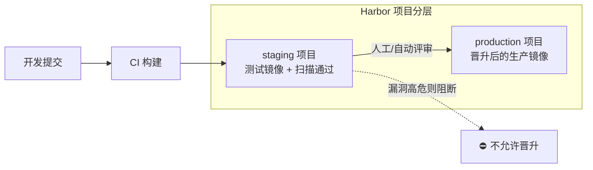

# 制品库 Harbor 与 Nexus

::: tip 本篇定位
CI 构建出的镜像、Jar、npm 包、Helm Chart 总得有个**统一、可信、可管**的地方存放和分发。这篇讲清楚为什么需要统一制品库、**Harbor**（容器镜像仓库）怎么玩、**Nexus**（多格式二进制仓库）怎么玩、制品怎么在流水线里**晋升（promotion）**，以及容量和备份怎么搞。适合给团队搭私有制品中心的 SRE。
本篇版本：Harbor v2.15.5、Sonatype Nexus Repository 3.96.3（Community 版）。所有版本以官网当前稳定版为准。
:::

## 一、背景与基础

### 1.1 小白类比：制品库是公司的"中央物流仓 + 中转站"

流水线每次构建都会产出一个"成品"：Docker 镜像、Java 的 Jar、前端的 npm 包、Helm Chart。这些成品要有地方放，还要能被别的环境拉下来跑。

如果没有统一制品库，会发生什么？

- 每台机器各自从 Docker Hub / Maven Central 拉，**国内又慢又经常被限流**；
- 测试环境构建完镜像直接 `docker save | scp` 拷到生产，**没法追溯、没法复用**；
- 谁能推镜像、哪个版本上线了，**完全靠口口相传**。

制品库就是**公司中央仓库**：
- **托管（hosted）**：存放我们自己构建出来的成品；
- **代理缓存（proxy）**：替公司去公网拉第三方依赖，第一次拉了就缓存下来，全公司共用，又快又稳；
- ** group 聚合**：把上面两类打包成一个地址给开发用，开发不用记多个地址。

> 一句话：**Harbor 主打容器镜像，Nexus 主打 Maven/npm 等多语言二进制**，两者经常一起用。

### 1.2 Harbor vs Nexus 怎么选

| 维度 | Harbor | Nexus Repository |
|---|---|---|
| 核心定位 | 容器镜像（OCI）仓库 | 通用二进制制品仓库 |
| 擅长格式 | Docker/OCI 镜像、Helm Chart | Maven、npm、PyPI、NuGet、Docker、Go、Helm 等几十种 |
| 强项 | 镜像复制、漏洞扫描、 RBAC、镜像签名、保留策略 | 多语言代理缓存、仓库类型齐全、生态成熟 |
| 一句话 | "公司的镜像仓库" | "公司的依赖超市 + 成品仓库" |

## 二、Harbor

### 2.1 核心概念

| 概念 | 作用 |
|---|---|
| **Project（项目）** | 顶层隔离单元，对应一个团队/业务，下面放多个镜像仓库 |
| **成员角色** | 项目管理员 / 开发者 / 访客，控制谁能推、谁能拉 |
| **标签保留 Tag Retention** | 自动只保留最近 N 个 tag，旧的清掉，防止磁盘爆 |
| **不可变不可变规则 Immutable** | 已推送的 tag 禁止覆盖，杜绝"同一个 tag 内容变了" |
| **复制 Replication** | 多套 Harbor 之间/到云 Registry 同步镜像 |
| **漏洞扫描** | 内置 Trivy 对镜像做 CVE 扫描 |
| **代理缓存 Proxy Cache** | 作为 Docker Hub 等的 pull-through 缓存 |

### 2.2 安装（离线安装包，固定 v2.15.5）

```bash
# 下载对应版本离线安装包（固定 v2.15.5）
tar xzvf harbor-offline-installer-v2.15.5.tgz
cd harbor

# 复制并修改配置
cp harbor.yml.tmpl harbor.yml
vim harbor.yml
#   hostname: harbor.example.com
#   https: 关 443 / 配证书
#   harbor_admin_password: 强密码

# 预生成配置并安装
./prepare
sudo ./install.sh

# 验证：访问 https://harbor.example.com，默认用户 admin
docker compose ps        # 由 docker compose 起的 core/portal/registry/...
```

### 2.3 日常操作与 CI 集成

```bash
# 登录
docker login harbor.example.com -u admin

# 打标签并推送
docker tag myapp:v1.4.0 harbor.example.com/team-order/myapp:v1.4.0
docker push harbor.example.com/team-order/myapp:v1.4.0

# 用 API 触发镜像扫描
curl -u "admin:$HARBOR_PWD" -X POST \
  "https://harbor.example.com/api/v2.0/projects/team-order/repositories/myapp/artifacts/v1.4.0/scan"
```

### 2.4 保留策略与不可变规则（防止磁盘爆炸）

```yaml
# 在 Harbor 项目 → 保留策略（Retention）里配（示意）
# 规则：每个仓库只保留最近 10 个镜像，其余自动删除
rules:
  - template: "recently_pushed_n_repos"
    params:
      repos: 10          # 只留最近 10 个 tag
    scope: { retain: "latest" }
```

> **不可变规则（Immutable Tag）**：上线后 `v1.4.0` 一旦推送就锁死，任何人不能再往这个 tag 推别的镜像。这非常重要——否则有人不小心覆盖了 `v1.4.0`，生产拉到的和当初测的不是同一个东西。

### 2.5 高可用（HA）

Harbor 单体安装适合小团队。生产多实例部署要点：

| 组件 | HA 做法 |
|---|---|
| harbor-core / portal / jobservice | 起多个副本，前面挂负载均衡 |
| PostgreSQL / Redis | 用外部高可用 PG / Redis，不要用容器内嵌的 |
| 镜像存储（registry 后端） | 共用对象存储（S3/OSS/MinIO），不要本地磁盘 |
| 证书 | 统一在 LB 层终结 TLS |

## 三、Nexus Repository

### 3.1 三种仓库类型（必懂）

| 类型 | 作用 | 小白类比 |
|---|---|---|
| **proxy（代理）** | 代理公网源（Maven Central、npmjs），第一次拉了缓存 | 公司统一代购，一次买全公司用 |
| **hosted（托管）** | 存我们自己发布的内部包 | 自家产品仓库 |
| **group（组）** | 把 proxy + hosted 聚合成一个地址 | 一个门牌号进所有货架 |

开发只需要配**一个 group 地址**：要第三方包自动走 proxy 缓存，要内部包自动走 hosted。

### 3.2 部署 Nexus 3.96.3

```bash
# 用官方镜像起（固定 3.96.3），数据挂到宿主机
docker run -d --name nexus \
  -p 8081:8081 \
  -v /data/nexus:/nexus-data \
  sonatype/nexus3:3.96.3

# 初始 admin 密码在容器里
docker exec nexus cat /nexus-data/admin.password
```

### 3.3 各类仓库配置要点

| 格式 | proxy 远程地址 | hosted 用途 |
|---|---|---|
| Maven (maven-central) | https://repo1.maven.org/maven2/ | 内部 release / snapshots |
| npm (npm-proxy) | https://registry.npmjs.org/ | 内部私有 npm 包 |
| PyPI (pypi-proxy) | https://pypi.org | 内部 Python 包 |
| Docker (docker-group) | pull-through 代理 Docker Hub | 内部镜像（可与 Harbor 互补） |
| Helm (helm-proxy) | https://charts.helm.sh/stable | 内部 Chart 仓库 |

开发端配置示例（npm 指向 Nexus group）：

```bash
npm config set registry http://nexus.example.com:8081/repository/npm-group/
```

Maven `settings.xml`：

```xml
<mirror>
  <id>nexus</id>
  <mirrorOf>*</mirrorOf>
  <url>http://nexus.example.com:8081/repository/maven-group/</url>
</mirror>
```

## 四、制品晋升（Promotion）流程

制品库不是"堆在一起"，而是按环境分级。**同一个镜像**在不同环境"晋升"，而不是每个环境重新构建。



> 小白类比：晋升像**毕业升年级**。制品在 staging "考试"（测试 + 安全扫描）及格了，才"升"到 production。全程**镜像 digest 不变**，保证"测的就是上的"。

```bash
# 用 Harbor 复制/API 把同一 digest 从 staging 晋升到 production 项目（示意）
# 注意：复制的是同一份 blob，不重新上传，省空间
curl -u "admin:$PWD" -X POST \
  "https://harbor.example.com/api/v2.0/projects/staging/repositories/myapp/artifacts/v1.4.0/additions" \
  -H "Content-Type: application/json" \
  -d '{"dest_project_name":"production","override":true}'
```

## 五、CI/CD 集成完整示例

```yaml
# .github/workflows/publish.yml（推镜像到 Harbor + 晋升）
name: publish-artifact
on:
  push:
    tags: ["v*"]
jobs:
  publish:
    runs-on: ubuntu-24.04
    permissions:
      contents: read
      id-token: write
    steps:
      - uses: actions/checkout@v4
      - uses: docker/login-action@v3
        with:
          registry: harbor.example.com
          username: ${{ secrets.HARBOR_USER }}
          password: ${{ secrets.HARBOR_TOKEN }}
      - uses: docker/build-push-action@v6
        with:
          context: .
          push: true
          tags: harbor.example.com/staging/myapp:${GITHUB_REF_NAME}
      - name: 扫描镜像（高危阻断）
        run: |
          trivy image --exit-code 1 --severity HIGH,CRITICAL \
            harbor.example.com/staging/myapp:${GITHUB_REF_NAME}
      - name: 晋升到 production
        run: |
          curl -u "admin:${HARBOR_PWD}" -X POST \
            "https://harbor.example.com/api/v2.0/projects/staging/repositories/myapp/artifacts/${GITHUB_REF_NAME}/additions" \
            -H "Content-Type: application/json" \
            -d '{"dest_project_name":"production"}'
```

## 六、容量与备份

| 事项 | 建议 |
|---|---|
| 磁盘规划 | 镜像很占空间，预留长期增长；开启**保留策略**只留最近 N 个 tag |
| 垃圾回收 GC | Harbor 定期跑 `docker-compose.yml` 里的垃圾回收，清理删除后无引用的 blob |
| 大文件存储 | 生产 registry 后端用对象存储（S3/OSS），别用本地磁盘 |
| Nexus 备份 | 备份 `/nexus-data` 目录（含 blob store + 数据库），停服或用在线备份工具 |
| Harbor 备份 | 备份数据库（PG）+ 镜像存储（对象存储）；升级前必备份 |

```bash
# Harbor 垃圾回收（先设为只读，再跑 GC）
docker compose stop harbor-core
docker compose run --rm registry garbage-collect /etc/registry/config.yml
docker compose start harbor-core
```

## 七、常见问题排错

| 现象 | 原因 | 解决 |
|---|---|---|
| docker push 报 unauthorized | 没登录 / 项目无权限 | `docker login`；确认账号在该 Project 的开发者角色 |
| push 报 toomanyrequests | 没走代理缓存，直连 Docker Hub 限流 | 配 Harbor Proxy Cache 或 Nexus docker proxy |
| 磁盘被打爆 | 没配 tag 保留策略，历史镜像无限堆积 | 配置 retention，定期 GC；清理无用 tag |
| 同名 tag 被覆盖引发事故 | 没开不可变规则 | 项目里开启 Immutable Tag 规则 |
| Nexus 代理拉 npm 包 401/超时 | 远程地址错 / 公司代理未配 | 检查 proxy remote URL，配置 Nexus 出站 HTTP 代理 |
| 晋升后生产拉不到镜像 | production 项目没授权给部署节点 | 给 K8s 节点 docker secret 配 production 项目的 pull 权限 |

::: warning 生产红线
- 镜像 tag 固定版本号，**开启不可变规则**，禁止覆盖已发布 tag；禁止生产用 `latest`。
- 生产 Harbor/Nexus **必须 HTTPS + 强密码 + 最小权限账号**，CI 用机器人账号（robot account）而非 admin。
- 定期跑垃圾回收与保留策略，**镜像存储用对象存储**，并纳入备份。
- 晋升路径要"测试环境扫过的镜像 digest 原样进生产"，不要在生产重新构建。
- 升级前先备份数据库与制品存储，先在测试环境验证升级路径。
:::

## 相关速查

- 流水线里镜像要先过安全扫描：[DevSecOps 与软件供应链安全](./devops-devsecops)
- 镜像签名后在仓库里怎么验：[DevSecOps（Cosign 签名）](./devops-devsecops)
- 容器基础：[Docker 命令速查](/reference/docker-commands)、[K8s 命令速查](/reference/kubectl-commands)
- 部署打包：[Helm 包管理](./container-helm)

### 官方文档

- Harbor 官网：https://goharbor.io/
- Harbor 文档：https://goharbor.io/docs/
- Harbor releases：https://github.com/goharbor/harbor/releases
- Sonatype Nexus Repository 下载：https://help.sonatype.com/en/download.html
- Sonatype Nexus 文档：https://help.sonatype.com/
- Nexus 2026 release notes：https://help.sonatype.com/en/nexus-repository-2026-release-notes.html
