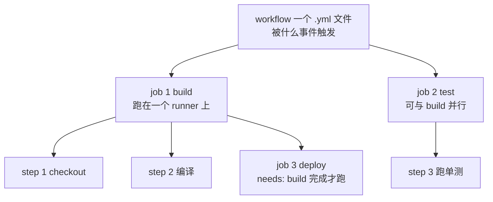
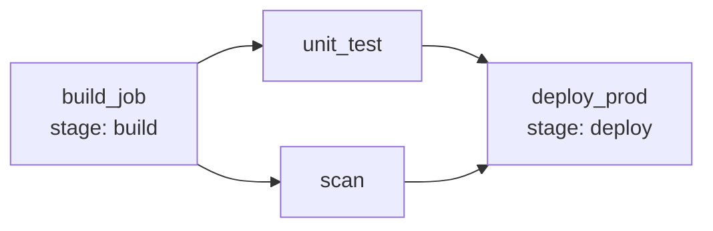

# CI/CD 进阶与渐进式交付

::: tip 本篇定位
你已经会写"push 了就跑个脚本"的流水线，但想搞懂 **GitHub Actions / GitLab CI 怎么写得专业、安全、可复用**，以及怎么把发布从"一把全量替换"升级到**蓝绿 / 金丝雀 / 自动回滚**。适合已经搭过 Jenkins/GitLab CI、想往企业级流水线和渐进式交付演进的 SRE。
本篇版本：GitHub Actions（托管服务，随平台更新）、GitLab CI 17.x、Argo Rollouts v1.10.0、Flagger v1.44.0、Unleash v8.2.0（自托管需 PostgreSQL 15+）。所有版本以官网当前稳定版为准。
:::

## 一、背景与基础

### 1.1 小白类比：流水线即代码

CI/CD 流水线就像**工厂的自动传送带**：原料（代码）从一头进来，经过一道道工序（编译 → 测试 → 扫漏洞 → 打包镜像 → 部署），成品从另一头出去。**流水线即代码（Pipeline as Code）**就是把这条传送带怎么造写成 YAML **放进 Git**，和代码一起评审、版本化，改流水线提个 MR 就行，不用找管理员点界面。

| 方式 | 问题 | Pipeline as Code 的好处 |
|---|---|---|
| 界面点选配置 | 配置在服务器上，没法评审、没法 diff | 配置进 Git，可评审、可回滚、可复用 |
| 每个项目各写各的 | 标准不统一 | 抽成 reusable 模板，一处改处处生效 |

### 1.2 CI 与 CD 到底各管什么

| 阶段 | 全称 | 干什么 | 失败了会怎样 |
|---|---|---|---|
| CI（持续集成） | Continuous Integration | 合并代码后自动构建、跑测试、出制品 | 拦住坏代码，不进下游 |
| CD（持续交付） | Continuous Delivery | 制品自动部署到类生产环境，**手动点一下才上生产** | 生产保持随时可发布 |
| CD（持续部署） | Continuous Deployment | 合格后**全自动上生产**，无人值守 | 对自动化和回滚能力要求极高 |

## 二、GitHub Actions 深化

### 2.1 三层结构：workflow / job / step



- **workflow / job / step**：workflow 是一个 `.github/workflows/*.yml`（定义触发事件与 job）；job 是跑在干净 VM 上的独立单元，多个默认并行；step 是 job 里的一条命令或一个 `uses:` action。

### 2.2 一个生产级 workflow 完整片段

```yaml
# .github/workflows/build-and-deploy.yml
name: build-and-deploy
# 触发：推 main、打 v* 标签、或对 main 发 PR
on:
  push: { branches: [main], tags: ["v*"] }
  pull_request: { branches: [main] }

# 关键：默认最小权限，整个 workflow 只读（要写权限的 job 单独放开）
permissions:
  contents: read

jobs:
  test:
    runs-on: ubuntu-24.04
    steps:
      - uses: actions/checkout@v4
      - uses: actions/setup-node@v4          # 缓存依赖，加速 CI
        with: { node-version: "22", cache: "npm" }
      - run: npm ci
      - run: npm run lint
      - run: npm run test:cov
  build:
    needs: test
    runs-on: ubuntu-24.04
    outputs: { image: ${{ steps.meta.outputs.image }} }
    steps:
      - uses: actions/checkout@v4
      - uses: docker/setup-buildx-action@v3
      - uses: docker/login-action@v3         # 凭据放 GitHub Secrets
        with:
          registry: harbor.example.com
          username: ${{ secrets.HARBOR_USER }}
          password: ${{ secrets.HARBOR_TOKEN }}
      - name: 生成镜像标签
        id: meta
        run: echo "image=harbor.example.com/team/order:${GITHUB_SHA::12}" >> "$GITHUB_OUTPUT"
      - uses: docker/build-push-action@v6
        with:
          context: .
          push: true
          tags: ${{ steps.meta.outputs.image }}
  deploy-prod:
    needs: build
    environment: production       # 绑定环境保护（手动审批 / 环境级 secret）
    runs-on: ubuntu-24.04
    if: startsWith(github.ref, 'refs/tags/v')   # 只有打 tag 才上生产
    steps:
      - uses: actions/checkout@v4
      - run: echo "部署 ${{ needs.build.outputs.image }} 到生产"
```

### 2.3 关键进阶点

| 主题 | 要点 | 示例 |
|---|---|---|
| **最小权限 permissions** | 别全仓库 `write-all`；默认 `contents: read`，发版 job 单独放开 | 见上面顶层 `permissions` |
| **缓存 + 并发** | 缓存 node_modules/.m2 提速；同分支新 push 取消旧 run | `cache: npm`；`concurrency.group: ci-${{ github.ref }}` |
| **environment + Secrets** | 生产部署绑 `environment: production` 配手动审批；敏感值放 Secrets 不写进 yml | `${{ secrets.XXX }}` |

### 2.4 Composite Action 与 Reusable Workflow

跨仓库复用流水线有两种方式，别用混：

| 方式 | 用途 | 特点 |
|---|---|---|
| **Composite Action** | 复用一段**步骤组合**（如"装 Go + 缓存 +  lint"） | 在同一个 job 里 `uses:` 进你的步骤 |
| **Reusable Workflow** | 复用一整套**完整 job 编排**（如"标准发布流程"） | 别的仓库 `uses: org/.github/.github/workflows/release.yml@v1` 调用 |

```yaml
# reusable workflow 被调用方写法（业务仓库里，固定版本别用 main）
jobs:
  call-release:
    uses: your-org/.github/workflows/reusable-release.yml@v1.5.0
    with: { image-name: order-service }
    secrets: inherit
```

::: warning 别用 @main 引用 reusable workflow
生产中引用 reusable workflow / 第三方 action 要**固定到具体 tag 或 commit SHA**（如 `@v1.5.0`），不要用 `@main`——上游被改了你不知道。这是供应链安全的基本要求。
:::

## 三、GitLab CI 深化

### 3.1 核心：`.gitlab-ci.yml` 的阶段与作业

GitLab CI 以 `stage` 为流水线阶段、`job` 为作业单元。先看一张图：



### 3.2 完整 `.gitlab-ci.yml`（含 include / rules / needs DAG）

```yaml
# 全局默认镜像与缓存
image: harbor.example.com/library/golang:1.23
default: { tags: [kubernetes] }
cache:
  key: "$CI_COMMIT_REF_SLUG"
  paths: [.go/pkg/mod/]

# include：抽公共配置，避免一个文件上千行
include:
  - local: "/ci/build-templates.yml"
  - remote: 'https://gitlab.com/your-org/cicd-templates/-/raw/main/security-scan.yml'

variables:
  REGISTRY: harbor.example.com/team/order

# needs 构建 DAG，不被 stage 顺序硬卡
unit_test:
  stage: test
  needs: []                       # 不依赖前置，尽早并行
  script: [go test ./... -cover]
build_image:
  stage: build
  image: harbor.example.com/library/kaniko-project/executor:v1.23.2
  script:
    - echo "{\"auth\":{\"auth\":\"$HARBOR_PULL\"}}" > /kaniko/.docker/config.json
    - /kaniko/executor --context . --dockerfile Dockerfile --destination $REGISTRY:$CI_COMMIT_SHORT_SHA
  only: [main, tags]
# rules：比 only/except 更灵活，可组合 &&/|| 与 changes
deploy_staging:
  stage: deploy
  script: [echo "部署到 staging"]
  rules:
    - if: '$CI_COMMIT_BRANCH == "main"'
      when: always
    - if: '$CI_COMMIT_BRANCH =~ /^feature\//'
      when: manual              # feature 分支手动触发
    - when: never
deploy_production:
  stage: deploy
  script: [echo "生产只在打 tag 且手动审批后部署"]
  rules:
    - if: '$CI_COMMIT_TAG =~ /^v\d+\.\d+\.\d+$/'
      when: manual
      allow_failure: false
```

### 3.3 include / parent-child / rules / needs 速查

| 特性 | 干什么 | 什么时候用 |
|---|---|---|
| **include / parent-child** | 把 yml 拆出去复用；父流水线按改动模块触发多条子流水线 | 公共模板多仓库共享；monorepo 按服务拆分构建 |
| **needs（DAG）/ rules** | needs 声明 job 依赖跳过串行等待；rules 取代 only/except 灵活决定是否跑 | 让流水线更快、按环境分支定触发策略 |

## 四、分支策略：Trunk-based vs GitFlow

| 维度 | Trunk-based（主干开发） | GitFlow |
|---|---|---|
| 主分支 | 所有人频繁合到 `main`，短生命周期特性分支 | `main` + `develop` + `feature/release/hotfix` 多层分支 |
| 发布频率 | 高频、小批量、持续部署 | 周期性发版，release 分支冻结 |
| 配合手段 | 强依赖 Feature Flag + 自动化测试 | 分支纪律 + 手动切分支 |
| 复杂度 | 低（分支简单），但要求自动化测试和灰度很成熟 | 高（分支多、合并痛苦） |
| 适合 | 云原生、天天发版的互联网团队 | 有固定发版周期、桌面/企业软件 |

> 现代云原生主流是 **Trunk-based + Feature Flag + 渐进式发布**：代码天天合 main，没做完的功能用开关藏起来，发出去也能一键关。

## 五、发布策略对比

| 策略 | 怎么做 | 优点 | 缺点 | 适用 |
|---|---|---|---|---|
| **滚动 Rolling** | 新版本逐步替换旧 Pod（K8s 默认） | 简单、无额外资源 | 新旧版本短暂共存，出问题影响范围边滚动边扩大 | 大多数无状态服务默认 |
| **蓝绿 Blue-Green** | 起一套全新"绿"环境，验证后流量一次性切过去 | 切换快、回滚秒切 | 要双倍资源 | 重要、需要快速回滚的系统 |
| **金丝雀 Canary** | 先放 1%~5% 流量给新版，观察指标，逐步放大 | 风险最小，自动按指标回滚 | 需要流量治理 + 指标观测 | 核心服务、大版本升级 |

> 蓝绿是"两套环境整体切流量"；金丝雀是"同环境内按百分比逐步导流、指标恶化自动回滚"。

## 六、Feature Flag（特性开关）

### 6.1 小白类比

Feature Flag 就像**电灯开关**：代码已上线，但某功能默认"关灯"藏着；产品想灰度给某批用户，远程"开灯"即可，**不用重新发版**，出问题远程关灯秒回退。它解决三件事：① 未完成功能先合并主干（配合 Trunk-based）；② 灰度给特定用户/比例；③ 紧急 kill switch。

### 6.2 自托管 Unleash（v8.2.0）

Unleash 是开源特性开关平台。v8 起要求 **PostgreSQL 15+**。用 Docker Compose 起一个：

```yaml
# docker-compose.yml（自托管 Unleash v8，需 PostgreSQL 15+）
services:
  postgres:
    image: postgres:15-alpine
    environment: { POSTGRES_USER: unleash, POSTGRES_PASSWORD: change-me-strong, POSTGRES_DB: unleash }
  unleash:
    image: unleashorg/unleash-server:v8.2.0
    depends_on: [postgres]
    environment:
      DATABASE_HOST: postgres
      DATABASE_NAME: unleash
      DATABASE_USER: unleash
      DATABASE_PASSWORD: change-me-strong
    ports: ["4242:4242"]
```

应用里用 SDK 判定开关（伪代码）：

```java
// 业务代码里：开关开了才走新逻辑，否则老逻辑
if (unleash.isEnabled("checkout-v2", userContext)) {
    return newCheckoutService.pay(request);
} else {
    return legacyCheckoutService.pay(request);
}
```

## 七、渐进式交付：Argo Rollouts 与 Flagger

前面说的金丝雀，手动一步步调流量太麻烦。**渐进式交付控制器**自动做：先切 5% → 等几分钟看错误率/延迟 → 没问题再切 25%/50%/100%；**指标一旦恶化自动回滚**。

### 7.1 Argo Rollouts vs Flagger

| 维度 | Argo Rollouts | Flagger |
|---|---|---|
| 资源类型 | `Rollout` CRD 替代 Deployment | `Canary` CRD 包装已有 Deployment |
| 流量治理 | 需配合 Istio / NGINX / ALB Ingress | 原生支持 Istio、Linkerd、App Mesh、NGINX |
| 指标分析 | `AnalysisTemplate` 查 Prometheus | `MetricTemplate` + `CanaryAnalysis` |
| 适合谁 | 已经用 Argo CD 的团队 | 已经用 Flux / Service Mesh 的团队 |

### 7.2 Argo Rollouts 完整 Canary 清单（v1.10.0）

```yaml
# 1) AnalysisTemplate：定义"健康指标"（Prometheus 查询）
apiVersion: argoproj.io/v1alpha1
kind: AnalysisTemplate
metadata: { name: error-rate }
spec:
  metrics:
    - name: pod-error-rate
      interval: 30s
      successCondition: result[0] <= 0.02     # 错误率 <= 2% 才算健康
      failureLimit: 3
      provider:
        prometheus:
          address: http://prometheus.monitoring.svc:9090
          query: |
            sum(rate(http_requests_total{status=~"5..",service="order"}[2m]))
            / sum(rate(http_requests_total{service="order"}[2m]))
---
# 2) Rollout：用 CRD 替代 Deployment，定义金丝雀步骤
apiVersion: argoproj.io/v1alpha1
kind: Rollout
metadata: { name: order }
spec:
  replicas: 10
  strategy:
    canary:
      canaryService: order-canary
      stableService: order-stable
      steps:
        - setWeight: 5                 # 先切 5% 流量给新版
        - pause: { duration: 5m }      # 观察 5 分钟
        - analysis: { templates: [{ templateName: error-rate }] }
        - setWeight: 25
        - pause: { duration: 10m }
        - analysis: { templates: [{ templateName: error-rate }] }
        - setWeight: 100               # 全量
  selector: { matchLabels: { app: order } }
  template:
    metadata: { labels: { app: order } }
    spec:
      containers:
        - name: order
          image: harbor.example.com/team/order:v1.4.0
```

```bash
# 安装 Argo Rollouts（固定 v1.10.0）
kubectl create namespace argo-rollouts
kubectl apply -n argo-rollouts -f https://github.com/argoproj/argo-rollouts/releases/download/v1.10.0/install.yaml
kubectl argo rollouts get rollout order --watch     # 查看发布进度
kubectl argo rollouts abort rollout order           # 手动回滚
```

> 配合 Argo CD 做 GitOps：Argo CD 负责把期望状态写进集群，Rollouts 负责把新版本平滑推上去。

## 八、常见问题排错

| 现象 | 原因 | 解决 |
|---|---|---|
| Actions 里拉私有仓库 action 报 403 | token 权限不足 | 给 `GITHUB_TOKEN` 加 `contents: read`，或用 Fine-grained PAT |
| GitLab CI job 一直 pending | runner 没有匹配标签 | 检查 `tags:` 是否有对应 runner，或 runner 没上线 |
| 金丝雀卡住不继续 | `pause` 时间未到 / analysis 没通过 | `kubectl argo rollouts pause/resume`；查 Prometheus 查询是否报错 |
| Argo Rollouts 流量不切 | 没配 canary/stable Service 或缺流量网关 | 确认 service selector，并接入 Istio/NGINX 流量拆分 |

::: warning 生产红线
- 生产部署必须绑定 **environment 保护 + 手动审批**，禁止 main push 自动直上生产（除非你已有成熟的全自动回滚）。
- 引用第三方 Action / Reusable Workflow **固定到 tag 或 commit SHA**，不要跟 `@main`。
- 金丝雀**一定要配自动回滚指标**（错误率、延迟），否则"自动灰度"只是"自动放大事故"。
- 镜像 tag 固定具体版本，流水线里**禁止用 `latest`** 做部署标签。
- Feature Flag 是临时设施，上线稳定后要**及时清理死开关**，否则代码里全是 if/else 烂尾。
:::

## 相关速查

- 流水线里打的镜像推到哪：[制品库 Harbor 与 Nexus](./devops-artifacts)
- 流水线里要插哪些安全检查：[DevSecOps 与软件供应链安全](./devops-devsecops)
- GitOps 部署底座：[GitOps（ArgoCD）](./automation-gitops)、[Helm 包管理](./container-helm)
- 回滚与稳定性：[SLO 与错误预算](./monitor-slo)、[事故管理](./sre-incident)
- Git 分支操作：[Git 命令与协作工作流速查](/reference/git-commands)

### 官方文档

- GitHub Actions 文档：https://docs.github.com/actions
- 工作流权限与 reusable workflow：https://docs.github.com/actions/sharing-automations/reusing-workflows
- GitLab CI/CD 文档（含 needs DAG）：https://docs.gitlab.com/ci/
- Argo Rollouts 文档与 releases：https://argo-rollouts.readthedocs.io/ 、https://github.com/argoproj/argo-rollouts/releases
- Flagger 文档与 releases：https://docs.flagger.app/ 、https://github.com/fluxcd/flagger/releases
- Unleash 自托管文档与 releases：https://docs.getunleash.io/ 、https://github.com/Unleash/unleash/releases
